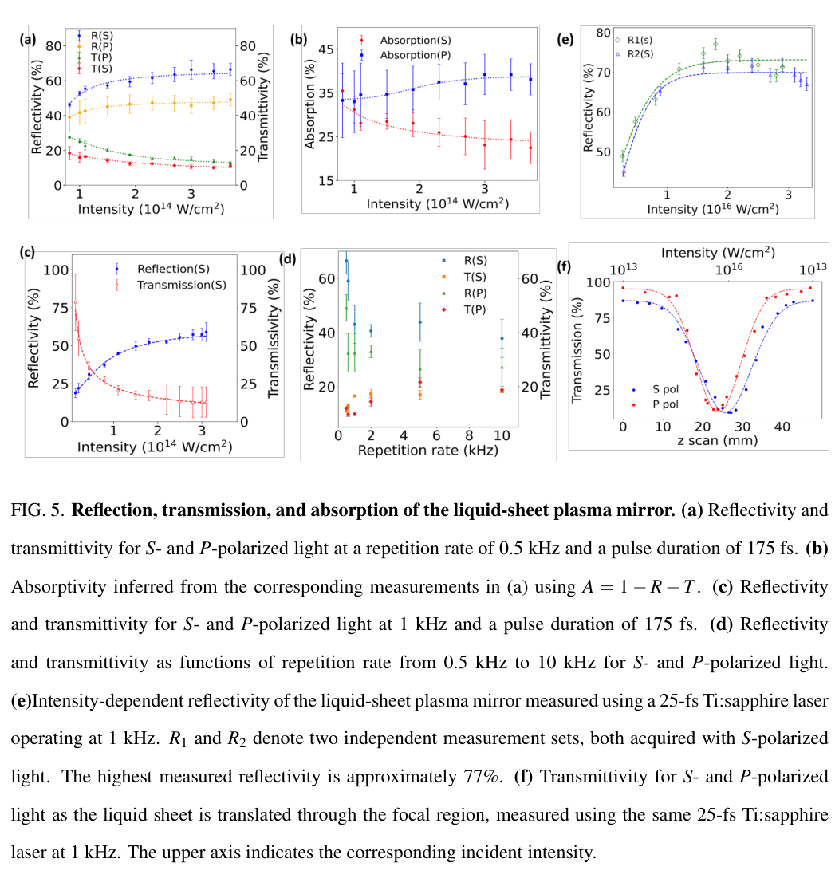
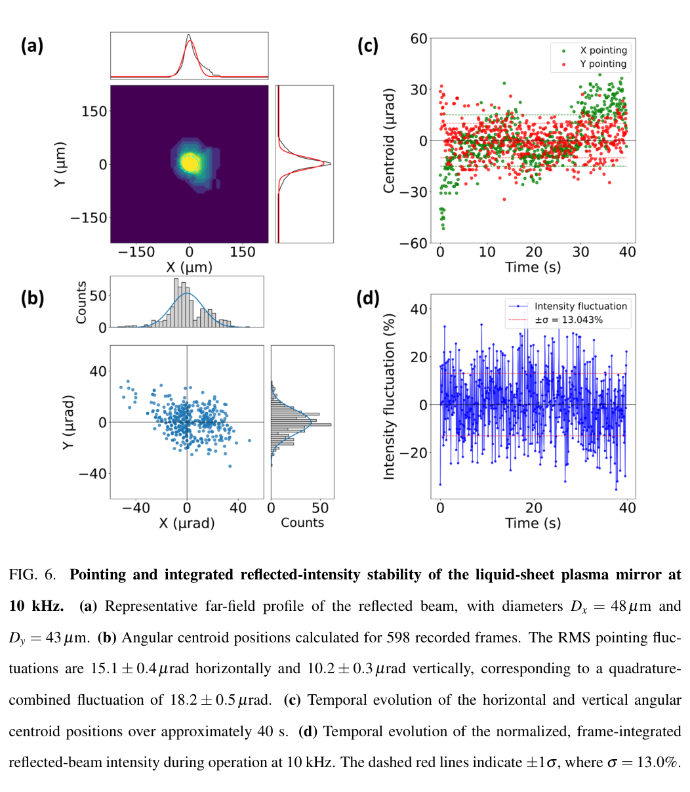

# 单射流撞刀口的微米液体薄片与多 kHz 等离子体镜

> Mukesh Kumar、S. Sree Harsha、Prashant Kumar Singh，[arXiv:2610.24504v1](https://arxiv.org/abs/2610.24504v1)，2026-10-17；PDF 内署日期 10-20。[官方 PDF](../pdfs/Kumar%20et%20al.%20-%202026%20-%20Multi%20kHz%20thin%20liquid%20sheets.pdf) 31 页，已读取布局文本与 MinerU，核对首页、几何/干涉图、反射率及稳定性页。精确题名 Crossref 前三条未发现同篇正式版。本文含直接液体靶与激光反射实验，尚不含同平台粒子束或 γ/中子产额实验。

## 一句话结论

单根液体射流打在倾斜刀口可生成不断更新的微米薄片，在 mJ 激光下作为 0.5–10 kHz 等离子体镜。最高 77% 反射率属于 25 fs、1 kHz 的另一组测量；10 kHz 时有光学污染和传输衰减，598 帧稳定性数据也不是逐个 10 kHz 脉冲的诊断。

## 靶结构、厚度与工作环境

作者以商用不锈钢刀片重定向单射流，形成主/次两片自由液面，比双射流少一个碰撞点对准。选定乙二醇:去离子水 **60:40 体积比**；100 μm 射流、约 13 m/s、代表夹角 $2\theta=64\pm1^\circ$ 形成约 8 mm×3 mm 主片。刀面 AFM rms 粗糙度 41 nm、刀口轮廓 rms 偏差约 100 nm，微米加工纹可能诱发褶皱。

角度、撞击点到刀口距离、流速和组分均有扫描；几何扫描中另用 237 μm 喷嘴，不应把不同喷嘴下的最大尺寸全归给 100 μm 喷嘴。夹角实用区约 50°–85°，60:40 是所测组分中表现较佳者，未证明普适最佳配方。

在**空气中**、8 bar 驱动、64° 几何下，用宽带反射谱干涉与 652 nm 空间干涉测得厚度随位置由约 4.8 降至 1.1 μm；这是非均匀薄片的空间轮廓，不是整个 8×3 mm 区域处处相同、亦非高真空激光瞬间的原位面密度。激光实验在约 **1.5 mbar** 粗真空中进行，45° 入射，乙二醇/水薄片持续更新。

## 激光反射结果与条件分离

| 工况 | 代表结果 | 适用口径 |
|---|---|---|
| 1030 nm、175 fs、0.5 kHz、约 3.7×10¹⁴ W/cm² | S 偏振 R=66.5%、T=11.0%；P 偏振 R=49.0%、T=12.8% | 该强度扫描上限；不能移植到 10 kHz |
| 1030 nm、175 fs、1 kHz、约 3.1×10¹⁴ W/cm² | S 偏振最高 R≈59%、T≈12.9% | 强度略不同，非严格只改重复频率 |
| 约 800 nm、25 fs、1 kHz、约 2×10¹⁶ W/cm² | S 偏振最高 R≈77% | 两套独立扫描；不是 10 kHz 结果 |
| 1030 nm、175 fs、0.5–10 kHz、固定名义脉冲能量 | 高频反射/透射信号下降后趋缓 | 包含入射/收集光路污染的系统响应 |

吸收率按 $A=1-R-T$ 间接推算，0.5 kHz 高强度点的 S/P 分别约 22.5%/38.2%；漏收散射和光路损失也会进入差值，不能视为独立量热结果。两激光系统的反射谱展宽/蓝移不同，Ti:sapphire 的 P 偏振展宽更强；光谱仪分辨率 0.5 nm，光纤耦合系统误差未量化。谱形保持、反射率与时间对比度不是同一指标，本文没有给出完整对比度提升测量。

## 关键原图与读法

**图 5，PDF 第 18 页。** (a–c,e) 横轴分别以 $10^{14}$ 或 $10^{16}$ W/cm² 标强度，纵轴为百分比，比较偏振和不同激光；(d) 横轴为重复频率（kHz），显示检测到的 R/T 随高频运行下降；(f) 横轴靶的轴向扫描位置、上轴相应强度，显示离焦透射到焦区镜面反射的转变。必须逐面板看条件，不能从 (e) 的 77% 加上 (d) 的 10 kHz 得出“10 kHz、77%”组合。误差条画在原图中，但本文未建立统一的全系统不确定度传播。

**图 6，PDF 第 20 页。** 10 kHz、入射脉冲能量 781 μJ 下，录制约 40 s、598 帧：(a) 横纵坐标为焦平面 μm；(b) 转换为角度 μrad 的帧质心分布；(c) 横轴时间 s、纵轴两方向角质心；(d) 为每帧积分强度相对均值的波动百分比。水平/竖直 rms 为 $15.1\pm0.4$、$10.2\pm0.3\,\mu$rad，正交合成约 $18.2\pm0.5\,\mu$rad；积分强度标准差约 13%。598/40≈15 帧/s，与 10,000 发/s 相差很大，曝光/同步细节不足，不能把这些数字解释为每一激光脉冲的独立指向和能量抖动。原文使用 shot-to-shot 一词，本笔记按实际采样保留帧级边界。

## 高频更新、污染与应用限制

按 13 m/s 流速和 100 μm 受扰区估算补靶约 8 μs；10 kHz 的 100 μs 间隔内位移约 1.2–1.3 mm，大于估计的孔洞回缩尺度。这支持局部几何更新，但约 120 kHz 只是估计值，实验只做到 10 kHz。10–30 J 时按作用直径平方根缩放得到 4–8 kHz 也属于外推，未在该能量下测试。

高频的主要限制转向蒸汽、液滴在聚焦/收集镜和窗上的累积沉积，需要停机放气清理。差分抽气、冷阱、独立液体回收和保护孔是建议，不能作为已实现的长时连续运行条件。反射束稳定不证明粒子加速、转换靶 γ/中子性能或医用可用性；且本文最高强度仍属 $a_0\ll1$，不能直接外推到相对论强度靶响应。

这项工作最适合用于高重频靶更新与碎屑管理的工程输入：后续应补高真空面密度、逐脉冲采样、污染增长随时间/平均功率、清理周期、真实束流及辐射诊断。本轮没有重做流体模型、干涉厚度拟合、激光实验或效率计算。

## 来源与复核记录

[官方 arXiv](https://arxiv.org/abs/2610.24504v1)，PDF 第 1、5、12、15、18、20、21 页身份与图文核查；[PDF 核验](../pdf_validation.json)、[原图裁框与哈希](../research/figure-manifest.json)、[MinerU 记录](../research/mineru-attempts.json)。
