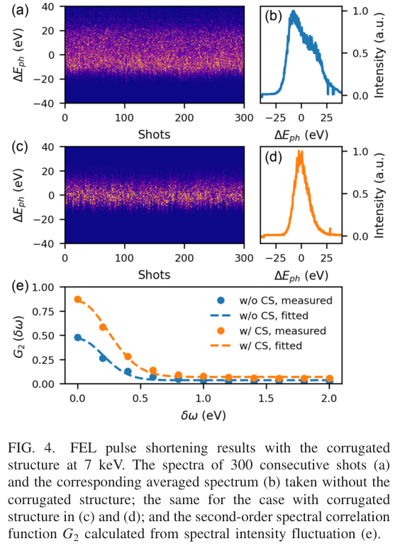
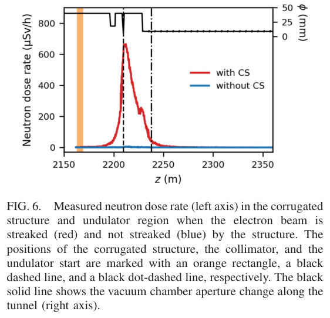

# L 形波纹结构在高重频 XFEL 中的束流与脉冲整形

> Weilun Qin 等九位作者，*Physical Review Accelerators and Beams* **29**, 103405，2026-10-20，Editors’ Suggestion。[DOI](https://doi.org/10.1103/r4nx-blvw)；[正式 PDF](../pdfs/Qin%20et%20al.%20-%202026%20-%20L%20shaped%20corrugated%20XFEL%20shaping.pdf)。阅读 APS harvest 的 9 页 VOR、布局文本与 MinerU，并核查首页、谱图、重建假设和中子剂量图。网页仍可检索到 9 月接受稿页，本地正式首页明确是 10 月 20 日出版版。

## 一句话结论

European XFEL 用 6 m 长 L 形波纹结构、低 beta 光学与准直器实现电子束切片选择和硬 X 射线脉冲缩短；7 keV 下谱相关重建的 rms 脉宽由 27.2 fs 降至 6.3 fs。列内 1.125 MHz、每列 100 束的实验不是连续 MHz 输出；脉宽也尚未由 SASE1 直接时域诊断验证。

## 装置与机制

L 形双板通过束流相对两板的距离调节横向偶极尾场。在适当几何位置，两板四极尾场分量可补偿，减小切片失配；较大横向偏离的束尾无法沿理想轨道放大，只让部分切片发光。结构总长 6 m，周期 0.5 mm、开口 0.25 mm、深度 0.5 mm，水平板宽 6 mm、竖直板宽 2 mm。结构固定，借助 orbit bump 改变束流位置；低 beta 与上游损失控制降低接近板面的束损和下游辐射。

作者先用下游屏观测不同 bump 下的条纹方向与切片尺寸，得到四极补偿的特征。但大偏移时 BPM 非线性使绝对板距未校准；模拟的 $d_x$ 与实测 bump 设定值不能逐点当成同一绝对距离。束流图像比较也存在电流轮廓、入射失配和高阶弯曲差异。

## 定量结果与条件

| 量 | 未使用结构 | 使用结构 | 证据口径 |
|---|---:|---:|---|
| 7 keV 平均脉冲能量 | 2.3 mJ | 0.2 mJ | XGM 等实验诊断 |
| 平均谱 rms 带宽 | 13.2 eV | 6.7 eV | 各 300 个谱、高斯拟合 |
| rms 脉宽 | 27.2 fs | 6.3 fs | 谱强度涨落的二阶相关重建 |
| 电子束 chirp 绝对值 | 1.5 MeV/μm | 2.8 MeV/μm | 同一模型重建，不能定正负 |

脉宽缩短约 4.3 倍，伴随脉冲能量下降，不能表述为同能量下峰功率提高四倍。另一个 **9 keV 模拟**例子给出 FWHM 37→2 fs、能量 2.8→0.23 mJ，不能混入上表的 **7 keV 实测谱重建 rms** 结果。

高重频单独实验在 9.3 keV、每列 100 束、列内 1.125 MHz、宏脉冲 10 Hz 下进行；用 300 列数据重建各列内位置的脉宽与 chirp，观察到近似均匀性质和可由 RF 调整的中心能量斜坡。按该束图样平均为 1000 束/s，不等于连续 1.125 MHz。更高平均重复频率和连续运行是后续工作。

## 关键原图与读法

**图 4，PDF 第 4 页。** (a,c) 横轴连续发次，纵轴相对光子能量（eV）；(b,d) 是按任意强度归一化的平均谱，(e) 横轴能量差 $\delta\omega$（图标 eV），纵轴二阶谱相关 $G_2$。有结构时谱更窄、相关曲线变化支持脉冲缩短，但它不是直接的强度—时间迹线。重建假设时间包络近似高斯、电子 chirp 近似线性，不能给出 chirp 符号；长脉冲尾部的非线性可能引入偏差。作者做了辅助检查，仍明确不能替代直接时域诊断。

**图 6，PDF 第 6 页。** 横轴束线坐标 $z$（m）；左纵轴中子剂量率（μSv/h），红/蓝曲线分别有/无整形；黑色曲线使用右纵轴束管孔径（mm），不能把它读成剂量。橙色区间、黑虚线和点划线标出波纹结构、准直器和波荡器入口。该测试使用每列 200 束的 7 keV 工况，准直器附近先出现高剂量区，之后降至波荡器入口约 40 μSv/h。它证明损失与防护设计的重要性，并不构成人员驻留安全、全设施屏蔽或全束流功率寿命认证；更高束数需重新评估积累损伤。

## 价值与未完成项

快 kicker 让共享束路的 SASE1/SASE3 束分别靠近或远离结构，已展示选择性条纹、交换受作用束以及全线传输；**尚未建立两线同时发光并切换脉宽整形**。尾场补偿、低 beta、准直和辐射监测的联合思路可供高平均功率束流输运借鉴；本装置是超导直线加速器 XFEL，不是 LWFA 转换靶 γ 源。

后续应优先补直接时域诊断、绝对板距、分时能量/光谱稳定性、束损随束数的标度，以及沉积剂量与材料退化的联系。作者未公开完整数据，按请求提供；本轮未运行 OCELOT、GENESIS、束损模拟或重算谱相关。

## 来源与复核记录

[正式 DOI](https://doi.org/10.1103/r4nx-blvw)、[APS 接受稿元数据页](https://journals.aps.org/prab/accepted/10.1103/r4nx-blvw)；正式日期以已验证 PDF 首页为准。文件、页数和哈希见 [PDF 核验](../pdf_validation.json)，原图出处/裁框见 [图像清单](../research/figure-manifest.json)，辅助正文见 [MinerU 记录](../research/mineru-attempts.json)。
