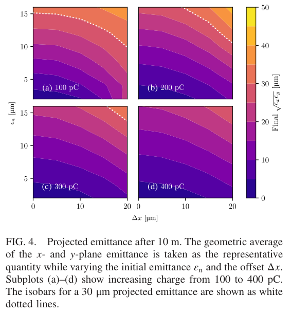
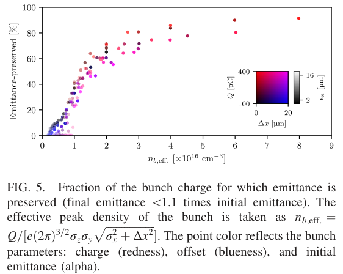

# 准线性 PWFA 的驱动束—见证束失准容差

> T. C. Wilson、J. Farmer、K. Lotov、A. Pukhov，*Physical Review Accelerators and Beams* **29**, 103602，2026-10-20。[DOI](https://doi.org/10.1103/47mg-t29q)；[正式 PDF](../pdfs/Wilson%20et%20al.%20-%202026%20-%20Quasilinear%20PWFA%20misalignment%20tolerances.pdf)。本笔记阅读 APS harvest 提供的 7 页 VOR，结合布局文本、MinerU 与首页/关键页渲染；这是解析模型与作者 PIC 扫描，尚非 AWAKE Run 2c 容差实测。

## 一句话结论

见证电子束能在准线性尾波内驱动自己的局部离子泡，保护束尾发射度；初始失准使束头相混合、降低有效密度并延迟成泡。用相混合后的有效峰值密度可组织不同电荷、发射度和位置偏移的模拟结果，但“20 μm 可容忍”必须先指定所需束质和保留电荷比例。

## 问题、方法与参数

作者使用三维准静态 PIC 代码 QV3D、HiPACE++ 并报告二者一致；本文未提供独立实验验证。等离子体长 10 m、半径 1 mm，密度 $n_0=7\times10^{14}\,\mathrm{cm^{-3}}$，$k_p^{-1}\simeq200\,\mu\mathrm m$。400 GeV 质子驱动束用**不演化的单个正电高斯椭球**代替完整微束团列，横向 rms 200 μm、纵向 rms 40 μm、2.34 nC、峰密度 $0.83n_0$，峰加速梯度约 500 MeV/m。

见证束注入能量 150 MeV、初始相对能散 0.1%、纵向 rms 60 μm；扫描电荷 100–400 pC、归一化发射度 2–16 μm、横向偏移 0–20 μm。横向尺寸按离子泡匹配式 $\sigma_r=[2\epsilon_n^2/(k_p^2\gamma)]^{1/4}$ 选择，为 5.76–16.3 μm；随电荷调整注入延迟至约 3.8–4.1 ps，因此不同电荷不是完全相同的纵向注入条件。

## 机制与定量结果

1. 束头主要感受准线性尾波，振荡较慢；束尾在自己形成的离子泡内还存在较快的 betatron 分量，$\omega_{\beta,b}=\omega_p/\sqrt{2\gamma}$。作者以泊松方程估算低频聚焦场，得到约 $E_{\perp,q}/E_{\perp,b}=0.175$；它依赖所选高斯横向密度与近轴、弱非线性近似。
2. 模拟 10 m 后能量增益约 2–4 GeV，投影能散约 5%–10%；两者对初始偏移相对不敏感，并不意味着发射度同样稳定。
3. 初始发射度 2 μm 且无偏移时，最终 $x$ 发射度约 2.1–2.5 μm；20 μm 偏移时，100 pC 与 400 pC 分别约 80 与 25 μm。高电荷改善局部保护，但没有保存全束原始发射度。

相混合的有效密度指标为

$$
n_{b,\mathrm{eff}}=\frac{Q}{e(2\pi)^{3/2}\sigma_z\sigma_y\sqrt{\sigma_x^2+\Delta x^2}}.
$$

它把电荷、束尺寸和偏移压缩为一个量。较高密度使离子泡更早形成，从而保护更大束尾电荷比例；指标与扫描结果相关，不能直接当成任意束型的普适阈值。

## 关键原图与读法

**图 4，正式 PDF 第 5 页。** 横轴初始偏移 $\Delta x$（μm），纵轴初始归一化发射度（μm），颜色为 10 m 后 $\sqrt{\epsilon_x\epsilon_y}$（μm）；四面板电荷依次 100、200、300、400 pC，白虚线是 30 μm 等值线。偏移或初始发射度增加通常使结果变差，而高电荷扩大较低发射度区域。注意颜色是两平面几何平均，不能与正文单独的 $\epsilon_x=80\,\mu$m 直接比较，也不是误差或存活率图。

**图 5，正式 PDF 第 6 页。** 横轴有效密度，以 $10^{16}\,\mathrm{cm^{-3}}$ 为单位；纵轴是切片最终发射度低于初始值 1.1 倍的**电荷比例**（%），不是全束发射度保持率或输运效率。颜色编码电荷、偏移，透明度编码初始发射度。较高有效密度与较高保留比例相关，但作者人为选择了 10% 阈值，散点也未完全塌缩为唯一函数；改阈值会改变曲线形状。

## 原文疑点、适用范围与应用

- 第 6 页把注入处波数印为约 **86 μm⁻¹**，同时用 20 μm 偏移得到约 1.7 mrad。两者量纲数值不相容；按式 (9) $\Delta\theta\simeq k_{\beta,q}\Delta x$，后一个结果对应约 **86 m⁻¹**。这是本笔记的量纲推断，不能静默当成已获作者确认的勘误。
- 角度等价来自小角度、近似正弦轨道；1.7 mrad 是所扫最大位置偏移的换算量级，不是所有束型的已验收最大入射角。
- 固定驱动束、均匀等离子体、准静态近似未覆盖完整自调制、强驱动演化、纵向定时误差、真实密度噪声和长距离输运。准线性近似要求驱动峰密度与背景密度比不超过约 1。
- 对激光束驱动或多级加速，可借鉴“有效密度—局部成泡—电荷加权束质”的诊断链，具体容差仍需在自己的分布与误差预算中重新计算。作者数据按请求提供；本轮未复跑 QV3D/HiPACE++，也未重建其扫描数据。

## 来源与复核记录

正式首页确认发表日期、卷号、文章号与四位作者；较早 [arXiv:2602.17468](https://arxiv.org/abs/2602.17468) 只是同题来源线索，本文实际以正式全文为准。PDF、解析和原图哈希见 [PDF 核验](../pdf_validation.json)、[图像清单](../research/figure-manifest.json)及 [MinerU 记录](../research/mineru-attempts.json)。
