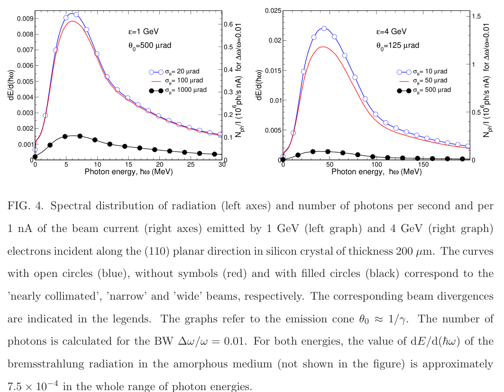
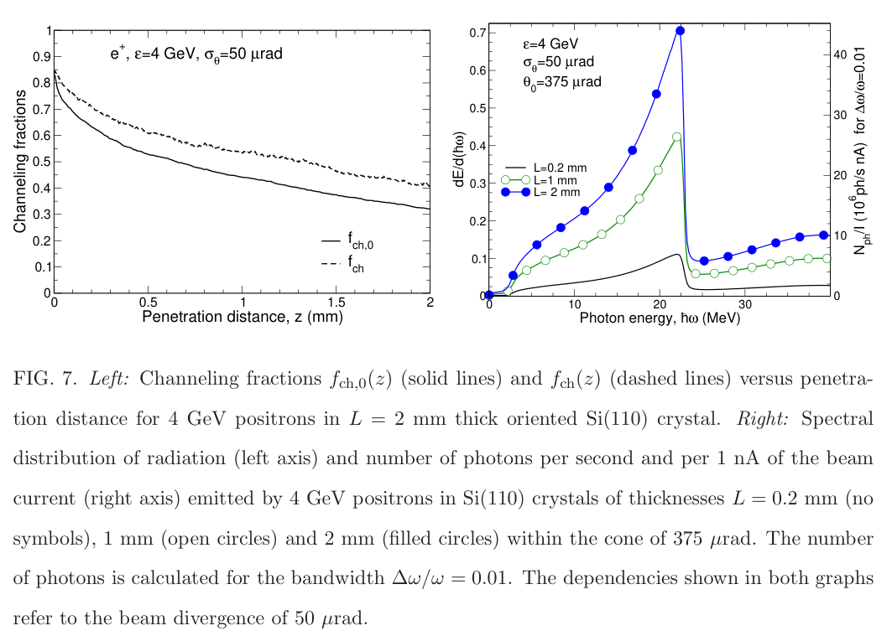

# LWFA 电子束驱动硅晶体沟道 γ 光源：散角与接受度

> Illia Zymak 等十位作者，[arXiv:2610.25336v1](https://arxiv.org/abs/2610.25336v1)，2026-10-18。[官方 PDF](../pdfs/Zymak%20et%20al.%20-%202026%20-%20LWFA%20crystal%20gamma%20source.pdf) 共 26 页，已读取布局文本与 MinerU 并目视核查束流表、光子定义和关键谱图。精确题名 Crossref 前三条未发现同篇正式版。这是基于 ELI-ELBA 能力讨论的 Rel-MD 辐射数值设计，尚未实测建成该 γ 源。

## 一句话结论

1、4 GeV 电子穿过 Si(110) 可产生增强沟道辐射，效果强烈依赖入射散角与探测接受锥；文中 $10^6$–$10^7$ 光子/s 量级依赖窄束、平均电流和带宽等条件。4 GeV 正电子厚晶体的更高通量是未来束流假设，不能直接继承 LWFA 电子束的 nA 电流作为已经可用的正电子流。

## 方案和方法

作者使用 MBN Explorer 的相对论经典分子动力学，随机抽样入口位置/角度与晶格热振动，再由轨迹计算辐射。光谱可用经典软光子近似或含反冲的准经典形式。本文电子支路忽略电离碰撞，援引已有计算说明该能区影响小；正电子支路保留电离碰撞。每个电子工况约 $2\times10^4$ 条轨迹，表中统计误差来自有限轨迹，未包含入射分布、晶格质量和绝对电流的系统不确定度。

硅 (110) 平面势阱约 20 eV，Lindhard 临界角 $\theta_L=\sqrt{2U_0/\epsilon}$ 在 1、4 GeV 下约 200、100 μrad。电子主扫描晶体厚度 200 μm，散角取 $5\theta_L$、$\theta_L/2$、$\theta_L/5$，分别称宽束、窄束、近准直束：1 GeV 对应 1000/100/20 μrad，4 GeV 对应 500/50/10 μrad。它们与文中不同现有/拟改造束线配置并非同一成套已测参数。

束线表同时列出现有宽能谱束、引导/注入方案、准直狭缝与估计的主动等离子体透镜（APL）；降低散角可能伴随电荷损失、体积增大或新的聚焦要求。不能把各行最佳电荷、散角和能散拼成一束已经存在的电子束。

## 辐射计数定义

令 $S=dE(\theta_0)/d(\hbar\omega)$ 为每入射粒子、接受半角 $\theta_0$ 内的能量谱，则式 (1) 的量实际为带宽内光子**率**：

$$
\dot N_\gamma=S\frac{\Delta\omega}{\omega}\frac{I}{e}.
$$

图中通常用 $\Delta\omega/\omega=0.01$，右轴为每 1 nA 平均电流的光子/s，而不是 5–50 MeV 整段积分产额或总能量转换效率。1 nC、1–3.3 Hz 对应 1–3.3 nA 平均电流。若要算单束团光子数，应把 $I/e$ 换成 $Q/e$；原文称用约 33 kA 峰电流即可计算“每束团光子数”，还缺少时间积分这一量纲步骤，不能据其文字直接把瞬时率当作粒子数。

## 关键原图与结果

**图 4，PDF 第 13 页。** 左/右面板分别为 1/4 GeV；横轴光子能量（MeV），左纵轴 $dE/d(\hbar\omega)$，右轴以 $10^6\,\mathrm{ph\,s^{-1}\,nA^{-1}}$ 计的 1% 相对带宽光子率。接收半角分别为 500/125 μrad，约 $1/\gamma$。黑色宽束峰值比窄束低约 6/14 倍：既因为沟道接受率低，也因为辐射超出固定探测锥，不能全归因于总发射效率下降。近准直相对窄束的峰值只再增加约 5%–10%。图中标注、曲线和表 II 的比较均为数值结果。

表 II：1 GeV 的近准直/窄/宽束入口接受率分别 0.70/0.49/0.067，4 GeV 为 0.73/0.50/0.071；200 μm 靶内总平均沟道长度分别约 50.9/45.5/16.2 和 80.8/73.1/16.8 μm。进入沟道的比例与全程留在沟道的比例不同，再俘获使二者随深度分离。增大探测半角至约 $3/\gamma$ 可令谱峰约再增两倍，代价是更宽角接受；4 GeV、50 μrad 束的 200–800 μm 有限厚度扫描提高光子率，不证明全局最优厚度或长期热稳定。

**图 7，PDF 第 17 页。** 左图横轴穿透深度（mm）、纵轴初始沟道存活比例及含再俘获的沟道比例；右图横轴光子能量，双纵轴定义同上。取 4 GeV 正电子、50 μrad 散角、375 μrad 接受半角，比较厚度 0.2、1、2 mm；约 22 MeV 一次谐波峰随厚度增高。作者给出 10–20 MeV 区域 1% 带宽内约 $(2$–$4)\times10^7\,\mathrm{ph/s}$（**正电子平均电流假定 1 nA**）。这不是从现有电子束经钨转换、收集、准直后已取得的正电子通量，更不是已测中子或同位素产额。

## 去重、疑点和研究价值

与已入库 [Sytov 等 2609.40005](../../2026-10-02/notes/Sytov%20et%20al.%20-%202026%20-%20LWFA%20crystal%20gamma%20positron%20neutron%20source.md) 不重复：本篇作者组不同，主研究是 Si(110) 平面沟道、1/4 GeV、MBN 原子轨迹与窄带谱；前者主要是 3 GeV、5 mm W⟨111⟩、FBPIC/Wake-T/Geant4 到光核中子的级联。两者提供不同证据，不能互相补成已完成实验。

原文第 14 页对图 5 的文字把两档电子束统写为 $\theta_L/2=50\,\mu$rad，而图 5 左面板明确为 1 GeV、100 μrad，右面板为 4 GeV、50 μrad；本笔记采用图例与临界角一致的两档值。摘要的通量量级也必须随具体接受锥、带宽、电流阅读。

后续需要真实单发能谱/二维角分布、取向误差和指向抖动折叠、准直损失、靶温升/辐照寿命、探测器响应与光核输运；本文未完成这些链路。本轮未运行 MBN Explorer、FLUKA、APL 输运或正电子产生模拟。

## 来源与复核记录

[官方 arXiv](https://arxiv.org/abs/2610.25336v1)、PDF 第 1、7、8、13、16、17 页；文件及解析记录见 [PDF 核验](../pdf_validation.json)、[MinerU](../research/mineru-attempts.json)，原图文件见 [裁框/哈希](../research/figure-manifest.json)。
