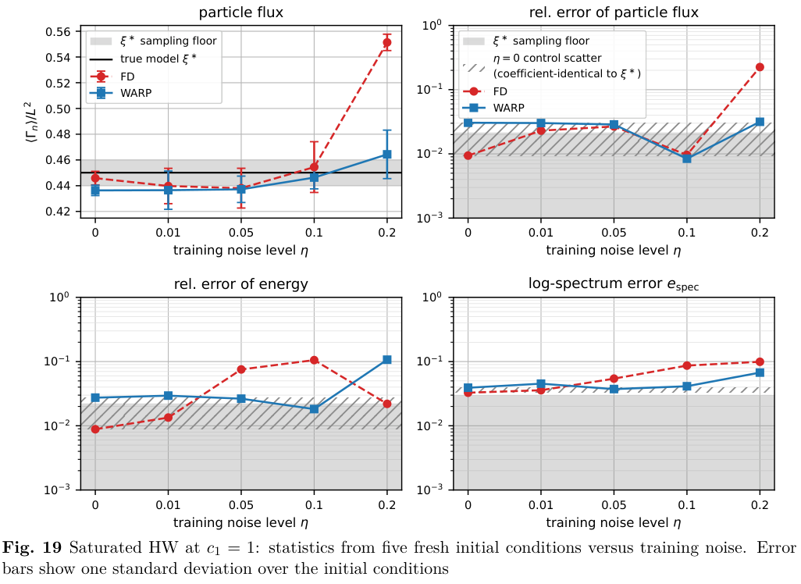
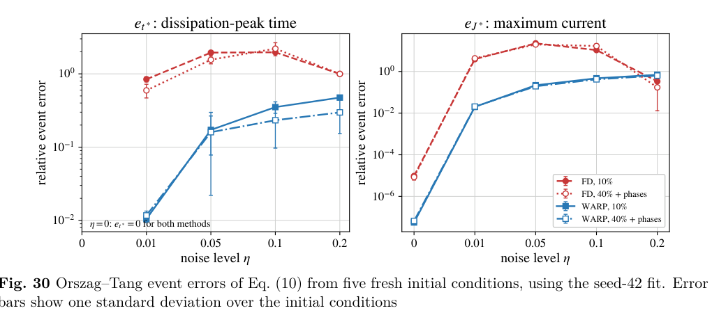

# WARP：以观测锚定多步积分识别流体与等离子体 PDE 系数

## 0. 论文信息与阅读范围

- **题名**：Machine-learned spectral PDE solvers for fluids and plasmas。
- **作者**：Mellow Baixuan Chen；Alan A. Kaptanoglu。
- **版本与日期**：arXiv:2610.27317v1，2026-10-19，physics.comp-ph；本轮收录高质量方法预印本，未确认同题正式发表版本。
- **标识**：[arXiv 摘要与版本](https://arxiv.org/abs/2610.27317v1)；[DOI](https://doi.org/10.48550/arXiv.2610.27317)；[原始 PDF](https://arxiv.org/pdf/2610.27317v1)；[本地 PDF](../pdfs/Chen%20et%20al.%20-%202026%20-%20WARP%20spectral%20PDE%20solvers.pdf)。
- **主题**：等离子体湍流、机器学习、方程识别、弱形式、谱 Galerkin、可微分求解器、MHD。
- **证据类型**：合成数值基准；其中一组使用独立程序生成的高分辨率 HW DNS 数据。没有实验测量，也没有在此笔记制作中重新训练或复跑作者求解器。
- **阅读**：29 页全文；重点阅读正文 pp.1–21、附录 A–F pp.21–27；参考文献用于核对方法归属。MinerU pipeline 转换成功，并以原 PDF 的正文/表格和页面渲染复核；已目视核对首页、pp.14、16、19 及两幅保留裁图。
- **名称提醒**：本文的 WARP 是 Weak-form Anchored Rollout for PDEs，与 PIC 程序 WarpX 不同。

## 1. 摘要：核心结论及适用范围

作者把“识别 PDE”直接写成“训练一个可以自主积分的有限维求解器”：先将候选物理算子投影到 Fourier Galerkin 空间，再从多个观测时刻重启短段积分，调整 PDE 系数，使整段预测与后续观测接近。训练和部署使用同一个模态 ODE，因此系数要经受自身预测状态的连续反馈。

八类流体/等离子体系统、九组配置中，多步训练通常比同一弱投影下的单步时间导数拟合更抗噪，尤其能改善色散系统、高波数敏感算子和部分湍流统计量。**主要结果假定正确算子项已经知道，识别的是系数；不能据此写成从任意未知物理中自动发现方程。** 附录 F 只对 Kolmogorov 流补做了一组 33 列过完备库测试。

最应保留的三个边界是：Burgers 在 1%–5% 噪声下 FD 的新初态预测更好；湍流系数误差更小不保证每个统计量都更准；WARP 在测试中数值稳定并不构成任意参数、任意初态下的稳定性定理。

## 2. 引言：为什么导数拟合不足以得到可部署模型

正文第 1 节先讨论可辨识性：一条轨迹只覆盖状态空间的一部分，不同候选算子可能强相关；观测噪声、缺失场、离散误差和未解析尺度又会混入系数。这些因素既影响方程解释，也影响长期预测。

随后作者指出，局部导数残差很小，不会自动保证耗散、守恒或有界性。一点负黏性或额外能量源就可能在积分时被不断放大。因此“拟合观测导数”和“从新初态独立演化”需要分开验收。

WARP 的做法是用解析 Fourier 基函数表示场、同时用它们测试弱形式，再把系数放进自适应 Dormand–Prince 积分器内训练。每个拟合只使用**一条训练轨迹**；它与大量多轨迹训练的神经算子不属于相同数据制度。

## 3. 背景与归属：新增点在具体构造和受控比较

正文第 2 节按方法类型区分了显式算子系数识别、神经向量场、神经算子以及已有求解器的修正。本文右端没有神经网络，未知量是少量有物理名称的系数。

作者明确承认 Neural ODE、operator inference with rollouts、Runge–Kutta SINDy、Unrolled-SINDy 和 solver-in-the-loop 等已有“通过积分训练”的先例。尤其 rollout operator inference 也会在观测状态重启预测。本文的区别在于：**用物理空间命名算子的弱投影构造模态右端，所有模态共享同一组 PDE 系数**，而不是为一般降阶多项式算子阵列逐项估计参数。

弱形式通过分部积分减少对带噪空间数据求导，但不消除统计偏差：观测既进入回归响应，也进入非线性候选库，是 errors-in-variables 问题。WARP 的锚点和目标也有噪声，故不能称为无偏估计器。

## 4. 方法：从弱投影到观测锚定积分

### 4.1 谱 Galerkin 表示与 band-closed 的含义（原文 3.1–3.3）

候选 PDE 和截断状态为：

$$
\partial_t u=\sum_{\ell=1}^{P}\xi_\ell\mathcal D_\ell(u),\qquad
q_k(t)=\langle u(\cdot,t),\psi_k\rangle,\qquad
u_M(x,t)=\sum_{k=0}^{K-1}q_k(t)\psi_k(x).
$$

这里 u 是场，ξ 是待识别系数，D 是给定微分算子，ψ 是正交归一 Fourier 基。每方向最大整数模态为 M，空间维数为 s，场数为 Nf，总状态维数为：

$$
K=(2M+1)^s,\qquad d=N_fK.
$$

一维基的常数项是长度的负二分之一次方，正余弦项归一因子为长度倒数两倍的平方根；二维采用张量积。本文数值模型主要使用归一化变量，没有把图中的空间、时间和系数标成 SI 量。

测试 PDE 并分部积分后得到真正用于训练及部署的 ODE：

$$
\dot q_i=F_i(q;\xi)=\sum_{\ell=1}^{P}\xi_\ell A_{i\ell}(q).
$$

这里 A 是在重建场上计算后投影得到的算子库。以 KdV 为例，可直接看到空间弱形式如何转移导数：

$$
u_t=-\alpha u u_x-\beta u_{xxx}
\quad\Longrightarrow\quad
\dot q_k=\frac{\alpha}{2}\int_\Omega u_M^2\,\partial_x\psi_k\,dx
 +\beta\int_\Omega u_M\,\partial_x^3\psi_k\,dx.
$$

推导先将非线性项写成场平方的一阶导数，再分部积分一次；三阶色散项分部积分三次。周期性使边界项抵消，导数落在解析已知的测试函数上。**直觉**：避免直接对噪声场做高阶差分，但高波数的测试函数导数仍很大，所以并非完全免疫高波数噪声。

band-closed 指训练数据本来就是这个有限 Galerkin 系统自身演化的结果：每步将非线性积投影回保留带，没有独立演化的舍弃模态反向作用。它不表示有限模态集合对非线性乘法封闭；高模态仍会生成，只是经投影/去混叠删除。高分辨率 DNS 事后投影一般不满足这一假设。

### 4.2 噪声、数据生成及 FD 对照（原文 3.4–3.6）

每个场按其干净训练轨迹标准差独立加入 Gaussian 噪声：

$$
\hat u_a(x_\ell,t_n)=u_a(x_\ell,t_n)+\varepsilon_{a\ell n},\qquad
\varepsilon_{a\ell n}\sim\mathcal N\!\left(0,\eta^2\sigma_a^2\right).
$$

η 是每个场的噪声/信号标准差比；5% 指 η=0.05，不是场幅度逐点相对误差。噪声随后和场一起投影成模态观测。合成数据、训练和测试主要使用自适应 Dormand–Prince，非线性积采用 2/3 去混叠。

FD 对照使用**同一基、同一模态观测、同一候选库 A**，先算中心时间差分，再最小二乘拟合系数：

$$
\dot q_{\mathrm{FD}}(t_n)=
\frac{q_{\mathrm{data}}(t_{n+1})-q_{\mathrm{data}}(t_{n-1})}{2\Delta t_s},\qquad
\xi_{\mathrm{FD}}=\arg\min_\xi\sum_n
\left\|\dot q_{\mathrm{FD}}(t_n)-A(q_{\mathrm{data}}(t_n))\xi\right\|_2^2.
$$

**比较口径**：摘要称其为单步 weak-form SINDy baseline，但主文实际是上述 FD 最小二乘，主要结果没有稀疏项选择。不能将优势推广成“胜过所有 WSINDy/SINDy 方法”，也不能用这个对照单独量化弱空间投影的贡献；后者还需相同轨迹上的强形式对照。

### 4.3 多步锚定损失与训练（原文 3.7）

对每个允许的观测锚点 j，从该带噪模态状态出发，自主积分到偏移 i 对应的观测时间：

$$
\hat q_{j,i}(\xi)=\operatorname{ODESolve}
\left(\dot q=F(q;\xi),\ q(t_j)=q_{\mathrm{data}}(t_j),\ t_{j+i}\right),
$$

$$
\mathcal L(\xi)=\frac{1}{Z}\sum_{j\in\mathcal B}\sum_{i\in\mathcal I}
w_i\left\|\hat q_{j,i}(\xi)-q_{\mathrm{data}}(t_{j+i})\right\|_2^2,
\qquad
Z=\sum_{j\in\mathcal B}\sum_{i\in\mathcal I}
\left\|q_{\mathrm{data}}(t_{j+i})\right\|_2^2.
$$

锚点集合 B 只包含所有目标偏移均在观测窗内的位置。I 可以双向、只向前，或 HW 使用的长前向/短后向配置；w 通常相等。Z 在锚点和训练数据选定后固定，不是模型随状态变化的归一化。Orszag–Tang 两场幅度不同，因此残差另按各场 rms 的倒数加权，防止振幅较大的一场主导优化。

流程是“投影观测 → 预计算基函数及解析导数 → FD 初始化 → 锚点积分 → 伴随灵敏度梯度 → L-BFGS 更新”。JAX odeint 执行自适应积分；一般最多 500 次优化迭代，梯度容差为十的负十次方。非有限积分给予固定的百万量级损失；正文主要结果不加正则项，因为算子库已给定正确项。

训练中每个积分器阶段都在**预测状态**重新计算 A。部署时只需要新初态和学得系数，不再需要后续观测；多个锚点是训练机制，不是测试阶段不断同化真值。

### 4.4 评价指标、初态和统计口径（原文 3.8）

系数误差与轨迹误差为：

$$
E_\xi=\|\xi-\xi^*\|_2,\qquad
E_{\mathrm{rel}}(t_n)=\frac{\|U_{\mathrm{pred}}(t_n)-U_{\mathrm{true}}(t_n)\|_2}
{\|U_{\mathrm{true}}(t_n)\|_2},\qquad
\bar E_{\mathrm{roll}}=\frac1T\sum_n E_{\mathrm{rel}}(t_n).
$$

U 堆叠被评价场的网格值。**Eξ 是绝对二范数，不是相对百分误差**；不同模型的系数数目和归一化不同，不能直接按它跨 PDE 排名。

三组随机种子 42、123、456 只改变固定训练轨迹上的观测噪声，并不代表三条独立训练动力学轨迹。Burgers/KdV/ZK/衰减 NS 的测试先平均五个全新干净初态，再统计三个噪声种子的散布；两模型从相同干净初态出发，以排除初态观测噪声。普通确定性测试使用低模振幅 ±40% 和新相位。

湍流要评估新初态的吸引子统计，而非无限期逐点相位重合。Kolmogorov/HW/mHW 分别丢弃 500、150、40 个相应时间单位的 spin-up，再平均 200、150、80 个单位；mHW 时间单位是最大线性增长率的倒数。五个新初态包括新 Gaussian 场或同一低模制度的扰动；真模型同初态结果提供有限采样参考。图中误差棒的对象随图改变，不能统称为三个噪声种子的置信区间。

## 5. 基准与结果：按原文次序阅读

### 5.1 共同设置和尺度（原文 4.1、表 1，pp.6–7）

以下时间/空间均按论文模型归一化；H 是**观测快照间隔的个数**，不是自适应积分器的内部步数。

| 系统 | 保留带与状态维数 | 观测间隔；快照数 | 识别窗；训练视野 |
|---|---|---|---|
| Burgers | M=12；d=25 | 0.001；401 | 0–0.4；双向 H=50 |
| KdV | M=15；d=31 | 0.00001；10001 | 0–0.1；双向 H=50 |
| 二维 ZK | M=4；d=81 | 0.00002；801 | 0–0.016；双向 H=50 |
| 衰减二维 NS 涡量 | M=4；d=81 | 0.0005；401 | 0–0.2；双向 H=50 |
| Kolmogorov 流 | M=21；d=1849 | 0.05；2001 | 500–600；前向 H=10 |
| HW，带内自洽数据 | M=12；两场 d=1250 | 0.01；10001 | c1≤1 时 250–350，c1=5 时 1250–1350；前向 50、后向 5 |
| HW，独立 DNS 投影 | DNS 网格 512²；M=12/16/21；d≤3698 | 0.05；2001 | c1=0.1/1/5 对应 200–300/250–350/1250–1350；前向 H=10 |
| mHW | M=21；两场 d=3698 | 增长率×间隔=0.05；801 | 增长率×时间=60–100；前向 H=10 |
| Orszag–Tang MHD | 64² 网格；M=21；两场 d=3698 | 0.005；271 | 0.15–1.5；前向 H=200，即归一时间 1 |

各图使用 0、1%、2%、5%、10%、20% 噪声集合的不同子集，并非每个系统都跑全套水平。HW 带内数据需要与分辨率匹配的耗散，不能直接把高分辨率 DNS 的极小超扩散系数搬到粗带上。

### 5.2 Burgers：低噪声存在例外（原文 4.2、图 1–2，pp.7–8）

方程为非线性对流加黏性扩散，真实对流系数 −1、黏性 0.05。无噪声两法基本精确；1% 噪声下系数误差相近，WARP 的扩散系数衰减略大。最高噪声时，WARP 的系数误差优势约一数量级，对流系数种子散布也小得多。

但在 1%–5% 噪声范围，FD 的新初态 rollout 更准。该例说明损失设计仍受 noisy regressors 的偏差影响。图 1 横轴为无量纲 η，纵轴同时放系数绝对误差和新初态平均相对误差、用对数刻度；实心/空心区分两类指标。图 2 是 5% 噪声的场、预测和误差，横轴归一空间 x，纵轴归一时间，色条为场值或其差。

### 5.3 KdV：色散项的高波数权重放大 FD 问题（原文 4.3、图 3–4，p.8）

真实非线性系数 6、三阶色散系数 1。弱形式虽不对数据直接做三阶差分，色散模态列仍按波数的三次方加权；很小的快照间隔又增强时间差分噪声。最高噪声下 FD 几乎丢失色散系数。

作者报告 WARP 系数误差改善 1–2 个数量级；在各非零噪声水平，新初态 rollout 误差改善 1–3 个数量级。图 3 与图 1 的指标/误差棒相同，图 4 的时空面板展示 5% 噪声训练后的自主积分。这是经验范围，不是由三阶导数推出的普适精度定律。

### 5.4 ZK 与衰减 NS：从二维色散到非局域涡量平流（原文 4.4–4.5、图 5–8，pp.9–10）

ZK 的色散算子是 x 导数作用于 Laplacian；若不依赖 y，就退化为 KdV。噪声增大时 WARP 的系数优势逐步达到约一数量级，新初态预测也改善。

衰减二维 NS 通过流函数与涡量的 Poisson 关系引入非局域速度，真实平流系数 1、黏性 0.02。最高噪声下 FD 将平流系数低估约一半，WARP 仍在约 1% 内；整体系数优势从约一数量级增至接近两数量级。

图 5、7 是系数/新初态预测误差随 η 的比较。图 6、8 是固定中央 y 切片的 x–t 图，不能当成完整二维场。初始时刻的非零误差来自带噪初态投影；它与从相同干净初态启动的新初态测试口径不同。

### 5.5 Kolmogorov 湍流：应检验能量收支和谱（原文 4.6、图 9–14，pp.9–12）

方程加入单色外力，真实平流系数 1、黏性 1/40、外力幅度 1，外力波数 4。识别窗在 500 时间单位 spin-up 之后，覆盖饱和湍流和间歇耗散峰。

图 9 先验证生成器：64²/M=21 与 128²/M=42 的平均能量只差 0.34%，平均耗散在分块采样误差内。能量用层流值归一，耗散和输入功率用层流耗散归一；涡量平方的波数壳谱向带边衰减，没有带边堆积。附录 C 给出饱和能量约层流的 0.44，耗散/输入约层流耗散的 0.09。

图 10 显示无噪声 FD 也有中心时间差分的采样偏差；噪声下三个系数一起衰减。图 12 的五新初态测试中，WARP 到 10% 噪声仍在真模型统计散布内，FD 偏离正确能量状态。图 11、13、14 另比较从同一带噪快照出发的部署：灰线用真系数重启，表示单独的初态扰动放大；WARP 靠近灰线，FD 的场误差约十个时间单位后达到一量级。

物理解读是，FD 的较弱黏性不足以清除小尺度涡量，导致耗散缺额、能量偏高和谱能量移向带顶。黑色干净原轨迹与灰色重启轨迹的分离本身不是系数识别失败，湍流评价必须把这两部分分开。

### 5.6 HW：两场系数、粒子通量与噪声下的非单调性（原文 4.7、图 15–19，pp.11–14）

HW 描述电阻性漂移波，演化密度扰动 n 和电势对应的涡量 ω。两个平流项、两个电阻耦合项、密度梯度驱动及两个耗散项，共七个独立系数；即使物理上同名耦合量相同，拟合中也不自动强制相等。

$$
\begin{aligned}
\partial_t n&=-\{\phi,n\}+c_1(\phi-n)-\kappa\phi_y-D_n(-\Delta)^p n,\\
\partial_t\omega&=-\{\phi,\omega\}+c_1(\phi-n)-D_w(-\Delta)^p\omega,
\qquad\omega=\Delta\phi.
\end{aligned}
$$

花括号是二维 Poisson bracket；电势从涡量通过 Poisson 方程求得。驱动向系统输入涨落能，耦合与超扩散消耗能量。M=12 带上若照搬 DNS 的极小超扩散会失稳，因此这里使用与分辨率匹配的耗散，图 15 先展示这个必要差别。

通量、耗散和能量定义为：

$$
\Gamma_n=-\int_\Omega n\,\partial_y\phi\,dx\,dy,\qquad
\Gamma_c=c_1\int_\Omega(\phi-n)^2\,dx\,dy,\qquad
E=\frac12\int_\Omega\left(n^2+|\nabla\phi|^2\right)dx\,dy.
$$

面积归一需再除以 L²，不能把空间积分通量与单位面积通量混比。谱横轴的波数以离子声回旋半径归一，纵轴 E(k) 是波数壳内能量和。

c1=1 时 WARP 系数误差通常改善 1–2 个数量级。5% 噪声、同带噪初态的 WARP 和真系数重启曲线早期重合，支持其额外系数误差较小；之后场逐点失相关并不等于统计错误。图 18 显示 FD 能量长期偏低、低波数谱不足。

**图 19 逐项解读（PDF p.14）**：四幅图横轴均为训练噪声 η。左上是单位面积平均粒子通量，线性纵轴；右上为通量相对误差，左下为能量相对误差，右下为对数谱误差，后三幅纵轴均用对数刻度。蓝方块为 WARP，红圆为 FD；黑线/灰区是真模型及有限采样参考，斜线区表示无噪声控制模型的散布。误差棒是**五个新初态之间的一倍标准差**，不是测量误差或统计置信区间。正文没有给出可据此自行重建对数谱误差的完整算式，本笔记不补造它的定义。

**图的关键结论**：到 10% 噪声，WARP 基本保持真实统计量；20% 时 WARP 的通量与谱误差仍小于 FD，但**能量相对误差高于 FD**。这直接说明“系数恢复更好”与“每个宏观统计量都最好”不是等价命题。灰色采样区也提示，接近几个百分点的差异不能只看曲线排序就宣布显著优势。

### 5.7 独立 512² DNS：零噪声偏差来自未闭合与离散不匹配（原文 4.8、图 20–21，pp.14–16）

独立 hw2d 采用 512² 网格、Arakawa bracket、有限差分空间算子，超扩散阶数 p=3、系数为五乘十的负九次方；与发现模型的谱离散不同。图 20 在 c1=1 时报告饱和窗空间积分通量 0.626±0.039，与所引参考的 0.6±0.05 对照。这是生成器验证值，不能与上节单位面积通量直接作数值相减。

把 DNS 场投影到 M=12/16/21 后，舍弃尺度仍影响保留尺度，给定算子库不一定能表示真实的投影动力学。作者将零噪声系数偏差称为 closure-induced offset，同时承认其中含空间离散差异；**它不是已证明的最小误差下界，也不代表已经识别出一个完整亚网格闭合模型**。

图 21 显示 WARP 在各 M 下均低于 FD，且增大 M 可降低 WARP 的零噪声偏差；加噪后 FD 误差上升，WARP 仍接近各自零噪声水平。这里最稳妥的结论是系数估计对噪声和投影更稳健，不能据图补出独立 DNS 全部长期统计已准确的结论。

**原文标签疑点**：主文称 HW 和 projected-DNS 的 Eξ 包含全部七系数，并说明两个超扩散系数对该范数贡献不足 0.1%；但 p.16 图 21 的纵轴实际标为 “five-coefficient error”。图注又写 Eξ。此为标签/统计对象口径不一致，未获取代码逐项确认，因此不从该图提取精确误差数字或擅自将两种口径等同。

### 5.8 mHW：跨越涡团—带状流转变的难点（原文 4.9、图 22–26，pp.15–17）

mHW 从电阻耦合中去掉 zonal 分量，使带状模态可以由 Reynolds stress 转移增长。随绝热性 C 增大，系统从涡团湍流向带状流过渡。作者保留七系数结构，在含十个最快增长波长的箱体中使用与分辨率匹配的四阶耗散。

图 22 是**仅求解器验证的扫描**，19 个 C、两种分辨率，不是 19 组全部重新识别。M=21 和 32 的带状动能占比过半位置分别约为 C=0.26、0.15；加宽带使转变更接近参考 DNS。不同区间的通量幂律斜率仍有定量偏差，且参考 DNS 拟合的 C 范围更宽，不能把视觉接近当成完全复现临界行为。

识别取 C=0.01、0.1、0.3、1，覆盖涡团、转变附近和带状流。图 23 的 FD 无噪声误差已有采样偏差底，WARP 更接近积分精度底；10% 噪声时系数误差优势约 1–2 个数量级。

图 24 的 5% 噪声新初态统计在 C≥0.1 时支持 WARP 接近真模型；FD 在带状区的通量和带状占比偏差最明显。到 10% 噪声，WARP 残余系数误差可把转变附近的状态推过阈值，涡团区的通量/能量甚至可能比 FD 更差。图 25–26 提醒：缓慢演化的 zonal 分量可以保留相关性，使总场相对误差低于两个同范数失相关场常见的根号二参考值；仍需同时检查粒子通量、带状占比和谱。

### 5.9 Orszag–Tang MHD：事件而不只是场均方误差（原文 4.10、图 27–31，pp.18–20）

该确定性 MHD 瞬态由光滑速度/磁场形成电流片。五个系数分别控制涡量平流、Lorentz 作用、黏性、磁通平流、电阻扩散；前三个理想项系数为 1，黏性和电阻率均为 0.025。这里与 HW 的电势定义不同，采用流函数 χ、磁通 A：

$$
\mathbf u=(\chi_y,-\chi_x),\quad \omega=-\Delta\chi,\qquad
\mathbf B=(A_y,-A_x),\quad j=-\Delta A.
$$

图 27 验证动能和磁能交换、总能衰减及电流片；图 28 将本地 M=21、64² 生成器与文献的 128² 参考比较，第一电流峰时间同为 1.07，峰值分别约 43.1、44.8，相差约 4%。正文另报告总耗散峰时刻约 1.05：**最大电流峰与总耗散峰是两个定义不同的事件**，不能混成同一时间。

训练使用 H=200，对应归一时间 1，并对两场按 rms 加权。图 29a 的视野/权重敏感性显示，足够长的积分视野与平衡两场损失对该例很重要；不能把 Burgers 的短视野饱和经验直接套用到 MHD。

事件指标按相同新初态、相同评价区间的真系数模型定义：

$$
t^*=\arg\max_{t\in\mathcal T}\varepsilon_{\mathrm{tot}}(t),\qquad
J^*=\max_{t\in\mathcal T}\|j(\cdot,t)\|_\infty,
$$

$$
e_{t^*}=\frac{|t^*-t^*_{\mathrm{ref}}|}{t^*_{\mathrm{ref}}},\qquad
e_{J^*}=\frac{|J^*-J^*_{\mathrm{ref}}|}{J^*_{\mathrm{ref}}}.
$$

总耗散包括黏性和电阻性两部分；电流峰是整个时空评价窗内的最大绝对值，不是只在耗散峰时取电流。事件误差以真模型对应事件归一，因此无量纲。

**图 30 逐项解读（PDF p.19）**：横轴为训练噪声 η，左纵轴是耗散峰时间相对误差，右纵轴为最大电流相对误差，均为对数刻度。蓝色 WARP、红色 FD；实心对应 ±10% 振幅扰动而保留相位，空心对应 ±40% 振幅并换相位的压力测试。两种初态制度各五个新样本；此图使用种子 42 拟合的模型，误差棒是初态间一倍标准差。图例的 “10%/40%” 是**初态扰动幅度**，不同于横轴上的训练噪声。

低噪声时 WARP 事件误差约几个百分点；噪声增大后逐步恶化，20% 时电流事件误差达到一量级。FD 从约 1% 噪声开始就可将耗散峰时间移动到与峰时间本身相当的幅度；在不高于 10% 噪声的一些设置中，峰电流被高估约 5–24 倍。20% 噪声下 FD 的电流误差反而变小，是因为电流片事件已经消失，不能解释为恢复了正确轨迹。

图 31 使用一个真正未见初态比较二维涡量/电流；参考每列独立定色标，超范围面板另标峰值。WARP 在保留带精度内保持事件结构，FD 电流显著超出色标。该结果仅支撑这一带宽内的瞬态预测，有限 M 仍限制电流片的无穷范数峰值。

### 5.10 超参数与附录证据（原文 4.11、附录 A–F）

附录 A 补 c1=0.1、5 的 HW 生成器、DNS 验证和投影识别；较大 c1 的噪声敏感性更明显。图 33 提供 c1=1 两场空间快照，补充主文的轨迹误差与统计量。

附录 B 给出多步改善的直觉。短时间内真实增量随时间偏移近似线性增长，而两个独立观测噪声的差值幅度不随偏移同比增长。若一个模态的单快照噪声方差为 σq²，则中心差分噪声方差与间隔平方的倒数成正比：

$$
\operatorname{Var}\!\left[\frac{\epsilon_{n+1}-\epsilon_{n-1}}{2\Delta t_s}\right]
=\frac{\sigma_q^2}{2\Delta t_s^2},\qquad
\operatorname{Var}[\epsilon_{n+r}-\epsilon_n]=2\sigma_q^2.
$$

这是独立、等方差时间噪声下的解释性推导，不是 WARP 无偏或最优的证明。多偏移共同受同一预测轨迹约束，还直接惩罚积分漂移，作用不只是平滑。

附录 C 说明无噪声 FD 也可受采样间隔影响。mHW 非 zonal 模态的电阻弛豫率含 C 乘以“一加波数平方倒数”，小波数也可能有很快弛豫；采样不解析它会造成有分量权重的偏差。WARP 以内部自适应子步在观测之间积分，减轻这项偏差；这不意味着任意稀疏观测仍可辨识。

附录 D/图 36 中，ZK 在所扫 M=3–6 范围的系数误差较平，Burgers 在 H 约 25 以上趋于平台。由于该试验的数据生成与识别共享截断模型，没有出现真实 DNS 投影那样的未闭合底；该平坦性不能作为实际数据对带宽不敏感的普遍证据。

附录 E/图 37 将 10% 噪声训练的模型从一个新初态积分到原测试窗两倍。WARP 在所测 OT/HW/Kolmogorov 三例保持有界并更接近正确能量收支或通量；OT 仍因耗散系数偏大而能量下降过快。**FD 三例也都数值有界**，但 OT 总能反而增长约一数量级、HW 电阻耗散偏高、Kolmogorov 动力学太慢而停在错误能量状态。该附录证明的是物理部署质量的差别，不是“FD 一定爆炸”。

附录 F/图 38–39 对 Kolmogorov 流使用 33 列库：场和其导数的线性/二次项及外力，所有列先投影为零均值。真模型在展开库中对应五列，因为平流与 Laplacian 分别拆成两列。无噪声两法都恢复；加噪后 WARP 的真项和伪项更好，但 10% 噪声时最大伪项可与所恢复黏性相当。未加稀疏正则而能部署的结果是这组模型的经验性质，不能代表任意过完备或漏项库都会成功；零均值处理本身也移除了可能被伪项驱动的无阻尼平均涡量。

## 6. 局限与结论：本文证明到哪里（原文 5–6）

本文最扎实的结论是：在相同 Fourier 弱空间表示、相同数据、相同主要正确算子库下，**把系数放进锚定多步积分中优化，通常能改善自主部署质量**。这一构造产生可检查的 PDE 系数和对应求解器，而非仅有拟合误差的局部回归模型。

主要未覆盖项包括非周期边界、冲击/间断、缺失场、实验非 Gaussian/相关噪声、普遍的未知项选择，以及大尺寸系统的 FFT 实现性能。独立 DNS 的库尚未显式加入闭合项；mHW 转变位置和电流片峰值仍有带宽依赖。正文未给出在统一硬件与精度下的完整训练/推理成本对比，本轮不能据此声称比高保真求解更快。

## 7. 与 PIC/激光等离子体机器学习的关联及开放问题

1. **可借鉴的验收设计**：从 PIC 或实验中提取低阶场/矩后，不仅比较拟合残差，还应从新初态评估能量、通量、谱及事件；把初态噪声放大与模型误差分开。这里是方法迁移建议，本文没有完成 PIC 测试。
2. **投影闭合要显式审查**：粗网格/低模态下拟合出的“黏性”可能补偿舍弃尺度与离散误差，未必等于微观输运系数。要通过多带宽、独立生成器和显式闭合算子分别检查。
3. **项选择与约束**：若使用更大库或可能缺项，仍需研究稀疏选择、守恒/耗散结构约束和可辨识性；本文的失败惩罚不是稳定性证明。
4. **实际观测制度**：实验/PIC 噪声具有相关性、粒子统计及不均匀误差，锚点和目标往往不独立。应先验证噪声模型、部分观测与边界，再谈真实数据的系数可信区间。

复习速记：空间弱投影使导数转移到已知基函数，多步积分损失迫使所学系数经受自身预测反馈；两者互补，但“正确系数、小场误差、正确湍流统计、稳定性保证”仍是四项不同验收。

## 8. 来源与图像溯源

- 本笔记的结论、参数和图读数均来自所收录 arXiv v1 全文；约数按作者正文或清楚图标注记录，没有自行数字化生成新的结果数据。
- **图 19**：原 PDF p.14，页面坐标以左上为原点、单位 pt，裁框 `(42, 254, 555, 628)`；PyMuPDF 以 2 倍比例/144 dpi 渲染，保留原坐标、图例和图注。文件 SHA-256：`6bba8de4c3d7201bb39216b61d35925b30d919065c126cccd63954245cec867a`。
- **图 30**：原 PDF p.19，裁框 `(45, 570, 555, 795)`；同样为 144 dpi 原图裁切。文件 SHA-256：`0f75465e0d4c0a7367afd0cb259f1442d1e95001f781bd205c6095aae015e177`。
- MinerU pipeline 本轮成功，task ID 为 `bbb7f617-6265-4743-b4ff-ffb8fc852407`；已结合解析全文与原 PDF 复核，未把解析器可能错位的表格符号当成原式。
- 图像仅作为原论文讨论的有署名来源摘录，不表示另有通用转载许可。未保存全页目视检查临时图到论文库。
