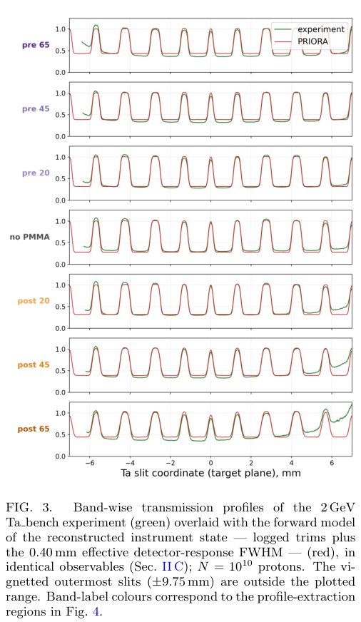
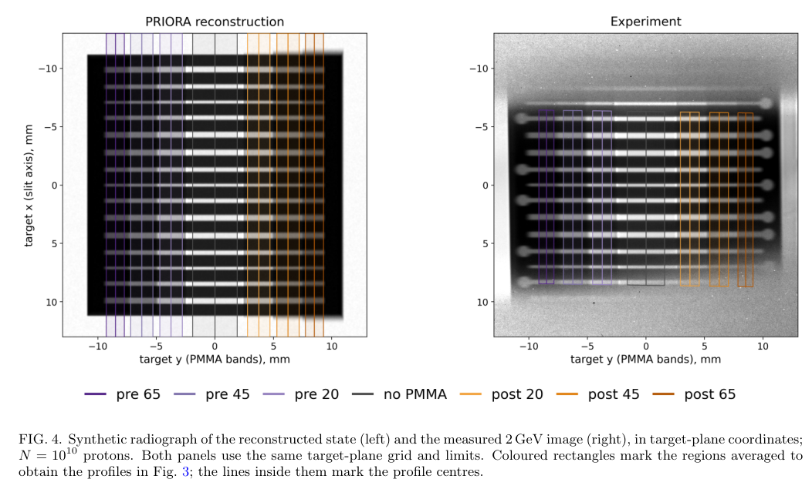

# PRIORA 高能质子照相：物质—磁光学耦合的实验核验

> D. Varentsov、M. Schanz、J. Schmidt，*Experimental verification of the PRIORA Monte Carlo code for proton radiography*，[arXiv:2610.26121v1](https://arxiv.org/abs/2610.26121v1)，2026-10-19。[本地 PDF](../pdfs/Varentsov%20et%20al.%20-%202026%20-%20PRIORA%20proton%20radiography%20verification.pdf) 5 页；已读全部主文、表 I 与 MinerU 正文。精确题名 Crossref 前三条未核实同篇正式版。本文用 GSI PRIOR-II 的 2/4 GeV 质子照相数据核验模型，并非激光加速质子实验。

## 结论与引言

PRIORA 将拟合的物质响应与随能量变化的离子光学传输映射交替计算，使一幅 Ta 狭缝靶图像同时约束倍率、散射对比度、色差、双平面焦点及有效响应。关键成果是恢复非名义仪器状态并与后找回的磁铁日志交叉核对；“无物理调参”不等于所有仪器参数均预先固定。

通用粒子输运处理散射、能损及核移除，磁光学代码处理传输；把两者简单分开会丢失物体内部能损对后续聚焦的影响。本文用 LADA 计算拟合响应函数，传输图可为任意阶，本轮验证实际采用三阶。

## II. 模型、速度与分析定义

对材料、参考能量和相对能偏差，预先拟合路径长度相关的散射角 RMS、平均能损和能损涨落，并按表列碰撞长度处理核移除。厚片再分薄片；每片中散射角踢及其位置相关横向位移共同采样，保留散射发生位置和能量演化。100 mm 厚 W 准直器作为真实材料/椭圆孔处理，包含边缘散射及部分穿透，并非理想角度硬截断。

在作者八核笔记本、完整 PRIOR-II 配置下约每秒输运一百万质子；5 亿质子约 8 分钟，两幅各 20 亿粒子的 target/empty 图像对约一小时。这是作者性能报告，本文档未本地运行或测得通用加速比。

实验和模拟独立配准到靶几何，按开放狭缝归一化；模拟不额外平滑。两条边联合用同一高斯宽度拟合误差函数 ESF。重要宽度定义为

$$
\mathrm{FWHM}_{\rm LSF}=2\sqrt{2\ln2}\,\sigma\simeq2.355\sigma.
$$

这里 ESF 对位置求导得到高斯线扩展函数 LSF；令高斯在半峰处满足指数等于二分之一，解得两侧位置差即上式。不能把 slit width、ESF 的 10%–90% 上升距离与本论文所报分辨率混用。有效探测响应须先作用于 target 和 empty，再作比值；它含探测器模糊及多发平均时束流/靶运动。

## III–IV. Ta_bench 靶与绝对量

2 mm Ta 板有 15 条精密狭缝，宽度组含 0.25/0.375/0.5 mm，前后放置对称 PMMA 阶梯、累计厚度 20/45/65 mm。已知狭缝间距定倍率，前后散射层的杠杆臂差给焦点偏差符号，正交 PMMA 边缘约束另一方向，Ta/开放狭缝透射比约束有效角接受。多种量共享仪器参数，必须联合解释，不能分别挑选最优参数。

未调仪器时，2 GeV 图像倍率与映射差小于 1%，与 4 GeV 倍率差 0.6%；Ta/open 实测约 0.31–0.34、模型 0.29。无/20/45 mm PMMA 开放狭缝透射实测 1/0.85/0.60，模型 1/0.88/0.62。这些绝对对比存在残差，不能写成逐点完全一致。

## V. 焦点与响应的联合重建

名义设计态给约 26 μm 宽度，数据为 121–189 μm。若全部归因于离焦，会预测 6.5%–9.1% 边缘过冲，超出实测 0.2%–4.8%，因此需要额外图像空间响应。联合拟合得狭缝平面纵向焦移约 +15 mm，以及靶平面有效响应 FWHM **115±6 μm**（探测器平面 0.40±0.02 mm）。该响应并非纯探测器本征分辨率。

**图 3，PDF 第 3 页。** 横轴为靶平面沿狭缝坐标（mm），纵轴为按开放狭缝归一化的透射，七行对应上游/无/下游 PMMA 带。绿色实验、红色 PRIORA；不同色差负载下的边缘宽度与对比度共同检验重建。模拟每图一百亿质子是 MC 样本数，不能当成每次实验照射粒子数。

后来恢复的控制日志中 Q1–Q4 修调为 −0.71/+0.24/+0.48/−0.58%，给双平面焦移 +15.6/−67 mm、倍率变化 +0.8%，与重建相容。结合上述有效响应，七带宽度 RMS 误差约 7%；表 I 最外下游 65 mm 带 188.8 对 217.6 μm，仍差约 +15%。正交上游 PMMA 接头的残差也未解决。

**图 4，PDF 第 4 页。** 左为重建后的合成照相，右为 2 GeV 实测；横轴 PMMA 带方向、纵轴狭缝方向，单位均 mm。彩框是图 3 的取样区域，不代表新的物理信号。图像相似支持几何—响应联合模型，但不能据其视觉相似替代表 I 残差与参数辨识检验。

## VI–VII. 4 GeV 交叉核验及限制

独立 4 GeV 数据未见应有的 PMMA 对称衰减带，作者据此判断实际分析的是裸 Ta 板。中央 Ta/open 实测 0.743；拟合有效角接受 3.75 mrad 后模型 0.746。此为完整 Fourier 平面映射的有效接受，不是直接测得机械孔角。拟合宽度 69±8 μm；由于无前后色差负载，不能再把该有效响应与小离焦唯一分开。

同一 Ta 板的散射角由 2 GeV 时约 3.5 mrad 减至 4 GeV 时约 1.9 mrad，解释高能图像边缘更锐但材料对比度较低。此权衡对 HED 动态照相设计有参考价值；迁移至 MeV 宽谱、强发散激光质子束，仍需重新建立材料响应、输运映射、能谱及单发探测模型。

开放问题包括独立靶/更多材料和能量验证、有效模糊项的分解、MC 误差与实验系统误差联合传播，以及 LADA 拟合表的公开可复现性（文献 [5] 为私人通信）。本轮未运行 PRIORA、LADA、Geant4 或 COSY，未新增激光束流、光核、中子、剂量或防护验收结果。

来源：[官方全文](https://arxiv.org/pdf/2610.26121v1)，PDF 1–5 页；[PDF 核验](../pdf_validation.json)、[解析记录](../research/mineru-attempts.json)、[原图来源与裁框](../research/figure-manifest.json)。
