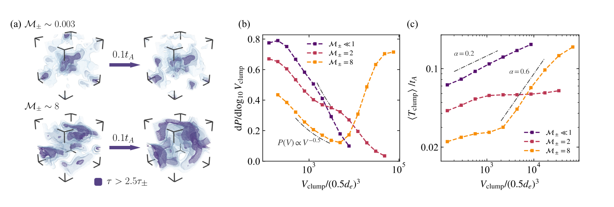
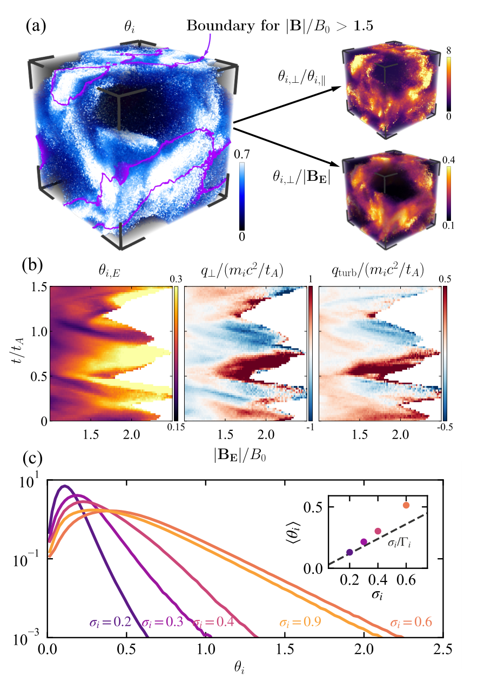

# 正负电子对加载相对论湍流中的离子加热

## 0. 论文信息与阅读边界

| 项目 | 信息 |
|---|---|
| 原题 | *Ion Heating in Pair-loaded Relativistic Turbulence* |
| 作者 | Yusen Wang, Zhonghai Zhao, Xinyu Zhu, Xianxu Jin, Zhipeng Zhang, Bin Qiao |
| 单位 | 北京大学物理学院、应用物理与技术研究中心、HEDPS、核物理与核技术国家重点实验室 |
| 版本 | arXiv:2610.26731v1，physics.plasm-ph；arXiv 标注 2026-10-19，PDF 内文日期 2026-10-20 |
| DOI | [10.48550/arXiv.2610.26731](https://doi.org/10.48550/arXiv.2610.26731) |
| 原文 | [arXiv 摘要与版本记录](https://arxiv.org/abs/2610.26731)；[v1 PDF](https://arxiv.org/pdf/2610.26731v1)；[本地 PDF](<../pdfs/Wang et al. - 2026 - Radiative pair loaded PIC ion heating.pdf>) |
| 文献性质 | 19 页预印本，主文至 p12，参考文献 p12–14，补充材料 p15–19；本轮未确认正式期刊版本 |
| 方向 | 辐射 PIC、相对论湍流、Compton 散射、正负电子对反馈、离子压力张量与加热诊断 |
| 阅读日期 | 2026-10-22 |

**一句话结论。** 作者的三维辐射 PIC 模型显示，正负电子对增多可增强散射不透明度，使高光深团块合并并保持更久；团块内持续磁场放大与非回旋对称压力功共同支持反复产生热离子团块。

**证据类型。** 这是面向黑洞日冕和伽马暴外流的作者数值模拟与近似理论分析，不是激光等离子体实验、实验室强场 QED 观测、光核/中子源实验，也不是本地运行 WarpX 得到的复现。论文使用“QED 过程”的表述；就本文明确展示的物理链条而言，关键是 Compton 上散射、光子成对产生与湮灭反馈，不能直接等同于激光背景场中的非线性 Compton 或强场 Breit–Wheeler 模型验证。

**全文处理与核验。** MinerU `pipeline` 全文解析成功，包含主文、全部补充材料和图片；随后逐节对照 PDF 文本与页码。已目视 PDF 首页 p1、图1 p5、图2 p7、图3 p8、图4 p10，以及补充阈值和追踪规则 p16；两幅保留原图均来自 PDF 原位裁切并复看。MinerU 将式(5)非回旋对称张量误识别成单位张量，以下按 PDF 的 Π 修正。临时解析包、全页渲染不作为论文库资产保留。

## 1. 摘要：从“产生电子对”到“持续加热离子”

摘要首先界定对象：紧致高能天体环境中存在富含正负电子对的相对论湍流，但离子能否被持续加热，取决于能量转换结构如何形成与存活。作者采用自洽三维辐射 PIC，而不是把辐射冷却当成固定外加损失项。

随后提出主要机制：正负电子对增加散射深度，增强辐射反馈；反馈促使光学厚结构长大、连接并延寿。在这些结构中，局部离子加热多次发生，进而提高总体平均离子温度。

摘要最后把结果定位为黑洞日冕、伽马暴外流中间歇热离子产生的理论基础。此处“基础”表示一个可能机制，尚未给出针对具体天体观测的辐射谱拟合、热离子输运存活计算或观测检验。

## 2. Introduction：为什么要研究团块的存续时间？

**第一段（p2）：问题来自能量输入的空间组织。** 磁化湍流可向紧致辐射区持续供能，Compton 散射塑造高能辐射，X 射线耀发与回响观测提示日冕几何紧致且随时间变化。因此仅比较全局平均加热率不够，还需理解局部能量转换结构能维持多久。电子对产生会改变不透明度与辐射—等离子体能量交换，可能成为影响结构寿命的反馈。

**第二段（p2）：已有 PIC 研究留下的缺口。** 作者回顾物种依赖的湍流加热、电子强冷却时仍可保留热离子、激波和重联电流片中的离子增能，以及纯电子对日冕的湍流 Compton 化和 pair regulation。本文将问题收缩为：电子对如何改变结构形态，再通过结构寿命控制离子加热的强度与持续性。

**第三段（p2–3）：本文的因果链。** 作者拟证明的不是“电子对直接把能量传给离子”，而是“电子对增强辐射耦合 → 高光深结构保持与合并 → 磁场持续放大 → betatron-like 增能和湍流整体动能转为离子内能”。后文的反馈判据、团块统计、电磁功与压力—应变诊断依次检验这条链。

## 3. Simulation Methods：三维、受驱动、有逃逸的天体辐射 PIC

### 3.1 几何、粒子与辐射处理（p3）

模拟用 WarpX 求解多组分 Vlasov–Maxwell 系统，在边长为 R 的周期立方盒中进行。周期边界并不意味着粒子永远留在系统中：作者另设本征逃逸长度，粒子任一方向扩散位移超过该长度后，就用在局部漂移流体系中从冷热库采样的新粒子替换。该操作持续移出热粒子并补入冷粒子，是决定温度上限的重要模型组成。

$$
d_{e0}=\sqrt{\frac{m_ec^2}{4\pi n_0e^2}},\qquad
\Delta x=\Delta y=\Delta z=0.5d_{e0},\qquad
s_{\rm esc}=\frac{R}{2},\qquad
\mu=\frac{m_i}{m_e}=50.
$$

这里 dₑ₀ 是初始电子惯性长度，n₀ 是初始离子与电子密度，μ 是降质量比。粒子替换在局部 E×B 漂移流体系中执行。原文写漂移速度时省略的单位制因子不应据此推断具体实现。

背景光子以黑体谱连续注入，温度等于冷库温度；光子逃逸概率同时依赖局部光深与光子能量。关键辐射过程用 Monte Carlo 处理，单元内动态重采样控制宏粒子数。本文没有给出逐过程开关、截面与实现版本清单，也没有提供输入卡或代码提交号；因此可确认作者使用辐射与成对反馈，无法仅凭本文完整复建其辐射模块。

### 3.2 控制参数与驱动（p3–4）

| 参数 | 本文取值/定义 | 物理作用 |
|---|---|---|
| 初始成分 | 仅电子与离子 | 正电子由辐射反馈自行产生 |
| 初始 Thomson 光深 | n₀σₜsₑₛ꜀ = 1 | 初始系统处于散射光深约一的状态 |
| 冷库温度 | T₀/(mₑc²) = 10⁻⁵ | 约 5.11 eV 的能量尺度；该换算是笔记的单位换算 |
| 注入光子紧致度 | ℓₚₕ = 0.01 | 固定软光子输入 |
| 平均磁场 | 沿 z 方向 | 以离子磁化参数控制强度 |
| 湍流涨落 | δB 约等于 B₀ | 强磁湍流 |
| 驱动方式 | Langevin antenna | 在盒尺度低波数持续注入能量 |
| 图4c展示的离子磁化参数 | 0.2、0.3、0.4、0.6、0.9 | 改变磁能输入，也改变最终 pair loading |

主要定义为：

$$
\ell_{\rm ph}=\frac{2.7\dot n_{\rm ph}R^2T_0\sigma_T}{m_ec^3}=0.01,
\qquad
\sigma_i=\frac{B_0^2}{4\pi n_0m_ic^2},
\qquad
v_A=c\sqrt{\frac{\sigma_i}{1+\sigma_i}}.
$$

光子注入率为单位体积单位时间的光子数，黑体平均光子能量用约 2.7T₀ 表示。σᵢ 比较磁能尺度与离子静质量能密度；升高 σᵢ 也增加湍流可耗散能，因此本文不是在完全相同磁能输入下独立扫描电子对数量。

驱动模态与时间尺度为：

$$
\left(\frac{k_xR}{2\pi},\frac{k_yR}{2\pi},\frac{k_zR}{2\pi}\right)
=(\pm1,0,\pm1),(0,\pm1,\pm1),
\quad
\omega_0=0.8\frac{2\pi v_A}{R},
\quad \gamma_0=-0.5\omega_0,
\quad t_A=\frac{R}{v_A}.
$$

各算例保持驱动构型一致，但 B₀ 与 vₐ 随 σᵢ 变化。作者称其可排除磁场本身的影响；严格说，这控制了驱动形式，并没有形成“固定磁化度、仅开关 pair creation”的对照。

### 3.3 耗散紧致度、pair loading 与准稳态

原文式(1)写为：

$$
\ell=\frac{B_0^2v_A}{8\pi s_0}
\frac{R^3\sigma_T}{s_{\rm esc}m_ec^2}.
\tag{1，按原文}
$$

s₀ 是能量级联尺度。第一因子可理解为磁能密度除以级联时间，即体积耗散功率；再乘几何尺度和散射截面构造辐射反馈强度。**量纲核对限制：**若 B²/(8π) 使用通常的能量密度单位、vₐ 为有量纲速度，原式右侧的单位为速度，而不是无量纲紧致度；作者是否采用 c=1 的归一化、或公式缺少光速因子，本文没有澄清。以下保留原式，不自行修订后代入。

电子对加载因子定义为：

$$
\mathcal M_\pm=\frac{2n_+}{n_0},\qquad
n_{\rm leptons}=n_-+n_+=n_0(1+\mathcal M_\pm).
$$

由电中性得到负电子密度等于原始电子密度加正电子密度，因此新增正、负电子都贡献散射，解释了系数 2。本文估计显著成对产生所需的离子磁化参数约为 0.62；该估计的推导与拟合输入见后面的补充材料笔记。

系统在约 3–5 个盒尺度 Alfvén 时间后接近统计准稳态；能量与粒子数平均值近似稳定，并不排除局部团块不断形成、加热、逃逸、消散。准稳态是受驱动、辐射和粒子补充共同维持的开放能量平衡。

## 4. Results：按结构、反馈、电磁功、离子热化的顺序理解

### 4.1 光深、磁场与温度的空间共定位：图1a（p4–5）

作者先说明离子通常是湍流动能的主要储库，轻子因快速辐射冷却而保持较低能量占比。轻子能量占比低，不等于其动力学作用弱：增加轻子数仍可显著增强辐射与物质的耦合。

图1a 比较弱加载与强加载快照，按列分别给出归一化光深、磁场强度和离子温度。光深除以包含全局 pair 增量的参考值：

$$
\tau_\pm=\tau_0(1+\mathcal M_\pm),\qquad
\frac{\tau}{\tau_\pm},\qquad
\frac{|\mathbf B|}{B_0},\qquad
\theta_i=\frac{T_i}{m_ic^2}.
$$

图的色标范围分别约为 0–3、0.5–2、0–0.7，均为无量纲。强加载行中的高光深结构更延展，与增强磁场和局部高温区有对应关系。除以 τ± 后仍看到结构变化，说明作者关注的并非只由平均轻子数增加带来的平凡光深增大；但空间共定位本身尚不能判定因果。

### 4.2 辐射反馈判据：图1b与式(2)–(3)（p4–6）

作者把破坏结构的磁压响应与有利于辐射滞留的辐射应力比较。磁压扰动相对有效焓密度的响应为：

$$
\delta P_B\sim f_B\sigma_i n_0m_ic^2,
\qquad
\mathcal R_B=\frac{\delta P_B}{w_{\rm eff}}\sim f_B\sigma_{\rm eff},
\qquad f_B\simeq0.13.
$$

fᵦ 是作者通过磁压响应与膨胀运动关系估计的有效系数，而非普适常数。原文有效焓公式的括号含有“5Tᵢ/2”；因温度在其他位置采用能量单位，该项只有在 Tᵢ 已除以离子静能时才无量纲。物理上可读作离子热焓修正，但本文的记号不完全闭合，不宜据此精确计算有效磁化度。

电子对增强 Compton 耦合速率，并用饱和指数形式表示一个局部 Alfvén 时间内完成的耦合比例：

$$
\Gamma_c\sim\frac{4n_0(1+\mathcal M_\pm)\sigma_TcU_{\rm ph}}{3w_{\rm eff}},
\qquad
\eta_c=1-\exp(-\Gamma_ct_{A\ell}),
\qquad t_{A\ell}=\frac{\ell_{\rm loc}}{v_A}.
$$

这里 Uₚₕ 是局部光子能量密度。本笔记以 ℓₗₒ꜀ 标记结构长度，避免与式(1)紧致度共用原文相同的 ℓ 字形。短时间耦合弱时 η꜀ 近似等于速率乘时间；耦合充分时趋近 1，不会无限增长。

局部光子能量方程为：

$$
\frac{dU_{\rm ph}}{dt}\simeq
\frac{U_B}{t_{A\ell}}\eta_c
-\frac{U_{\rm ph}}{t_{\rm eff}},
\qquad
t_{\rm eff}\sim\frac{(1+\tau_\pm)\ell_{\rm loc}}{c}.
\tag{2}
$$

**推导与直觉。** 第一项把局部磁能级联的一部分转换成辐射；第二项是光子逃逸。令左端为零可得光子能量相对磁能的稳态比值。对于局部近各向同性光子场，压力约为能量密度的三分之一，再乘光深依赖的有效耦合比例：

$$
\frac{U_{\rm ph}}{U_B}\simeq
\frac{t_{\rm eff}}{t_{A\ell}}\eta_c,
\qquad
\delta P_{\rm rad}\sim\frac{g(\tau_\pm)U_{\rm ph}}{3},
\qquad
g(\tau_\pm)=\frac{\tau_\pm}{1+\tau_\pm}.
$$

把辐射应力与磁压响应相除，便得到结构是否能抵抗湍流扰动的判据：

$$
\Xi\equiv\frac{\mathcal R_{\rm rad}}{\mathcal R_B},
\qquad
\Xi\gtrsim1.
$$

较大光深既延长光子驻留，也提高有效耦合；辐射应力反过来有助于保持压缩结构。作者给出的隐式闭合式为：

$$
\Xi=\Xi_0+
\frac{\tau_\pm}{3f_B}
\sqrt{\frac{\sigma_{\rm eff}}{1+\sigma_{\rm eff}}}
\left[1-\exp\left(
-8f_B(1+\tau_\pm)
\sqrt{(1+\sigma_{\rm eff})\sigma_{\rm eff}}
\frac{\ell_{\rm loc}}{R}\Xi
\right)\right].
\tag{3}
$$

图1b 横轴为 pair loading，纵轴为 Ξ，双对数坐标；曲线在加载因子约 0.77 附近越过 Ξ=1 的虚线，随后进入作者标为辐射主导的区域。**该阈值属于本组参数与闭合模型，不是普适临界电子对数。** 显著成对产生的 σᵢ 阈值与这里辐射反馈压过磁扰动的加载阈值是两个不同判据。

**推导可复核边界。** 本文可重建上述“能量平衡 → 辐射压力 → 响应比”的逻辑。原文称完整式(3)推导见补充，但所附补充实际只给显著成对产生阈值、追踪算法和时空图；未见 Ξ₀、结构尺度选择与有效磁化度的完整定量闭合。不能声称已独立重算出 0.77。

### 4.3 团块合并、体积与寿命：图2（p6–7）

作者先比较加载因子约 0.003 和 8 的演化：弱加载中局部压缩形成的光学厚区域很快受扰动破坏；强加载时，辐射反馈帮助团块保持，软光子被上散射到电子静能以上后参与成对产生，新增轻子继续增加散射光深，形成正反馈。孤立团块因此合并为接近盒尺度的连通结构。

**图2a：三维结构快照。** 两组相邻快照间隔为 0.1 个盒尺度 Alfvén 时间。主文与图例把团块核心定义为光深高于 2.5 倍 τ±；深色区域呈现满足阈值的核心，浅色轮廓显示周边结构。强加载时大团块明显更连通。

**图2b：体积分布。** 横轴是团块体积除以一个边长为 0.5dₑ 的立方体体积，采用对数刻度；它是无量纲体积，不是厘米或微米。纵轴是对十进制对数体积的概率密度。弱加载分布随体积增加而衰减，图中参考趋势约为体积的 −0.5 次幂；加载因子为 2 时形成过渡分布，为 8 时大体积端的权重明显抬高。正文用“体积超过约 10³ 个 dₑ³”描述大连通结构；读数需注意坐标实际按 0.5dₑ 的立方归一化，不能直接把横轴数字当作 dₑ³。

**图2c：寿命—体积关系。** 横轴与图2b相同，纵轴为平均团块寿命除以 Alfvén 时间，双对数展示。弱加载的大团块自然更长寿，参考指数约 0.2；强加载的大体积支段更陡，约 0.6。该图并不表示所有体积的强加载团块都比弱加载长寿：在小体积端，强加载团块可能很快并入大结构，按追踪身份规则结束寿命。

**物理含义。** 辐射反馈改变的是结构总体分布及其合并史，不只是把每个已有小团块按同一比例延寿。长寿的大连通结构为后续持续磁场增能和离子加热提供环境。

**关键保留意见。** 补充 p16 实际追踪筛选写的是光深超过 1.5 倍 τ±，与主文的 2.5 倍不一致，尚不清楚是“核心”与“跟踪外壳”两种阈值，还是文稿未统一。体积、寿命与幂律指数依赖该选择，不能在未澄清时直接作为复现验收数值。

### 4.4 团块内先发生等离子体向电磁场做功：图3与式(4)（p7–8）

作者进一步检查强加载算例的 0.3 个 Alfvén 时间窗口。为量化高光深团块是否偏好出现显著负电磁功，使用重叠增强因子：

$$
\mathcal E=
\frac{P\!\left(\mathbf j\cdot\mathbf E<-(jE)_{\rm rms},\;\tau>\tau_{\rm th}\right)}
{P\!\left(\mathbf j\cdot\mathbf E<-(jE)_{\rm rms}\right)
 P(\tau>\tau_{\rm th})}.
\tag{4}
$$

分子是两种事件同时出现的概率；分母是独立事件假设下的概率乘积，因此增强因子为 1 表示不相关，大于 1 表示偏好共存。这是空间概率关联指标，不是能量转换效率。

图3a上部横轴为该窗口中的时间除以 Alfvén 时间，纵轴为重叠增强因子；曲线使用光深阈值 9、15、18、21。较高阈值的曲线峰值更明显，其中 τ>21 时约达到 4。下部比较团块内平均电磁功及两种分量，图中归一化尺度标为 n₀ec²B₀；其与所用场单位制的完整对应关系未另行展开。

电磁功的代数分解为：

$$
\mathbf j\cdot\mathbf E
=\mathbf v\cdot(\mathbf j\times\mathbf B)
+\mathbf j\cdot(\mathbf E+\mathbf v\times\mathbf B).
$$

**符号与能量方向。** 由三重积恒等式，电磁功可拆为理想流动项和非理想项。Poynting 能量方程中的物质受功是正的电磁功，因此这里的负值代表等离子体向场返还能量。作者诊断中，流体对 Lorentz 力做反向功的分量占主导，非理想项较小。这一步说明团块不是仅靠瞬时重联耗散加热：它们还能使整体流动维持局部强磁场。

图3b在两个磁增能事件中给出截面：上排为归一化电磁功，红蓝区分符号；下排为磁场幅值，色标约 0.5–2.3 倍 B₀，叠加高光深轮廓。负电磁功结构与磁增强区域重叠。作者称单次过程可持续近 0.2 个 Alfvén 时间，是其“结构持续供能”的依据；这仍是在给定窗口和给定算例中的诊断。

### 4.5 从局部强磁场到离子内能：Eckart 温度与式(5)（p9）

作者在局部 Eckart 系中构造离子压力张量，以排除相对论整体运动对温度的污染。先对离子能动张量作 Lorentz 变换，再投影到随流磁场方向和平面：

$$
P_{i,E}^{jk}=\Lambda^j{}_{\mu}\Lambda^k{}_{\nu}T_i^{\mu\nu},
\qquad \mathbf b=\frac{\mathbf B_E}{|\mathbf B_E|},
$$

$$
T_{i\parallel}=\frac{\mathbf b\cdot\mathbf P_{i,E}\cdot\mathbf b}{n_i},
\qquad
T_{i\perp}=\frac{\operatorname{Tr}\mathbf P_{i,E}-n_iT_{i\parallel}}{2n_i},
\qquad
\theta_{i\parallel,\perp}=\frac{T_{i\parallel,\perp}}{m_ic^2}.
$$

nᵢ 为离子固有数密度。平行方向只有一个自由度，垂直平面有两个自由度，解释了垂直温度分母中的 2。这里温度是压力矩定义的方向性有效温度，不要求各向同性 Maxwell 分布。

热团块内垂直/平行温度比可超过 5，与磁场增强下的 betatron-like 增能相容。在磁化、缓变和近似非相对论垂直运动极限下，第一绝热不变量使垂直能量随磁场增强；若垂直温度除以磁场也显著上升，则单纯绝热放大不足以解释，需要额外非绝热过程。这个直觉不能替代对相对论粒子第一不变量和完整压力矩演化的直接验证。

进一步把压力张量分解为回旋对称部分与非回旋对称余量：

$$
\mathbf P_{i,E}=P_\perp\mathbf I+
(P_\parallel-P_\perp)\mathbf b\mathbf b+\boldsymbol\Pi,
$$

$$
q_\perp=-\frac{P_\perp}{n_i}
\left(\nabla\cdot\mathbf v_i-\mathbf b\mathbf b:\nabla\mathbf v_i\right),
\qquad
q_{\rm turb}=-\frac{\boldsymbol\Pi:\mathbf S_i}{n_i},
\tag{5}
$$

$$
S_{ij}=\frac{\partial_iv_j+\partial_jv_i}{2}
-\frac{\delta_{ij}}{3}\nabla\cdot\mathbf v.
$$

**推导。** 从内能方程中的压力—应变功开始：压力张量与速度梯度作双点积，再取负号。把上面的张量分解代入，垂直各向同性部分给出总压缩功减去沿磁场方向的压缩功，即式(5)第一项；非回旋对称、对称且无迹的余量与速度梯度收缩时，只保留对称无迹应变部分，得到第二项。除以固有离子密度后，两者都是每个离子的能量变化率。

**物理直觉。** 垂直压缩可增强垂直压力并体现 betatron-like 增能；非回旋对称应力通过剪切与变形把有序或湍流整体动能转为内能。正值表示相应项向离子内能供能，负值表示局部返还。本文展示这两个重要通道的可比贡献，并未给出所有平行压力功、输运、辐射耦合和逃逸项的完整逐项内能收支闭合；压力功也不能自动等同于不可逆熵产生。

### 4.6 强磁场中的反复加热与温度分布：图4（p9–11）

**图4a：空间结构。** 加载因子为 8 的三维离子温度图用紫色线标识磁场超过 1.5 倍 B₀ 的区域。左侧温度色标约 0–0.7；右上垂直/平行温度比色标约 0–8；右下为垂直温度除以随流磁场幅值，色标约 0.1–0.4。后者未明确单独标出磁场单位归一化，故适合比较相对增强，不能解释成有量纲的绝对热化效率。热区、各向异性和该比值增强共同支持双通道解释。

**图4b：时间—磁场条件统计。** 横轴为随流磁场幅值除以 B₀，纵轴为时间除以 Alfvén 时间，覆盖约 1.5 个 Alfvén 时间。三幅色图分别是 Eckart 系温度、垂直回旋对称功、非回旋对称功；后两者除以每离子静能/Alfvén 时间。温度色标约 0.15–0.3，垂直功约 −1 到 1，非回旋功约 −0.5 到 0.5。强磁场出现时常同时出现较高温度与正压力功，但也有蓝色负功阶段，体现间歇性和能量返还。

作者据此估计垂直通道的功率量级达到每个 Alfvén 时间一个离子静能，非回旋通道在同一强磁场区接近其量级。持续结构让这两种过程有时间累积，而不是由单个瞬时峰值决定温度。

**图4c：全局温度分布。** 横轴为离子温度除以静能，范围约 0–2.5；纵轴为对数显示的温度分布幅度，图内没有明确写出其概率密度单位，不能仅凭图读出绝对粒子数。σᵢ 从 0.2 增至 0.6 时，分布明显拓宽并形成高温尾。σᵢ=0.9 的曲线并未在所有温度上超过 0.6 的结果；作者将其归因于热团块在充分加热前受到逃逸模型限制。

插图比较平均温度与无 pair loading 理论基线，点明显可高于虚线。需要保留一个记号问题：p11 正文将基线写作 Γᵢσᵢ，而图内虚线标签看起来为 σᵢ/Γᵢ，且本文未完整定义 Γᵢ；因此本笔记只保留“高于无 pair 理论基线”的作者结论，不将两种不一致写法任选其一当作已核实定律。

**研究含义。** 热团块的形成、增能、弛豫和逃逸反复发生，可持续向逃逸粒子群提供热离子；可达到的最高温度、远离源区后的团块输运与存活则仍未确定。图4c反而提醒：增加磁化度/加载并不保证当前有限盒与逃逸模型中温度单调增加。

## 5. Conclusions：作者的结论与适用范围（p11–12）

第一段将全文收束为：电子对反馈通过光子散射和成对产生维持高光深结构，流动对 Lorentz 力做反向功维持局部磁增强，再由垂直回旋压力功与非回旋对称压力功共同形成热离子团块。这个结论依赖作者给定的受驱动三维辐射 PIC 系统。

第二段提出黑洞日冕与伽马暴光球附近耗散区的潜在应用，并建议以反馈响应比判据评估适用性。作者明确需要更大模拟域和更真实的逃逸处理来确定温度上限、热团块后续输运与存活。因此不能把本文写为已确认天体解释，更不能外推成激光离子源、辐射诊疗、同位素或材料辐照的既有性能提升。

## 6. 补充材料：准稳态、pair 阈值与团块身份规则

### 6.1 准稳态与显著成对产生阈值：图S1和式(S1)（p15–16）

图S1展示低磁化基准算例的粒子数和能量随时间演化：横轴为时间除以盒尺度 Alfvén 时间，密度以 n₀ 归一化，能量以初始磁能密度归一化。σᵢ=0.2 时平均加载因子约 0.003，系统在初始弛豫后保持平均统计稳态，支持后续在稳态窗口统计间歇结构。

阈值估计先用稳态辐射能量平衡：

$$
(\bar E_{\rm esc}-\bar E_0)\dot n_{\rm ph}
=(1-p_i)\frac{B_0^2v_A}{8\pi s_0}.
$$

左边是单位体积单位时间的光子净增能；右边是耗散功中未分配给离子加热和粒子逃逸的部分。pᵢ 因而包括加热与逃逸，不是单一离子热化效率。

随后令高能光子成对产生与电子对湮灭近似平衡：

$$
0.1n_H^2\simeq\frac{3}{8}n_+(n_0+n_+),
\qquad n_H=f_Hn_{\rm ph}.
$$

fᴴ 是高于电子静能的光子数份额；系数来自作者采用的近似有效产生/湮灭率。令加载因子约为 1，则正电子密度约为 n₀/2，代入得高能光子密度约为初始密度的 1.7 倍，作者取近似根号 3 的条件：

$$
\mathcal M_\pm\gtrsim1
\quad\Longrightarrow\quad
\frac{f_Hn_{\rm ph}}{n_0}\gtrsim\sqrt3.
$$

结合辐射能量平衡和磁化定义，可把条件写成：

$$
\sigma_i\gtrsim
\left[
\sqrt3\left(\frac{\dot n_{\rm ph}}{n_{\rm ph}}\right)
\frac{R(\bar E_{\rm esc}-\bar E_0)}{m_ic^3(1-p_i)}
\frac{1}{f_H}
\right]^{2/3}.
\tag{S1}
$$

2/3 次幂反映了磁能密度与 Alfvén 级联速率共同随磁化度增大；在低到中等磁化近似下，二者乘积呈约 3/2 次幂。原文使用该估计得到约 0.62；作者输入为平均逃逸/注入光子能量比约 312，pᵢ约 0.555，高能光子份额约 1.66×10⁻³。该结果包含从模拟测得的量，属于模拟约束的半解析阈值估计，不是完全无输入的独立第一性原理预言。

### 6.2 三维团块追踪与寿命定义：图S2（p16–17）

作者追踪超过 10 个 Alfvén 时间，相邻快照间隔为 8 个 CFL 时间步。每帧选择超过光深阈值的网格，用三维 26 邻域连接，包含周期边界连通，并丢弃少于 200 个诊断网格单元的结构。这里补充写的阈值为 1.5 倍 τ±，与前述主文2.5倍差异应保留。

相邻帧结构只要单元重叠或位于彼此 26 邻域中即可连接，允许分裂与合并。身份规则如下：

1. 一对一连接：继承身份。
2. 纯分裂：最大子结构体积至少为母结构的70%时继承，其余重新开始；否则全部重新开始。
3. 纯合并：新结构体积不超过某母结构的130%时可继承，多个满足则选最大母结构；否则重新开始。
4. 合并与分裂交织：旧身份全部结束，新身份全部重建。
5. 无前驱为新生，无后继为消失。

统计量定义为：

$$
T_{\rm clump}=t_{\rm last}-t_{\rm first},
\qquad
\bar V=\frac{1}{N_{\rm snap}}\sum_{k=1}^{N_{\rm snap}}V_k.
$$

Vₖ 是该帧的诊断网格单元数。作者排除首帧已存在、末帧仍存在的截尾轨迹，也排除仅出现一帧而寿命未分辨的轨迹。因此统计量是按特定身份规则测量的**连通高光深结构寿命**，并非同一批离子的驻留时间，也不是粒子 Lagrangian 轨迹寿命；删去截尾轨迹还会影响最长寿命端的抽样。

### 6.3 热离子团块的形成与长时间间歇性：图S3–S4（p18–19）

图S3依次显示温度、垂直/平行温度比、垂直温度与随流磁场之比的空间演化：热离子团块在增长的强磁区形成，随后按规定逃逸并消散，期间保持明显各向异性。这补充了图4a单帧无法反映的时间因果顺序。

图S4把温度及两种压力功的磁场条件统计扩展到约6个 Alfvén 时间，坐标和归一化与图4b一致。较大结构支持更长的加热，小结构也可出现更强但短暂的局部爆发。这支持“反复且间歇加热”，而非每个团块连续单调升温；扩展窗口仍不构成无限时间收敛证明。

## 7. 可复核限制、研究价值与接续问题

| 限制 | 对本文结论的影响 |
|---|---|
| 离子/电子质量比为50 | 远小于真实质子质量比；离子与轻子惯性比例、能量分配、反馈阈值需要质量比扫描 |
| 确为三维 | 避免把二维结构当三维，但没有提供维度对照和系统尺寸收敛证据 |
| 空间网格为初始电子惯性长度的一半 | 给出初始分辨率；未给R/dₑ₀、每格宏粒子数、CFL系数、热尺度/加载后惯性长度分辨率与收敛扫描 |
| 周期盒加人工逃逸/冷库替换 | 热团块温度与寿命受逃逸规则限制；不是天体开放几何的直接输运计算 |
| 局部光深与能量相关光子逃逸 | 比常数冷却更丰富，但本文未给完整光深估计、角分布和输运实现；不能把Thomson参考光深等同所有高能光子的真实散射深度 |
| 高能光子散射与成对反馈 | 相对论能段需能量相关截面；文稿没有逐过程实现表，不能据此认证完整QED模型或实验室强场过程 |
| 用磁化度驱动pair loading | pair数量、磁能输入和Alfvén速率同时变化；阈值和增温幅度不是固定磁化度下的独立pair开关实验 |
| 闭合与记号欠完整 | 式(1)量纲、有效焓温度归一化、式(3)基底项和图4基线写法需澄清 |
| 团块阈值不统一 | 主文2.5倍、补充1.5倍；寿命/体积指数未做阈值敏感性检验 |
| 未给误差条/独立随机种子统计 | 长时间窗口提高样本量，但幂律指数与临界值不能视为带统计置信区间的通用常数 |

**对本库方向的价值。** 本文适合放在“辐射 PIC 的反馈与诊断方法”脉络：粒子数增加如何改变散射、辐射驻留时间和结构寿命，以及如何用局部共动压力张量区分整体动能与内能。这些思路可帮助检查其他高能等离子体模拟是否把冷却、成对产生和加热当作互不耦合的过程。

**可迁移的方法。** 结构身份追踪、概率重叠增强、电磁功分解、Eckart系压力张量和压力—应变功，均是比单一平均温度更有解释力的诊断组合。但若用于激光靶或束流转换靶，必须重新证明该系统具有足够散射光深、驻留时间与pair loading；不能仅因使用PIC或QED模块就直接移植天体阈值。

**最值得接续的复核。** 获取输入卡和辐射实现版本，澄清两个团块阈值及式(3)闭合；再开展固定磁化度的pair过程对照、质量比/盒尺寸/分辨率扫描、压力功全收支与熵诊断，最后才讨论天体源参数映射。本文没有给出可由本轮直接复跑的完整公开数据链。

## 8. 图像来源、校验与速记

两幅图均为作者原图，未重绘或改变数据，仅从上述v1 PDF以 PyMuPDF 3倍矩阵裁切；裁框坐标单位为PDF point，以左上为原点。图像用于来源明确的论文阅读笔记。

| 图像 | PDF页 | 裁框 (x₀,y₀,x₁,y₁) | SHA-256 |
|---|---:|---|---|
| 图2 | 7 | (65,60,555,226) | `99578937a6c7ba8ebca2bb7be492ebffecb7dc034c5597f236ef1cb66b127d66` |
| 图4 | 10 | (160,63,455,486) | `8e20fcba5eb8d8bcd9fc572c1c9eee974c4be5020d6a78f4e361df13d8b61f06` |

原始PDF的SHA-256：`018b55a69b1a4bb2644bd264766963110d02ca33de54becff53e286e75e4e3b7`。元数据以arXiv版本记录和PDF首页为依据；机制、参数、图表与限制均来自该v1主文及随附补充。文中的推导直觉和量纲/记号审查是笔记分析，已与作者报告数值分开。

**复习速记。** pair loading最重要的作用是通过增加散射和辐射反馈改变结构的“存活环境”；离子获得更多热能靠长寿强磁结构中的多通道增能。0.62的磁化阈值与0.77的加载反馈阈值都属于作者特定模型，尚未形成可直接用于激光或核应用装置设计的普适条件。
