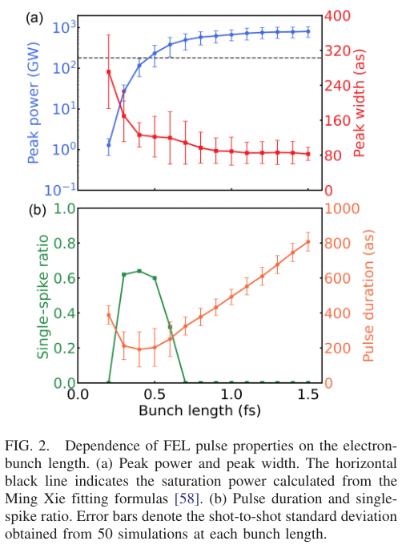
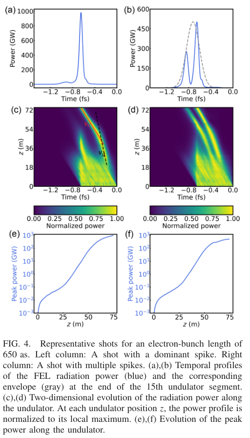

# 阿秒 XFEL：超辐射增益与单峰概率的束流设计权衡

> Chenzhi Xu、Jiawei Yan、Ye Chen、Winfried Decking、Marc Guetg、Tianyun Long、Bingyang Yan、Haixiao Deng，*High-power attosecond x-ray free-electron lasers: Physics and design strategy*，**Physical Review Accelerators and Beams 29, 103406 (2026)**，2026-10-21，DOI [10.1103/hqjn-r9k9](https://doi.org/10.1103/hqjn-r9k9)。[本地正式 PDF](../pdfs/Xu%20et%20al.%20-%202026%20-%20High%20power%20attosecond%20XFEL.pdf) 19 页，来自 APS 官方 harvest；已读主文及附录 A–D，并对照 MinerU。作者名单以正式 PDF 为准：MinerU 首页漏掉 Tianyun Long，已纠正。

## 摘要与引言

相同短电流尖峰可以追求较高单峰概率，也可以追求后饱和超辐射的高峰值功率，两种目标对应不同束长。本文用三维时域 GENESIS 1.3 version 4 扫描，并提出设施设计建议；论文中的新定量结果是模拟，不能与引言列举的既有阿秒 XFEL 实验混写。

激光调制/ESASE、低电荷强压缩、自啁啾等路线虽不同，均通过限定有效增益窗口形成短脉冲。作者把问题转为辐射在滑移中还能与电子重叠多久，因此比“电流尖峰越短越好”的单参数判断更具体。

## II. 滑移与后饱和超辐射

一维归一化电子相位、能偏差和辐射场满足原文式 (1)–(3)：

$$
\frac{d\theta_j}{d\bar z}=p_j,\qquad
\frac{dp_j}{d\bar z}=-(Ae^{i\theta_j}+\mathrm{c.c.}),\qquad
\left(\frac{\partial}{\partial\bar z}+\frac{\partial}{\partial\bar z_1}\right)A=\langle e^{-i\theta_j}\rangle.
$$

其中 A 为归一化复场，右端是电子聚束因子，归一化尺度为增益长度和合作长度：

$$
l_g=\frac{\lambda_w}{4\pi\rho},\qquad
l_c=\frac{\lambda_s}{4\pi\rho},\qquad
\lambda_s=\frac{\lambda_w(1+K^2/2)}{2\gamma_0^2}.
$$

波荡器周期 λw、光波长 λs、Pierce 参数 ρ 和电子 Lorentz 因子 γ0 决定尺度。每周期辐射比电子前移一个 λs，累积滑移把相互作用变为时变过程。场强增大后，电子在有质动力势中迅速旋转相位；辐射前沿持续取能、尾部回馈电子，能量集中到更窄峰中。这解释峰变高、局部宽度变小，并不保证整个脉冲包络更短。

基准为 14 GeV、20 kA、归一化发射度 0.5 μm、平均 β=32 m、切片能散 10 MeV；硬 X 光 8.7 keV，波荡器周期 40 mm、每段 5 m、共 15 段，有效长度 75 m。计算包含段间隙，但图横轴省略间隙。ρ≈1.07×10⁻³，Ming Xie 估计饱和功率约 180 GW。10 fs 平顶束仅用于展示全过程，不是阿秒优化点；其代表峰由 72 GW/115 as 演化至约 1.3 TW/67 as。

### 束长扫描与统计定义

每档束长 50 个散粒噪声模拟。约 1 fs 束长，平均峰功率 676 GW、90 百分位 0.94 TW，局部主峰宽约 89 as；这些统计量不能拼成同一发的性能。单峰判据为峰高超过全局峰的 1/20、prominence 超过 1/30；单峰脉宽用 FWHM，多峰脉冲则用强度加权二阶矩构造等效高斯包络 FWHM。

**图 2，PDF 第 4 页。** 横轴电子束长（fs）；上图双轴为峰功率（GW，对数）与局部峰宽（as），下图为单峰比例与整体脉宽（as），误差棒是 50 发模拟的发间标准差，而非均值置信区间。约 300–500 as 束长时单峰比例超过 60%；继续加长可提高峰功率并压缩主峰，但次峰使整体包络变长。小于 300 as 时辐射过早滑出束团，200 as 的代表模拟只有约 2 GW、整体宽 349 as。

**图 4，PDF 第 5 页。** 左/右列是两个不同散粒噪声 realization，功率时间曲线以 fs/GW 表示；中排沿有效波荡器距离 z（m）演化的色图，每个 z 独立按局部最大值归一化，不能从颜色直接比较不同 z 的绝对功率；下排才显示峰功率增长。左侧近 1 TW、约 66 as 为代表单发，不是所有发的平均结果。

650 as 束长另作 200 次模拟：全部发平均 449 GW/278 as，峰功率 90 百分位 0.68 TW；出口仅 37/200=18.5% 满足单峰判据，这一子集平均 557 GW/100 as。主峰平均含总脉冲能量的 93%，积分边界为峰高 5% 的最近交点。这是筛选子集结论，不能把其均值当无条件工作性能。时域单峰在更长传播后可能对应多峰光谱，故单峰光谱调机可能错过高功率点。

软 X 光改用 1 keV、70 mm 周期、8 段（40 m），ρ≈2.69×10⁻³；更长合作长度使同样束长容纳的独立峰较少。1 fs 束的单峰比例约 76%，约 1.3 fs 时平均峰功率超过 1 TW。软硬光结果不能跨参数直接比较效率。

## III. 能散、发射度、啁啾与倾斜

切片能散扫描 1–15 MeV，双平面相等归一化发射度扫描 0.1–1.0 μm，通常每档 50 发。较小能散/发射度提高增益，却也缩短合作长度，使更多次峰成长；增大两者可能改善单峰概率但牺牲功率。例如 650 as、0.8 μm 情况约 116 GW、单峰率 68%；14 MeV 情况单峰率 56%。0.1 μm 时超过 2 TW 的模拟被作者明确称为当前不现实的极低发射度，不能当设施承诺。

正能量啁啾定义为束头能量较高，强度 0–300 MeV/μm。适量正啁啾可部分补偿辐射取能；650 as 无 taper 的功率约从零啁啾 476 GW 升至 60 MeV/μm 附近 546 GW，1 fs 在 110 MeV/μm 附近约 933 GW。过大啁啾导致失谐。零啁啾约 476 与前述 449 GW 来自不同模拟统计报告，保留原有口径，不当作一组精确相同数据。

由谐振波长式对传播距离微分，并沿滑移光场所见的电子能量补偿谐振，作者给出式 (4)：

$$
\frac{dK}{dz}=-\frac{(1+K_0^2/2)^2}{K_0\gamma_0^3}\frac{d\gamma}{c\,dt}.
$$

K 无量纲、z 长度，右侧能量梯度按 γ/(ct) 定义，量纲为逆长度。符号须随本文束头时间坐标理解。模拟只逐段调整 K，不作连续段内 taper；该啁啾补偿不同于专门的后饱和功率 taper 优化，后者未做。补偿后 300 MeV/μm 时仍约 470 GW（650 as）或 700 GW（1 fs）。

高斯强度脉冲的 Fourier 极限来自 ΔνΔt=2ln2/π≈0.441，结合 h≈4.136 eV·fs 得

$$
\tau_f\simeq\frac{1.82}{\Delta E[\mathrm{eV}]}\ \mathrm{fs}.
$$

这只是变换极限参考值。筛出的时域单峰在模拟中 τ/τf≈1.3–2，不应把光谱宽度反算值写成直接时域测量。横向倾斜单位是横向位移/纵向位置（μm/μm），并非以 μrad 表示的角散；增大倾斜缩短有效重叠窗，降低功率。

## IV–V. 设计策略、附录与限制

作者区分三类目标：较短束求干净单峰；650 as 附近在低单峰概率下选取高功率短脉冲；更长束求无条件高峰值。多级放大有望延长主峰增益且抑制竞争结构，但不能从单级扫描推出已实现的三目标兼得。

附录 A 的 650 as FWHM 高斯束、50 发平均 326 GW/330 as，单峰率 16%，说明平顶数值不能无条件迁移。附录 B 中 500 as 硬光第 11 段单峰率 76%，第 15 段为 60%；加长波荡器也有概率代价。附录 C 的三维修正合作时间基准约 57.5 as，整理了能散/发射度趋势。附录 D 的 cw 超导、多能量 DBA 延迟压缩、三条 FEL 线及下游纳聚焦均为概念设计，尚无整机成本/容差/验收闭环。

原始模拟数据未公开，需向作者合理申请；当前数值以理想平顶/高斯束为主，真实注入器、压缩、CSR、能量/指向抖动、传输光学及样品面峰值仍需端到端验证。扫描有限，未给全局最优，更未给强场 QED、转换靶 γ、中子/同位素产额、剂量或防护验收。本轮未运行 GENESIS、束流压缩或设施设计计算。

来源：[APS 正式页面](https://journals.aps.org/prab/abstract/10.1103/hqjn-r9k9)、[官方 VOR 下载](https://harvest.aps.org/v2/journals/articles/10.1103/hqjn-r9k9/fulltext)，PDF 1–16 页及参考文献；[核验](../pdf_validation.json)、[MinerU](../research/mineru-attempts.json)、[图来源](../research/figure-manifest.json)。
