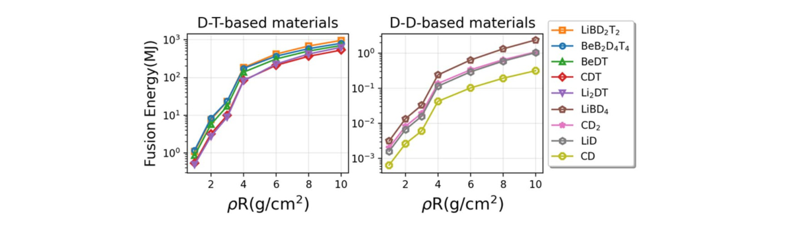
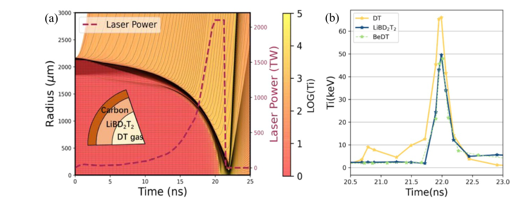

# 室温直接驱动聚变靶：多燃料输运与遗传算法优化

> Qianlei Du、Fuyuan Wu、Rafael Ramis、Jie Zhang，*Optimization of room-temperature targets for laser direct-drive fusion*，**Nuclear Fusion 67 (2027), 016007**，在线发表于 **2026-10-22**，DOI [10.1088/1741-4326/aeb1db](https://doi.org/10.1088/1741-4326/aeb1db)。[本地正式 PDF](../pdfs/Du%20et%20al.%20-%202026%20-%20Room%20temperature%20direct%20drive%20fusion%20targets.pdf) 共 11 页，含 IOP 封面；下文同时给 PDF 页码与印刷页码。本轮恢复 10-09 留下的全文重试。MinerU 报文件读取失败，已用独立文件、逐页文本、布局抽取与页面渲染回退，未把失败解析写为成功。

## 摘要与 1. 引言：工程动机和证据类型

本文研究能否用常温固态氢化物替代直接驱动中的低温 DT 燃料层，以减轻制靶、储存、注入和飞行时的低温维护要求。高增益结论来自**一维球对称 MULTI-IFE 辐射流体计算与遗传算法搜索**，没有新点火实验、靶丸投送实验或发电装置验收。引言中的 NIF 点火、DCI 等实验是背景，不能移作本文方案的实测证据。

常温材料含 Li、Be、B、C，降低 DT 比例并增大辐射损失，同时改变碰撞、热流和 α 粒子阻止。这是物理与工程间的权衡。优化后的靶仍有**高压 DT 气体内芯**，不能把“室温靶”理解为无氚、无气体或没有燃料处理要求。

## 2. MULTI-FUEL 模块

### 2.1 材料选择

作者比较 LiD/LiT、BeDT、硼氢化物同位素替代品和碳氢聚合物。CD₂ 便于试验制备，但无氚材料的热核产额低；LiBD₂T₂ 和 BeDT 被选为进一步优化候选。LiBH₄ 工业原料成熟不等于含氚靶丸的量产、密封、长期稳定和注入已解决。论文也承认吸湿、氧化、毒性与合成损耗等材料边界。

### 2.2 α 沉积、燃烧和中子近似

α 粒子速度损失分成静止离子近似项和 Maxwell 电子项，原文式 (9)：

$$
\frac{dv}{dt}=-\frac{v_0^3}{2\tau_{\alpha i}v^2}-\frac{v}{2\tau_{\alpha e}}.
$$

速度 v、初速 v₀ 和时间 τ 分别控制离子与电子阻止。随着 α 减速，离子项按逆速度平方增强，电子项随速度减小。原文用同一阻止轨迹确定吸收时间与扩散系数，使扩散沉积的空间方差与直线传播简化模型一致：

$$
\frac{\partial e_\alpha}{\partial t}=\nabla\cdot(D\nabla e_\alpha)-\frac{e_\alpha}{\tau_{\rm abs}}+S,
\qquad
\tau_{\rm abs}=\tau_{\alpha e}\phi(x),\quad
D=\frac{\tau_{\alpha e}^{2}v_0^2}{9\tau_{\rm abs}}\Theta(x),\quad x=\tau_{\alpha e}/\tau_{\alpha i}.
$$

eα 为 α 能量密度，S 为体积注入功率，D 的量纲为长度平方/时间；电子/离子能量份额为 φ 与 1−φ。对文中 LiBD₂T₂ 示例，初始速度处的离子阻止份额约 50%，沿完整减速过程积分后离子得到约 76%、电子约 24%；两种比例的计量边界不同。拟合 φ、Θ 的误差称小于 6%，不是整个流体模拟的不确定度。

核网络含 D+T、两支 D+D、D+³He 和 ⁶Li+n 产氚，并用四阶 Runge–Kutta 与拉格朗日流体运动分步更新。相同反应物需有 1/2 因子。论文说次级反应能量被监测但未耦合流体；新增 T 又可通过主 DT 通道继续燃烧，应区分组成反馈与直接次级放热。

中子采用**仅第一次碰撞**近似，忽略飞行时间和确定中子密度时的衰减，弹性碰撞截面取约 0.9 barn。它不是能量依赖的完整中子输运、屏蔽或活化求解。用早期 NIF 设计的规定 X 射线驱动算得 15.9 MJ，对照文献约 15 MJ，是实现层面的设计算例核验，不能等同于对当前常温靶的实验验证。

## 3. 预压缩燃料与未优化激光驱动

预组装均匀球的扫描把初始温度设为 5–30 keV：200 μm/200 g·cm⁻³ 或 100 μm/300 g·cm⁻³。这些是**已经压缩加热的初态**，不包含制备该状态所需的激光能量，图中的融合能量不是驱动增益。含氚燃料产额比无氚材料高约 2–3 个数量级；超过约 10 keV 后收益趋缓。

**图 2，PDF 第 7 页/印刷第 6 页。** 横轴为面密度 ρR（g·cm⁻²），纵轴融合能量（MJ，对数）；两图分别为含 DT 与仅含 D 的材料，纵轴范围不同。10 keV 下，约 3–4 g·cm⁻² 区间产额显著增加，之后斜率减小。约 4 g·cm⁻² 是作者在该预压缩扫描中的设计建议，不能直接当后续激光内爆的唯一最优值，也不能把左右图的等高曲线当等产额。

未优化激光基准取气区半径 1760 μm、固体层 174 μm、消融层 37 μm 和 1.7 MJ 激光。Table 2 中 LiBD₂T₂ 产额 166.75 kJ、中子数 5.93×10¹⁶，增益约 0.098；BeDT 为 163.31 kJ。中子数与 DT 每反应约 17.6 MeV 的能量换算一致，是模拟网络结果，不能作独立中子探测或出靶输运数据。最高材料产额也只有 229.14 kJ，尚未达到激光增益一。

## 4. 遗传算法与优化结果

### 4.1 搜索流程

靶与波形参数编码、交叉、变异后逐个调用 MULTI-FUEL，以密度、温度、面密度、增益和融合能量构造适应度。单独常温材料在作者搜索中不能获得大于一的增益，故改用 DT 气体辅助点火。论文未完整给出可重放的参数范围、适应度权重、种群/随机种子与全部输入文件；Fig. 5 阶跃也包含人工调整范围和目标函数，不能解释成单一固定目标函数下的全局收敛证明。

### 4.2 低于 2.6 MJ 的设计

选中设计为 DT 气体半径 2150 μm/0.25 mg、LiBD₂T₂ 层 93 μm/4.49 mg、碳层 17 μm/1.20 mg，总质量约 5.94 mg；300 K 内压约 29.5 atm。作者称碳壳可支持该压力，但未在本文给出机械制造/循环试验。

$$
G_{\rm target}=\frac{E_{\rm fusion}}{E_{\rm laser}}
=\frac{23.93\ {\rm MJ}}{2.35\ {\rm MJ}}\simeq10.18.
$$

分母是入射激光能量，不是墙插电能。该算例平均温度约 16.57 keV、平均面密度约 1.36 g·cm⁻²；Li 产氚反馈使融合能量增加约 5.2%，并不等于全燃料循环的氚增殖比。相同初始条件换 BeDT 得 19.09 MJ、增益约 8.1。Fig. 5 代际最优曲线末端接近 12，而选中设计明列 10.18；图的优化轨迹不应与该具体设计数值混为同一个工作点。

### 4.3 约 10 MJ 的厚壳设计

**图 6，PDF 第 9 页/印刷第 8 页。** (a) 横轴时间（ns），左轴半径（μm），右轴虚线激光功率（TW）；背景标为 LOG(Ti)，论文未在色标写明温度的单位约定，不能由色值直接补出绝对温度。细线为一维流体轨迹。(b) 横轴时间（ns），纵轴最大离子温度 Ti（keV）：DT 气体先局部点火，LiBD₂T₂ 壳随后升温；BeDT 是替换材料的独立算例。原图注把 (a) 描述为平均温度对面密度演化，与实际坐标不符，本笔记按图中坐标读图。

高能设计气区半径 1846 μm/0.158 mg、LiBD₂T₂ 层 281 μm/11.1 mg、碳层 40 μm/2.59 mg。9.4 MJ 激光得到 109.7 MJ 融合能量，作者报增益 11.6；平均温度约 35.2 keV、平均面密度约 2.8 g·cm⁻²，壳层峰温约 50 keV，与气体峰温不同。初始 IFAR=7.2，内爆中保持小于 17，只是抑制 RT 风险的设计指标，**一维计算未解析横向 RT 增长、混合和非均匀照射**。

同几何、相同 DT 原子密度且沿用 LiBD₂T₂ 最优脉冲时，纯 DT 增益约 9.7；但重新优化 DT 脉冲，7.5 MJ 可算得 460 MJ、增益约 61。前一种比较不能证明常温复合燃料普遍优于低温 DT。

## 5. 意义、限制与后续

价值在于把低 Z 复合燃料、α 阻止、简化中子加热和波形/靶设计放进同一计算链条。当前约 10–12 的靶增益仍未闭合商用电站需求。常温材料的制备、氚库存、化学稳定性、气压封装、注入、碎屑、重复频率、多维流体不稳定性及完整中子输运均需另行核验。没有激光电子束转换靶、光核中子或同位素应用实测。

本轮未运行 MULTI-IFE、遗传算法、核反应网络或输运；只核查论文全文、数值口径与图文关系。来源：[正式 PDF](https://iopscience.iop.org/article/10.1088/1741-4326/aeb1db/pdf)、[PDF 核验](../pdf_validation.json)、[解析记录](../research/mineru-attempts.json)、[原图裁框与哈希](../research/figure-manifest.json)。
