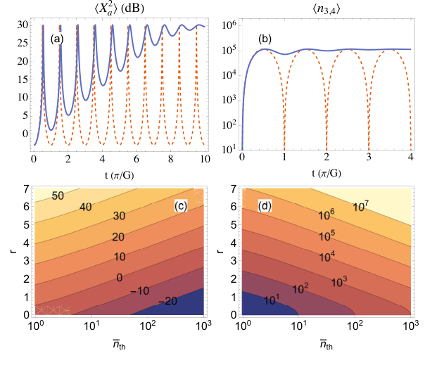

# 等离子体波介导量子压缩：Raman 双通道与热噪声边界

> Kenan Qu、Nathaniel J. Fisch，正式题名 *Ultrastrong quantum squeezing mediated by plasma waves*，**Physical Review E**，2026-10-22，DOI [10.1103/c4r9-jsw7](https://doi.org/10.1103/c4r9-jsw7)。正式元数据由 Crossref 核实；APS harvest 返回 404，期刊 PDF 为 403 验证页。本轮实际阅读的是 [arXiv:2507.12288v1](https://arxiv.org/abs/2507.12288v1)，2025-07-16 提交，题名为 *Ultra-strong Quantum Squeezing Mediated by Plasma Waves*，作者相同。[本地作者稿](../pdfs/Qu%20et%20al.%20-%202026%20-%20Plasma%20wave%20quantum%20squeezing.pdf) 7 页，MinerU 成功。**没有把 2025 作者稿当作已读到的 2026 VOR，最终版差异未核查。**

## 引言：两步 Raman 耦合的目的

固体/光纤非线性介质受损伤与电离限制，作者提出在已电离等离子体中，以 Langmuir 模作量子中介，将 Stokes 的光子—声子成对产生与 anti-Stokes 的状态交换连接起来，生成双模相关光。本文证据是**量子光学解析模型、阻尼 Langevin 演化和实施参数估计**，没有本文新开展的压缩光实验，更不是强外场 Breit–Wheeler/QED 对产生观测。

过去的 SRS、HHG 和光学压缩实验仅作背景。Langmuir “phonon”是量子化集体等离子体模，不是固体晶格振动。目标是联合正交量低于真空噪声，输出光强相等或经典强度相关本身不能证明量子压缩。

## Model and two-mode squeezing：匹配与变换

原文式 (1) 对简并输出给出：

$$
\omega_1-\omega_{3,4}=\omega_{3,4}-\omega_2=\omega_p,
\qquad \omega_1-\omega_2=2\omega_p,
\qquad \omega_i^2=c^2k_i^2+\omega_p^2.
$$

泵浦频差应为两倍等离子体频率；PDF 第 2 页开始却写“equal to the plasma frequency”，与式 (1)、摘要和实施段不符，本笔记保留此作者稿疑点，按匹配方程解释。另须满足两组动量匹配，输出以小角度交叉，泵浦近共线；集体条件为 kλD<1。

泵浦以经典振幅 α₁、α₂ 处理，输出模 a₃、a₄ 与等离子体模 p、q 量子化。Bogoliubov 变换定义：

$$
b_3=a_3\cosh r+a_4^\dagger\sinh r,\quad
b_4=a_4\cosh r+a_3^\dagger\sinh r,\quad
\tanh r=|\alpha_1/\alpha_2|,
\quad G=g\sqrt{\alpha_2^2-\alpha_1^2}.
$$

相位取定后以实振幅理解上式，稳定交换要求较强 anti-Stokes 通道。变换把相互作用化成两个独立的光学混合模—等离子体模交换，首个完全交换时刻约 π/(2G)。r 增大可以提高理想压缩，却使两泵更接近、G 变小，需要更长作用区；“允许任意热占据”并非没有长度或调幅代价。

采用第 3 页的联合真空方差为一的口径，完整交换后：

$$
V_a=(2\bar n_{\rm th}+1)e^{-2r},\qquad
S_{\rm dB}=-10\log_{10}V_a,
\qquad V_a<1\ \Longleftrightarrow\ 2\bar n_{\rm th}+1<e^{2r}.
$$

热占据 n̄th 无量纲、r 无量纲、G 为逆时间。式子说明先相干转移噪声，再在合适联合正交量中压缩；不能由单通道光子数大推断联合噪声低。

**图 2，PDF 第 3 页。** (a) 横轴时间，以 π/G 为单位；纵轴压缩幅度 dB，正值表示相对真空噪声的降低，不是线性方差。(b) 平均每模光子数，对数纵轴，时间范围不同。(a,b) 固定 n̄th=10，虚线 κ/G=0，实线 0.3；阻尼抑制理想无阻尼交换的周期振荡。(c,d) 横轴热占据（对数）、纵轴 r，分别给压缩 dB 与每模光子数等值线。所有曲线/色图是模型结果，无实验误差棒、探测损耗或统计检验。

## Plasma wave damping：热库模型与公式疑点

有限温度同时带来热占据和 Langmuir 阻尼；模型以常数 κ 与 δ 相关热库噪声表示，利用线性 Langevin 方程求解。欠阻尼参数为：

$$
\Delta=\sqrt{G^2-(\kappa/2)^2},\qquad
M=e^{-\kappa t}(G/\Delta)^2\cos^2(\Delta t-\varphi),\quad
\tan\varphi=\kappa/(2\Delta).
$$

热库使混合模趋于稳态，作者在固定模型里发现阻尼有利于稳定压缩；不能推广成任意碰撞、密度漂移、泵相位噪声或寄生 SRS 都有益。原文解中的时间积分/噪声记号也应在重现时逐项复核。

有三处关键内部不一致：

1. 前文联合真空方差定为 1，第 3 页完全交换得到 (2n̄th+1)e⁻²ʳ；式 (9) 却在 M→0 给 (n̄th+1/2)e⁻²ʳ，相差因子二，即约 3 dB。单模/双模正交量转换也需统一规范；本文不自行宣布最终正确式，更不声称 VOR 仍有该问题。
2. 第 3 页称 n̄th=100、r=7 时每模约 10¹⁸ 光子；但按其式 (10)、M→0，局部代入得到：

$$
\langle n\rangle=\bar n_{\rm th}+(2\bar n_{\rm th}+1)\sinh^2r
\simeq6.04\times10^7.
$$

这也与图 (d) 的数量级更接近。因此 **10¹⁸ 不作为可信产额**。上述只是公式一致性算术检查，不是复跑作者量子模型。
3. 第 4 页滑移时间写为 vg₃τ/(vg₁−vg₂) 后，近似式却与前文速度差的平方尺度同向相乘；由其 Δvg≈3(ωp/ω₃)²c 推得时间应反比于该小量。实施段的滑移距离仍需最终版与完整时空包络计算复核。

## Single-mode squeezing 与 Experimental implementation

平衡分束器加相移把双模输出变成单模压缩/反压缩正交量，作者建议 homodyne 验证。这里“Experimental implementation”是设计讨论，没有本文实验数据。

光学示例给 α≈0.1、强度约 10¹⁶ W·cm⁻²、波长 0.8/0.89 μm、密度 3.9×10¹⁸ cm⁻³、100 fs，选取 1 cm 作用长度；G≈2.13×10⁻⁵ω₁、泵相对差 δ≈6×10⁻⁴、r≈4。T=1 eV、n̄th≈10 时约 20 dB 是模型估计，输出角约 0.16°、1 cm 横向分离约 28 μm，不是实测发散或集光效率。

更强示例需 2.5 cm 通道、约 1/100 临界密度、δ≈1.2×10⁻⁵、r≈6，作者估约 40 dB、每模近 10⁶ 光子。泵幅匹配更严格；用上面统一真空口径代入，r=4/6、n̄th=10 对应约 21.5/38.9 dB，仅说明数量级。模式占据依赖归一化体积与带宽，不能未经时空模式计数就当成可用总脉冲光子数、能量或 γ 源产额。

## 末段展望与后续

作者把短波 SRS 耦合率尺度外推到约 1 nm、10²¹ cm⁻³，提出更易压缩的可能性；已有 X 射线散射证据不等于已产生 40 dB X 射线压缩光。未闭合项目包括泵耗尽、绝对/相对相位噪声、幅度容差、有限包络和失谐、密度温度非均匀、模式收集、传播/探测损耗与 homodyne 真空基准。

与本库相对论四波混频或强场 QED 辐射反作用工作相比，本篇的区分点是 Raman/Langmuir 模交换和联合噪声；未证明光核/中子/同位素转换效率，也没有量子增强诊断验收。本轮未运行量子演化、PIC、激光传播或实验，优先后续对照正式 VOR 处理上述作者稿疑点。

来源：[正式 DOI](https://doi.org/10.1103/c4r9-jsw7)、[实际阅读的官方作者稿](https://arxiv.org/pdf/2507.12288v1)、[PDF 核验](../pdf_validation.json)、[MinerU](../research/mineru-attempts.json)、[原图来源](../research/figure-manifest.json)。
