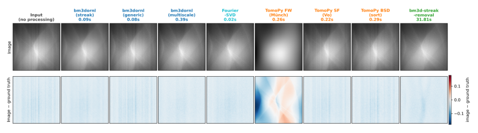
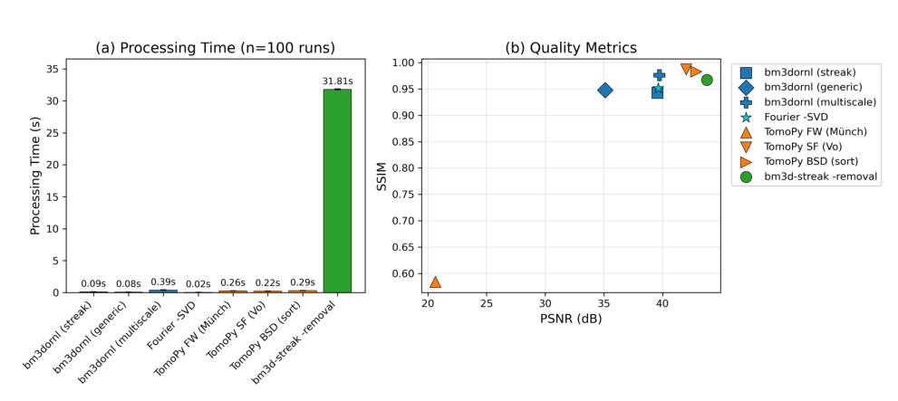

# BM3DORNL：中子断层条纹去除的速度与定量保真权衡

> Chen Zhang、Jean-Christophe Bilheux、Dmitry Ganyushin、Pete Peterson，*BM3DORNL: High-Performance BM3D Denoising for Neutron Tomography*，**Journal of Open Source Software 11(126), 11132 (2026)**，2026-10-22。DOI [10.21105/joss.11132](https://doi.org/10.21105/joss.11132)。[本地正式 PDF](../pdfs/Zhang%20et%20al.%20-%202026%20-%20BM3DORNL%20neutron%20tomography.pdf) 6 页；MinerU 成功，正文与图已对照原 PDF。[软件仓库](https://github.com/ornlneutronimaging/bm3dornl)、[归档版本](https://doi.org/10.5281/zenodo.22285606) 链接来自 PDF。

## Summary 与 Statement of Need

探测器像素响应差异、束流变化和系统误差会在 sinogram 中形成固定竖条纹，重建后变成环伪影。本文在重建前处理 sinogram，以避免伪影经反投影扩散。它是**软件与合成数据 benchmark 论文**，不是新中子源、中子产额、束流防护或材料定量实验。

generic 模式用于常规噪声；默认 streak 模式专门处理条纹。作者以 Python 接口配合 Rust 后端，解决参考实现的许可、平台和性能限制。这里 BM3D 的“3D”指相似二维图块组成的三维协同滤波组，不能当作三维体数据物理重建或三维神经网络。论文 AI 使用声明指代码/文档辅助，本算法不因使用 AI 工具而成为机器学习模型。

## State of the Field：基准与度量

比较输入是 **720×725 像素合成 sinogram**，人工加入环伪影，并保留干净真值。八种方法包括 streak/generic/multiscale BM3DORNL、Fourier-SVD、三种 TomoPy 方法和原 bm3d-streak-removal。质量比较与图均在 Linux x86_64 上完成；Apple Silicon 计时是另一个主机实验。

作者使用缩放到 [0,1] 后的 PSNR 与 SSIM。PSNR 的通用定义可写为：

$$
{\rm MSE}=\frac{1}{N}\sum_{i=1}^{N}(x_i-y_i)^2,
\qquad {\rm PSNR}=10\log_{10}\frac{L^2}{{\rm MSE}}.
$$

这里 x 为处理结果、y 为真值；两者采用单位动态范围时 L=1，PSNR 单位 dB。此式是解释指标的通用补充，不是论文新增物理模型。PSNR 衡量像素平方误差，不自动等同于衰减系数、同位素浓度或缺陷尺寸准确度。SSIM 使用局部 7×7 窗口，可能偏好平滑而忽略窄条纹残留。



**图 2，PDF 第 3 页。** 上排为输入与各方法结果，下排为结果减真值；红为正、蓝为负，所有列使用同一以零为中心的色标。图是局部裁块，未给物理像素尺寸或材料长度单位。每列共有的淡蓝背景来自输入缩放导致约 3% 的整体低估，**不是去条纹成功的标志**。generic 基本保留条纹；streak、multiscale、Fourier-SVD 和参考 BM3D 减少竖纹；TomoPy wavelet-Fourier 的大块红蓝代表低频内容失真。图像看起来更平滑不能代替定量保真。



**图 3，PDF 第 4 页。** (a) 纵轴单张 sinogram 处理时间（秒，线性），Linux x86_64、100 次运行；(b) 横轴 PSNR（dB）、纵轴 SSIM，不是二者都由同一种误差定义。没有展示材料反演不确定度；100 次计时不等于 100 个独立材料或噪声场景。

| 方法/口径 | 论文报告结果 | 解释 |
|---|---|---|
| 原 bm3d-streak-removal | 约 31.8 s；PSNR 43.8 dB；SSIM 0.967 | PSNR 最高，但耗时大 |
| 默认 streak | 0.094 s，约 340 倍参考速度 | Linux 同机 benchmark，不是所有输入的保证 |
| multiscale | 0.389 s，约 82 倍；SSIM 0.976 | 高于参考 SSIM，仍不是各指标全胜 |
| Fourier-SVD | 0.017 s，约 1900 倍；SSIM 0.951 | 是不同算法分支，不能把其速度与 multiscale 质量拼在一起 |
| TomoPy sorting-fitting | SSIM 0.987 | 局部平滑受 SSIM 奖励，条纹残留仍需看差图 |

Apple M2 Max/12 核上 streak 约 0.20 s、Fourier-SVD 0.022 s；TomoPy 约 3.5–3.6 s。Linux 主机为 24 核，两机的绝对时差混有硬件与并行因素。作者强调只比较**同一机器内的算法比值**，不能据此宣称 ARM 与 x86 的普遍架构优劣。

## Software Design：实现与使用

Rust 通过 rayon 并行，PyO3 接入 NumPy。积分图预筛用均值/范数界排除候选，作者称省掉约 80% 距离计算；FFT/SIMD、8×8 专门路径、共享 FFT plan、变换缓存、tile 归并与线程复用缓冲减少重复计算和分配。这些是实现优化，未在短文中给出逐项独立消融，不应把每项都说成已单独测得的加速来源。

论文给出的最小 API 如下，本轮未安装或执行：

```python
from bm3dornl import bm3d_ring_artifact_removal
cleaned = bm3d_ring_artifact_removal(sinogram, sigma_random=0.0)
```

0.0 启用自动噪声估计，默认参数值为 0.1；默认模式是 streak。GUI 支持差图、HDF5/TIFF 与交互参数调节。正文称支持 Python 3.12+、Apple Silicon 原生版本、软件 MIT 许可；文章本身为 CC BY 4.0。实际安装兼容性仍应按所用 release 验证。

## Research Impact、披露与适用边界

作者称正接入 ORNL VENUS/MARS 流程；1000 张从约 9 小时缩至 17/94 秒或 6.5 分钟，是由该单张 benchmark 得出的批量口径，未给出包含磁盘读取、体重建、网络传输的端到端实测。不能由此认定束线全流程已完成部署验收。

对中子材料成像的直接价值是快速筛选去环策略；真正应用需另验低计数 Poisson 噪声、散射本底、漂移、空间分辨率、边缘/细丝结构、绝对衰减与重建后材料量化。本文未证明降低辐照剂量、改善中子产生效率或恢复被滤掉的真实结构。本轮未复跑 benchmark 或处理实验 sinogram。

来源：[正式 PDF](https://joss.theoj.org/papers/10.21105/joss.11132.pdf)、[PDF 核验](../pdf_validation.json)、[MinerU 记录](../research/mineru-attempts.json)、[原图裁框与哈希](../research/figure-manifest.json)。
