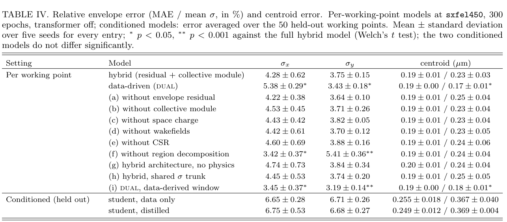
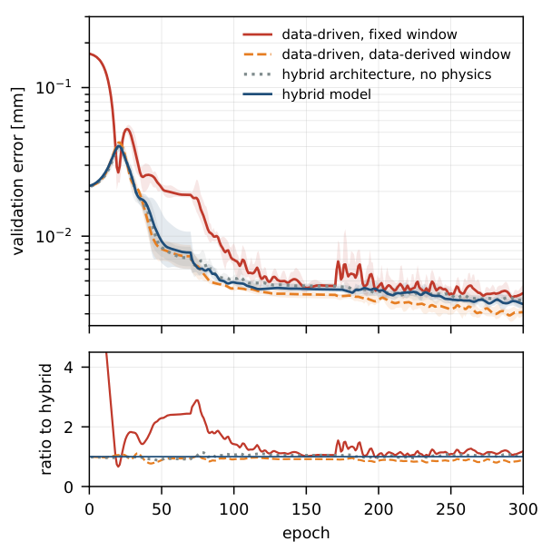
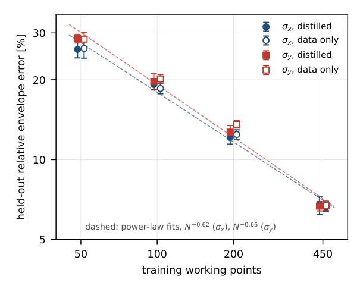

# 束流图网络：结构守恒、归一化与物理约束的消融

> Bowen Zhang、Dazhang Huang、Nengyuan Zhang、Duan Gu、Chao Feng，*Physics-constrained graph closures and working-point conditioning for a fast surrogate of linac beam dynamics*，**arXiv:2610.28250v1**，提交于 2026-10-20，PDF 内署 10-21。[官方条目](https://arxiv.org/abs/2610.28250v1)、[本地作者预印本](../pdfs/Zhang%20et%20al.%20-%202026%20-%20Physics%20constrained%20graph%20linac%20surrogate.pdf) 18 页。精确题名 Crossref 前三条未发现同篇正式版；这不是不存在正式版的穷尽证明。全文与附录 A–D 已读，MinerU 成功并对照 PDF。

## I. 引言：什么是本工作的主要贡献

作者将空间电荷、短程尾场和 CSR 写成解析核上的有界神经网络闭合，强调图的坐标系、边方向、聚合和输入对称性本身决定能否违背物理规律。主要证据是结构恒等式检查与**模拟数据训练/消融**。论文没有真实 SXFEL 束流测量校准或在线调机实验。

另一关键结果是反例性质的：在所测弱集体效应区间，训练改善主要来自数据导出的输出范围，而非物理损失或集体闭合。不能仅从“physics-constrained”标题推出泛化精度必然提高。

## II. 物理对象、参考数据和留出方式

测试是 SXFEL-UF 18.4 m L0+L1，常规工作点约 130→252 MeV，57 个 watch point。15 个输入为 11 个四极磁铁强度、2 个 RF 相位、2 个 RF 电压；激光加热器参数固定。500 个工作点在磁铁 ±20%、相位 ±10°、电压 ±10% 范围均匀取样，50 个完整工作点留出，450 个用于训练。留出表示采样范围内新设置，不是全新束线或任意域外工况。

Pelegant 参考含纵向空间电荷、短程尾场和 CSR，**不含横向空间电荷**。作者估计该段横向效应较弱，计划后续用 ASTRA/IMPACT-T 或测量校准。模型中横向分支的“无损加入”不能当作它已正确识别真实横向集体物理。57 点分布不均：约三分之一集中在 1.7 m 束腰附近，7.7 m 加速结构只在三个间隙有观测。

## III. 架构、物理闭合与可辨识性

### A. 输出和教师模型

包络、质心由分离残差 MLP 与 transformer 路径组合，4 个软区域描述沿程聚焦变化。网络输出束斑、角散和相关系数，再组装几何发射度：

$$
\epsilon=\sigma\sigma'\sqrt{1-\rho^2},\qquad
\epsilon_n=\beta\gamma\epsilon.
$$

σ 为位置 rms，σ′ 为角度 rms，ρ 为位置—角度相关；公式由二维协方差矩阵行列式直接得到。发射度吻合不保证每个因子独立正确。单工作点教师用 rms 包络残差、边界和平滑约束训练，归一化发射度、加速与空间电荷进入包络方程；数据与物理损失的相对权重会决定约束实际影响。

### B. 有界解析核和图拓扑

原文式 (4) 的消息为：

$$
m_{ij}=k_{\rm analytic}(r_{ij})[1+\lambda\tanh f_\theta(\cdot)],\qquad \lambda\leq0.3.
$$

最后一层零初始化，使未训练模型回到解析核；tanh 把修正限制在 ±30%。空间电荷形状因子另限于 [0.85,1.15]，避免它吸收磁铁、能量和发射度误差。**约束只限集体项幅度，不限制最终束斑预测误差。**

空间电荷在束流静止系建图，默认以纵向切片作节点、完全无向连接；短程尾场由束头指向束尾，CSR 因后部辐射追赶前部而具有相反因果方向。空间电荷核乘交换对称修正后保持反对称：

$$
k_{ji}=-k_{ij},\quad f_{ji}=f_{ij}
\ \Longrightarrow\ m_{ji}=-m_{ij}
\ \Longrightarrow\ \sum_i\sum_jm_{ij}=0.
$$

这是在所构造图/离散近似下的代数恒等式，不依赖训练。切片内部还需要关于横向偏移的偶修正；有限随机粒子样本并不自动镜面对称。尾场/CSR 可把动量交给结构和辐射，不应强迫其净力也为零。

### C–D. 第二观测量与蒸馏

投影协方差分成切片内部矩阵与切片质心展宽，作者定义：

$$
\epsilon_{\rm proj}^2=\epsilon_{\rm slice}^2+\epsilon_{\rm banana}^2.
$$

后项为剩余量，含切片质心矩阵与内部矩阵的交叉贡献，**不是两个独立发射度简单相加**。此拆分为分辨空间电荷/尾场提供必要的第二观测量，但尚未证明优化器在真实强集体效应中恢复唯一参数；空间电荷全局倍数仍由先验控制。

每个教师训练 800 epochs，然后蒸馏为以机器设置条件化的学生。学生推理时不运行粒子图闭合或包络物理残差，物理只通过教师曲线间接传递。包络与质心尺度分离，质心训练到日程约 27% 后冻结，以避免微米量级轨道被毫米量级包络损失淹没。不能把教师的离散力守恒恒等式无条件推广为学生轨迹的全部物理守恒。

## IV. 不训练的结构检查

8192 宏粒子、专门镜像构造的束团与随机权重，对照仅反转某项设计的模型。Table III 中整束净自力占比约 3.3×10⁻¹⁰，对照有序边输入为 4.1×10⁻²；切片约 6.4×10⁻⁹，对照有符号输入为 4.7×10⁻³。两类差异约八个与六个数量级，是结构测试，不是实验精度。

均值聚合使邻居数为约 21 时力被稀释，未去重边可约倍增 kick；实验室系与静止系近邻仅约 5.5% 重合，kick 相差约 79%。附录 D 另报告绝对尺度标量对压缩响应的未训练检查 0.013±0.015，与零一致，因此那项功能没有得到同等的经验验证。

## V. 精度、消融与数据效率

相对包络误差定义为**沿程 MAE 除以沿程参考 σ 均值**，不是逐点相对误差的均值；束腰小分母会使后者出现更大尖峰。单工作点消融 300 epochs、transformer 关闭，五个 seed 的均值±标准差；教师语料训练 800 epochs 是另一预算。

**Table IV，PDF 第 8 页。** σx/σy 列为百分比，质心为 μm；上半是 sxfel450 单工作点，下半为 50 个留出工作点。完整模型 4.28±0.62%/3.75±0.15%，纯数据固定窗口基线 5.38±0.29%/3.43±0.18%。删去物理残差或集体模块差异不显著；给数据基线相同输出范围后反而为 3.45±0.37%/3.19±0.14%。比较“有物理/无物理”前必须匹配归一化与输出窗口。

**图 5，PDF 第 10 页。** 横轴 epoch，上图 validation error（mm，对数），下图相对完整 hybrid 的比值；曲线为五 seed 均值，阴影为范围，不是置信区间。给数据基线训练数据导出的输出范围后，初始误差由约 0.17 降至 0.022 mm，收敛速度接近 hybrid。跨 16 工作点、稀疏观测在内，输出范围带来 2.2–8.5 倍初始误差差异；物理组件在当前区间未显示可测精度优势。

50 个留出设置上，蒸馏学生 σx/σy 为 6.75±0.53%/6.68±0.27%，不蒸馏为 6.65±0.28%/6.71±0.26%，无显著差异。sxfel019 单例沿程包络误差 4.7%/3.1%，低于总体平均，不能替代全测试集；局部束腰可约 +22%，出口 σx 低估约 8.2%、归一化 εx 低估约 6.7%。

**图 7，PDF 第 11 页。** 横轴训练工作点数 50/100/200/450，纵轴留出包络相对误差（%），对数坐标；实心为蒸馏、空心为仅数据，误差棒是五 seed 标准差。拟合约 N⁻⁰·⁶²/N⁻⁰·⁶⁶，450 点时约 6.7%；将误差减半约需三倍语料只是在该有限扫描上的外推，不是普适样本复杂度定律。

单 RTX 6000 的 57 点 forward 为 0.159 s，包含 checkpoint 加载的在线流程为 0.378 s；正文早先 0.16 s 与摘要 0.38 s 对应不同边界。Pelegant 对照为 16 核 Xeon、20.34 s，跨硬件速度比含硬件因素。500 个教师总训练约 100 h，使用双 RTX 6000；快速推理不等于训练或生成语料免费。

## VI–VII 与附录：适用范围

18 点训练、其余 39 点测试的稀疏观测复查中，未观测位置误差明显增大，但删掉物理项仍无可测变化。16 个工作点的效果随平面与观测密度变化，不能只挑对 hybrid 有利的单例。这个结果限制在弱集体效应段，尚未验证强 CSR 压缩器、强空间电荷和纵向相空间。

一维 CSR、切片近似、Bane 核范围与 X-band 长尾外推均有限；训练 seed 散布不是校准预测区间。作者预印本多处仍写 **“Supplementary Section ??”**，正文未提供能定位的补充章节，故 lattice、若干训练细节和成本回收分析未完全闭合。本轮未运行 Pelegant、网络训练、结构检查或真实调机。与昨日 WARP 的已知算子谱 PDE 学习不同，本篇是直线加速器集体闭合与机器设置条件化，不重复计数。

来源：[官方 PDF](https://arxiv.org/pdf/2610.28250v1)、[版本查询](../research/version-checks.json)、[PDF 核验](../pdf_validation.json)、[MinerU](../research/mineru-attempts.json)、[原图来源](../research/figure-manifest.json)。
