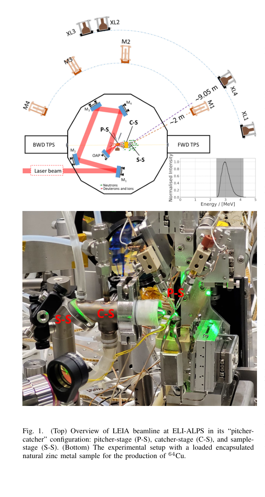
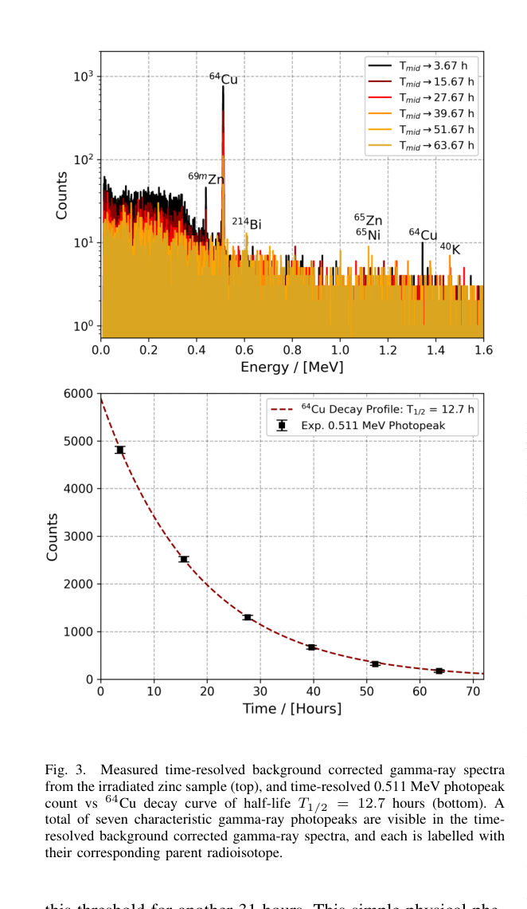

# 激光 D–D 中子照射天然锌制备 ⁶⁴Cu：实测活化与纯度推断

> Jeremy M. C. Brown 等，*Direct Production of Ultra-High Radioisotopic Pure ⁶⁴Cu from Natural Zinc Metal via D-D Fusion Narrowband Fast Neutron Source Irradiation*，[arXiv:2610.31340v1](https://arxiv.org/abs/2610.31340v1)，2026-10-22。[官方全文](https://arxiv.org/pdf/2610.31340v1)、[本地 PDF](../pdfs/Brown%20et%20al.%20-%202026%20-%20Laser%20DD%20neutrons%20Cu64%20from%20natural%20zinc.pdf)，5 页。实际为**作者预印本**；PDF 的 “Manuscript received October 2026”不是正式发表证明。精确标题 Crossref 前三项未核实同篇正式版。

## 研究问题与证据范围

本篇研究天然锌的 ⁶⁴Zn(n,p)⁶⁴Cu 路线，希望用窄带 D–D 中子提高 ⁶⁴Cu 相对于长寿命 ⁶⁷Cu 的比例。它与已收录的中子源、输运设计或 ⁹⁹Mo PIC–MC 预测不同，提供了**激光加速离子—转换靶—样品中子活化—延迟 γ 谱**的实验链。但“超高纯度”仍包含未检出杂质的模型推断，并非每个环节都直接测量到临床验收精度。

这是离子驱动的 D–D 聚变中子，再在锌中发生 (n,p)；不是电子韧致辐射驱动的光核反应。本文没有诊疗试验或药品放行。

## 实验链：pitcher、catcher、sample

**原图 1，PDF 第 2 页。** 上图是 LEIA/ELI-ALPS 装置示意，下图是加载锌样品后的照片；P-S 为重水薄片 pitcher、C-S 为重水 catcher、S-S 为样品。示意中的中子谱插图横轴 MeV、纵轴 normalized intensity，峰值归一化，**不是绝对通量或剂量谱**；照片本身没有产额坐标。

SYLOS 3 激光以 1 kHz、50 mJ 工作，160 mm 焦距 OAP 以 45° 入射重水叶片；叶片位置/角度主动稳定。加速氘离子平均动能约 0.4±0.1 MeV，入射另一重水液层产生 ²H(d,n)³He，中子前向成瓣、平均能量约 3.1±0.5 MeV。这里的 ±0.5 MeV 未明确为 RMS 或 FWHM，笔记不另定宽度口径。

作者报告“2×10⁷ neutrons per second over 4π”。按单位应理解为全空间积分的中子发射率，**不能当作样品处 n·cm⁻²·s⁻¹ 通量**。正文未给出足够信息重建样品处绝对谱通量、各向异性输运与其不确定度，因而不能由该数字直接推导靶上活化效率、屏蔽或剂量。

样品为高纯天然锌粉压实圆柱，直径/高各 5 mm、密度 6.99 g/cm³、化学纯度 99.995%，封装在直径 25 mm、高 10 mm 的 EP33 树脂中，照射 1 h。天然同位素组成与化学纯度不同；这里没有富集 ⁶⁴Zn。照射后放气和转运约 0.67 h，随后用铅屏蔽内的 Canberra GC2020 HPGe 在 72 h 内测六组谱，每组 6 h，间隔 6 h。

## 核素辨识：可见、未见与 MDA

**原图 3，PDF 第 4 页。** 上图横轴 γ 能量 MeV、纵轴背景修正后 counts、对数尺度；六种颜色是不同测量时间，并非六次独立照射。0.511 与 1.3458 MeV 峰归于 ⁶⁴Cu，另有锌/镍核素及背景峰，说明整个照射样品不只含放射性铜。下图横轴时间 h、纵轴 0.511 MeV 峰 ±3σ 能窗计数，黑点/误差棒与 T₁/₂=12.7 h 的红虚线比较；它支持 ⁶⁴Cu 是主要正电子发射来源，不能单凭相符曲线排除所有未检出核素。

表 I 给出的首组 ⁶⁴Cu 活度为 **17.099 Bq**，随后为 8.956、4.589、2.360、1.145、0.601 Bq；这些是报告的测量时段活度，不是 EOB 总产额或 MBq 临床批次。⁶⁶Cu、⁶⁷Cu、⁶⁸Cu 均未检出，对应 MDA 为 0.462、0.065、0.085 Bq。短寿命 ⁶⁶Cu/⁶⁸Cu 可能在转运中衰减，未见不等于未产生；长寿命 ⁶⁷Cu 仅能约束在探测限以下。

原文有可追溯的不一致：表 I 将中点时间写成 3.63,…,63.63 h，图 3 图例写成 3.67,…,63.67 h；0.67 h 转运加 3 h 半测量窗也对应 3.67 h。正文将纯度定位到照射后 0.67 h，却未充分交代时段平均活度及衰变回推步骤。正文称六个可见特征峰，图注称七个。笔记保留这些问题，不据此修改原始数据或宣布作者最终正确数值。

## 99.62% 与 99.97% 的不同来源

作者用 ⁶⁷Cu=MDA=0.065 Bq 构造保守污染情形，报告铜同位素活度纯度 **99.62±1.53%**。再按核反应截面和半衰期估算 ⁶⁷Cu≈0.005 Bq，得到 **99.97±1.54%**。后者超出原始实测检出能力，必须称为**反应/衰变模型修正的纯度估计**；不能将 ⁶⁷Cu 未检出写成 0 Bq。

两项 ± 值都是原文数字，未见清晰的置信水平定义。99.97% 与 99.95% 阈值只差 0.02 个百分点，远小于报告的约 1.54 个百分点不确定度；因此点估计超过阈值**不构成统计上确认纯度优于 99.95%**。纯度物理范围为 0–100%，原文误差形式也需要有界区间和探测限传播的复核。

原表 II 的 fractional total cross-section 给 ⁶⁴Cu、⁶⁷Cu 通道约 0.9984、0.001465，比约 682:1；这是反应数据口径，不能直接当成活度比。对恒定照射的基本关系为：

$$
A_i(t_c)=R_i\bigl(1-e^{-\lambda_i t_{\rm irr}}\bigr)e^{-\lambda_i t_c},
\quad
R_i=N_{\rm target}\int\phi(E)\sigma_i(E)\,dE,
\quad \lambda_i=\ln 2/T_{1/2,i}.
$$

φ 为样品处谱通量，t_c 为冷却时间；子体还需完整 Bateman 方程，探测时段计数需再对时间积分。上式仅解释为什么截面比与活度比不同，并未用本文缺失输入复算产额。图 4 是作者 Bateman **模型**的相对核素产额/衰变轨迹，约 0.8 h 后跨阈值、持续约 31 h 是模型窗口，不是独立的药品储存实测。

## 化学、经济与应用边界

“Copper radioisotopic purity”只比较铜放射性同位素；它不等于全样品放射性核素纯度、化学纯度、放化纯度或制剂质量。作者称 no-carrier-added，但本文未展示铜—锌化学分离、稳定铜杂质定量、摩尔活度、标记率与临床 QC，因此这些不能作为已验收交付。对短寿命污染的冷却收益也须与 ⁶⁴Cu 衰减损失权衡。

“约 2000 倍”来自作者列出的富集 ⁶⁴Ni 原料 $50k/g 与天然锌 $24/g 价格比，**只涉及每克原料的文中报价**。未计靶质量利用率、同位素回收、激光/加速器、捕获几何、活度产率、分离、运行与配送成本，不是每 GBq 成本降低 2000 倍。作者提出未来转向高通量静电/RF 氘加速器和约五年规模化，是展望。

## 对本库的增量与接续

本篇补上与用户方向直接相关的激光离子—中子—同位素实验链，当前规模仍是一次 1 h 照射与低活度谱学验证。优先接续：获取样品处绝对中子能角谱、HPGe 效率/MDA/几何和自吸收修正、EOB 活度与完整误差预算；核实铜化学分离及高灵敏度 ⁶⁷Cu 约束；检验长时稳定性、重复样品、剂量/屏蔽和活度扩展。本文未闭合临床生产、诊疗或防护验收，本轮没有复跑核反应、输运、Bateman 拟合或实验。

来源与核验：[PDF 核验](../pdf_validation.json)、[版本检查](../research/version-checks.json)、[MinerU](../research/mineru-attempts.json)、[原图来源](../research/figure-manifest.json)。
