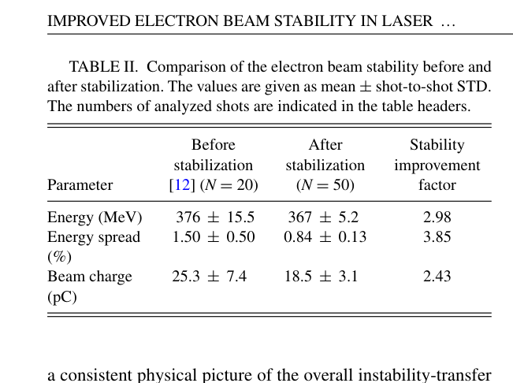
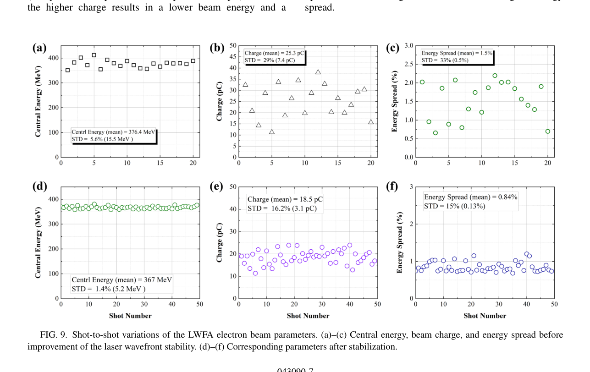

# LWFA 稳定性：角啁啾传递链与波前热扰动

> Zhan Jin 等，*Improved electron beam stability in laser wakefield acceleration through control of laser angular chirp and wavefront stability*，**Physical Review Research 8, 043090**，2026-10-23。DOI：[10.1103/rsvg-r3bg](https://doi.org/10.1103/rsvg-r3bg)。实际阅读全文为 [APS 官方 VOR](https://harvest.aps.org/v2/journals/articles/10.1103/rsvg-r3bg/fulltext)，[本地 PDF](../pdfs/Jin%20et%20al.%20-%202026%20-%20LWFA%20angular%20chirp%20and%20wavefront%20stability.pdf) 15 页；MinerU pipeline 与本地布局文本交叉核对。

## 问题、证据与实验条件

紧凑辐射源和后级束流应用不仅需要高能量，还需要逐炮的能量、电荷和指向可重复。本篇把压缩器角啁啾、入射激光指向、GDD、聚焦后的脉冲前沿倾斜（PFT）和电子指向串联，并测试空气输运、真空输运和相机热源对波前的影响。证据包含**直接 LWFA/波前测量、光线追迹、PIC 机制支持和统计回归**，各部分不能互相替代。

LAPLACIAN 的 Ti:sapphire 束线使用 0.8 J、最短 21 fs 脉冲，焦斑约 22 μm FWHM、能量集中度约 70%，估算峰强度 5.0×10¹⁸ W/cm²、a₀=1.5。Mach 3 超音速气流与刀口形成下降沿，采用 shock 注入，典型加速长度约 3 mm。1 m 处屏测束斑，2.5 m 处 0.55 T、900 mm 磁铁能谱仪测能谱；漏光经像差补偿后作同步近远场和波前诊断。

本文延续作者早期气靶、beam mask 与 FEL 平台工作；新增的是稳定性传递与实际扰动源分析。引用的既有 FEL、GeV 加速或核应用不计为本篇新实验。

## 指向：从角啁啾到 GDD/PFT

光栅不平行会引入波长相关传播角与到达时间差，聚焦放大 PFT，造成非对称横向尾场和离轴注入。PIC 图 3 的 0.3 mrad PFT 是受控模拟输入。实验扫描光栅相对角 ψg，每个指向椭圆取 **20 个连续炮次**；同时用 Dazzler 重新优化 GDD，并轻调 shock 强度使电荷约 20 pC。因此这不是其他参数完全不变的单变量比较。

表 I：ψg=−0.1 mrad、角啁啾 −0.21 μrad/nm 时，水平/垂直指向 STD 为 0.91/0.27 mrad；名义 ψg=0 时为 0.11/0.12 mrad。ψg 是机械光栅角，μrad/nm 是角啁啾，两者也均不同于电子指向角。

固定 ψg=0.1 mrad，GDD 扫描给出经验斜率：

$$
\frac{d x_{\rm center}}{d\mathrm{GDD}}
=(0.025\pm0.006)\ \mathrm{mrad/fs^2}.
$$

压缩器前激光指向波动实测 1.17 μrad；光线追迹推算 GDD 波动 29.3 fs²，再用经验斜率得到电子指向波动 0.73±0.18 mrad，与 0.91 mrad 相符。**GDD 波动是计算结果，PFT—尾场环节有 PIC 支持；整条链不是每一环均被同炮直接测量。**该斜率仅适用于所扫光学设置。

## 波前：真空光路与相机热源

约 10 m 激光输运段即使封管，邻近 scroll pump 仍可能引发热对流。改为真空管后，600 次测量的 Tilt X、Coma Y 波动比约 0.806、0.895。坐标经 periscope 旋转 90°，不可直接按通常水平/垂直定义解释 Zernike 名称。

15 台内部相机机体温度约 40–50 °C，环境约 21 °C。关闭其中 14 台、等待约 120 min 热稳定后，多数 Zernike 模波动降低约 20%。这是一项诊断热负荷测试，不是已有等效在线控制系统。真空开关和相机开关在不同日期测量，附录 B 明确要求以各自前后比值比较，不能把不同日的绝对值连续相乘。

## 束流结果：均值与炮间波动分开

**原表 II，PDF 第 5 页。** “±”表示炮间 STD，不是均值的置信区间；前组 N=20、来自既有 Ref. [12]，后组 N=50。本表没有横轴，单位随行标示，改善因子是 STD 比值。

| 量 | 稳定化前，均值±STD | 稳定化后，均值±STD | STD 比值 |
|---|---:|---:|---:|
| 中心能量，MeV | 376±15.5 | 367±5.2 | 2.98 |
| 单炮相对能散，% | 1.50±0.50 | 0.84±0.13 | 3.85 |
| 电荷，pC | 25.3±7.4 | 18.5±3.1 | 2.43 |

3.85 倍指的是能散**逐炮波动** 0.50/0.13，平均能散改善是 1.50/0.84≈1.79 倍。电荷均值也下降，不能把三项 STD 改善解释成完全相同输出束团下的性能提升。

**原图 9，PDF 第 7 页。** 横轴是各组独立炮次号，前组到 20、后组到 50；三列纵轴分别为中心能量 MeV、电荷 pC、相对能散 %，不是沿加速段演化。稳定后能量散布明显收窄，电荷仍约 16% 相对波动。图 (a) 的 “STD=5.6% (15.5 MeV)”内部不一致：15.5/376.4≈4.12%，因此笔记采用表 II 的绝对 STD，不采信 5.6% 注记。该算术核对不构成重新拟合。

为检查较低平均电荷的影响，附录 D 在稳定设置下提高到 23.6±3.4 pC，得到 336±6.0 MeV、能散 1.3±0.3%。它支持稳定改善并非仅由降电荷产生，但同时呈现电荷—能量—能散权衡，不能将 23.6 pC 与 367 MeV/0.84% 拼成一个工作点。

## 回归、因果边界与剩余扰动

稳定后的 50 炮中，能量—电荷 Pearson r=−0.82，能量—defocus r=−0.55。附录 E 拟合：

$$
E[\mathrm{MeV}]=409.12-1.241Q[\mathrm{pC}]-1135.3D,
\qquad R^2=0.808,
$$

D 为以 λ 表示的 defocus 数值系数。拟合方差分解中电荷、defocus、协方差项分别占实测总方差的 53.6%、14.3%、12.8%，剩余约 19.2%。它们是**同一线性模型的统计分解，不是三个独立因果贡献**。气靶/shock 位移、密度和未同步测量的谱相位/脉宽仍可能参与。

附录 C 将 defocus 波动 6.2×10⁻³λ→2.3×10⁻³λ 换算为焦位波动约 55→20 μm；只改变该项的 PIC 得电荷波动 6.5→2.4 pC，属于模型支持。附录 F 的实验区升温约 0.5 °C 时，指向 STD 从 (0.11,0.12) 变为 (0.17,0.31) mrad；激光室有 ±0.1 °C 控温，而实验区没有主动控温，因此不能写成整个平台已完成长期热稳定化。

## 对本库的价值与接续

角啁啾/波前/气靶联合诊断可用于稳定后级转换靶入射束，但本篇未测韧致辐射、中子、活化、剂量或防护性能。数据按作者声明需合理请求取得，本轮未复跑 PIC、光学追迹、回归或实验。接续应先取得逐炮数据与明确波前定义，验证长期漂移、注入位置和后级产额的共同稳定性。

来源与核验：[PDF 核验](../pdf_validation.json)、[MinerU 记录](../research/mineru-attempts.json)、[原图/表来源](../research/figure-manifest.json)。
