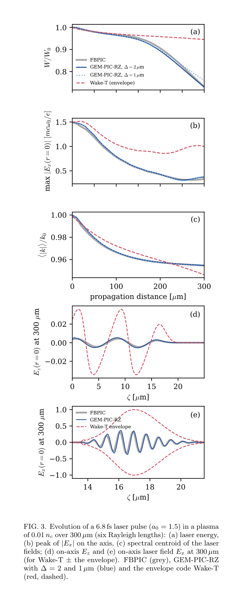
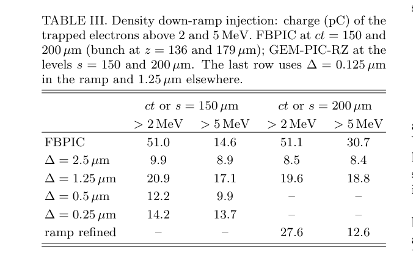

# GEM-PIC-RZ：保留激光载波的大步长算法及注入失效边界

> Alexander Pukhov，*GEM-PIC-RZ: a Galilean electromagnetic particle-in-cell code in quasi-cylindrical geometry with nonuniform grids*，[arXiv:2610.31622v1](https://arxiv.org/abs/2610.31622v1)，2026-10-22 提交；PDF 正文署日期 10-23。[官方全文](https://arxiv.org/pdf/2610.31622v1)、[本地 PDF](../pdfs/Pukhov%20-%202026%20-%20GEM-PIC-RZ%20nonuniform%20Galilean%20PIC.pdf)，14 页。**本篇为预印本**；精确题名 Crossref 前三项未核实同篇正式版。检索中的 JCP 567, 115331、DOI 10.1016/j.jcp.2026.115331 是本文 Ref. [16] 的三作者基础算法论文，不是本篇单作者 RZ 实现的正式版本；既有 QUARZ 也属不同作品。

## 目标与证据层

LWFA 既有微米激光载波，也有毫米至米的传播尺度。本文在准柱坐标中实现 Galilean electromagnetic PIC，以少数方位角模表示近轴对称驱动，保留前向激光载波的慢演化，同时省略部分后向/纵向分量的慢导数。证据是**解析/离散恒等式验证、作者代码测试和与 FBPIC/Wake-T 的数值对照**，没有本篇新束流实验。本轮只精读并核对论文，未下载编译或运行作者代码。

## 方程约化与粒子推进

采用 c=1、长度 k₀⁻¹、时间 ω₀⁻¹、密度 nc、动量 mec、场 mecω₀/e 的单位。快坐标 ζ=z−t，慢坐标可取 GT1 的 s=t 或 GT2 的 s=z；本实现粒子推进采用 GT2，一个 level 对应实验室固定 z 平面，ζ 切片代表信号经过该平面的不同时刻。它与 FBPIC 的同时刻快照不同，对照必须匹配实验室束团位置。

对场作方位角展开，m=0 主要表示 wake、m=1 表示横向偏振激光。组合 Rr=Er+Bφ、Rφ=Eφ−Br 表示前向分量，L 表示相应差分量。R 保留 ∂s，L 和纵向场在与较大 ∂ζ 并存处省略慢导数；因此能演化载波衍射、耗尽和红移，但**不能描述后向传播辐射、Raman 背散射或过密反射**。它也不是完整 Maxwell 方程的无约化求解器。

streaming 粒子按 ζ 积分，快速 trapped/beam 粒子按 s、使用 Vay pusher；进入/退出 beam 列表分别有 vz≥0.9、vz<0.8 阈值，不删除粒子。瞬时场 ADK 电离、移动离子和 Monte Carlo 等待时间已实现。非均匀径向/纵向/慢步网格把分辨率集中在轴、激光、束团和密度斜坡。

## 数值问题与正则化代价

梯形慢步更新和有限体积离散最终成为每模两个三对角系统。真空线性色散无增长模，不存在把慢传播步 Δ 直接绑在网格上的 Courant 限制；等离子体仍有作者给出的实用约束 Δh≲4/ωp²，且必须满足激光、betatron、斜坡演化精度。**“无 Courant 限制”不等于步长任意大，也不意味着所有 PIC 算法都受同一种显式 CFL 条件。**

ζ-Nyquist 奇偶模可被束流噪声共振驱动，作者对 beam 电流作 (1,2,1)/4 滤波；冷、严格轴对称 bubble 闭合处的密度奇点则会激发另一类慢步奇偶模。后者用径向源平滑处理：

$$
\mathbf j_\perp\leftarrow(1-a^2\nabla_{\rm vec}^2)^{-1}\mathbf j_\perp,
\qquad (\rho,j_z)\leftarrow(1-a^2\nabla_m^2)^{-1}(\rho,j_z).
$$

离散散度与滤波交换，使平滑后的电流和电荷保持对应连续性；这是一项结构性质。a 是数值模型参数，**未由真实温度/非轴对称性推导**。选择最小可收敛 a，再作倍数扫描；强阈值注入量仍可能随 a 明显变化，不能用电荷守恒代替模型精度验证。

## few-cycle 载波 benchmark

**原图 3，PDF 第 13 页（图置于参考文献后）。** 参数 a₀=1.5、6.8 fs（约 2.5 周期）、w₀=3.56 μm、密度 0.01nc≈1.74×10¹⁹ cm⁻³，传播 300 μm、六个 Rayleigh 长度。上三图横轴传播距离 μm；纵轴依次 W/W₀、轴上峰 Ex 的归一化场、谱质心 ⟨|k|⟩/k₀。下两图横轴 ζ/μm，纵轴是末端轴上 Ez、Ex；场以 mecω₀/e 归一化，不能当成 V/m。灰为 FBPIC，蓝为两种 GEM 慢步，红为 Wake-T 包络。

FBPIC 末端 W/W₀=0.731、谱质心 0.9547；GEM 基准约 0.731、0.9546，Δ 减半后 W/W₀=0.761。包络模型仅损失 5.5% 激光能量，对照约 27%，该**特定 few-cycle/高密度案例**耗尽低估约五倍；不是对所有包络模型的统一结论。载波相位偏差约 0.4 rad，末端峰场约高 12–13%；弱尾场后部相位误差可使 RMS 差异到约 20%，不能以能量匹配替代局域场精度。

## 注入：电离对照与下降沿失败分开

电离注入采用 a₀=2.3、0.002nc、1% N⁵⁺。在束团 z≈183 μm、E>5 MeV 的口径下，GEM/FBPIC 电荷约 1.58/1.76 pC，平均能量 12.4/12.6 MeV，RMS 能散 5.2/5.4 MeV。表 IV 则在 z=175 μm 列数，不能与该点混比。a 扫描表明注入电荷模型不确定度约 ±15%，大于减半步长的约 7%；这是敏感性估计，不是蒙特卡洛统计误差。

**原表 III，PDF 第 9 页。** 列为不同输出时刻/平面与 >2、>5 MeV 能阈，表值为 pC。FBPIC ct=150 μm 对应束团 z≈136 μm，GEM s=150 μm 为平面位置；作者给出了该比较约定，二者不是严格同一坐标切片。>2 MeV 时 FBPIC 约 51 pC，而 GEM 在不同步长约 9–28 pC，且不收敛；单独细化斜坡仍未修复。分歧远大于电离 benchmark 的 ±15%。

作者推测 GT2 的 trapping 判断不能充分跟踪快速移动的 bubble 尾部，GT1 又会产生条纹，尚待后续方法解决。**尖锐密度下降沿自注入不能定量采信。**这一限制直接涉及本日 Jin 实验采用的 shock 注入；不能直接用本代码的已有电离验证宣布已能可靠复现该实验。

## 时间、并行与 AI 开发披露

few-cycle 案例 GEM 6.7 min/1 核、FBPIC 3.7 h/2 核；电离案例为 8.5 min/1 核、3.4 h/2 核。作者“约 2% CPU 时间”包含核数口径；例如前者 6.7/(222×2)≈1.5% core-time，而墙钟比约 3%。不同网格、约化模型和实现使之不是相同算法/同核硬件的通用 50 倍加速保证。

GH200 上 16 倍粒子的另一基准每步 0.37 s，25 项测试/约 230 unit checks 为作者报告；不能与前述 CPU 案例拼接成同一性能点。MPI pipeline、OpenMP/GPU 一致性和重启证据也均来自作者。AI 生成代码、测试和文档，物理学家定义方法与验收；这种开发披露不是机器学习物理代理或独立可信性证明。

## 接续与适用范围

适合优先研究近轴对称、前向传播的载波分辨 LWFA 扫描；实施前需固定代码版本、输入、硬件、网格和 a，并分别验证守恒、局域场、注入及性能。论文的 FEL 初步测试/计划不等于完成加速—输运—FEL 全链验证，也未给出转换靶、QED、光核或剂量结果。

后续可从[作者代码](https://github.com/AlexMPukhov/GEM-PIC-RZ)核实 decks 和测试，本轮没有做源码审计或计算复现。来源：[PDF 核验](../pdf_validation.json)、[版本检查](../research/version-checks.json)、[MinerU](../research/mineru-attempts.json)、[原图/表](../research/figure-manifest.json)。
