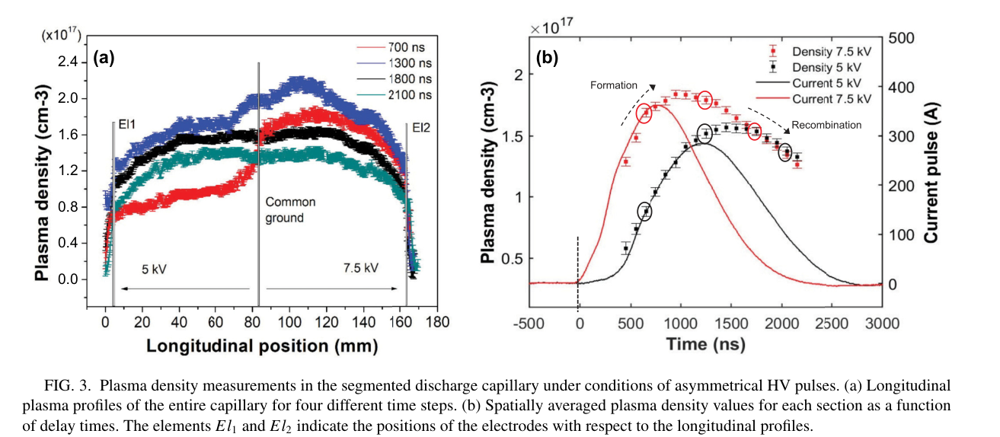
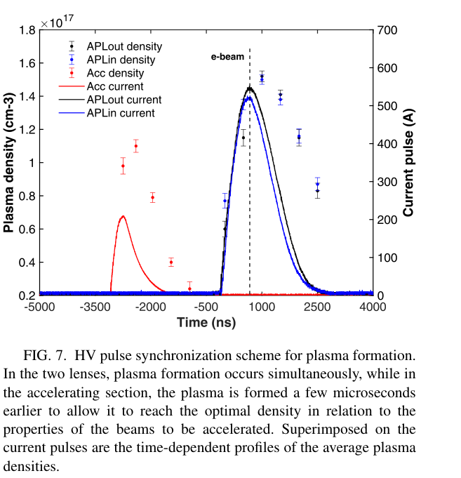

# 分级放电毛细管：密度剖面与透镜—加速段同步控制

> Angelo Biagioni、Lucio Crincoli、Romain Demitra、Mario Galletti、Valerio Lollo、Donato Pellegrini、Riccardo Pompili、Massimo Ferrario、Arie Zigler，*Plasma density manipulation in staged discharge capillaries for plasma-based accelerators*，**Physical Review E 114, 045210 (2026)**，[DOI](https://doi.org/10.1103/yrts-62hs)，2026-10-23 正式发表。[官方全文](https://harvest.aps.org/v2/journals/articles/10.1103/yrts-62hs/fulltext)、[本地 PDF](../pdfs/Biagioni%20et%20al.%20-%202026%20-%20Staged%20discharge%20capillary%20density%20control.pdf)，10 页；实际阅读 APS **VOR**。10-06 是接受日期，旧重试记录使用该日期，本轮以正式出版信息纠正并闭合重试。

## 摘要与证据范围

论文解决的是等离子体源如何按功能分段、独立供电和同步，而非直接给出新的高能电子束纪录。第一部分实测两段放电毛细管的纵向密度随电压与时间演化；第二部分表征入口主动等离子体透镜、PWFA 加速段、出口透镜组成的同体结构。气体输运用 OpenFOAM 辅助，电子密度由 Stark 展宽反演。

证据属于**真实放电/光谱诊断实验与工程原型**，但密度并非直接数电子；米级高能运行是设计动机。本篇将电子束加速/聚焦的既有结果引向其参考文献 39（2024 PRE），不能把那些结果当作本文新增束流验收。未涉及转换靶 γ、中子、核素、剂量或防护测试。

## I. 引言：分段降低单段击穿负担

连续长气柱的击穿电压随气压—长度积变化。作者以约 30 mbar 氢气举例：8 cm 单段约需 4.5 kV，16 cm 连续约 8.3 kV，24 cm 超过 11.5 kV；拆成各 8 cm 的独立段，可保持每段约 4.5 kV 的击穿条件。这是文中 Paschen 估算，不能替代实际电路、电极和动态放电测量；实验中也使用 5、7.5 或 10 kV。

$$
V_b=\frac{Bpd}{\ln(Apd)-\ln\!\left[\ln(1+1/\gamma_{se})\right]}.
$$

p 是气压，d 是间隙长度，A、B 是特定气体/单位体系下的 Townsend 参数，γ_se 为二次电子发射系数。由自持放电条件 γ_se[exp(α_T d)−1]=1，先取对数得到 α_T d=ln(1+1/γ_se)，再代入 α_T/p=A exp(−Bp/E)、E=V/d，即得上式。这里 α_T 是电离系数，勿与后文光谱系数混淆。物理意义是通过缩短单个击穿间隙降低每路电源负担，并非总能耗自动下降。

## II. 装置与诊断：共同结构、独立电路

两段各长 8 cm，主放电通道直径 2 mm，机械加工于同一塑料块中；中央电极共地，两段各接独立高压电路。公共供气管通过四个竖直注入口进气，每段两个；压力可调 10–50 mbar，电磁阀可按 1–10 Hz 工作。本文不是 kHz 放电器件或米级实装结果。

图 2 是 OpenFOAM **中性气体模拟**：开阀后 1 ms 仍有注入口峰，2 ms 更均匀，两端通孔形成下坡。它不直接等于电离后的电子密度，更不能单独证明径向均匀性。

光路将毛细管发光送入 SpectraPro 275 成像光谱仪与 Andor iStar 320 门控相机。Hα/Hβ 的线宽受微观电场影响；本文以 Hβ≈486.13 nm 为主要诊断，分三个纵向视场采集后拼接覆盖整个长结构。不同延时的剖面是门控重复测量，不能理解为单次放电的全时空连续电影。

$$
n_e=8.02\times10^{12}\left(\frac{\Delta\lambda}{\alpha_s}\right)^{3/2}\ {\rm cm}^{-3}.
$$

Δλ 为 Stark 线型的 FWHM，α_s 为原文引用 Griem 表的谱线参数，两者按原文均以 Å 表示。该式可视为线宽对密度约 2/3 次幂关系的反解，系数来自线型理论/标定，不能由量纲自行推出。固定 α_s 时，对数微分给出 δn_e/n_e≈(3/2)δΔλ/Δλ；若 α_s、仪器展宽或温度有误差，还要一起传播。本文未提供足够完整的谱拟合、视线积分和逐项误差预算来重新验收绝对密度。

## III.A. 两段毛细管：不对称供电与时间选择

**原图 3，PDF 第 4 页。** 左图横轴纵向位置 mm，纵轴 n_e（×10¹⁷ cm⁻³），颜色为 700、1300、1800、2100 ns；竖线标电极/中央共地。右图横轴相对触发时间 ns，左轴为空间平均电子密度，右轴为电流 A；带误差棒的点是密度，连续线是放电电流，不能把两种纵轴直接比较大小。空心圆只标出左图选定延时。

两段同时触发、分别加 5 与 7.5 kV。高压较高段的峰电流约 380 A，另一段约 300 A，且上升时间不同。7.5 kV 段在 700、1300 ns 的局部峰密度约 1.8、2.2×10¹⁷ cm⁻³；空间平均峰值则在约 1100–1300 ns 出现，5 kV 段推迟到 1300–1500 ns。**局部峰与空间平均不能混用。**

在形成期可得到台阶/渐变剖面，晚些的复合阶段两段趋向相近密度，约 ≥1800 ns 的剖面更接近均匀。这使同一器件可用取束时刻选择不同剖面；作者用扩散、复合和残余电流再电离作解释，但没有用独立粒子通量诊断分离这些贡献。

对称 5 kV 的图 4 则在早期约 500–800 ns 给出接近相同的两段密度，后来出现差别，2200 ns 时约 1.1 与 1.3×10¹⁷ cm⁻³，原文称约 20%。这个“20%”取决于分母，不是整机稳定性误差。作者将差别归于小的电源/气压及残余电流差异，部分是解释性判断。

图 5 将上述剖面画成随时空变化的三维表示，并非新增测量。原文报告形成/复合期 shot-to-shot 波动约 2%，但未清楚给出样本量、全部统计定义及长时漂移；因此只能保留为报告值，不能推为全参数域的 2% 稳定性保证。

## III.B. 组合源：把透镜电流与加速密度放在不同时间窗

第二种一体结构依次是 APL_IN—PWFA—APL_OUT，三路电源独立、公共气路同步进气。加速段注入口直径为两透镜的一半，以降低流量和工作密度。透镜地电极安排在同侧，使相对束流方向的磁场起聚焦作用；加速段则在电流衰减后取束。图 6 给出光屏、RF 偏转腔和磁谱仪布置，不能仅凭装置图判定本篇已提供全部束参实测。

**原图 7，PDF 第 7 页。** 横轴时间 ns，加速段电流在负延时出现；左轴密度 ×10¹⁷ cm⁻³，右轴电流 A。红色对应加速段，黑/蓝对应两透镜。竖虚线为电子束到达时刻，位置靠近透镜电流峰，而非加速段电流峰。密度点与电流线共享横轴，但并非同一个物理量。

在示例中，加速段约提前 3 μs 点火，由约 1.1×10¹⁷ cm⁻³ 复合到文中报告约 3×10¹⁵ cm⁻³，电子束到达时两透镜电流约 550 A。其意图是同时满足透镜需要的磁聚焦和 PWFA 所需约 10¹⁵–10¹⁶ cm⁻³ 密度。**低密度值应结合诊断灵敏度理解**：图 7 左纵轴下限约 0.2×10¹⁷ cm⁻³，本身无法图读核验低于该范围的 3×10¹⁵ 数值；图 8 用红虚线标出低于可测阈值的区间，不能把低信噪或未测区作精确零密度，也不能由图 8 独立确认图 7 所述低密度取束点的精度。

图 8 的三组纵向剖面在 1500、2500 ns 测量，显示两透镜接近相同，中央加速段更低，各段入口附近的峰与端部下坡明显。透镜约用 10 kV/550 A，加速段约 5 kV/220 A。图 8 证明的是选定条件的光谱剖面，不是所有电压/时序任意组合时均无耦合。

一体加工减少相对机械对准量，电流调节可改变透镜焦距；代价是无法独立移动各段纵向位置。作者认为电调能部分代替小幅机械调节，尚不是任意几何与束能范围内的等效证明。

## IV. 结论、价值与接续

对本库的增量是**分段电源与密度时序的真实实验依据**，可为 PWFA 输入剖面、匹配段和联合诊断设计提供参数。本文不支持直接套用到激光 LWFA 的导光通道，更未测米级串联效率或新的束流能散/发射度。结论中的 “m³-scale” 与前文的米级长度叙述不一致，应向作者确认，不能据此扩展为立方米装置。

后续优先获取门宽、谱线去卷积/温度修正、各段密度的重复样本与低密度灵敏度；将时序、径向电流/密度和同炮次束流相空间联合测量，再检验长结构的气负载、放电寿命及热/侵蚀漂移。本轮没有复跑 OpenFOAM、放电模型或束流实验。

核验：[PDF/哈希](../pdf_validation.json)、[来源元数据](../research/sources.jsonl)、[版本日期](../research/version-checks.json)、[MinerU](../research/mineru-attempts.json)、[原图来源](../research/figure-manifest.json)。
