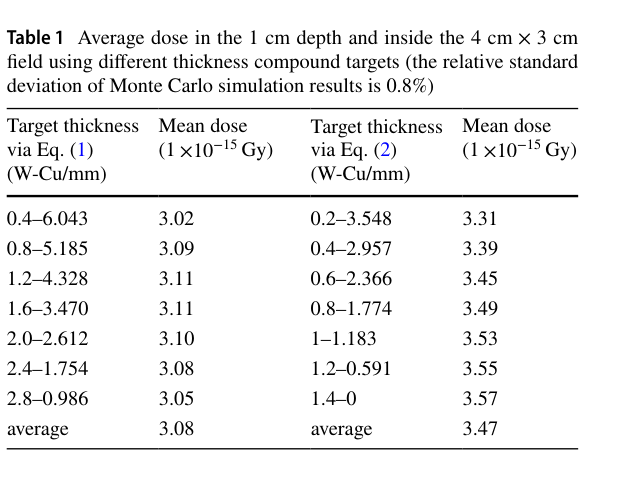
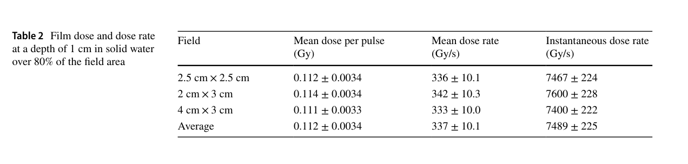
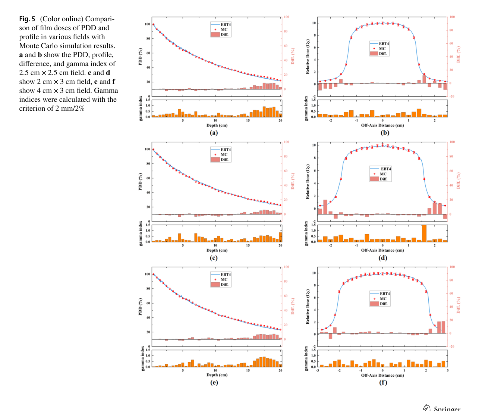

# 紧凑 LINAC 的 X 射线 FLASH 平台：转换靶、剂量学与时间结构

> Yi Zhang、Chang-Lin Lan、Yi-Wei Yang、Feng Gao、Ying-Hong Tang、Ji-Rong Zhao、Shi-Lan Wang、Jun-Tao Liu，*FLASH radiotherapy using high-energy X-rays: critical dosimetry design and characteristics of FLASH radiation platform based on compact LINAC*，**Nuclear Science and Techniques 37, 254 (2026)**，[DOI](https://doi.org/10.1007/s41365-026-02073-3)，2026-10-24 在线发表。[官方 PDF](https://link.springer.com/content/pdf/10.1007/s41365-026-02073-3.pdf)、[本地 PDF](../pdfs/Zhang%20et%20al.%20-%202026%20-%20Compact%20LINAC%20X%20ray%20FLASH%20dosimetry.pdf)，12 页；实际阅读 **Springer VOR**。2025-10-10 是接受日期，与 2026 在线年不同，PDF 首页页脚及 Crossref 一致确认在线日期。

## 摘要与研究边界

本文提供**真实紧凑室温 RF LINAC 的固体水剂量学实验 + MCNP6 输运设计**。名义 10 MeV 电子打 W–Cu 转换靶产生韧致辐射，胶片测百分深度剂量（PDD）及横向场形，MC 扫描靶厚并讨论调节剂量率。它与激光电子—转换靶方向共享输运/诊断问题，但电子源并非激光加速器。

最高约 330 Gy/s 的平均剂量率是平台剂量学结果；约 7500 Gy/s 为按脉宽定义的脉内平均。本文没有给出新的正常组织保护、肿瘤控制、动物终点或临床治疗实验。超过文中采用的 40 Gy/s 数值条件，不能替代 FLASH 生物效应验证。

## 1. 引言：同机比较的价值

常规组与 FLASH 组若来自不同装置，可能同时改变谱、场形和时间结构。本文希望在同一 X 射线平台上调剂量率，减少这类混杂。此动机合理，但还需比较单位脉冲剂量、总剂量、脉冲数与组织响应，不能只匹配平均剂量率。

## 2. 实验平台与胶片链

名义 10 MeV 电子入射旋转 W–Cu 靶，电机最高约 1500 rpm，用以分散热负荷；这不是本文完成疲劳/烧蚀寿命验收的证据。一级准直器为厚 10 cm 铅块，距组合靶约 10 mm；二级为厚 8 cm 铅块。电子滤片抑制残余电子，PMMA 组织补偿体改变浅层 buildup；因此样品剂量由整条链决定，不能只用裸转换靶的出射量判断。

FCT 与电离室分别监控电子束和 X 射线；绝对空间剂量采用 EBT4 胶片在 RW3 固体水测量。胶片在常规 Elekta LINAC、可溯源电离室链上校准，照后等待 24 h，以 100 dpi 扫描并由 netOD 转剂量。胶片是积分计，时间结构仍需独立监控。文中引用胶片在 UHDR 下剂量率不敏感的研究，不等于本批胶片的全脉冲条件响应均已单独验收。

## 3. 转换靶设计：局部通量、体模剂量与最优口径

### 3.1 射程约束的用途

作者引用 10 MeV 电子的 CSDA 射程：W 为 3.218 mm，Cu 为 6.901 mm，并采用复合射程近似：

$$
\frac{t_W}{R_W}+\frac{t_{Cu}}{R_{Cu}}\ge 1.
$$

t、R 分别为厚度与同材 CSDA 射程，均取 mm。将每层厚度除以该材料的完整射程，可形成“耗尽射程份额”的简化相加；它没有独立求解多重散射、能损涨落及混合能谱，不是完全停止所有电子的严格定理。最终靶后电子剂量还需输运与实测。

### 3.2 单材扫描

图 2 的指定靶后中心面计分中，光子通量峰位于 W 1.40 mm、Cu 4.14 mm，对应 43.5%、60.0% CSDA 射程；再增厚，光子吸收/散射开始抵消生成收益。到 CSDA 厚度，相对峰值通量降低约 28%、15%。峰值处仍有较多电子穿出，必须联合滤片/补偿体设计。

图 2 横轴靶厚 mm，纵轴通量 cm⁻²，分光子/电子及 W/Cu；这是**局部出射通量**的 MC 结果，不是全空间能量转换效率。图 3 纵轴为 energy（MeV），正文未充分定义其统计量，笔记不将其擅改成谱峰能或最大端点。

### 3.3 两组厚度路径的比较

作者另以单材光子通量峰厚度构造较薄路径：

$$
\frac{t_W}{1.40\ {\rm mm}}+\frac{t_{Cu}}{4.14\ {\rm mm}}=1.
$$

其含义是用两种归一化峰厚度线性配比构造候选集合，并非推导出双层靶的全局最优条件。与射程约束路径比较时，MC 目标变成固体水 **1 cm 深、4×3 cm² 场内平均剂量/源电子**。

**原表 1，PDF 第 4 页。** 左列为射程路径，右列为通量峰厚度路径；厚度单位 W–Cu/mm，剂量表头为 ×10⁻¹⁵ Gy，正文明确按 source particle 归一化，MC 相对标准差报告为 0.8%。这里既非 Gy/pulse，也非实测靶效率。

两组算术均值 3.08 与 3.47 的比给出：

$$
\left(\frac{3.47}{3.08}-1\right)\times100\%\simeq12.7\%.
$$

这是**两个不同候选集合的均值之比**，不是同一个配比的前后实测，也不是最佳对最佳增益。表中最高为 1.4 mm W、0 mm Cu 的 3.57×10⁻¹⁵ Gy/source，实际上是纯 W 候选；左组最高为 3.11。有限表格不支持“最佳双层组合”或连续参数空间的全局最优。本文亦未充分公开最终实装 W/Cu 厚度、真实电子谱/束斑和完整 MC 输入，不能据此完整复现绝对输出。

## 4. 实测剂量与剂量率

**原表 2，PDF 第 5 页。** 条件为 SSD=50 cm、固体水深度 1 cm、超过 80% 的场面积。三种场为 2.5×2.5、2×3、4×3 cm²，列分别是单脉冲平均剂量 Gy、平均率 Gy/s、文中称 instantaneous 的率 Gy/s。表格均值 0.112±0.0034 Gy、337±10.1 Gy/s、7489±225 Gy/s；±约为 3% 量级，但不能擅定为 95% 置信区间。

各场平均率分别 336、342、333 Gy/s，脉内率约 7467、7600、7400 Gy/s。该结果限于给定深度/场面积，不代表任意人体深度、肿瘤体积或全空间的均匀 UHDR。

为解释这些列，按原文第 6 节定义：

$$
D_p=\frac{D_{\rm total}}{N},\qquad
\overline{\dot D}=D_p f,\qquad
\overline{\dot D}_{\rm pulse}=\frac{D_p}{\tau}.
$$

D_total 是总吸收剂量（Gy），N 是脉冲数，f 是重复频率（Hz），τ 是脉宽（s）。总照射时间近似 N/f，脉冲内总开束时间为 Nτ，分别用总剂量除以两种时间即得两种率。因此“instantaneous”在本文口径实际为**脉宽平均率**，不是 RF 微束团的瞬时峰值。

由表内平均数反推 f≈3.0 kHz、τ≈15 μs、占空比约 4.5%；这是笔记的代数一致性检查，**不是原文直接报告的独立机器时间测量**。正文称调频可覆盖约 0.11–330 Gy/s，但未展示完整频率扫描下的独立剂量校准/稳定性曲线。

表 3 把其他源按平方反比折算到 SSD=50 cm；其中 LLNL 项明确为 Planned，其余部分为 Tested。不同装置的场大小、能谱、补偿体与出射几何并不相同，因此这不是统一条件下的源性能排名。

## 5. MC 与胶片的比较：归一化和复现疑点

### 5.1 每源电子计分与物理电子数

MCNP6 使用 *F8 沉积能量计分，作者报告 5×10⁹ 个初始粒子，以达到约 2% 的 MC 不确定度目标。单位转换是：

$$
d=\frac{E_{\rm dep}\,[{\rm MeV/source}]\;1.602\times10^{-13}\,[{\rm J/MeV}]}{M\,[{\rm kg}]},
\qquad
D_p=d\frac{Q_p}{e}.
$$

d 为 Gy/source，M 为体素质量，Q_p 为物理单脉冲电荷。第一式只是 MeV→J 后除质量；第二式将单源电子响应乘实际电子数。**5×10⁹ 是抽样 histories，不能直接当真实每脉冲电子数**。缺失真实束流电荷/谱与输入时，本轮不反推一套未经确认的绝对标定。

PDF 第 6 页正文确实印有 **30×30×10 cm³ 体模、2×2×2 cm³ 体素，PDD 为 2×2×5 cm³**。它与图 4/5 延伸至 20 cm 的深度、厘米级小场精细边缘及 2 mm γ 准则不易相容。已经核对渲染原页，不能归咎于文本提取。可能存在单位、轴向或尺寸笔误，须索取输入澄清；本笔记不替作者改成 mm，也不声称模型已完整可复现。

### 5.2 比较结果及限定区域

**原图 5，PDF 第 7 页。** 从上至下是三种照射场。左列横轴深度 cm（至 20 cm），纵轴 PDD%，反映相对最大剂量的衰减；右列横轴离轴距离 cm，纵轴原标 “Relative Dose (Gy)”，相对/绝对表述含混，不将约 10 的峰值视为表 2 的单脉冲剂量。蓝线为胶片、红点为 MC，红柱相对偏差%、各子图下方橙柱为 γ 指数。PDD 的归一化比较并不独立证明绝对 Gy 标定。

正文把 PDD 的 <3% 限于 D>0.3D_max 的 R30 区域；尾部可见偏差增大，横向陡降/半影也更大。三场 PDD 的 2 mm/2% γ 通过率均 100%，横向依次 100%、96%、100%。**不能把摘要的“全部曲线 <3%”无条件推广到尾区/半影**。原文未充分交代 γ 的局部/全局归一化、剂量阈值与插值，不能由通过率推出整机临床认证。

原文 γ 判据可理解为在邻近位置搜索剂量与距离的联合归一化偏差最小值：

$$
\gamma(\mathbf r)=\min_{\mathbf r'}\sqrt{
\left[\frac{D_{\rm MC}(\mathbf r')-D_{\rm meas}(\mathbf r)}{\Delta D}\right]^2+
\left[\frac{|\mathbf r'-\mathbf r|}{\Delta S}\right]^2}.
$$

ΔD、ΔS 是剂量容差和空间容差，γ≤1 为通过。容差椭球允许一部分位置差与剂量差相互权衡，故通过不等价于每一点剂量误差 <2%。本文的厘米级体素描述若属实，也必须先解释它如何支持毫米级比较。

表 4 unflatness 是中心剂量/指定离轴剂量。表内相对差为 +0.87%、−3.90%、+2.58%，而正文写 −3.99% 至 +2.70%；应保留该差异。PMMA 补偿体在 PDD 测试中保留，比较对象是**整条带补偿束线**，不是裸靶光子谱。

## 6. 剂量率调节：可控变量与模型外推

调频在单脉冲剂量/脉宽不变时，只改平均率；改变脉宽通常也会改变单脉冲剂量，不能将变量视为独立。改变 SSD 会同时改剂量率、PDD 与场形。文中式 9 只给平方反比几何项，缺少介质衰减和散射，不能当作完整的 PDD 方程；图 7 本身来自 MC。

固定 SSD 加衰减层是作者推荐的另一方案：MC 扫描 10×10 cm² 的 SUS/Pb/Al，0–80 mm、步长 4 mm，得到半值层约 SUS 24 mm、Pb 13 mm、Al 74 mm。图 8 横轴厚度 mm、纵轴原标 Relative Dose(Gy)，用于比较相同计分归一化下的衰减，不能据此认定每次照射绝对剂量。

图 9 中，各材料取**一个半值层**时归一化 PDD/横向曲线近似重合，支持这个有限场景下形状变化较小；不能扩大到任意厚度、任意衰减因子，亦未对每种衰减层厚度提供独立实测。这里的 beam attenuator 不等于机房辐射防护屏蔽设计；本文没有周围剂量、漏射、光核中子或活化验收。

## 7. 结论、对激光束迁移的价值与接续

本篇的可复用部分是源—转换靶—滤片/准直—体模—胶片/MC 的联合剂量学框架，以及平均率和脉内率分开的比较方式。迁移至 LWFA 宽谱电子时，应重新折叠实测能角谱、单发电荷和束斑，不能直接套用 10 MeV 单能假设下的靶厚。局部光子通量、能量转换效率、样品剂量和生物保护效应分别需要相应证据。

接续优先核实 MC 体模/体素的真实单位和输入、最终实装靶厚、物理电荷归一化、频率/脉宽与逐发稳定性，再实测全频段和衰减层的绝对剂量/场形，并与生物终点关联。本轮完成全文/图表审阅与简单比例核算，没有重跑 MCNP6、胶片校准、束流或生物实验。

核验：[PDF/哈希](../pdf_validation.json)、[来源元数据](../research/sources.jsonl)、[版本日期](../research/version-checks.json)、[MinerU 失败与本地回退](../research/mineru-attempts.json)、[原图来源](../research/figure-manifest.json)。
