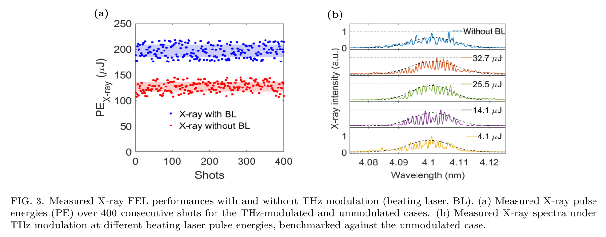
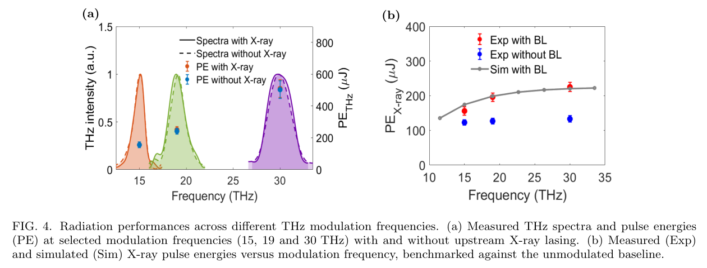

# 同一预聚束电子束驱动的自同步 X 射线与红外 FEL

> Yin Kang, Kaiqing Zhang, Zhen Wang, Cheng Yu, Zhangfeng Gao, Wencai Cheng, Hang Luo, Yue Wang, Hanghua Xu, Xiaoqing Liu, Jinguo Wang, Huan Zhao, Yanyan Zhu, Yongmei Wen, Fei Gao, Yangyang Lei, Chengcheng Xiao, Liping Sun, Yongfang Liu, Jiaqiang Xu, Weiyi Yin, Xingtao Wang, Taihe Lan, Zheng Qi, Tao Liu, Bin Li, Zhi Guo, Chao Feng, Bo Liu, Zhentang Zhao；*Self-Synchronized Soft X-Ray and Infrared Free-Electron Lasers from a Single Prebunched Electron Beam*。Physical Review Letters，2026-10-26。[正式 DOI](https://doi.org/10.1103/3kmz-18bp) · [实际阅读全文](https://arxiv.org/pdf/2608.15106v1) · [本地 PDF](../pdfs/Kang%20et%20al.%20-%202026%20-%20Self%20synchronized%20soft%20X%20ray%20infrared%20FEL.pdf)。版本：正式记录对应的arXiv作者稿。

## 版本、摘要与证据范围

正式论文为 2026-10-26 **Physical Review Letters 137, 185001**；官方 harvest 在代理/直连均返回 HTTP 401。本地全文是 **2026-08-15 arXiv:2608.15106v1**，原题 *Self-Synchronized Terahertz and X-Ray Free-Electron Lasers from a Single Pre-Bunched Electron Beam*。以首作者、30 人作者组、SXFEL、同一预聚束电子束顺序经过 X 射线与低频波荡器的场景确认为对应作者稿。**全文细节未与 VOR 逐条对照。** 正式标题改为 soft X-ray / infrared，不能声称正式版完全保留旧稿所有表述与数值。

本文展示 RF 直线加速器 FEL 实验及 start-to-end 模拟，不是激光等离子体电子束或转换靶 γ 实验。作者稿把 15–30 THz 称为 THz；按波长约 20–10 μm，它也落在中红外范围，光谱名称与正式版措辞必须分开记录。

## 装置与相空间控制

400 pC、115 MeV、约 80 keV 能散、1 mm·mrad 归一化发射度、约 14.3 ps 束团，在 laser heater 中与 800 nm 拍频激光相互作用；能量调制经压缩与受控微聚束不稳定性转为周期密度调制，束能升至 1.04 GeV。前述参数属于不同位置，不能把 115 MeV 能散直接当作最终束参。

电子束依次通过十段 4 m、16 mm 周期 X 射线波荡器，在约 4.1 nm 发光，再经过长 5 m、280 mm 周期低频 wiggler。时域偏转腔所见相空间支持微结构在 X 射线发光后仍存活。装置的顺序天然是 X-ray 先于低频光；反转 pump/probe 次序需额外延迟光路。

局部电流增强 B 提高一维 Pierce 参数，但同样增大局部能散：

$$
I=BI_0,\qquad \rho\propto I^{1/3},\qquad L_g^{1D}\propto B^{-1/3}.
$$

这些是简化 FEL 缩放，实际需三维能散、发射度和衍射修正。B 在此为电流增强因子，不是磁场。ASTRA/ELEGANT/GENESIS 曲线用于解释实验趋势，本轮没有运行这些软件。

## 拍频能量扫描与稳定性

作者稿 Fig. 2 的横轴写 “Laser intensity (μJ)”；单位实际是**脉冲能量**，不能当 W/cm² 强度。正文“below ∼1.1 μJ”与图中刻度/约 14 μJ 的选择不易相容，暂记为待核实，不据此给出精确最优工作窗。

**来源：作者稿 PDF 第 4 页上部，Fig. 3。** 左图横轴 shot、纵轴 X 射线能量 μJ；选定约 14 μJ 拍频输入时，400 连发均值约 197 μJ、相对 RMS 6.23%，未调制对照约 127 μJ、7.5%。提高约 55% 是这一组均值比，不是任意频率与长期运行都提高 55%。右图横轴波长 nm，纵轴任意强度且堆叠偏置，不能比较绝对谱积分。

约 19 THz 谱条纹对应时间间隔：

$$
\Delta t=\frac1{\Delta\nu}\simeq\frac1{19\times10^{12}}=52.6\ {\rm fs}.
$$

这是 Fourier 关系结合谱结构作出的推断，不是单个 X 射线子脉冲宽度的直接测量；SASE 各子脉冲相位随机，条纹位置会逐发变化。不能把此处“mode locking/pulse train”写成每发相位完全确定。

## 频率调谐与下游输出

**来源：作者稿 PDF 第 4 页中部，Fig. 4。** 左图横轴频率 THz，左轴归一化谱、右轴脉冲能量 μJ；实/虚谱线及点对应上游 X 射线发光/不发光。右图横轴调制频率，纵轴 X 射线能量 μJ，点为实验、灰线为模拟。三组离散频点不等于全频段连续的联合验收。

作者稿报告 30 THz 最多约 595 μJ、相对谱宽约 8.6–10.4%；上游 X 射线发光开关对下游谱/能量影响小。30 THz 组 X 射线均值约 133→225 μJ，15 THz 约 122→156 μJ；这些不是 Fig. 3 的同一 400 发比较。光斑 FWHM 约 1.2×1.2 mm²（X-ray）及聚焦后 145×138 μm²（低频光），在不同诊断位置，不能据此直接计算联合峰值强度。

## 结论、限制与接续

同一束团产生两色光，为共同时间基准提供物理依据；但稿中未给逐发相对到达时间的实测 jitter 分布，**“jitter-free”是作者的机制描述，不是已量化的零抖动验收**。曾报道 60 MV/cm 的源是引用的既有工作，不作为本篇新测场强。材料相变、THz泵浦/SXR探测和高重复运行兼容是应用前景，没有在本篇逐项演示。

后续优先恢复合法 VOR，核对正式版的 MIR/THz 划分、低频抑制与 machine tuning、数值/图号变动及上述扫描口径，再补充两色到样品处的相对计时、输运损失和长期漂移。本轮不因 VOR 401 增加“无全文”重试；已验证作者稿入库，正式版差异对照保留为待办。未新增光核中子/同位素或临床防护实证。

核验：[PDF与哈希](../pdf_validation.json) · [来源与去重](../research/sources.jsonl) · [版本核查](../research/version-checks.json) · [MinerU](../research/mineru-attempts.json) · [原图来源](../research/figure-manifest.json)。
