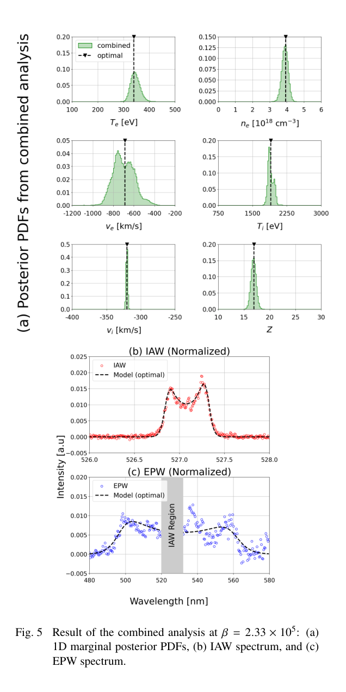
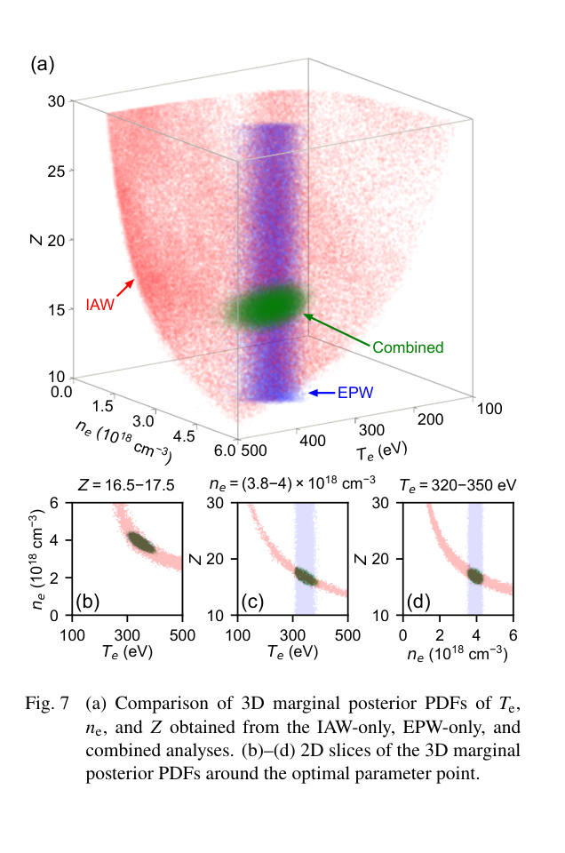

# 双组分联合 Thomson 反演：用互补谱段约束电离度

> Akito Nakano, Kentaro Sakai, Hantao Ji, Lan Gao, Brandon K. Russell, Takeo Hoshi；*Two-component Bayesian modeling in the data analysis of collective Thomson scattering*。arXiv preprint，2026-10-23。[arXiv DOI](https://doi.org/10.48550/arXiv.2610.32033) · [实际阅读全文](https://arxiv.org/pdf/2610.32033v1) · [本地 PDF](../pdfs/Nakano%20et%20al.%20-%202026%20-%20Two%20component%20Bayesian%20Thomson%20scattering.pdf)。版本：官方arXiv v1作者稿。

## 摘要与证据范围

本文对**已有激光驱动电容线圈磁重联实验**在 2.9 ns 的集体 Thomson 散射（CTS）数据重新作 Bayesian 分析，联合离子声波 IAW 与电子等离子体波 EPW 谱段，求六参数完整后验。它是实测谱的模型辅助反演，不是新的磁重联实验，也不是直接测量电子/离子分布函数。

arXiv 注明 2026-10-16 获 *Plasma and Fusion Research* 接受；本轮未核实正式卷页/DOI，实际阅读全文为 10-23 官方 arXiv v1。接受日期不作为正式出版日。

## 1–2. 数据与模型

测量位于线圈中心外约 600 μm，采样体积约 60×60×50 μm³，探针波长 526.5 nm、散射角 63°。原装置 EPW/IAW 光谱仪总范围约 340/7 nm；本轮拟合选用 IAW 526–528 nm、EPW 480–580 nm，并从 EPW 去除 520–530 nm。

参数是 T_e、n_e、v_e、T_i、v_i、Z，采用电荷中性 n_i=n_e/Z 与 Maxwellian 双组分动态结构因子。速度是散射矢量投影及既定符号约定，不是任意三维流速。先验为有限区间内均匀，部分范围围绕既有常规分析设定；“均匀”不表示没有先验信息。

$$
p(X\mid Y,\beta)\propto p(X)\exp[-\beta F(X;Y)].
$$

各谱段分别归一化到离散强度和为一，再构造各自残差，主结果等权相加。β 由**含 Gaussian 归一化因子**的 evidence 最大化确定；对应有效残差方差为 1/(2β)，不是已实测的探测器噪声。独立同方差假设没有显式容纳波长相关噪声、响应校正或归一化引入的相关性。

PAMC 使用 76800 replicas、61 个 β 点（1–10⁷）、每点 30 次 MC 更新，作者报告 Fugaku 384 节点约 3 h；不能写成通用桌面耗时或作者方法相对其他程序的公平加速比。三随机种子 evidence 曲线一致，说明所展示采样的稳定性，不代表统计模型无偏。

## 3. 单谱与联合后验

IAW 对离子温度、流速约束较强，但电子参数与 Z 存在弯曲退化面；EPW 主要约束 T_e、n_e，对离子参数弱。联合分析在六维空间保留相关性后，Z 的一维后验在约 17 形成清楚峰。正文近似峰 T_e≈340 eV、n_e≈4.0×10¹⁸ cm⁻³，与旧分析约 340 eV、3.8×10¹⁸、Z≈18–19 基本相容。没有给出可直接照抄的统一可信区间时，不以图读峰值冒充精确置信范围。

**来源：PDF 第 6 页右列，Fig. 5。** 上部六幅横轴分别是 eV、10¹⁸ cm⁻³、km/s 或 Z，纵轴是一维边缘概率密度；下部为分别归一化的 IAW、EPW 强度对波长 nm。黑虚线是全六维最小残差点，不必等于各边缘后验峰；归一化强度不能用来比较两谱段绝对光子量。β=2.33×10⁵ 用于跨配置后验对比，并不是三配置各自单独最佳的 β。

## 4. 为什么联合可以打破退化

**来源：PDF 第 7 页右列，Fig. 7。** 三轴为 T_e、n_e、Z，红色 IAW 曲面、蓝色 EPW 长柱与绿色联合局域区域显示不同的相关方向。下部切片附带 Z、n_e 或 T_e 的固定区间；切片并非无条件一维后验。不能将绿色较窄自动等同于更接近真值。

$$
c_s^2\simeq\frac{ZT_e+3T_i}{m_i},\qquad
\lambda_D\propto\sqrt{T_e/n_e}.
$$

温度按能量单位计。IAW 峰间距和阻尼依赖 ZT_e、T_i 和 kλ_D；不同电子温度、密度、电离度可拟合相近 IAW。EPW 约束电子状态后压缩这条退化。它说明的是当前结构因子与数据下的辨识性，不能推广成任意 CTS 都可唯一恢复六参数。

## 5–附录. 归一化、权重与模型偏差

全谱只归一化一次会使强 IAW 主导残差；独立归一化则让两类结构都参与。附录 B 再按采样点数加权（IAW 292、EPW 215）时，Z 仍受约束，但后验形状改变。按真实异方差/相关噪声或 S/N 的完整建模仍是后续工作。

扩宽 T_e、n_e、v_e、Z 先验后，联合对 Z 的约束仍出现；T_i、v_i 的先验未全部扩宽，因此不能称所有先验任意变化均稳健。实验 EPW 中存在 Maxwellian 模型解释不了的额外峰；联合拟合可以缩窄错误模型的后验，需加入非 Maxwell 分布、梯度、有限孔径与仪器响应后复验。

本库旧文 2609.31020 侧重非 Maxwell 分布的 Bayesian 反演；本篇强调实测双谱、六维相关与独立归一化，作者/工作场景不同，保留独立条目。对 HEDP/PIC 的价值是为温度、密度与电离度提供有条件的诊断约束，而非核产额或剂量验收。本轮未运行 ODAT-SE/PAMC 或重新分析原始实验数据。

核验：[PDF与哈希](../pdf_validation.json) · [来源与去重](../research/sources.jsonl) · [版本核查](../research/version-checks.json) · [MinerU](../research/mineru-attempts.json) · [原图来源](../research/figure-manifest.json)。
