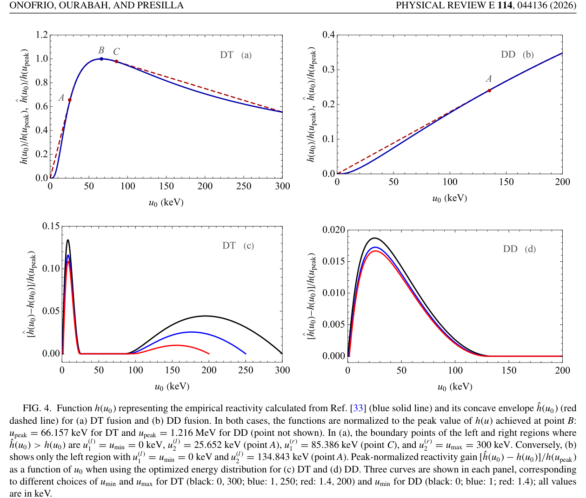

# 固定能量下的聚变反应率优化：凹包络与双温度混合

> Roberto Onofrio, Kamel Ourabah, Carlo Presilla；*Maximization of nuclear fusion reactivity via optimal energy distributions*。Physical Review E，2026-10-23。[正式 DOI](https://doi.org/10.1103/xhzy-hxdw) · [实际阅读全文](https://harvest.aps.org/v2/journals/articles/10.1103/xhzy-hxdw/fulltext) · [本地 PDF](../pdfs/Onofrio%20et%20al.%20-%202026%20-%20Optimal%20energy%20distributions%20fusion%20reactivity.pdf)。版本：APS正式VOR。

## 摘要与证据范围

本文把“非 Maxwell 分布是否提高聚变反应率”改写成受约束的概率优化。给定平均能量与温度支持区间，在 **Maxwell–Boltzmann（MB）混合分布族**内，最优值由 MB 反应率曲线的上凹包络给出；最优混合只需至多两个温度。论文是数学推导与经验截面数值积分，没有新放电、激光核反应或净能量实验。

## I–II. 反应率、波包与公平比较

反应率系数是截面乘相对速度的分布平均，单位 cm³/s；实际体积反应率还需乘反应物密度乘积，相同粒子反应还涉及计数因子。提高反应率系数不自动等于提高每发中子数。

$$
\mathcal R=\langle\sigma v\rangle=\int dE\,f_E(E)\sigma(E)\sqrt{2E/\mu}.
$$

μ 是两反应物约化质量。正文先在一维动量框架中讨论 Gaussian 波包的内禀动量宽度，再对波包中心动量作统计平均；后面的经验截面例子取平面波极限。**数值例子不是波包效应与双温分布的全部增益叠加。**

将逆温度 β 变为 u=β⁻¹=kBT，令 h(u) 为该温度的 MB 反应率。比较条件为概率归一化和固定 u 的均值：

$$
\int p(u)du=1,\quad \int u\,p(u)du=u_0,\quad
\mathcal R[p]=\int h(u)p(u)du.
$$

原文一维 MB 的平均动能是 u/2，而部分应用段落把 u 称为平均能量；本笔记始终保留 **u=kBT**，不将 10 keV 无条件改写为三维单离子平均动能。固定平均 β 也不等于固定平均能量，重尾分布间比较尤其要注意。

若 h 在整个允许域为凹函数，Jensen 不等式给出 R[p]≤h(u₀)，单温 MB 达到上界。一般情况下，用最小上凹包络 ĥ 替代 h，则 R[p]≤ĥ(u₀)。若 u₀ 位于端点 u₁、u₂ 的包络弦段，取

$$
p(u)=w_1\delta(u-u_1)+w_2\delta(u-u_2),\quad
w_1=\frac{u_2-u_0}{u_2-u_1},\quad w_2=1-w_1
$$

即可同时满足平均能量并达到弦段上界。该结论针对允许的 MB 混合模型；不能推广为所有各向异性束靶分布、任意非热分布或任意空间密度配置的全局最优。实际均匀混合粒子的碰撞可能有冷热交叉项，部署时应重新从双方速度分布计算相对速度分布，而非直接照抄线性温度混合。

## III. 三类超统计

作者比较 χ²、逆 χ²、log-normal 逆温度分布。它们可在低能区超过同能量 MB，却都低于同一允许域内的凹包络。q 控制逆温度涨落；type-I 的重尾还受有限平均能量条件约束。不能只比较同一 β 参数或把“尾更长”当作普遍增益保证。

## IV. DT/DD 例子与图 4

**来源：VOR PDF 第 10 页，Fig. 4。** 上排横轴 u₀（keV），纵轴 h/h(u_peak) 与 ĥ/h(u_peak)，蓝实线为 MB，红虚线为包络；下排纵轴是 **[ĥ−h]/h(u_peak)**，不是相对当前 h 的增益倍数。黑、蓝、红线改变允许温度端点，显示结果依赖约束域。DT 峰值位置约 66.157 keV；DD 峰值约 1.216 MeV，在右上图显示范围外。

DT 在允许域 u∈[0,300] keV、u₀=10 keV 时，文中 h≈1.15×10⁻¹⁶ cm³/s，差值约 1.2×10⁻¹⁶，故 ĥ/h≈2.04；冷组分权重约 0.61，热组分约 25.652 keV。13.5% 是差值相对峰值归一化，不能写成只提高 13.5%。DD 在 u₀=23 keV 的示例给约 1.7 倍、冷组分约 0.84；“约两倍”不是所有温区的结果。DD 截面计算含两个反应道。

零温端点是理想边界；把最低温度提高到 1 或 1.4 keV 会降低增量。该优化没有计算维持双温分布的外部功、碰撞热化、辐射损失、密度与约束变化。JET 双模分布是引用的历史证据，不是本论文实现的最优分布实验。

## V. 价值、限制与接续

对激光核反应扫描的直接价值是要求先固定物理能量、归一化和可实现分布族，再谈优化；不能把有限 MC primaries 或单个选中角 bin 当作物理粒子预算。迁移到激光离子—catcher—中子链仍需实测能角谱、靶内阻止与完整核输运。原文无公开配套研究数据/软件，本轮未重算截面积分或复现优化。

核验：[PDF与哈希](../pdf_validation.json) · [来源与去重](../research/sources.jsonl) · [版本核查](../research/version-checks.json) · [MinerU](../research/mineru-attempts.json) · [原图来源](../research/figure-manifest.json)。
