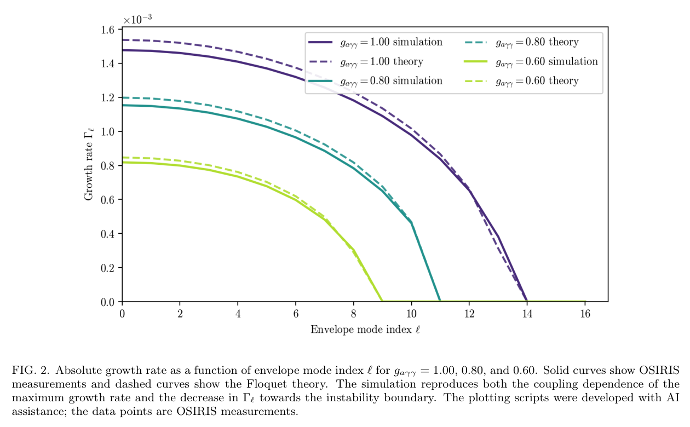
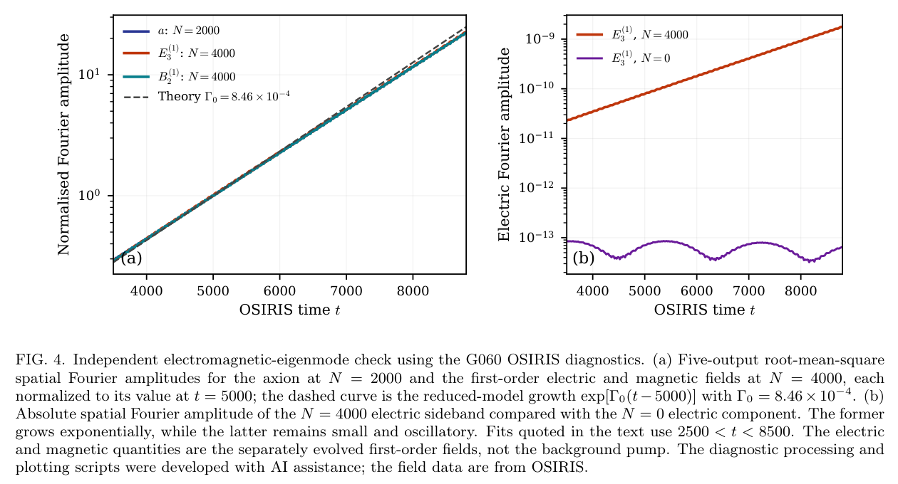

# OSIRIS 相干轴子场：对向泵浦 Floquet 不稳定性的数值基准

> Miles Radford, Pablo Bilbao, Thomas Grismayer, Luis Silva, Robert Bingham, Subir Sarkar, Gianluca Gregori；*Coherent axion electrodynamics in OSIRIS: a counter-propagating axion-photon parametric instability*。arXiv preprint，2026-10-23。[arXiv DOI](https://doi.org/10.48550/arXiv.2610.32091) · [实际阅读全文](https://arxiv.org/pdf/2610.32091v1) · [本地 PDF](../pdfs/Radford%20et%20al.%20-%202026%20-%20Coherent%20axion%20electrodynamics%20OSIRIS.pdf)。版本：官方arXiv v1作者稿。

## 摘要与证据范围

作者将相干 Klein–Gordon 轴子场和独立保存的一阶电磁扰动加入 OSIRIS，并用一维周期真空中的两束等强对向泵浦作理论—模拟对照。本文**不是轴子发现、QED 对产生实验或现实耦合强度下的灵敏度预言**。尽管装在 PIC 框架中，展示的基准不含动理学粒子；粒子推送和扰动电流路径尚未由本基准验收。

## I–II. 从耦合方程到正确的模结构

采用原文自然单位和符号约定：

$$
(\partial_t^2-\nabla^2+m_a^2)a=-g_{a\gamma\gamma}\mathbf E\!\cdot\!\mathbf B.
$$

轴子 a 由电磁场的赝标量积驱动，反过来进入 Maxwell 方程。两束共同线偏振的泵浦形成 A₀=P x̂，P=−2A_L sin(ω₀t)cos(k₀z)；正交的扰动矢势 A₁=b ŷ 满足

$$
(\partial_t^2-\partial_z^2)b=g(P_ta_z-P_za_t),\qquad
(\partial_t^2-\partial_z^2+m_a^2)a=g(P_zb_t-P_tb_z).
$$

两项必须保留。作者认为早先严格共线分支在一致约化后消失；本篇的对向驻波几何是新的 Floquet 侧带耦合问题。这个更正是作者的推导结果，本轮未独立符号复核，不写成对全部轴子参量不稳定性的否定。

展开时间与空间谐波后，泵浦把轴子和光子模连成梯级；不是一颗在壳真空光子直接衰变成有质量轴子与光子。包络模 ℓ 对应 kℓ=2πℓ/L，轴子绝对模号为 N₀±ℓ，不能将 ℓ 与 N₀ 混用。

定义 r=(gA_Lω₀/m_a)²，在所选长包络分支的渐近约化内：

$$
\Gamma_0^2=\frac{(gA_L)^2m_a^2}{8}-\frac{m_a^4}{4\omega_0^2},\qquad
\ell_+=\frac{Lm_a^2}{2\pi\omega_0}\sqrt{\frac{r+2}{8}}.
$$

r>2 是零包络波数分支的阈值，不意味着 r≤2 时所有 Floquet 区域都稳定。精确 ℓ=0 的不稳定本征矢中中心电磁分量为零，但 ±2k₀ 的高阶侧带可以增长。

## III. 离散实现与适用范围

轴子在网格中心、半时间层推进；强背景与微弱一阶电磁场分开存储，避免相减丢精度。E·B 需要把 Yee 网格分量平均到同一位置。种子场初值使用离散 Klein–Gordon 频率作 cos(ω_hΔt/2) 修正，避免时间交错带来伪瞬态。

实现还描述 base/shadow 粒子电流之差 J₁=J_shadow−J_base。作者限定 Cartesian 线性粒子插值，其他阶次会中止；“open”是外流式 guard-cell 外推，**不是独立 PML 吸收层**。理论实现包含二维/三维分支，不等于本篇完成多维粒子回归。强非线性、泵耗尽、长时粒子反馈均需额外验证。

## IV.A–C. 增长谱和截止

周期域 L=5×10⁴、100000 格、Δx=0.5、Δt=0.25，N₀=2000，k₀=ω₀≈0.251327；每束 A_L=0.3，m_a/ω₀=0.06。三组 g=0.60、0.80、1.00 为**代码归一化的大耦合基准**，不能按实物单位直接套入激光实验。

**来源：PDF 第 11 页，Fig. 2。** 横轴包络模 ℓ，纵轴 Γ（代码时间的倒数，标注×10⁻³）；实线为 OSIRIS 场诊断拟合，虚线为连续 Floquet 根。这里的“measurement”是数值诊断。增大耦合既提高增长率又拓宽模带；不是单看是否存在指数增长。

种子范围 N=1984–2016，逐模种子振幅 10⁻¹²。对 ln Aℓ 在 2500<t<8500 拟合，Γ>0 且 R²≥0.995 才分类为指数不稳定；稳定/振荡模被报告为零，零不是无限精度的稳定性测量。理论截止 8.44、10.80、13.23，对应模拟最后增长整数模 8、10、13。较强耦合内部增长率约为理论的 0.96，近截止处受有限 e-foldings 影响，不能称所有点严格吻合。

## IV.D–E. 本征矢交叉检查

**来源：PDF 第 12 页，Fig. 4。** 横轴 OSIRIS 时间；左图纵轴为各自相对 t=5000 归一化的 Fourier 振幅并取五个输出 RMS，不能比较不同场的绝对能量；右图是电场 Fourier 振幅。N=4000 侧带增长，N=0 电场保持小幅振荡。G060 的轴子/电/磁增长率约 8.184、8.241、8.210×10⁻⁴，对照约化值 8.46×10⁻⁴。N=0 磁场为零由一维横场表示保证，不是独立验收。

## V. 价值、与旧文去重及接续

本库旧文 2609.03550 是 EPOCH 准柱对称 QDS 电磁/轴子求解器，本篇是 OSIRIS 相干场分裂、修正驻波 Floquet 模，作者和基准场景不同，保留独立条目。该扩展也不同于作者早先非相干轴子 MC 框架。

后续应索取并核对输入 deck、实际代码版本、场输出和处理脚本，验证边界反射、网格收敛、有限脉冲与焦斑、粒子路径和真实耦合尺度。原文数据声明称 decks/脚本拟在投稿后补充、完整 raw 未公开；不能据仓库地址称已独立可复现。作者披露 AI 辅助推导/作图，本轮仅核读全文和原图，未编译或运行 OSIRIS，也未复算 Floquet 行列式。

核验：[PDF与哈希](../pdf_validation.json) · [来源与去重](../research/sources.jsonl) · [版本核查](../research/version-checks.json) · [MinerU](../research/mineru-attempts.json) · [原图来源](../research/figure-manifest.json)。
