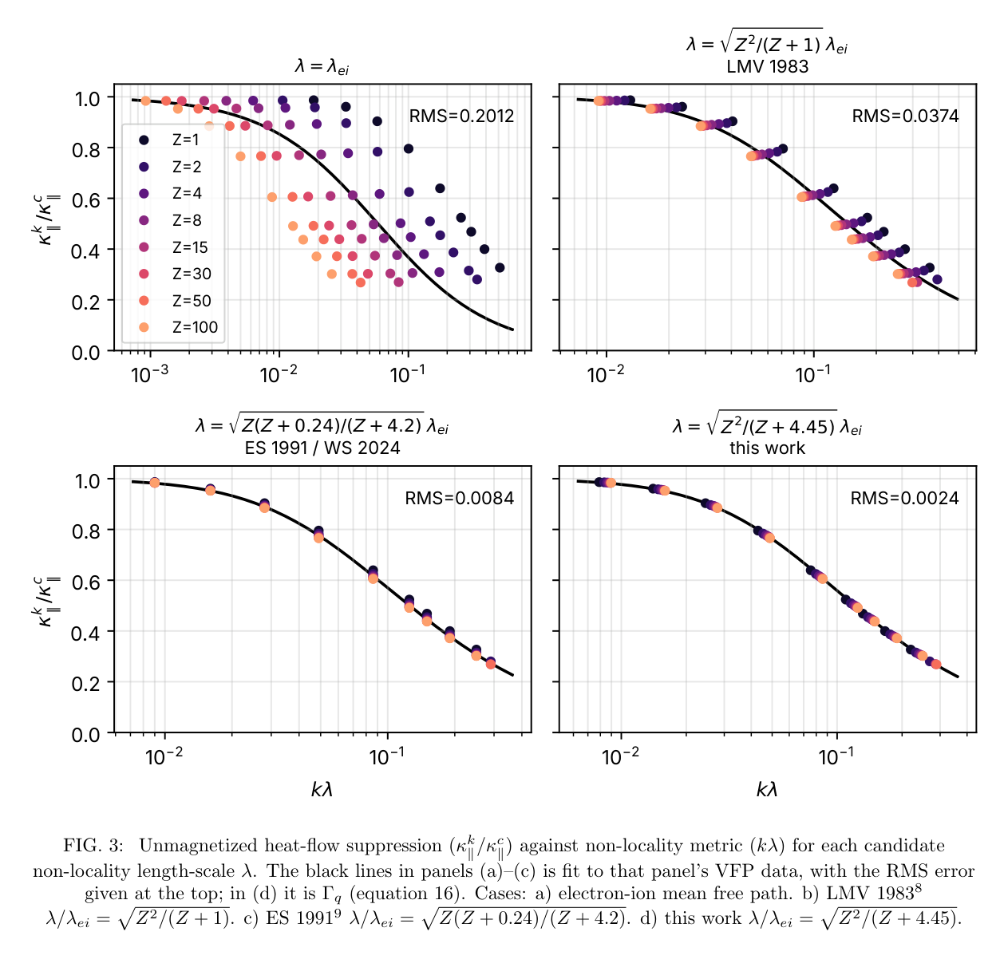
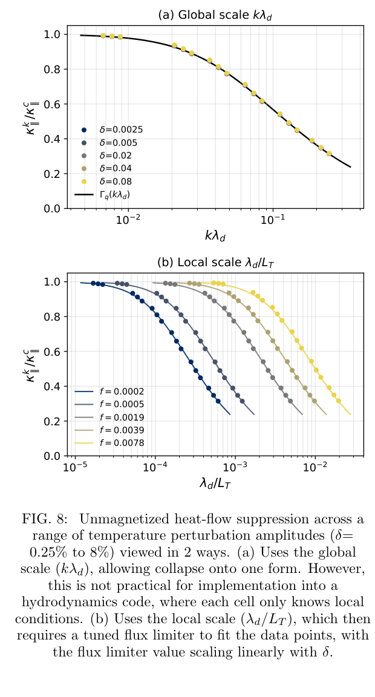

# 热流载流电子的非局域长度：电离度、磁化与限流器边界

> C. A. Walsh；*Plasma transport by carrier electrons: delocalization length for heat-flux*。arXiv preprint，2026-10-23。[arXiv DOI](https://doi.org/10.48550/arXiv.2610.32085) · [实际阅读全文](https://arxiv.org/pdf/2610.32085v1) · [本地 PDF](../pdfs/Walsh%20-%202026%20-%20Carrier%20electron%20heat%20flux%20nonlocality.pdf)。版本：官方arXiv v1作者稿。

## 摘要与证据范围

Walsh 用一维线性温度扰动的 K2 Vlasov–Fokker–Planck（VFP）与线性模数据库，为非局域热流建立电离度和磁化统一的经验尺度。证据是**作者数值计算、拟合和保留测试集验证**，没有新的 ICF 实验或本地辐射流体计算。本文是三篇系列中的第二篇：第一篇 2610.30303 研究经典输运载流速度；两者相关但不是同一作品。

## I–II. 为什么热电子平均自由程不足够

热流主要由比热速度更快的尾部电子承担；电子—离子碰撞主要改变方向，电子—电子碰撞还重新分配能量。等离子体的热导长度与失去热记忆的净位移不同：经 N 次随机步进，净位移约为步长乘 √N。这解释了去局域长度同时依赖方向随机化和能量交换，系数仍需动理学计算标定。

$$
\lambda_d=\lambda_{ei}\frac{Z}{\sqrt{Z+4.45}},\quad
\psi_d=13.5\chi\frac{Z}{Z+4.62},\quad
\lambda_{d\perp}=\frac{\lambda_d}{1+\psi_d^{1.6}}.
$$

λ_ei 按本文碰撞时间/热速度约定，Z 为电离度，χ=ω_eτ_B 是 Braginskii Hall 参数。不同文献碰撞时间定义可能相差系数。ψ_d=1 表示磁化使去局域长度减半；它不同于令经典垂直热导减半的 ψ_κ，不能互换。λ_d/λ_ei 随 Z 并非总小于 1；“低 Z 碰撞使局域化”应相对于同一碰撞模型比较。

## III. 数值设置

离子固定且视为无限重、均匀磁场固定，一维小振幅正弦电子温度扰动。电子分布球谐展开到 f₆，采用完整 e-e 碰撞算子；f₂ 以上虽不直接贡献热流矩，仍通过反馈改变 f₁。用缩放 e-i 频率代替 e-e 算子可近似经典热导，却不能保证正确的载流速度和非局域响应。

拟合使用超过 10⁵ 个线性模计算；验证包括 75 个无磁 VFP 点与 224 个磁化 VFP 点，不是 10⁵ 次独立实验。磁化测试涵盖 Z=1、4、15、50 和 χ=0.01–1；附录整体报告域为 Z=1–100、χ=0–1、kλ_d≈0.0079–0.29、初始扰动 δ≈0.0025–0.08。

## IV–V. 无磁与磁化验证

**来源：PDF 第 5 页，Fig. 3。** 横轴 kλ（对数），纵轴动理学/经典热导比，无量纲；颜色代表不同 Z。仅 λ_ei 时数据不塌缩，本文 λ_d 的右下图 RMS≈0.0024。这个 RMS 是抑制比的绝对残差，不是所有实验热流的 0.24% 相对精度。

例如 Z=50、kλ_ei≈0.013 时热导比约 0.60；Z=1 即使 kλ_ei≈0.033，仍约 0.96。不能只凭 kλ_ei 排非局域强弱。磁化垂直热流在 χ≤0.3 的验证 RMS≈0.011，χ=0.5、1 约 0.018；Righi–Leduc 约 0.019。附录最大绝对偏差可达 0.034（垂直）及 0.087（Righi–Leduc），平均 RMS 不代表逐点上界。

Righi–Leduc 横向热流的载流电子更快，所需无磁长度为 2λ_ei Z/√(Z+2.5)，并需另一条抑制函数；不能把垂直热导拟合原样用于所有分量。作者发现两者的去局域长度具有相同的磁化缩放 ψ_d，而非“所有热流相同”。

## VI. 从全局模尺度到局部限流器

**来源：PDF 第 9 页右列，Fig. 8。** 上图横轴全局 kλ_d，各扰动振幅的热导比近乎重合；下图横轴局部 λ_d/L_T，曲线随 δ 分开，虚线为不同限流值。纵轴均为无量纲热导比。图示的是局部信息无法单独识别全局 Fourier 模的问题，而非局部闭合已普适解决。

$$
T_e=T_0[1+\delta\sin(kx)],\qquad
L_T\simeq\frac1{k\delta},\qquad
\frac{\lambda_d}{L_T}\simeq\delta k\lambda_d.
$$

以上在小扰动、最大梯度附近成立。因此即使线性全局响应不依赖振幅，用局部梯度代替 k 后仍需有效振幅参数 f；单模时 f≈δ。Fig. 8(b) 图例的 f≈0.0002–0.0078，对应 δ≈0.0025–0.08，数值并不等于 δ；该图的调参限流值与正文新形式中 f=δ 的定义/换算需澄清，不能混作同一标定。把小振幅标定外推到 δ≈1、强梯度、多模实际 ICF 没有在本文完成验证。原文末尾把常用 f=0.05–0.2 与“δ of order unity”联系，口径与 f=δ 的单模关系需按实际场景解释，不能读为已证明 f=1。

作者提出三热流分量用完整温度梯度构造同一个 L_T，使 B→0 任意夹角可回到无磁形式；但数据库只验 B∥∇T、B⊥∇T，混合角度尚待测试。

## VII–附录. 适用性与接续

拟合跨到 kλ_d≈0.29，但作者仍将 kλ_d>0.15 的深非局域修正列为后续问题；不能把扫描范围等同为所有物理机制的验证范围。正文摘要 Kn_d=8.28λ_d⊥/L_T 的局部判据应与上面的振幅限制一起读。下一篇的非局域 Nernst/Biermann 磁场输运不是本篇已交付结果。

对 HEDP 模型的价值是用正确的载流电子尺度审查限流，并在电离度、磁化、谐波截断、最坏残差和几何域内报告精度。后续需真实多维非线性温度结构、混合磁角、离子运动及实验热流验证。本轮没有运行 K2、MHD 或改动任何模拟软件。

核验：[PDF与哈希](../pdf_validation.json) · [来源与去重](../research/sources.jsonl) · [版本核查](../research/version-checks.json) · [MinerU](../research/mineru-attempts.json) · [原图来源](../research/figure-manifest.json)。
