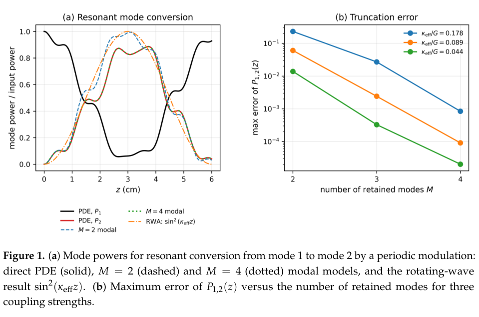
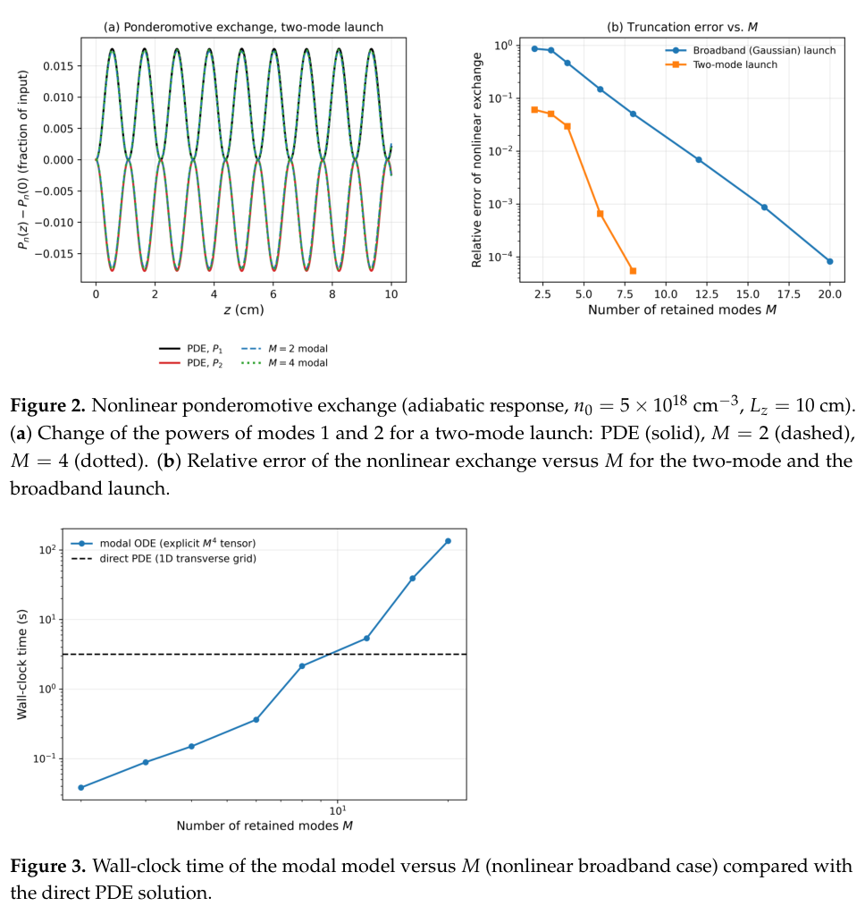

# 激光—等离子体模耦合的算符表示：守恒结构、截断误差与降阶代价

> Mostafa Behtouei、Carlos Salgado Lopez、Giancarlo Gatti；*Operator Formalism for Laser–Plasma Mode Coupling*，**Axioms 15(11), 800**，正式发表 2026-10-27，接受 10-23。 [正式 DOI](https://doi.org/10.3390/axioms15110800) · [实际阅读全文：官方开放 CDN VOR](https://mdpi-res.com/d_attachment/axioms/axioms-15-00800/article_deploy/axioms-15-00800.pdf) · [本地 PDF](../pdfs/Behtouei%20et%20al.%20-%202026%20-%20Operator%20laser%20plasma%20mode%20coupling.pdf)。对应早期稿为 [arXiv:2512.04982](https://arxiv.org/abs/2512.04982)，题名 *Operator Formalism for Laser-Plasma Wakefield Acceleration*；本笔记按 29 页正式版核读，不用早期稿摘要替代正式结论，也不将其计为另一篇作品。

## 摘要与证据范围

论文把近轴激光包络和冷流体等离子体响应投影到横向模空间，明确线性传播、折射率反馈、等离子体振荡和有质动力源四类算符。数学工作包括自伴性、模功率守恒、无限模表示与 PDE 的等价、冻结响应下的截断上界和不变子空间选择规则。作者另做一横向维度的 PDE—模 ODE 对照；**这是有条件的表示/降阶验证，没有验证真实尾场产生、泵浦耗尽、注入和电子加速，也没有 PIC 对照或神经算符训练**。

一个尤其重要的限制已由作者在第 5、26、28 页明确承认：数值例保留有质动力非线性，却省略在该组参数下峰值约为其 **3.6 倍**的相对论质量非线性。因此小的“模模型相对参考 PDE 误差”只能说明两个同样简化的模型接近，不能说明它们已准确预测同参数真实等离子体。

## 1. 引言：为什么换一种表示

引言先区分粒子束驱动 PWFA 与激光驱动 LWFA，再回顾包络/耦合模方法。作者的目标是把几何缺陷、介质响应和模间反馈放进同一表示，使低维近似的耦合通道可解释；这没有增加新的物理机制。只有实际激光场集中于少数横模时，降阶才可能省时，不能由“矩阵较小”直接推出普遍加速。

正式版收窄了早期稿中较宽的应用措辞。神经算符、强相对论/动理学扩展和复杂飞行焦点都在展望层；引用已有加速实验只是背景，不是本论文的新实验。

## 2. 记号、时间尺度与算符的数学域

### 2.1 三个时间尺度和量纲

光周期远短于欠密度等离子体周期。载波平均去掉光相位，等离子体感受到包络平方；慢时间作为传播变量的参数。长脉冲远长于等离子体周期时可以用绝热响应；同量级短脉冲需保留延迟振荡。本次数值只测试前者。

文中原始包络是电场幅度，所谓 I 是电场包络平方，并非已经换成 W/m² 的 SI 强度。线偏振平面波的物理平均强度还需相应的介电常数和光速因子。第 11 节数值又把包络改成归一化幅度，不能把两个变量的单位直接混用：

$$
a=\frac{e|\Psi|}{m_e\omega_0c},\qquad I_{\rm SI}=\frac{\epsilon_0c}{2}|\Psi|^2.
$$

这里 e 为正的元电荷，m_e 为电子质量，ω₀ 为激光角频率；a 无量纲。横模正交归一化后，模范数平方与横向积分电场平方相等，转换成物理功率还需保持相同归一化约定。

### 2.2 从 Helmholtz 到近轴包络

把场写成慢包络乘纵向快相位，保留传播的一阶导数、舍去包络二阶纵向导数，得到：

$$
i\partial_z\Psi=-\frac{1}{2k_0}\Delta_\perp\Psi-\frac{k_0}{2}\chi\Psi,
\qquad \chi=\chi_0+\chi_1+\chi_{\rm pl},\qquad
\chi_{\rm pl}=-\frac{e^2\delta n}{\epsilon_0m_e\omega_0^2}.
$$

k₀=ω₀/c，单位 m⁻¹；χ 无量纲，δn 是电子密度扰动。第一项为衍射，χ₀ 是导引背景，χ₁ 是给定的弱介质/壁面扰动，χ_pl 是密度反馈。负号意味着电子密度增加使欠密度等离子体折射率下降。该标量局域冷流体模型不包含 Landau 阻尼、速度空间共振和动理学空间色散。

### 2.3 四个算符与守恒的含义

激光态属于复 L² 空间，密度态属于实 L² 空间；横向有限域使用理想 Dirichlet 导引壁。未扰动传播算符由横向 Laplacian 和实背景势组成，有实本征值与完备正交模。实有界折射率扰动给出有界自伴扰动。

$$
\hat K=\hat K_0+\hat K_1,\qquad
\hat K_0=-\frac{\Delta_\perp}{2k_0}-\frac{k_0\chi_0}{2},\qquad
\hat K_1=-\frac{k_0\chi_1}{2},\qquad
\hat N[\delta n]=\chi_{\rm pl}[\delta n].
$$

K 的本征值/耦合矩阵元单位是逆长度；N 是无量纲乘法算符，必须乘 k₀/2 才成为传播生成元。模间非对角矩阵元表示相干的功率重分配。

$$
P=\|\Psi\|_2^2=\sum_n|A_n|^2,\qquad
\frac{dP}{dz}=i\langle H\Psi,\Psi\rangle-i\langle\Psi,H\Psi\rangle=0.
$$

推导用到传播生成元 H 的自伴性。**该守恒是模功率守恒，不是激光把能量交给尾场后的完整能量守恒**；泵浦耗尽被舍去，因此不能同时将其读作已描述激光向加速电子的净能量转换。

局部适定性 Proposition 3 还要求光滑域/实系数、H² 初值，以及严格正的有限温度正则化。严格冷极限含包络平方的二阶空间导数，是另一类准线性问题；作者没有证明该冷极限或时间延迟响应的适定性，也没有宣称全局存在。数值测试恰使用冷极限，不能用这个有额外假设的定理直接背书测试的所有情形。

## 3–5. 有质动力、密度反馈和等离子体振荡

第 3 节先构造模矩阵，第 4 节回到连续性、动量和 Poisson 方程解释其系数。线性化连续性并用电子位移 ξ 表示速度，可得密度扰动等于背景密度乘位移散度的负值；再对动量方程取散度，并消去低频电场：

$$
U_p=\frac{e^2|\Psi|^2}{4m_e\omega_0^2},\qquad
\delta n=-n_0\nabla\cdot\boldsymbol\xi,
$$

$$
\left(\partial_t^2+\nu\partial_t+\omega_p^2-\gamma v_{\rm th}^2\Delta\right)\delta n
=\frac{n_0}{m_e}\Delta U_p,
\qquad v_{\rm th}^2=\frac{k_BT_e}{m_e}.
$$

U_p 单位 J，右端单位为密度/时间²；ν 为碰撞率。γ=3 是作者对沿扰动方向一维电子响应的闭合，不是任意几何下的普适热力学 γ。均匀背景模频率因此满足 Bohm–Gross 形式：

$$
\omega_{p,m}^2=\omega_p^2+\gamma v_{\rm th}^2k_m^2,\qquad
\hat\Omega_p^2=\sum_m\omega_{p,m}^2|\varphi_m\rangle\langle\varphi_m|.
$$

把强度投影到密度模后，每个模是受驱振子。对均匀 n₀，源系数随横向波数平方增加；不同激光模的干涉交叉项也贡献驱动，不能把总场平方替换成各模功率的简单和：

$$
\partial_t^2\delta n_m+\nu_m\partial_t\delta n_m+\omega_{p,m}^2\delta n_m
=-\alpha_m\int_\Omega\varphi_m|\Psi|^2\,d^2r_\perp,
\qquad \alpha_m=\frac{n_0e^2k_m^2}{4m_e^2\omega_0^2}.
$$

绝热冷极限忽略时间导数，得到：

$$
\delta n\simeq\frac{\epsilon_0}{4m_e\omega_0^2}\Delta|\Psi|^2,
\qquad \chi_{\rm pl}=-\frac{\Delta|a|^2}{4k_0^2}.
$$

激光中心通常是强度极大处，Laplacian 可为负，对应电子排空。有限温度把 Laplacian 响应加上椭圆平滑算符，其适用性需比较 Debye 长度与保留模波长。作者称数值参数下热修正不大于约 2×10⁻⁴，但这不消除相对论非线性被省略的问题。非均匀背景使等离子体模和源矩阵不再同时对角化；文中后续分析主要回到均匀背景。

## 6. 完备模等价与有限模截断不是同一件事

在完备基中投影不增加物理假设，Parseval 恒等式保证 PDE 与无限模系统只是同一近轴模型的不同表示。但有限 M 模会丢失初始场尾部，也会漏掉演化时从保留子空间流出的耦合。

令 P_M 投影到前 M 模，Q_M 为其补空间；给定、冻结的实有界响应 V 满足：

$$
\epsilon_M=\sup_z\|P_MV(z)Q_M\|,\qquad
\delta_0=\|Q_M\Psi(0)\|,
$$

$$
\|\Psi(z)-\Phi(z)\|
\le\delta_0(1+\epsilon_Mz)
+\epsilon_Mz\|\Psi(0)\|\left(1+\frac{\epsilon_Mz}{2}\right).
$$

推导先将全解拆成保留部分 p 和漏出部分 q。两块内部传播各自幺正，Duhamel 积分先界定 q 随距离增长，再用 q 驱动保留部分与截断解的差，最后相加。ε_M 单位逆长度，δ₀ 是**场范数**而非丢失功率比例。

该上界忽略模传播常数失谐，十分保守；文中 M=2–4 给 ε_M 约 1.1×10⁻⁴ μm⁻¹，只在约 0.9 cm 量级以内较有信息。不能把这一上界改称自洽非线性系统的全距离误差保证，作者明确没有证明后者。

**来源：正式 PDF 第 16 页 Fig. 1，含完整坐标、图例和图注。** 左图横轴传播距离 cm，纵轴模功率/入射功率；右图横轴保留模数，纵轴模 1、2 功率的最大绝对误差（相对入射功率归一化、对数轴）。二模在较强耦合时明显高估转换峰；增加模数或减弱耦合可显著降低误差。图证明的是有限模泄漏的重要性，不是两模普遍充分。具体测试参数在第 11 节给出。

## 7–8. 全矢量表示与周期模转换

第 7 节区分光场的小纵向分量和真正加速粒子的低频纵向尾场。前者由 Maxwell 横向约束决定，与横向激光模不独立；后者属于等离子体低频电势，应从密度和 Poisson 方程求出。加入光场纵向分量不等于已经计算电子能谱。

第 8 节的 Floquet 分析要求传播变量 z 中的**给定周期算符**，适用于外加静态周期介质，或忽略反作用的弱探针穿过预先给定的周期尾场；不能直接套在驱动脉冲自身产生并随时间运动的自洽尾场。强非线性 blowout 不在该弱周期降阶的验证范围。

对于两个同向传播模，周期扰动的倒格矢接近传播常数差时共振。旋转波近似给出：

$$
P_m(z)=\frac{|\kappa_{\rm eff}|^2}{\delta^2+|\kappa_{\rm eff}|^2}
\sin^2\!\left(\sqrt{\delta^2+|\kappa_{\rm eff}|^2}\,z\right),\qquad
\delta=\frac{\beta_m-\beta_n-G}{2},\quad\kappa_{\rm eff}=\frac{\kappa_{nm}}2.
$$

δ、κ_eff、G 单位均为逆长度；零失谐时两模近似预言在相应半拍长完全转换。这里“带隙”是同向模谱分裂，幺正传播没有增长解；一阶近轴方程不含反向波，不能把它当作真正反向 Bragg 停带或反射率计算。

## 9–10. 神经算符只是展望，不变子空间是选择规则

第 9 节没有构建、训练或验收神经算符。用学习映射代替密度反馈，只是候选闭合；准确性、稳定性和相对直接 PDE 的成本仍需系统比较。学习项只有被约束为实乘法算符时才继承这里的自伴性与功率守恒，不能默认网络自动守物理。

第 10 节把保留子空间严格不变的条件写成离开该子空间的矩阵元为零。轴对称通道的单一方位模扇区可以满足相应对称性，但叠加不同方位模会产生非轴对称密度响应而耦合扇区。对自伴算符，本征子空间由谱定理自然存在；这里并未解决一般有界算符的不变子空间问题。正式版还明确撤回把强模混合类比 hypercyclicity 的早期措辞：幺正轨道范数恒定，不可能在整个 Hilbert 空间稠密。

## 11. 一维数值测试：精度、输入复杂度与成本

### 11.1 参考模型和离散误差

平面通道半宽 40 μm，波长 0.8 μm，理想导引壁，只有一个横向坐标。参考 PDE 用正弦基伪谱 Strang 分裂，400 网格点、48 个保留模、传播步长 10 μm；作者称减半步长、加倍分辨率后模功率变化低于入射功率的 10⁻⁶。模 ODE 用自适应八阶 RK，相对容差 10⁻¹⁰，模功率漂移低于 10⁻⁹。这些是作者报告的内部数值检查，本轮没有运行其程序。

### 11.2 线性共振：二模误差可以很大

纵向扰动取 7.4×10⁻⁵ 的介电调制幅度，示例背景密度 10¹⁸ cm⁻³，κ_eff=5.2×10⁻⁵ μm⁻¹。旋转波两模模型预言约 3 cm 完全转换，参考 PDE 实为最大 P₂≈0.89、位置约 3.7 cm。第 3 模有不够大的失谐，二模最大功率误差达 **0.23 个入射功率单位**，M=3、4、6 分别约 0.027、8.4×10⁻⁴、1.5×10⁻⁵。二模旋转波近似自身还有约 0.09 的最大差异。必须报告耦合与失谐比，不能只展示完美正弦曲线。

### 11.3 非线性交换：误差分母改变后含义不同

非线性例取 5×10¹⁸ cm⁻³、传播 10 cm、密度扰动不超过约 2%，且要求脉宽远大于约 50 fs 等离子体周期。两模初始权重为 0.74/0.26，峰值 a₀≈0.55；参考 PDE 两模间交换约入射功率的 **1.8%**。M=2 的最大功率绝对误差 1.1×10⁻³，换成“相对交换量”便约 **6%**，不是 0.11% 的交换误差。M=4、6 相对交换误差约 3%、0.07%。

偏移 Gaussian 宽带输入取 a₀=0.5、腰斑 9 μm、偏移 6 μm，交换量仍约 1% 入射功率，但二模丢失的初始场范数为 0.64，交换相对误差约 87%。M=8、12、16、20 才分别降到约 5%、0.7%、0.09%、0.008%。小的总功率交换量使归一化分母尤其重要。

**来源：正式 PDF 第 27 页 Figs. 2–3，完整坐标/图注。** Fig. 2(a) 横轴 cm，纵轴是各模功率相对初始值之差/总入射功率；正负摆动表示保守的模间转移。(b) 横轴模数，纵轴是对非线性交换量归一化的误差，采用对数轴；宽带输入需要更多模。Fig. 3 横轴模数、纵轴同机器单线程墙钟秒数，双对数；显式四阶张量使高模数迅速变贵，虚线是直接 PDE 基准。

### 11.4 成本数字与图文差异

第 26 页正文给直接 PDE **1.2 s**；模 ODE 的 M=2、4、8、12、16、20 分别为 **0.03、0.12、0.53、2.0、7.9、37 s**，另需一次张量组装（M=4 约 0.03 s、M=20 约 0.44 s）。显式立方非线性张量有四个模指标，每次计算成本随 M⁴ 增长。按这组正文数据，只在约 M≤8、输入已集中于少数模时更便宜；宽带输入若需要低于 1% 的交换误差，至少 M=12，成本已高于 PDE。

**未解释的图文口径差异：** Fig. 3 虚线目视约 3 s，M=20 点位于约 10² s 量级，并不对应正文 1.2 s 和 37 s；部分其他点也不同。本笔记保留正文明确数字与原图，两者尚不能作为同一套精确计时互证；不自行选一个值计算宣传性加速比。图和正文共同支持“宽带高模数时不具普遍成本优势”这一有条件趋势。论文未公开完整运行代码仓库，仅称可向通讯作者合理索取；机器具体性能可比性和该图文差异仍待作者材料澄清。

## 12. 结论与接续重点

本论文的可复用成果是把耦合和近似的结构写清楚，并在一个共同简化 PDE 内量化有限模误差。优先接续事项是：加入在本参数下更大的相对论非线性；验收延迟等离子体响应/短脉冲与泵浦耗尽；用物理一致的能量计分连接加速电子；增加开放边界/多维/PIC 对照；公开代码和一致的计时数据。有限温度适定性证明、冻结响应截断界、冷绝热数值测试是三个不同证据域。

本轮只做正式 PDF、MinerU 正文、布局文本与原页/原图交叉核读，**没有复跑作者 PDE、模 ODE、张量组装、PIC 或机器学习训练**。本篇没有激光转换靶—光核中子/核素端到端实验或诊疗/防护验收。

核验：[PDF与哈希](../pdf_validation.json) · [下载来源](../download_report.json) · [来源与去重](../research/sources.jsonl) · [MinerU](../research/mineru-attempts.json) · [原图来源](../research/figure-manifest.json)。
