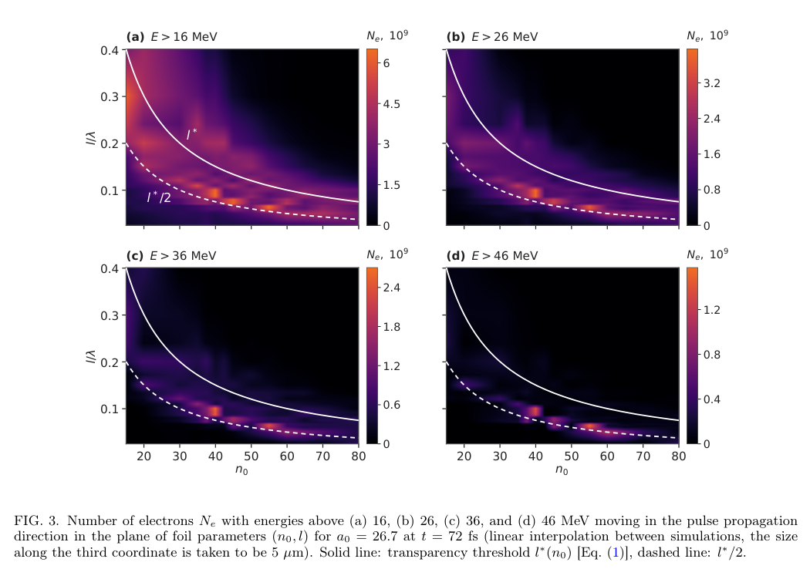
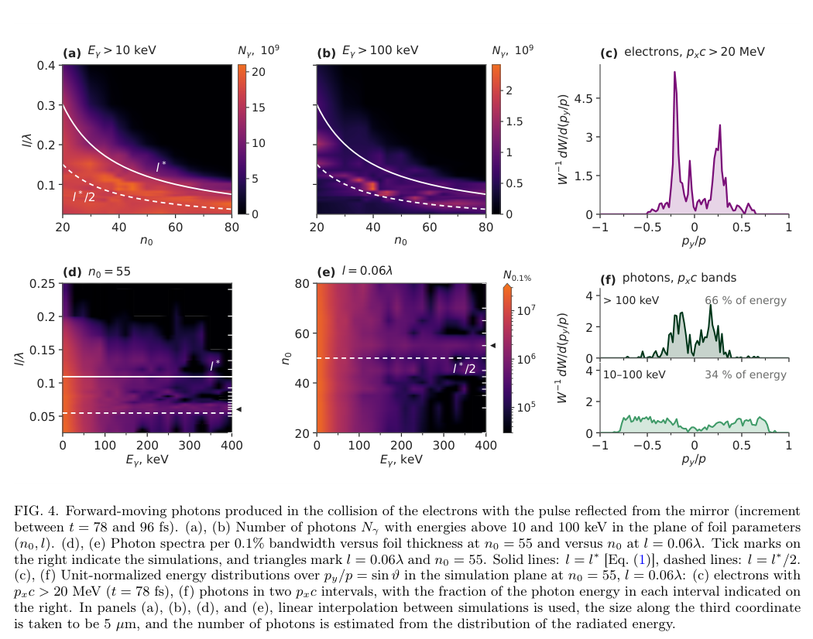

# 透明薄箔与等离子体镜的单脉冲 Compton 源：谱产额、发散与二维换算

## 0. 论文与版本

Daria A. Chekmareva、Artem V. Korzhimanov，*Bright Compton source based on the interaction of an ultraintense laser pulse with a relativistically transparent foil and a plasma mirror*，官方 arXiv:2610.35039v1，2026-10-26 提交，12页含4个补充小节。实际阅读官方 v1 PDF；精确标题 Crossref 前三项未验证到同作品正式发表版本。

## I. 引言：用固体密度增加辐射电子数

气体 LWFA/Compton 源的散射电子数受低密度限制；本稿令同一脉冲先穿过相对论透明薄箔，直接加速剥离电子，再被后方等离子体镜反射回来与电子碰撞。免去两个独立脉冲的同步，但没有实验到达时间稳定性的测量。本文是 **2D PIC 数值方案**，文献中的泡沫和碳纳米管实验是比较对象，不能称作本方案已实验实现。

## II. 方案、透明条件与计算设置

| 量 | 本文设置与定义 |
|---|---|
| 激光 | 800 nm；11 fs强度FWHM；5 μm强度FWHM直径；5 J；a₀=26.7；峰值1.5×10²¹ W/cm²、约430 TW |
| 偏振 | 线偏振，偏振平面相对模拟平面45° |
| 薄箔 | 初始完全电离、陡峭边界；扫描 n₀=10–90、l/λ=0.025–0.4；可动离子 q/m=3e/(7mₚ)，相当于Fe²⁴⁺ |
| 反射镜 | 57n_c、0.8 μm厚；位于薄箔后9 μm |
| 数值 | PICADOR；25×20 μm²；Δx=12.5 nm、Δy=100 nm；100宏粒子/格；x吸收、y周期 |

n₀=Nₑ/n_c，无量纲，800 nm时 n_c≈1.74×10²¹ cm⁻³。薄箔的面密度参数ε₀=πn₀l/λ，线偏振按相同强度与圆偏振比较，透明条件为：

$$
\frac{a_0}{\sqrt2}>\epsilon_0,qquad
l<l_* = \frac{a_0\lambda}{\sqrt2\pi n_0}.
$$

先由光压推动电子与离子分离，比较光压和最大静电束缚力得到条件；√2 来自偏振振幅与强度换算。对 n₀=55，l_*≈0.109λ，参考 l=0.06λ=48 nm 约为0.55l_*。这属于超薄层压缩/脱离的透明机制，不宜仅以“有效临界密度因相对论质量增加”解释；实际透明时刻取决于瞬时包络 a(t)。

头碰中强场摆动参数 K≈a≫1，非线性散射形成宽带连续谱：

$$
\omega_n\simeq\frac{4\gamma^2 n\omega_0}{1+a^2/2},\qquad
\omega_c\simeq3a\gamma^2\omega_0,\qquad
\chi_e\simeq\frac{2\gamma a\hbar\omega_0}{m_ec^2}.
$$

γ 为电子Lorentz因子，n为谐波阶数，ω_c是特征频率；分母表达横向强振动对基本频率的红移，高阶谐波使谱延伸到硬X射线。以γ≈200、a≈20估计χₑ≈0.024，量子性弱，不能称为强QED或对产生验证。代码仍使用依赖χₑ的MC同步辐射并扣除光子反冲；作者估计累积辐射损失约5%、辐射反作用力相对Lorentz力约0.03，是特定参数估算。

## III. 电子加速：最佳厚度是一条窄带

薄箔在场峰附近释放电子，形成λ/2间隔的团簇。平面波中 R=γ−pₓ/(mₑc) 是常数，由相对论能量关系得到：

$$
\gamma=\frac{1+R^2+p_\perp^2/(m_e^2c^2)}{2R}
\simeq\frac{1+p_\perp^2/(m_e^2c^2)}{2R}.
$$

第二式是原文使用的高能近似；完整式由 γ²−pₓ²/(mₑc)²=1+p⊥²/(mₑc)² 和R代入得来。薄箔帮助电子进入激光峰，而非仅靠真空平面波从静止获得同样净增益。补充S1的轨迹显示>45 MeV电子来自峰附近，离箔后平均横场做功约50 MeV、纵场带走约20 MeV；低密度无箔对照不超过25 MeV。

**来源：PDF第5页 Fig.3。** 横轴n₀、纵轴l/λ；颜色为沿激光前进电子数，标尺单位10⁹，四图阈值16/26/36/46 MeV，时间72 fs。实线l_*，虚线l_*/2，图是离散模拟之间线性插值，并假设第三向长5 μm。低阈值在更宽域存在，高能电子集中于约0.5–0.7l_*附近；相邻扫描点可差2–3倍，不是平滑全局最优证明。

>26 MeV电子扫描最大约4×10⁹（n₀=40,l=0.1λ），>46 MeV约1.6×10⁹（55,0.063λ）。电子谱宽、非热，截断约95 MeV；“最优参数”是有限扫描的观察最大附近，不能写成单能100 MeV束或全局唯一最优。过薄会过早放走电子，过厚则反射大部分能量；作者选n₀≈45–55、厚44–53 nm作折中。

## IV. 光子计分：第二阶段与三阶段总量分开

碰撞只有约80%的>25 MeV电子参与，最前沿电子先穿过镜区。作者把前向辐射分为薄箔作用48–66 fs、头碰78–96 fs及回返脉冲再撞箔108–126 fs三阶段。Fig.4只统计**第二阶段增量**，不能把其光谱与全时段总数互换。

**来源：PDF第6页 Fig.4。** (a,b)轴为n₀、l/λ，颜色为>10、>100 keV光子数（10⁹）；(d,e)横轴光子能量keV、纵轴分别为厚度和密度，颜色为每0.1%带宽光子数，并非每keV。若从能谱密度换算，窄带近似N₀.₁%=0.001Eγ(dN/dEγ)。(c,f)横轴pᵧ/p=sinθ，纵轴是单位总能量归一化的角能量分布；66%/34%是两个pₓc区间的辐射能量分配，**不是光子数比**，pₓc角分量区间也不严格等于总能量分箱。

第二阶段>10 keV约(1.6–1.9)×10¹⁰/shot，>100 keV约(1.5–2.4)×10⁹；典型光谱约1.5×10⁷/0.1%于10 keV、2×10⁶于100 keV、3×10⁵于250 keV。三阶段合计的前向10–250 keV光子约7×10¹⁰/shot，总能约0.4 mJ；相对5 J约8×10⁻⁵，作者写η≈10⁻⁴。全时段谱产额最高约10⁷ photons/(0.1% BW·J)，250 keV约4×10⁵；不能把最高值铺满整个10–250 keV能区。

**绝对产额的重要限制：** 2D结果乘假设的第三向5 μm得到总数；但硬光子的有效横向尺寸降到约2.5 μm，作者自己说明硬谱绝对数可能高估约两倍。没有真实3D模型、收集孔径、靶热/碎屑寿命或重复频率实测。

源的第二阶段持续约5–10 fs、横向约3 μm。附录S3/S4说明辐射是偏振平面内的扇形而非轴对称圆锥；测试粒子估算80%能量立体角约1.2 sr（10–100 keV）、0.13 sr（>100 keV），全三阶段另有约1 sr和0.4 sr口径。由谱数除以τAΔΩ估得约10²⁰ photons/(s·mm²·mrad²·0.1%)，依赖时长、尺寸和立体角近似。谱产额提升没有等比例转化成峰值亮度。

## V. 应用价值、比较与接续

作者比较气体镜Compton和betatron文献时混有全角、轴上、带宽、每J等不同原始口径，已作估算换算；其结论是大收集角单发成像潜力，不能推广到准单色小发散源的全部指标。文中“1 Hz时接近某紧凑源总通量”是假设，不是本方案已1 Hz运行；未优化谱宽和发散。建议先做3D与宏粒子统计/网格收敛，真实预脉冲/电离/面密度误差扫描、谱角联合诊断，以及衰减、屏蔽和剂量验证。本文能区为硬X射线，没有转换靶韧致辐射—光核中子/核素链条，不能据此推断临床或核反应产额。本轮未运行PICADOR、轨迹模型或实验。

来源：[DOI](https://doi.org/10.48550/arXiv.2610.35039) · [实际全文](https://arxiv.org/pdf/2610.35039v1) · [本地PDF](../pdfs/Chekmareva%20and%20Korzhimanov%20-%202026%20-%20Transparent%20foil%20Compton%20source.pdf)。

核验：[PDF与哈希](../pdf_validation.json) · [来源与去重](../research/sources.jsonl) · [版本核查](../research/version-checks.json) · [MinerU](../research/mineru-attempts.json) · [原图来源](../research/figure-manifest.json)。
