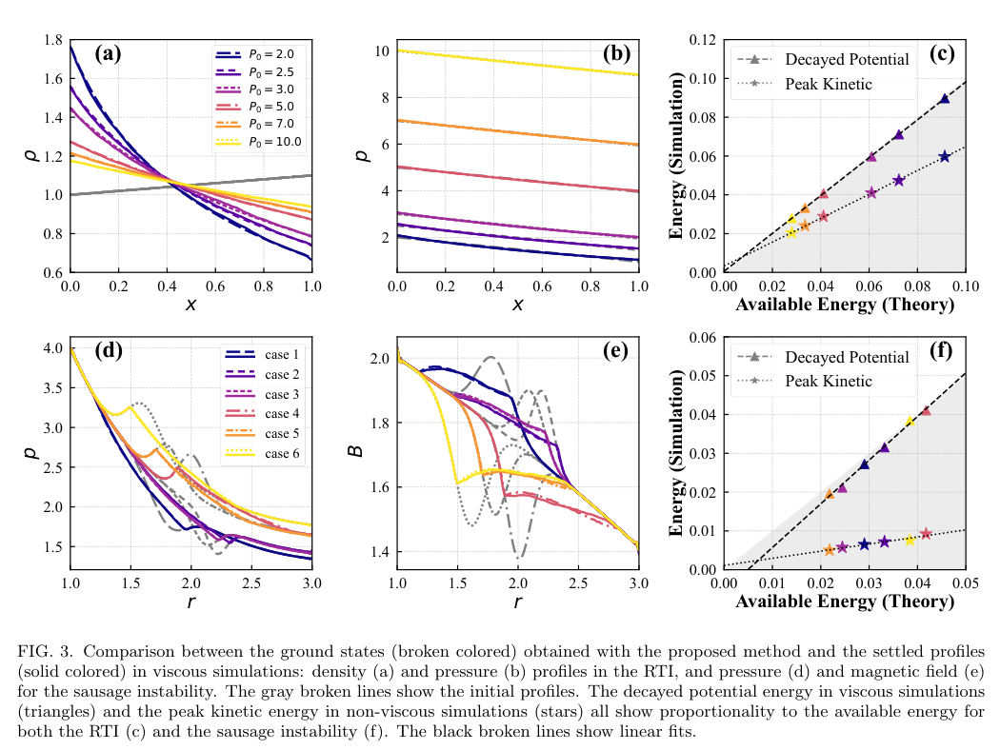

# 对流不稳定性可释放多少能量：重排—松弛方法的基态与边界

## 0. 论文与实际阅读版本

Kaixuan Fan、Yao Zhou，*Available Energy and Ground States of Convective Hydrodynamic and Hydromagnetic Instabilities*。PRL **137, 185101，2026-10-27 正式发表**；接受为 10-07。正式 DOI 10.1103/bp24-s332。**实际阅读全文为官方 arXiv:2602.23983v1 作者稿**：提交 2026-02-27，首页打印 March 2, 2026；APS harvest 本轮代理与直连均 HTTP 401。以下公式、图及数值结论属于这份 6 页作者稿，未完成与最终 VOR/补充材料的逐项对照。

## 1. 引言：线性失稳与最终破坏程度之间缺少什么

作者先区分是否线性不稳定与不稳定最终能发展多大。RTI、托卡马克锯齿/边缘模和 Z-pinch 的交换运动都可释放势能，但线性增长率并不决定最终是温和饱和还是大尺度崩塌。本篇把“可用能量”作为不依赖详细时间轨迹的非线性量度；它不能输出增长时间、输运通量或某次实验的破坏阈值。

Gardner 原方法在无碰撞等离子体相空间内重排分布函数，保留相体积和分布值；Lorenz 可用势能则重排流体团。单用连续 Lagrangian 映射过于严格，无法完成对流所需的不连续换序。作者因此先换序，再在新顺序下连续压缩/膨胀，求满足局部守恒与力平衡的低能状态。

## 2. 不可压 RTI：从交换论证得到能量界

$$
W[\rho]=\int \rho(\mathbf x)\phi(\mathbf x)\,dV,\qquad
\mathcal A=W_0-W_g.
$$

ρ 是质量密度，φ 是单位质量的重力势，W 是势能，A 是初态高于所选约束基态的能量。交换位于低势和高势两处的等体积流体团，势能差为密度差乘势差：若较重流体在高势处，交换可降低能量。因此最低能排列应使 ρ 随 φ 单调下降，且保留每种密度占据的体积。这是构造可释放能量上界的直觉，不是“全部势能最终变成动能”。

对应 Vlasov 问题中以 f 代替ρ、粒子能量ε代替φ；不可压流体只是配置空间的形式对应，不能把真实可压等离子体直接当作相空间不可压体处理。

## 3. 可压 RTI：熵排序之后还必须恢复力平衡

理想绝热气体的比熵指标为 ln(p/ρ^γ)，沿流体团不变；质量 ρdV 也不变，而密度和体积各自可以变。γ 是绝热指数。本篇先将等体积流体团按熵指标递增排列；此时团的 p、ρ 不变，但新状态通常不满足静力平衡。图1是这个两步构造的示意，图2展示换序态与最终基态明显不同。

令 x₁ 是换序后的坐标、x_g(x₁) 是松弛映射、J=dx_g/dx₁>0。质量与绝热关系分别给出：

$$
\rho_g=\frac{\rho_1}{J},\qquad p_g=\frac{p_1}{J^\gamma},\qquad
W_g=\int\left[\rho_g gx_g+\frac{p_g}{\gamma-1}\right]dx_g.
$$

这里 W 包含重力势能与内能；平面模型可按单位横截面积理解。把 dx_g=Jdx₁ 代入，再对 x_g 的变分为零，得：

$$
\rho_1 g+\frac{d}{dx_1}\left(\frac{p_1}{J^\gamma}\right)=0.
$$

它等价于新坐标中 dp_g/dx_g=−ρ_g g。由于 J>0 保留熵排序，最终态同时满足力平衡和所用的 Schwarzschild 稳定条件。并非在原始密度曲线上排序就结束了。

作者以 Dedalus 二维可压流体比较：y 周期，x 方向密度/压力 Neumann、速度自由滑移；加入小超扩散用于数值稳定，大黏性用于阻尼到近静态。另做无普通黏性而有小超黏性的运行取动能峰值。P₀=2–10 改变可压性，P₀=10 更接近不可压极限。这里的 P₀ 和图轴是论文数值模型量，不能直接读成 Pa 或实验压强；当前作者稿把更完整设置指向单独补充材料，该补充材料没有随本 PDF 取得，故未宣称复现了运行配置。

**来源：PDF第4页 Fig.3。** 上排(a,b)横轴 x、纵轴ρ和p；下排(d,e)横轴r、纵轴p和B，均按论文数值规范化显示。实线为黏性模拟最终剖面，彩色虚线为重排—松弛预测，灰虚线为初态。(c,f)横轴理论可用能量，纵轴模拟能量，三角为黏性运行损失的势能、星形为弱耗散运行的峰值动能，黑线是拟合。最终剖面与预测相近，势能损失接近可用能量；峰值动能明显较小，尤其 sausage 算例。**相同比例关系不代表斜率为1，更不能说全部可用能量转化成峰值动能。** 图未给出通用误差条或网格收敛上界。

## 4. m=0 sausage：几何因子和磁通是额外约束

对纯环向磁场的圆柱 Z-pinch，初态需满足磁压与磁张力共同平衡。原文采用把磁导率吸收到磁场单位中的规范化：

$$
\frac{d}{dr}\left(p+\frac{B^2}{2}\right)+\frac{B^2}{r}=0,
\qquad \sigma=\ln\left(\frac{r p^{1/\gamma}}{B}\right),\quad
\frac{d\sigma}{dr}>0.
$$

SI 单位写磁压/张力需恢复μ₀，不能直接把图中B代入特斯拉。σ 的不变性来自质量、熵与环向磁通守恒；其梯度是本模型稳定判据。作者比较等体积团与等径向长度团的换序，得到的中间态不同，但 σ 顺序相同，进一步松弛的基态一致。

圆柱 Jacobian 为 J=(r_g/r₁)(dr_g/dr₁)，因此基态 B_g=r_g B₁/(r₁J)、p_g=p₁/J^γ；漏掉 r_g/r₁ 就不再保磁通。作者用轴对称(r,z) Dedalus 理想 MHD 检查六种压力峰/谷剖面，图3下排仍支持受约束基态和可用能量尺度。此处可用能量占总能量很小，作者承认对数值设置较敏感；不宜把图上对齐写成任意 Z-pinch 都有同样精度。

## 5. 讨论与接续

方法的当前便利是稳定判据可用一个局部守恒量表达；更一般几何可能没有这样的判据，松弛态也可能再失稳，需要迭代。螺旋 pinch、环形 ballooning 是未来工作，未在本稿交付。A 给出指定守恒约束下的能量尺度，不含电阻重联、真实三维磁拓扑约束、动力学耗散、辐射冷却或装置壁热负荷验收。

对 HEDP/靶设计的价值是先筛查潜在能量释放，再决定哪些工况需要完整演化计算；不能由此直接放宽真实装置稳定性门槛。本轮完成全文/原图阅读，**未运行 Dedalus、求解松弛边值问题、重拟合图3或进行实验**。待恢复 VOR 与补充材料并核实系数、单位和数值收敛。

来源：[DOI](https://doi.org/10.1103/bp24-s332) · [实际全文](https://arxiv.org/pdf/2602.23983v1) · [本地PDF](../pdfs/Fan%20and%20Zhou%20-%202026%20-%20Available%20energy%20convective%20instabilities.pdf)。

核验：[PDF与哈希](../pdf_validation.json) · [来源与去重](../research/sources.jsonl) · [版本核查](../research/version-checks.json) · [MinerU](../research/mineru-attempts.json) · [原图来源](../research/figure-manifest.json)。
