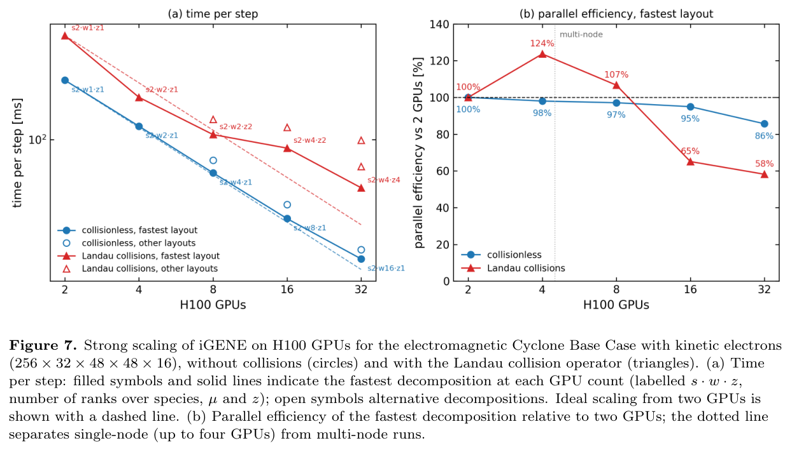
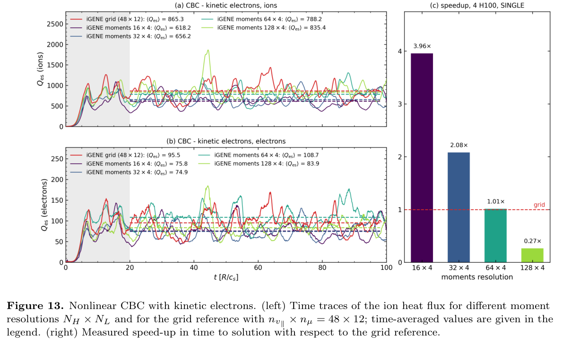

# iGENE 的 JAX 回旋动理学：自动微分、GPU 加速与精度成本

> Gabriele Merlo、Victor Artigues、Carl-Martin Pfeiler、Frank Jenko；*Accelerating high-fidelity gyrokinetic fusion simulations with iGENE*。2026-10-24 提交的官方 arXiv v1 作者预印本。[论文页面](https://arxiv.org/abs/2610.33561) · [实际阅读全文](https://arxiv.org/pdf/2610.33561v1) · [arXiv DOI](https://doi.org/10.48550/arXiv.2610.33561) · [本地 PDF](../pdfs/Merlo%20et%20al.%20-%202026%20-%20iGENE%20JAX%20gyrokinetic%20acceleration.pdf)。PDF 共25页；首页保留 IOP 模板的 Journal vv/yyyy、日期占位符，不能据此认定已经正式出版。

MinerU pipeline 已返回真实全文，并与已验证 PDF 的布局文本及关键原页交叉核对；标题中的模板占位符、表格和图标注均按原页解释，未仅依赖解析文本。

## 摘要与证据范围

iGENE 将局部 GENE 回旋动理学求解器重写为 JAX，实现多物种、碰撞、电磁非线性模型及可微分计算。本文证据是**作者的跨代码核验、自动微分—有限差分比较和指定 H100 上的性能测量**，没有新聚变实验，也没有本轮本地代码运行或机器学习训练。它扩展了作者2026年 *Physics of Plasmas* 33, 083901 的 TensorFlow 原型，是新的 JAX 版本研究，不能把两篇的误差和性能混在一起。

作者给出的四个醒目数字具有不同分母：**86%**是无碰撞强缩放相对两块 GPU 的效率；**3.97倍**只指特定 FFT；**2.63倍**是单卡、指定算例相对 GENE fp32 的稳态每步性能；**1.89倍**是另一个高并行分辨率算例使用四个快子步的求解总时间收益。它们不能直接相乘，也不代表所有物理模型都以同样精度整体加速。

## 1. 引言：加快求解器而保留可控物理精度

作者首先指出，湍流输运的可信模拟仍需高成本的多尺度计算。重写目标包括物理完备性、端到端自动微分及GPU效率，未来可服务优化和AI/ML流程。**JAX求解器、自动微分和AI辅助写CUDA核本身都不是已训练的机器学习代理模型。** 文末明确将实际梯度优化/ML工作流留给后续论文。

本文随后区分保持同一离散模型的实现优化、改变时间积分的算法优化，以及主动降低速度空间保真度的矩截断。最后一类的收益必须与所需观测量的误差一起读。

## 2. 数值模型与离散：局部、δf、Maxwell背景的范围

每个物种的回旋中心分布满足回旋动理学方程：

$$
\frac{\partial F_s}{\partial t}+\dot{\mathbf X}\cdot\nabla F_s+\dot v_\parallel\frac{\partial F_s}{\partial v_\parallel}=C[F_s],\qquad F_s=F_{0s}+f_s.
$$

这里 X 是回旋中心位置，v∥为沿背景磁场速度，磁矩μ是另一速度坐标，C是碰撞算子。本文仅支持固定的局部 Maxwell 背景F₀；不应把“多物种/全电磁”理解成全局、full-f或任意非热背景模型。沿磁场漂移、镜力、曲率/梯度漂移和广义E×B项共同驱动演化。

为把平行矢势的时间导数并入演化变量，作者定义：

$$
g_s=f_s-\frac{q_s}{m_s}\overline A_\parallel\frac{\partial F_{0s}}{\partial v_\parallel}.
$$

q、m是物种电荷和质量，横线表示回旋平均。把该定义对时间求导，就能与原方程中含∂ₜA∥的项合并，因此实际推进g。Maxwell背景满足∂ᵥF₀=−mv∥F₀/T；换元改变量在v∥上为奇函数，所以不改变密度矩，却改变平行电流矩，后者在安培方程中产生skin项。温度T按能量单位计。

低频准中性方程与平行安培方程给出φ和A∥；加入B∥后，垂直压力平衡使φ、B∥成为耦合的线性代数问题。忽略位移电流和德拜尺度，属于回旋动理学排序，不是全频Maxwell/PIC模型。

空间采用沿场坐标，x、y为伪谱，z为四阶有限差分；v∥为等距网格，μ为Gauss–Laguerre求积。E×B非线性采用3/2去混叠，默认显式RK4，自适应步长；碰撞以一阶Runge–Kutta–Chebyshev分裂加入。Landau–Boltzmann和Sugama碰撞采用守恒有限体积实现，但本文不是独立碰撞实验验证。

几何接口包括s–α、圆形、Miller、EFIT、VMEC和GVEC；**EFIT、VMEC和GVEC在本文版本尚不可微分**。所以端到端梯度声明要限定在实际被追踪的参数和几何路径。当前只支持局部flux-tube；全局扩展、多尺度附加分片和常规纯本征值计算均未完成。

## 3. 代码核验：线性、非线性与梯度分开验

### 3.1 线性物理

Cyclone Base Case采用ε=0.18、q=1.4、磁剪切ŝ=0.789，R/Lₙ=2.22、R/Lₜ=6.96。作者分别核对绝热电子ITG、动理学电子ITG/TEM和随β变化的ITG→KBM转变。线性图的增长率γ、频率ω单位为cₛ/R，横轴kyρₛ或β；不同代码和速度表象的贴合是相同模型的数值一致性。加入B∥会降低KBM阈值并增加增长率，约1.5%的阈值只适用于该组参数。

### 3.2 非线性热流

作者将饱和窗口分为8个连续块，以块均值的标准误报告统计误差。这处理了时间相关性的一部分，但8块并不自动证明所有慢时标都已收敛。

绝热电子时，GENE离子热流39.4±0.3，iGENE网格40.9±0.8，相差3.8%、约1.8个合成标准误；8×4矩版本43.2±0.8，比GENE高9.6%、约4.5个合成标准误，作者明确承认小而显著的偏差。动理学电子时网格版离子/电子热流相对GENE约差1.9%/0.8%；128×4矩版离子热流差约6%，**电子热流仍低约13%**。不能只引用“结果一致”而忽略矩表象残差。

这些热流沿用GENE内部归一化；本文图表没有在每处重写SI换算，笔记不把数值直接写成W/m²。不同章节温度梯度和分辨率不同，热流均值也不能跨图直接比较。

### 3.3 自动微分梯度

在线性、无碰撞、绝热电子ITG算例，作者对温度梯度、密度梯度、q、ŝ、ε五个参数求窗口平均增长率的前向梯度，比较中心有限差分。窗口从40至102400步；长窗口约2247R₀/cₛ，五个参数的相对偏差依次约3.7×10⁻¹⁰、2.8×10⁻⁹、1.2×10⁻⁷、1.6×10⁻⁴和8.3×10⁻⁹。

前向模式每个方向推进切向量，不保留反向模式的完整激活带，因而能延长时间窗口。旧TensorFlow版本ŝ、ε的30–50%偏差，在这里通过把依赖ŝ的径向网格构造放回可追踪损失中消除。**光滑且数值看似合理的梯度仍可能漏依赖**，有限差分核对不可省略。该结果只验证线性窗口；湍流混沌的切向发散使非线性长时平均梯度仍待处理。

## 4. JAX 多GPU：86%从两卡起算，碰撞改变最优布局

数据按批次b、物种s、μ、z分片，v∥与横向波数平面留在每个rank，避免全转置/all-to-all。lax.scan等把多个时间步编译进单块，主机仅在诊断块边界同步；代价是初次编译、特定分片选择，以及尚无GENE式运行时全布局自动调优。

**来源：PDF第10页，Fig.7。** 左横轴H100数量，对数刻度；纵轴每步时间ms，也为对数。右纵轴是**相对两块GPU**的并行效率百分数。蓝圆无碰撞、红三角Landau碰撞；实心是该卡数最快布局，空心是其他布局。虚线理想缩放并不包含编译/初始化。

$$
S_N=\frac{t_{\rm step}(2)}{t_{\rm step}(N)},\qquad
E_N=\frac{2\,t_{\rm step}(2)}{N\,t_{\rm step}(N)}.
$$

由此若32卡每步17.4ms、两卡238.4ms，速度比约13.7，理想比16，效率约86%。这里E为无量纲；单卡装不下该问题，不能把13.7倍误称“相对单卡”。作者用同进程650步与150步耗时之差除以500，排除了编译和初始化；未覆盖完整科研作业的排队、I/O和重启成本。

无碰撞在16卡前效率约95%以上；Landau碰撞在32卡最佳布局49.3ms/步、约58%效率，错误布局98.9ms/步，接近慢一倍。图中碰撞4/8卡出现124%/107%的超线性效率，是相对两卡和布局/资源的结果，不能推导成算法无限超线性。86%不适用于含碰撞全模型。硬件为CINECA Pitagora、每节点4块H100，最多8节点32卡；更大规模尚待附加分片。

## 5. 算法加速及对应精度

### 5.1 平行快算子子循环

动理学电子平行穿越速度大，显式CFL可能被电子时间尺度限制；作者把右端拆为快平行F和慢横向S，S含E×B非线性。二阶Strang步为：

$$
g^{n+1}=\Phi^{S}_{\Delta t/2}\circ\left(\Phi^{F}_{\Delta t/N}\right)^N\circ\Phi^{S}_{\Delta t/2}(g^n),\qquad
\Delta t=\min\bigl(\Delta t_{\rm slow}^{\rm CFL},\,N\Delta t_{\rm fast}^{\rm lin}\bigr).
$$

Φ是相应子系统的显式RK流，N为快子步数量。半慢—N快—半慢使局部分裂误差O(Δt³)，故全局二阶；如叠加默认一阶碰撞分裂，总方法仍一阶。N只减少慢项重复计算，无法突破横向E×B自己的CFL，也需重复场求解；N越大不保证越快。

高z分辨率、氘质量比3671、β=10⁻³、纯ITG驱动R/Lₜₑ=0的指定算例，在N=4时达到1.89倍求解时间收益。离子/电子热流与N=1、2在作者块统计误差范围内一致。N再增加时已经碰到横向步长限制；这是该算例的收益上限，不是一般最佳N。

自适应Δt通过stop_gradient排除出梯度，所以导数沿**已实现的步长序列**计算，不包含步长控制器的参数响应。数据依赖N支持前向模式，但反向模式需固定N。附录B还记录了隐式平行解的失败边界：静电模型可重现，但电磁多卡的twist-and-shift链需全域gather/solve/scatter，Krylov维数与显存相互制约，未获得多卡墙钟收益。不能把“实现隐式”写成成功加速。

### 5.2 混合精度与定制 FFT：把核、每步和实际运行区分

性能测试在另一环境EUROfusion Gateway单块94GB H100，JAX 0.10.2/CUDA12；这些是作者报告的版本，未在本轮安装或复测。JAX缺少低于单精度的复数类型，故bf16仅用于非线性项的部分数据/计算，**并非整个求解器16位**。定制核只针对96、192、384等特定去混叠长度，其他长度回退jnp.fft。

算子优化包括warp内分解、转置融合、跳过已知为零的去混叠区；因此同精度收益也含减少工作量，不能全部归因于bf16或新FFT算法。基础核在fp32寄存器计算，另有packed bf16蝶形变体，后者每级舍入而非只在输入/输出舍入。

| 作者比较，单位ms/步或ms/变换集合 | 原耗时 | 新耗时 | 对应速度比 |
|---|---:|---:|---:|
| 算例A：fp32 cuFFT→bf16定制FFT，仅变换 | 87.2 | 22.0 | 3.97倍 |
| 算例A：整个Poisson括号 | 209.7 | 62.6 | 3.35倍 |
| 算例A：整个时间步 | 271.0 | 123.8 | 2.19倍 |
| 算例B：整个时间步 | 152.6 | 67.9 | 2.25倍 |
| 算例C：GENE fp32→iGENE bf16括号 | 575 | 219 | 2.63倍 |
| 算例C：iGENE cuFFT→iGENE bf16括号 | 447 | 219 | 2.04倍 |

前三组分别取Table2，后两组取Table3；算例A/B/C网格、剪切和成本不同。Table3还给iGENE fp32定制FFT约267ms/步，相对GENE2.15倍。GENE双精度预计105GB，超过该卡显存，故**没有同机GENE双精度比较**。作者承认部分优化可以回移植Fortran，因此差值不是Python/JAX语言天然优越性的证明。

Table3是预热后、关闭诊断和检查点的稳态每步测量。Fig.10对应带通信和完整诊断的实际时间序列比较时，bf16相对fp32收益为**1.73倍**，不是2.04/2.63倍。离子、电子热流及粒子流均值分别向同方向偏移约6.9%、2.3%、4.0%，虽然各在2个标准误内，**一次运行不能排除小的系统偏差**。

### 5.3 Hermite–Laguerre矩：少自由度不保证同精度更快

令v=v∥/vₜₕ、w=μB/T，vₜₕ=√(2T/m)，用归一化Hermite pₙ与Laguerre Lₗ展开：

$$
g=F_0\sum_{n<N_H}\sum_{l<N_L}c_{nl}(z)\,p_n(v)L_l(w),\qquad
c_{nl}=\frac1{n_0}\int d^3v\,p_nL_lg.
$$

F₀提供Maxwell权重，因此正交投影把速度积分化成系数求和；cₙₗ为相对背景归一化的无量纲扰动矩，NH、NL为保留阶数。v或w乘法通过多项式递推只耦合相邻指标，使线性算子带状；密度与平行电流只直接用n=0、1的矩，高阶仍通过动力学耦合影响低阶。

截断时场方程的极化/skin项也用同一有限Laguerre和替代解析Γ₀，避免Boltzmann响应出现伪电荷。因此**有限阶矩版与网格版形式上求解不同离散方程**，只有提高阶数后收敛。截断末端积累的自由能用超碰撞或指定闭合耗散，低阶误差也可能依赖未调节的超碰撞强度。

**来源：PDF第19页，Fig.13。** 左上/下分别为离子/电子静电热流Qₑₛ的GENE归一化时间序列，横轴t单位R/cₛ；灰区为早期演化，横向虚线为选定窗口均值。右侧速度比相对48×12速度网格，4块H100、单精度；1为等耗时基线，柱低于1表示更慢。原图caption把左侧简写为“ion heat flux”，但下图面板明确是电子热流，解读按面板标签。

16×4矩以3.96倍速度运行，但图中离子均值618.2对网格865.3，约低28.6%（正文概述“约25%”）；电子温度涨落在Fig.14中低估超过两倍。128×4矩时离子均值835.4、电子83.9，对网格865.3/95.5约差−3.5%/−12.1%，速度比仅0.27，即约慢3.7倍。原文称高阶取得统计匹配，但第3.2节也明确电子热流仍低约13%；不能把128×4说成所有观测量无差别收敛。

绝热电子更有利：Fig.11中8×4矩离子热流42.7、网格41.0，约4.1%偏差而快6.1倍；4×3矩虽然快18.3倍，却给64.1、过高约56%。同为256个速度自由度的32×8矩，因可解析更大速度、显式时间步更小，反而约慢4倍。矩最高速度随√NH增长，漂移频率也随阶数增加，**变量少与每步便宜不等于到同一物理时间更便宜**。

## 6–7与附录. 综合限制、可复现性与接续

子循环与bf16都压低慢非线性项的成本占比，组合后收益会相互削弱，不能直接乘1.89、2.63、3.97。为特定任务选择低阶模型，应同时验热流、涨落、线性阈值和优化目标，不能只用一个饱和热流平均数验所有保真度。

数据可用性声明为输入文件、时间序列、计时日志可向通讯作者合理请求；本文没有给这些图数据的公开归档链接。本轮完成全文、关键页与原图核读，没有取得作者运行输入/计时原始文件、复跑GENE/iGENE、测试GPU性能或训练代理模型。作者使用Claude Code辅助开发定制CUDA核，并声明由作者审查核验；这属于开发过程披露，不是独立软件保证。

后续优先：同一硬件/精度/诊断/时间终点下复测；多种随机种子与更长相关窗口确认bf16偏差；对真实几何和碰撞下的梯度进行独立检查；统一下游容差后比较矩与网格；补全可微几何接口、全局模型和公开可复现输入。该研究与PIC/ML方向的联系是高保真动理学、可微模拟和多保真数据生产，不能写成已经解决激光加速器、全局聚变输运或机器学习闭环优化。

核验：[PDF/哈希](../pdf_validation.json) · [来源与版本](../research/sources.jsonl) · [MinerU](../research/mineru-attempts.json) · [原图来源](../research/figure-manifest.json)。
