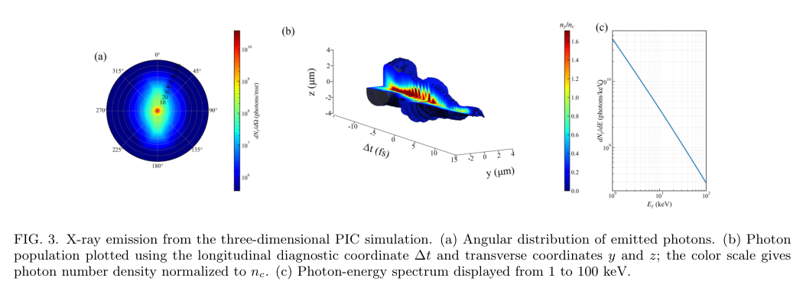
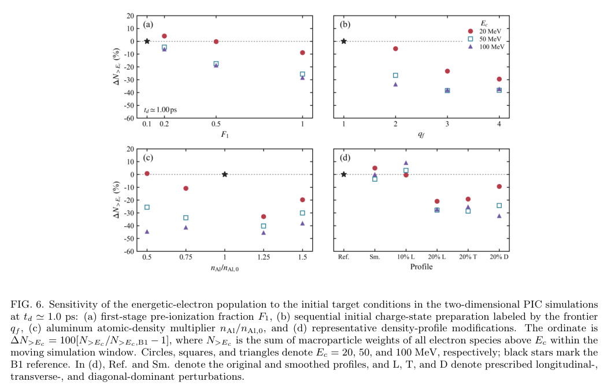

# 电爆铝丝低密度等离子体中的尾场加速与X射线：三维产额和二维机制证据

## 0. 论文信息与证据层

Heng Wang、Liang Sheng、Jun Liu、Yang Li、Yanfei Li、Xinjian Tan、Dongwei He，*Laser wakefield acceleration and x-ray emission in plasma produced by the electrical explosion of an aluminum wire*。官方 arXiv:2610.34859v1，2026-10-26提交，PDF首页打印2026-10-27，9页。精确标题Crossref前三条未验证正式版本。本篇新增的是**作者3D/2D电离PIC模拟**，电爆铝丝的早期实验/密度演化来自所引Sarkisov等既有文献；本篇没有给出电爆靶加PW激光的端到端实测。

## I. 引言：先电爆制靶，再用飞秒脉冲驱动

气体密度可控，已成为LWFA常用平台；电爆金属丝提供另一种把固体预先稀释为低密度等离子体的方式。不能与激光直接打仍处固体密度的金属丝/表面导引混同。本方案把纳秒电爆的密度分布规定为PIC初态，随后飞秒激光改变电离和集体场；两阶段没有统一求解。

## II. 模型与初态的不确定性

| 项目 | 3D产额计算 | 2D轨迹/敏感性计算 |
|---|---|---|
| 激光 | λ=800 nm，a₀=21.5，w₀=10 μm，τ=30 fs | λ=800 nm，峰强1.0×10²¹ W/cm²，横向Gaussian尺度5 μm，施加时间25 fs |
| 网格 | 50×40×40 μm³；1250×400×400格 | 50×40 μm²；1250×400格 |
| 宏粒子/窗口 | 10宏粒子/格；150 fs开启移动窗口 | 同为10宏粒子/格、150 fs开窗 |
| 作用 | 束流与光子量的来源 | 机制诊断和相对敏感性；不替代3D绝对产额 |

3D瞬时窗口约2亿格；沿传播方向步长40 nm、两横向100 nm是从给定尺寸/格数计算所得，不是另做网格收敛。3D和2D驱动参数及维度均不同，不能把2D扫描误差直接当3D产额误差条。

原始15 μm直径Al丝由峰值约1.7 kA电流驱动；取既有计算160 ns时原子密度径向剖面，按圆柱对称映射到PIC，激光垂直于原丝轴。参考初态10% Al¹⁺、90%中性，每个Al¹⁺配置一个自由电子保证局部中性；参考初始作用区自由电子密度<0.05n_c，不代表后续动态电离后总电子密度始终低于该值。

$$
n_c=\frac{\epsilon_0m_e\omega_0^2}{e^2},\qquad
\omega_0=\frac{2\pi c}{\lambda_0}.
$$

由冷等离子体频率平方nₑe²/(ε₀mₑ)等于ω₀²得到临界密度；800 nm约1.74×10²¹ cm⁻³。原子密度、电荷态和自由电子密度分别保存物理含义，不能只把给定Al原子剖面当nₑ。EPOCH以ADK/势垒抑制模型逐级场电离；同步辐射MC模型输出>1 keV光子宏粒子并以权重求总数。本文未验证原子线、韧致辐射或转换靶输运，不能把该模型自动理解为完整金属X射线谱。

## III.A. 激光传播与电子加速

Fig.2的两正交切面显示腔体和尾后高动量群，支持3D非线性尾场形态。在t=1 ps，电子高能尾接近GeV，>10 MeV电荷为数十nC、>100 MeV为数nC数量级；不是窄能散GeV单能束，未给实测发射度、能散、准直度、重频稳定性或品质验收。密度空泡与高动量共处只能支持尾场解释，需能量分解进一步区分DLA。

## III.B. 光子输出及其计分边界

**来源：PDF第5页 Fig.3。** (a)角分布色标为每立体角光子数，极角相对激光轴；(b)横向y/z以μm，纵向诊断坐标Δt以fs，颜色是光子数密度除以n_c的无量纲量，不能把Δt轴的云团长度直接当探测器脉冲FWHM；(c)能量轴keV，谱密度photons/keV，只展示1–100 keV。图示前向宽带输出，无单色峰。

t=1 ps保留的>1 keV光子宏粒子权重和给出2.39×10¹¹，总光子能量相对入射激光能量为3.39×10⁻⁴。**积分能区是完整保留的>1 keV群体，并非只积分图3(c)的1–100 keV。** 这些量不是给定孔径/样品处、出靶后或探测器响应折叠后的有效光子数；也不能把移动窗口内的诊断自动等同完整全历史出射计分。缺少能谱/角度统计不确定性与实际探测验证，亮度、可调谐性和成像分辨率没有在这里验收。

## III.C. 做功分解：纵场主导的证据

磁力不直接做功，Lorentz方程点乘速度并积分得到每一电场分量的能量贡献：

$$
W_i(t)=-e\int_{t_b}^{t}v_i(t')E_i(t')\,dt',\qquad
W_\perp=W_y+W_z.
$$

e为正的基本电荷；电子电荷为−e，所以公式有负号。t_b为场电离的出生时刻或预置电子的初始化时刻。若把功与动能比较，还需记初始能量及辐射反冲等能量项；不能把离散轨迹做功一致性当成未经检查的严格数值守恒。

Fig.4的三个代表粒子纵场功达到数百MeV、横场净功小；最后>500 MeV群体的权重归一化Wx–W⊥直方图也支持同一趋势，强于只选三条轨迹的论据。其来源仍是2D诊断，并未将3D每个高能电子做同等追踪。纵场功主导支持所测条件下的尾场加速解释，横场仍影响振荡和辐射；不宣称发现了新机制或全部粒子都无DLA。

## III.D. 电离态标签能说明什么

Fig.5按释放电子的Al源电离态统计电荷、各群体达到阈值的分数和谱；若干高阶群体在>100 MeV中占比升高，且其群内高能比例也高，不能仅解释为某阶段总电子更多。最高能量并不随电荷态单调增加。电离阶段与进入高能尾的概率相关，但完整“电离注入”机制仍需出生位置/时间与尾场相位联合记录，不能仅凭最终谱作因果证明。

## III.E. 初态扫描：高能群存在不代表产额不敏感

**来源：PDF第7页 Fig.6。** 四组横轴为初始Al¹⁺比例F₁、最高预置电荷态q_f、原子密度乘数和形状扰动类型；纵轴为相对B1参考的电子数变化百分比。圆/方/三角对应20/50/100 MeV阈值，黑星为参考，0表示与参考相同，不是无电子。归一化为：

$$
\Delta N_{>E_c}=100\left[\frac{N_{>E_c}(t_d)}{N_{>E_c,\mathrm{B1}}(t_d)}-1\right],
\qquad t_d\simeq1.0\,\mathrm{ps}.
$$

N 是共同诊断时刻**移动窗口内**所有电子种类的宏粒子权重和；不表示累计注入量，更不是2D预测的3D束流电荷。F₁=0.1参考、扫描到1；密度0.5–1.5倍；形状包括平滑、10–20%不同方向扰动。高阈值对预电离和密度更敏感，图中可下降数十个百分点；扫描范围内仍有相对论电子，只支持质性持续，不能称“稳定产额”。密度两端均可降低高能群，也不构成全参数全局最优证明。

## IV–V. 价值与后续

电爆靶提供可由电流/延迟调节的金属低密度平台，值得做放电诊断与PW激光的联用实验。当前证据没有证明优于优化气体LWFA/betatron源。应先提供激光到达时的密度、电离、温度剖面与误差，再核对3D分辨率/粒子统计、真空与碰撞/辐射模型适用性、出射面唯一轨迹计分、谱角接受度以及材料碎屑/热管理。没有光核中子、同位素、临床照射或屏蔽验收。作者称数据可合理请求获得，本轮未获得输入deck/原始轨迹、未运行EPOCH或复现电爆/激光实验。

来源：[DOI](https://doi.org/10.48550/arXiv.2610.34859) · [实际全文](https://arxiv.org/pdf/2610.34859v1) · [本地PDF](../pdfs/Wang%20et%20al.%20-%202026%20-%20Exploded%20aluminum%20wire%20wakefield%20X%20rays.pdf)。

核验：[PDF与哈希](../pdf_validation.json) · [来源与去重](../research/sources.jsonl) · [版本核查](../research/version-checks.json) · [MinerU](../research/mineru-attempts.json) · [原图来源](../research/figure-manifest.json)。
