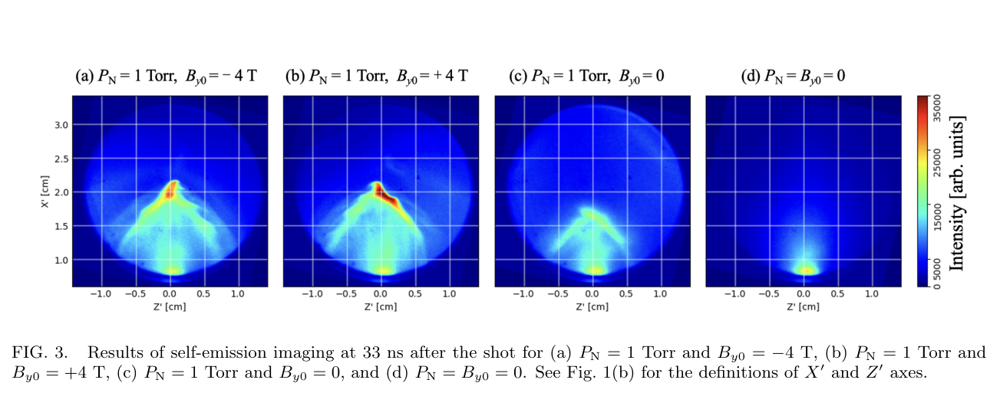
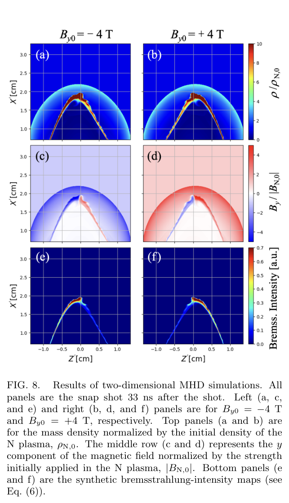

# 激光烧蚀铝活塞与静止氮等离子体的波纹界面：先辨认界面，再解释冲击

> R. Yamazaki 等；*Identification of rippling interface between laser-ablated plasma and ambient uniform plasma at rest*。PRE 接受记录：[DOI 10.1103/mhz4-f54x](https://doi.org/10.1103/mhz4-f54x)，[官方接受页](https://journals.aps.org/pre/accepted/10.1103/mhz4-f54x)确认 **2026-10-23 接受**，尚未核实 VOR 卷页；Crossref 将 10-23 标作 published-online，此处依官方页面保留为接受日期，不写成正式发表。本轮实际阅读：[官方 arXiv:2610.34057v1](https://arxiv.org/abs/2610.34057v1)／[全文](https://arxiv.org/pdf/2610.34057v1)，提交时间 2026-10-25，PDF 首页打印 “Dated: October 27, 2026”。打印日期与提交日期均保留，不替代正式发表日期。本地[作者稿 PDF](../pdfs/Yamazaki%20et%20al.%20-%202026%20-%20Rippling%20laser%20ablated%20plasma%20interface.pdf)为 15 页；**不是本轮已核验的 PRE VOR**。本文恢复了先前的全文重试，不把作者稿再计为另一篇论文。

## 摘要与证据范围

论文研究 Gekko-XII HIPER 纳秒激光烧蚀铝靶后，Al 活塞向外推动磁化氮等离子体时出现的明亮波纹边缘。直接实验证据是磁场极性反转时自发光形态反转、亮边缘外移、无磁场时边界变钝；辅助 CTS 反演支持亮区由高密度 Al 主导。二维理想 MHD 在指定注入不对称条件下定性复现这些形态，并支持“圆钝前缘周围的涡运动”解释主要波纹。

关键区分是：**最亮波纹边缘标记 Al–N 接触界面，并不能直接当作氮等离子体内的冲击前沿**。微观电子尺度是与数据相容的解释，成像没有直接分辨本征电子层厚度；MHD 也不解析冲击的离子动理学。本轮没有重跑 Athena++、CTS 拟合或实验。

## I. 为什么先辨认界面

准垂直超临界磁化无碰撞冲击可能反射上游离子。但活塞—环境界面自身也能改变离子轨迹；如果这两种位置在早期尚未分开，看到高密度边缘或离子回返不等于已辨认冲击反射。已有实验的非均匀上游又会混入背景密度结构。

本文把环境氮气从既有工作的 5 Torr 降到 1 Torr，以减弱环境发光和碰撞，提高 Al–N 界面的可辨识性。均匀环境质量密度有利于定义上游 Alfvén 速度。作者明确把本文与伴随论文分工：本文辨认界面；伴随论文研究反射离子、温度各向异性和冲击足区。官方 arXiv:2610.34058 对应后者，不能将同实验体系的两篇诊断论文写成两次独立复现实验。

## II. 实验设置与观测量

| 项目 | 本文设置及口径 |
|---|---|
| 铝靶 | 5 mm × 5 mm、厚 2 mm；靶法线与 x 轴夹角 14° |
| 驱动 | 4 束 1053 nm 激光；脉宽 1.3 ns；**每束**平均 671 ± 43 J；焦斑直径 2.8 mm |
| 环境 | 初始氮气 1.0 Torr；Al 等离子体的电离光子先使周围氮气成为环境等离子体 |
| 外磁场 | TCC 附近典型 By0 = ±4 T；翻转线圈电流改变极性；另有无磁场、无气体对照 |
| 线圈 | 双层各 50 匝、合计 100 匝；椭圆内长／短轴 87／43 mm，两线圈间隔 39 mm；4.2 kA、5.4 ms FWHM 脉冲电流 |
| GOI | 从 +y 看 X′–Z′ 平面；450 ± 2 nm 中心、10 ± 2 nm FWHM 蓝滤光；曝光 0.2 ns |
| 坐标 | X′ 沿靶法线、Z′ 与其垂直；靶在 X′=0，TCC 在 X′=2.0 cm；视场半径 1.4 cm |

每炮只取得指定延时的一幅 GOI 图。因此 Fig. 2 的 23–35 ns 时间演化是**跨炮取样**，不能据此声称同一波纹被连续追踪或直接测得其相速度。后面的 SOP 提供另一种沿固定视线的时间分辨诊断，不能与二维连续电影混同。

## III. 自发光图像：极性、速度与边界定位

对于负极性，23–35 ns 亮区向外扩张，表观前缘速度约 500 km/s；正极性有相近速度。作者用上游氮离子密度和 4 T 磁场估计 Alfvén 速度约 92 km/s。

$$
v_A=\frac{B}{\sqrt{\mu_0 m_N n_N}},\qquad
M_A\simeq\frac{500}{92}\simeq5.4.
$$

这里采用 SI 形式，磁场 B 以 T、氮离子质量 m_N 以 kg、离子数密度 n_N 以 m⁻³ 给出。将文中 n_N=0.64×10¹⁷ cm⁻³ 换成 6.4×10²² m⁻³ 即可得到该速度量级。比值说明此驱动具备超 Alfvén 条件；**它使用亮前缘速度和模型上游参数，不能单独替代冲击速度、临界 Mach 数与离子反射诊断**。

**来源：作者稿 PDF 第 6 页 Fig. 3，t=33 ns，保留全部面板、坐标、色标和原图注。** 横轴 Z′、纵轴 X′，单位均为 cm；色标是相同标度的自发光强度，任意单位，未归一化为电子密度。(a)(b) 为 ±4 T：亮前缘约在 X′≈2.0 cm，并随极性变为近似镜像；(c) 有氮但无磁场，亮区较弱、边界较钝；(d) 无氮也无磁场，主要剩近靶 Al 发光。此对照支持磁化 Al–N 相互作用控制全局形态，但发光还受温度、电荷态、谱带和视线积分影响，不能直接从颜色反推出离子组分或密度压缩比。

Fig. 4 的轴上剖面进一步给出：有磁场时峰约在 2.0 cm、2.1–2.2 cm 处明显下降，2.5 cm 外有弱尾；无磁场但有氮时峰约 1.6 cm。X′<1 cm 的各对照曲线接近，支持内区由 Al 主导。视场边界的低探测器增益区在原图中有灰色标识，不当作真实等离子体衰减。

作者从像素强度 I 提取归一化梯度峰值：

$$
r_{ij}=\frac{(I_{i+1,j}-I_{i-1,j})^2+(I_{i,j+1}-I_{i,j-1})^2}{I_{ij}^2}
\ \propto\ \frac{|\nabla I|^2}{I^2}.
$$

推导是用中心差分近似两个空间导数，再平方相加。相同像素间距时，原文离散 r 省去了公共的 1/(4Δx²)，不改变局部峰的位置；它因此是**光学边缘定位量**，不是密度梯度或具有绝对物理单位的微观层宽测量。Fig. 5–6 的峰值点显示极性反转与边缘外移；通常只看见约一个波长，作者承认难以可靠量化波长、振幅及其增长率。

## IV. 二维理想 MHD：模型范围、输入与结果

### IV.A. 为什么能描述大尺度，而不能解析冲击

CTS 在亮区给出约 2×10¹⁸ cm⁻³ 的电子密度；取 Al 电荷态 11，离子密度约 2×10¹⁷ cm⁻³。作者估算离子惯性长度约 0.024 cm，小于波纹和圆钝前缘的 0.1–0.4 cm 尺度；这支持用流体模型定性描述高密度亮区的整体形态。

但取 B≈10 T、离子速度 500 km/s 时，Al 离子回旋半径约 0.13 cm、离子—离子 Coulomb 平均自由程约 0.47 cm、回旋周期约 16 ns。这些尺度并未消失，作者也明确不以 MHD 解释离子微观非平稳过程。对较稀薄环境氮，离子惯性长度约 0.1 cm、接近预计冲击层宽，因而 MHD 不适用于冲击过渡层本身。

### IV.B. 指定注入设置与可复现性疑点

Athena++ 采用单流体二维理想 MHD、HLLE Riemann 求解、二阶分片线性重构与二阶 Runge–Kutta。域为 X′∈[0,4] cm、Z′∈[−2,2] cm，网格步长均 0.002 cm；入口半宽 Rin=0.4 cm，注入持续 2.8 ns，其余边界为流出。该注入时长是计算设置，不等于实验激光 1.3 ns 脉宽。

模型不自洽计算激光烧蚀、电离辐射或 Biermann 电池，而从入口施加近似环向磁场：

$$
B_y(0,Z')=B_{Al,0}\tanh\!\left(\frac{Z'}{0.1R_{in}}\right).
$$

它在轴上变号，形成弱磁区；指定速度使轴附近外喷较快。要复现亮度不对称，作者另外**假设** Al 注入密度的反对称分量随外磁场极性翻转：

$$
\rho_{Al}(0,Z')=\rho_{Al,0}\pm\delta\rho_{Al}\sin\!\left(\frac{\pi Z'}{R_{in}}\right).
$$

这不是模拟自行从对称靶中预测出不对称。Table I 报告 Al／N 初始密度比 21、温度比 32、磁场幅度比 5.3、βAl=1、βN=0.08，以及 δρAl/ρAl,0=1.4；环境再加入 ±0.002 的相对密度白噪声。

**静态设定核查发现：**若将 Eq. (3)(4) 与 Table I 的 1.4 按字面用于整个入口 Z′∈[−Rin,Rin]，密度最小值为 −0.4ρAl,0。本文未见相应密度底限、截断或更窄有效入口的说明，需作者代码／输入文件澄清。这是正文与表格的可复现性疑点，**不是已证实作者实际运行产生了负密度**。未解决前不宜将表格参数直接当作可运行的完整算例。

### IV.C. 形态复现、合成发光及 KH 的限制

**来源：PDF 第 10 页 Fig. 8，t=33 ns；原图和完整图注。** 横轴 Z′、纵轴 X′，单位 cm；左右为 −4 T／+4 T。(a)(b) 色标为质量密度除以初始氮密度，(c)(d) 为 By 除以初始氮场幅度，均无量纲；(e)(f) 是任意单位的合成韧致辐射强度。弓形外层与内侧亮界面分开，亮度不对称随极性反转。**密度图中更靠外的冲击结构并非合成发光最亮的位置**，这是不能把实测最亮边缘直接当作冲击的核心证据之一。合成图仅定性比较；没有二维图对真实三维视线的积分。

合成发光采用热自由—自由发射的简化标度：

$$
j_\nu\propto n_en_i Z^2T^{-1/2}
\exp\!\left(-\frac{h\nu}{k_BT}\right).
$$

电子／离子密度 n_e、n_i 的单位要一致，Z 为离子电荷数，T 为温度，hν 为光子能量。由准中性 n_e≈Zn_i、n_i∝ρ/A 得到前因子对电荷态约按 Z³ 增强；再按作者压强—温度约定代换，可得到原文 Eq. (6) 的 ρ⁵ᐟ²/√P 与 A⁻⁵ᐟ² 因子。该表达式说明亮度同时依赖密度、温度和电荷态，并非密度越高必定越亮。本文合成图取 ZAl=9、ZN=3，而附录 CTS 亮区约 ZAl=11；因此这些合成强度不构成绝对辐射或元素丰度标定。真实谱线、详细电离、辐射输运及三维投影仍未自洽纳入。

对 Kelvin–Helmholtz（KH）解释，作者从模拟估计界面声 Mach 数由早期约 0.1 增至 33 ns 时约 1；波长约 0.15 cm 的有限剪切层 KH 增长时间约 100 ns，长于观测波纹形成阶段，故不支持其为主要来源。这是指定模拟背景上的尺度／增长率论证，未构成所有 KH 模的排除定理。

替代机制是轴附近弱磁区使 Al 优先外喷形成圆钝前缘，周围产生涡，波纹沿界面向后发展。实验前缘特征尺度约 0.4 cm、模拟约 0.2 cm，模拟波长系统性偏短约一倍；作者把它与几何尺度差异联系。模型未精确复现三维形状，实验也没有连续跟踪这一传播。作者还明确允许局部前缘的小尺度 KH 贡献，故笔记不将结论写成“证明波纹完全不是 KH”。

## V. 讨论：不对称起源与界面离子动力学

### V.A. 注入不对称的物理猜想

作者提出早期激光对电子的驱动与外磁场共同作用，可能使电子偏转方向随场极性反转，从而产生密度偏置。它尚未自洽包含时变 Biermann 场、压力梯度、电离辐射、静电场、碰撞和多维烧蚀。相应地，现有 MHD 以人为指定的密度偏置复现形态，支持一种相容机制，**没有从第一原理确认偏置起源**。

### V.B. 表观宽度、磁化限制与 Al 污染

观测边缘的表观过渡尺度不超过约 0.1 cm；代表性相对速度 500 km/s 下，跨组分 Coulomb 平均自由程约 0.5 cm 或更长，大于该尺度和离子回旋半径。作者因此认为碰撞不太可能决定窄层宽度。但视线积分与三维曲率会展宽成像边缘，**本征微观厚度没有直接分辨**，所以结论应保留为“与电子尺度界面解释一致”。

无磁场时，Al 离子可穿入环境氮，产生向上游扩展的微弱弥散发光；作者由不同延时形态粗估快分量约 800–1000 km/s，并声明很难准确测速。该混合区较宽，使初期氮冲击更难独立辨认。有磁场时，扫起氮中的增强磁场可使 Al 离子折返、积聚，形成尖锐亮峰，界面上游因而可主要由氮组成。这里“主要由氮组成／较少 Al 污染”不是零 Al 含量的直接谱学上限；离子反射与足区结构的详细证据由伴随文讨论。

原文注 [54] 还把 1.28×10¹⁷ cm⁻³ 描述为“远上游离子密度的四倍”，与正文远上游 0.64×10¹⁷ cm⁻³ 的字面四倍关系相差 2。该处影响具体碰撞路径估算的密度口径，应对照实际算例澄清，不自行改写文中自由程数值。

## VI. 结论与 Appendix A：CTS 对亮区的补充约束

正文结论是建立界面识别，给随后解释磁化氮冲击提供几何与组分背景。上游 ZN≈3 时半回旋周期约 38 ns，作者指出冲击开始从界面分离与该尺度相关；这不是用当前 23–35 ns GOI 序列单独完成微观冲击层验收。

附录 CTS／SOP 并非全部与主图相同磁场、时刻，须分开：

| CTS 情形 | 作者拟合所得量 | 解释限制 |
|---|---|---|
| By0=−4 T，33±1.5 ns，TCC，离子特征 IAW | ne=(1.97±0.26)×10¹⁸ cm⁻³；ZAl=11；Te=377±19 eV；Ti=882±16 eV；vx=456.1±0.5 km/s | 以 Al、无相对漂移的 Maxwellian 离子模型拟合；原谱双峰不对称，拟合谱对称，参数误差不覆盖该模型失配 |
| By0=+2.7 T，29±1.5 ns，TCC，电子特征 EPW | ne=(2.61±0.02)×10¹⁸ cm⁻³；Te=261±4 eV；Al 碰撞—辐射模型给平均电荷态约11 | 此例 SOP 用绿滤光片，主 GOI／负极性 SOP 用蓝滤光；不同谱带和炮次不能当作严格定量亮度重复实验 |

离子谱双峰不对称可能来自离子—电子漂移、非 Maxwellian 或多流；本文只用对称模型拟合总体形态。这些很小的形式误差，尤其速度 ±0.5 km/s，不应被解读为所有系统误差已小于该值。

对正极性 EPW 数据，作者给一个有条件的密度排除论证：若亮区仅是氮、上游密度为正文值、最大电荷态为 7、压缩比至多 4，则

$$
n_{e,N,\max}=4\times7\times0.64\times10^{17}
=1.792\times10^{18}\ \mathrm{cm}^{-3}.
$$

它低于观测反演的 2.61×10¹⁸ cm⁻³，支持“亮区由 Al 主导”。推导仅是电荷中性与假定压缩比相乘，依赖 Maxwellian／散射模型与压缩比假设，并非完整成分反演，更不构成上游零 Al 的直接测量。

## 接续问题与使用价值

优先取得正式 VOR、作者输入文件和密度正值处理，核对 Table I 与注 [54] 的密度口径；对 CTS 加入漂移／非 Maxwellian 和谱模型误差，并以组分分辨诊断或定量谱学约束 Al 污染。随后才考虑三维视线投影、界面微观厚度和冲击层 PIC／混合模型。

对 HEDP 与实验室天体研究，本文最有用的是把“驱动活塞界面”和“冲击过渡层”分开计分、分开诊断。证据支持一种形态识别与机制解释，没有新增激光转换靶—光核中子／同位素链条，也没有束流或辐射防护性能验收。

核验：[PDF、页数与哈希](../pdf_validation.json) · [下载／作者稿来源](../download_report.json) · [来源与去重](../research/sources.jsonl) · [版本核查](../research/version-checks.json) · [MinerU 解析](../research/mineru-attempts.json) · [原图来源与裁框](../research/figure-manifest.json)。本笔记以已验证 PDF、布局文本、MinerU 全文和实际查看的首页／关键页交叉核对；未运行作者模型或独立重拟合。
