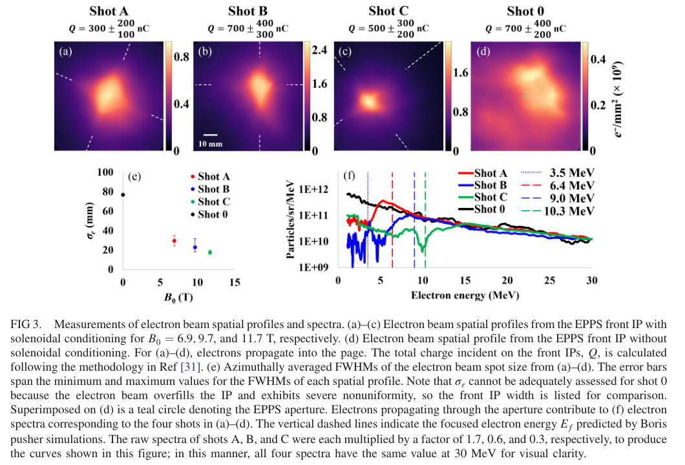
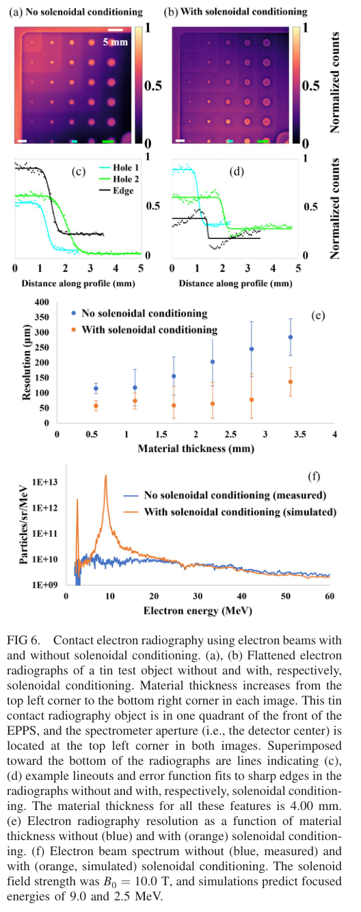
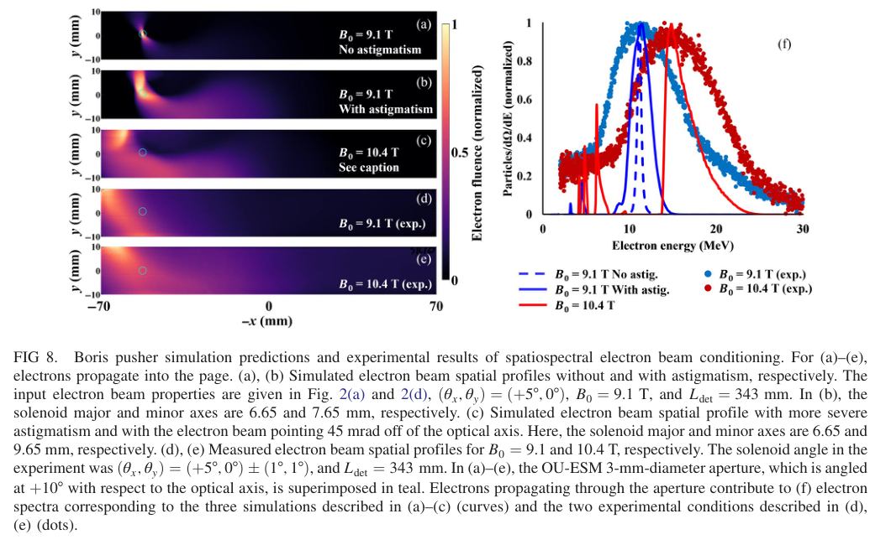

# 电磁螺线管对激光等离子体电子束的空间—能谱调控

## 0. 论文信息与阅读证据

- **原题**：Spatiospectral conditioning of laser-plasma-accelerated electron beams using electromagnetic solenoids。
- **作者**：M. V. Ambat、H. G. Rinderknecht、J. Peebles、D. Fess、R. McEvoy、C. D. Arrowsmith、G. Bruhaug、I. A. LaBelle、M. A. VanDusen-Gross、D. H. Froula、J. L. Shaw。
- **正式来源**：Physical Review Accelerators and Beams **29, 104602 (2026)**；[DOI](https://doi.org/10.1103/2dby-29s7)。2026-04-08收到、09-28接受、**10-28正式出版**，三个日期不能互换。
- **实际阅读全文**：[APS正式VOR PDF](../pdfs/Ambat%20et%20al.%20-%202026%20-%20Solenoid%20spatiospectral%20electron%20beam%20conditioning.pdf)，15页，来自[官方harvest全文](https://harvest.aps.org/v2/journals/articles/10.1103/2dby-29s7/fulltext)。恢复10-08旧接受稿重试项，未重复计数。
- MinerU pipeline成功，与本地布局文本、PDF关键页交叉核查；[文件与哈希](../pdf_validation.json)、[解析来源](../research/mineru-attempts.json)。实际查看PDF第1、5、7、10、11、12页及下列完整图注摘录。本轮没有运行作者轨迹程序、PIC、实验或二次粒子输运。

## 1. 摘要与引言：大电荷不等于可用局部通量

论文针对千焦级装置平台上数百nC至微库仑量级LPA电子束：束流总电荷很高，但角度、空间不均匀性和下游大斑点会降低照相或转换靶处的有效通量。单个螺线管同时聚焦两个横向方向，并可通过倾斜产生能量依赖的偏转。本篇直接测量的是电子束空间分布、部分角接受内的能谱与静态电子照相；正电子、X射线和中子只是应用动机。

## 2. 装置与聚焦机制

OMEGA EP采用1054 nm、700±100 fs激光，1/e²焦斑半径8±1 μm，氦气射流中心4 mm的平均等离子体密度约4.1×10¹⁸ cm⁻³。正文概述靶上能量31–96 J；Table I无螺线管对照却列110.2 J、a₀=12.8，超出概述范围。应以具体炮次表为依据，不能把四炮比较当作固定激光输入的单参数扫描。

MIFEDS驱动四匝铜线圈，10–15 kV、24–36 kA，中心场约7–12 T；磁脉冲上升约1 μs、±5%平台约700 ns，覆盖飞秒电子脉冲。EPPS前像板给空间分布及总电荷，1 mm孔后的磁谱仪只测穿孔部分；50 μm Al挡光与前层像板造成低能阈值，因此谱不是全束积分。

在薄透镜、近轴和磁场规定的近似下，Busch聚焦关系为

$$
\frac{1}{f}=\left(\frac{e}{2p}\right)^2\int B_z^2(z)\,dz,\qquad p^2c^2=E_k(E_k+2m_ec^2).
$$

这里f为焦距（m）、B为磁感应强度（T）、p为动量、e为电荷绝对值、Eₖ为动能。横向径向方程中的聚焦系数是e²B²/(4p²)，沿薄透镜积分便得到1/f；因此同磁场下高能电子焦距更长。这是选择一个能量群的色差聚焦，并不增加全束能量，也不自动减小全束能散或发射度。

作者Boris轨迹模型使用规定线圈磁场，忽略电场及空间电荷；初始16 μm束源半径、160 mrad全角发散、空间/能谱形状来自已有炮次。理想圆线圈预测6.1–11.0 MeV电子在探测面形成0.5 mm FWHM斑点。低能电子可在磁场中多次振荡，再在同一面聚焦，产生多个峰；不能将每个峰认作新的加速机制。

## 3. 同轴螺线管：通量与照相的直接证据

**图3，VOR第5页原图。** (a–d)颜色为电子数面密度e⁻/mm²（×10⁹），尺度条10 mm，各图色条上限不同；(e)横轴B₀（T）、纵轴方位平均FWHM（mm），误差棒跨各方向宽度的最小—最大值，非多炮标准差；(f)横轴动能（MeV）、纵轴Particles/sr/MeV且为对数坐标。A/B/C谱分别乘1.7/0.6/0.3使30 MeV处重合，因此不能直接从曲线高度读取绝对增益。

| 炮次 | 靶上激光能量（J） | B₀（T） | 方位平均FWHM（mm） | 前像板总电荷（nC，原表非对称误差） |
|---|---:|---:|---:|---|
| A | 45.8 | 6.9 | 29 | 300 +200/−100 |
| B | 91.4 | 9.7 | 24 | 700 +400/−300 |
| C | 55.0 | 11.7 | 18 | 500 +300/−200 |
| 0 | 110.2 | 无线圈 | 无可靠FWHM；充满>76 mm像板 | 700 +400/−200 |

峰值面密度B约2.4×10⁹ e⁻/mm²，对照0约0.4×10⁹，给出作者报告的**6倍局部峰值**。这不等于总电荷、激光转换效率或二次粒子产额提高6倍。总电荷误差较大，激光输入与指向也不同，没有给出大样本统计的平均增强率。A炮5.8 MeV附近约1 nC的孔内聚焦电荷与全束300 nC要分开；C炮约10 MeV出现凹口是焦点偏离孔的可能表现，不能解释成全束丢失该能量电子。

真实斑点18–29 mm明显大于理想0.5 mm。作者引入椭圆线圈像散后模拟0.5→27.5 mm，另以两种输入谱扫描得到约8–55 mm，说明线圈制造误差和逐发能谱都影响聚焦；这是机制解释，不是已独立测得全部线圈形变或严格排除其他效应。

**图6，VOR第7页原图。** (a,b)锡阶梯/孔结构照相为归一化计数，尺度5 mm；(c,d)沿轮廓距离（mm）对归一化计数的曲线并拟合边缘；(e)横轴材料厚度（mm）、纵轴分辨参数（μm）；(f)横轴动能（MeV）、纵轴Particles/sr/MeV，蓝线为无聚焦**测量**，橙线为有聚焦**模拟**，两者证据层不同。

边缘以y=a+b erf[(x−c)/d]拟合，论文把d定义为分辨率；它不是未经换算的高斯FWHM或完整系统MTF。对约2.8 mm材料厚度，作者给出无/有聚焦的d之比最大3.14，故“最高约3倍”是有限样品/厚度内的观测最大值，不能作所有厚度和材料的普遍倍数。能量选择同时增强边缘散射造成的limb brightening，须避免把亮环误认成真实材料结构。正文阶梯厚度0.56–3.35 mm，而图6(c,d)图注写示例厚度4.00 mm，具体几何对应仍需原始数据澄清。

## 4. 倾斜线圈：空间分开选定能量群

第二套OU-ESM在343 mm探测距离上有−10°至+10°五通道，+10°通道3 mm孔接收偏折束。线圈名义倾角(θₓ,θᵧ)=(+5°,0°)±(1°,1°)，中心场约10 T。理想模型预测通过调B₀可改变焦点能量，同时大致维持选定几何下的焦点位置；这是有限参数下的轨迹性质，不是对任意束流的普适消色差传输。

**图8，VOR第10页原图。** 左侧x、y均为mm，颜色为归一化电子面密度；(a–c)是模拟，(d,e)是9.1/10.4 T实测，青色圈标出+10°通道的孔。右图横轴动能（MeV），纵轴为归一化Particles/sr/MeV；点为实验，曲线为轨迹模拟。实验峰随9.1→10.4 T由约11.2→14.8 MeV移动，但实验谱远宽于理想模型；归一化叠图不能给出透过电荷或绝对亮度。

理想图7给出的约1 MeV FWHM是11.2 MeV模型能量群，不能挪用为图8的实测能散。为接近空间图，作者在20组模型中扫描指向、倾角与像散；约45 mrad指向偏差及更大像散可改善匹配，仍未完全解释谱展宽。正文所述椭圆轴尺寸(6.95,9.95 mm)与图8(c)图注(6.65,9.65 mm)不同，而且长短轴命名顺序也混乱，不能直接当可复现输入使用。

## 5. 附录、数据可复现性与科学边界

作者仅提供方法描述，明确**没有公开研究数据或支持软件**。附录称0.5 ps步长约每回旋周期10步，并以100步/周期做作者收敛检查；本轮没有执行这些检查。空间电荷依据总电荷500 nC/700 fs、5.8 MeV、σ=28 μm和160 mrad估算层流参数ρ≈0.44，但用了全束电荷/激光时长及全角发散代入均方根量的近似，因此不能视为严格的全相空间空间电荷排除。正文也承认空间电荷可能导致未解释的谱展宽。

从印刷公式静态核对还需注意：B(z)=B₀/[1+(z/a)²]的半高点在±a，故a是半高**半宽**，而原文称全宽；附录Boris第二次旋转印为v⁺=v⁻+v⁻×s，常见Boris式应使用中间v′×s。这里只标记原文表述/公式疑点，未取得源码，不能据此断言作者实际程序算错。

若用于转换靶，本篇可提供下游电子空间—能谱的设计思路，但还必须联合测量目标面全相空间、入靶电荷、实际γ谱和中子/活化产额，并验证靶热、散射、EMP及屏蔽。论文未做转换靶辐射产额、光核、剂量或临床实验，也没有给出全束发射度改善。作者给出的约200 μm位置、2°角度容差只适用于其装置几何。

## 6. 复习速记

约10 T同轴／倾斜螺线管已在OMEGA EP上改善大电荷LPA电子照相并展示能量群偏转；最可靠的是实测18 mm斑点、特定炮次局部6倍通量和有限厚度内最高约3倍照相分辨改善。理想0.5 mm焦点与1 MeV能宽、绝对二次产额和通用应用性能仍不能当实测结论。
