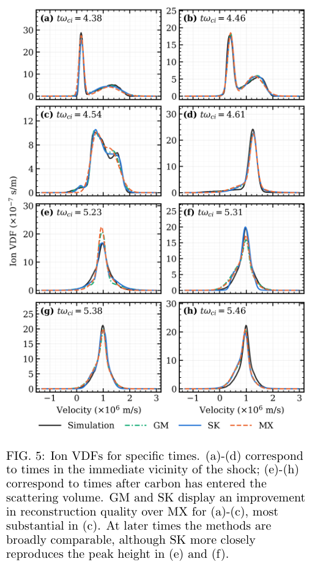
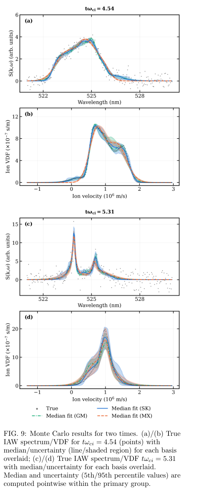
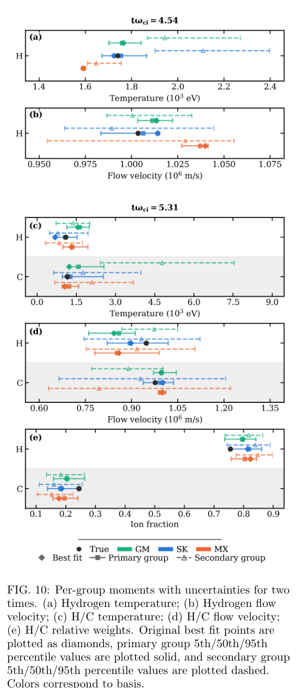

# 广义基函数重建非麦克斯韦 Thomson 散射速度分布

## 0. 论文身份与证据

- 原题：*Recovering Non-Maxwellian Velocity Distribution Functions from Collective Thomson Scattering Spectra Using Generalized Basis Representations*。
- 作者：Greg A. Baker、Bradyn Klein、Kristopher Wright、Vedang Bhelande、Zhaoyan Sun、Rayner Sutardja、Samuel R. Totorica、Derek B. Schaeffer；前两位共同一作。
- 来源：[官方 arXiv 页面](https://arxiv.org/abs/2610.37516)，[实际阅读 v1 PDF](https://arxiv.org/pdf/2610.37516v1)，DOI `10.48550/arXiv.2610.37516`；提交于 **2026-10-27 16:37:30 UTC**，10-28 分类公告可见，PDF 首页印 27 Oct 2026。作者标注投稿 *Physics of Plasmas*；本笔记的全文依据为 **arXiv v1 作者预印本**，不声称已读期刊 VOR。
- [本地 PDF](../pdfs/Baker%20et%20al.%20-%202026%20-%20Non%20Maxwellian%20Thomson%20VDF%20reconstruction.pdf)，16 页。MinerU pipeline 成功，关键公式、结果和不确定性段落与本地布局文本、原 PDF 交叉核对；实际查看第 1、3、4、5、7、8、10、12、13、14 页，保留原图 5、9、10 的完整坐标与图注。
- **证据层级：作者准一维 PIC → 合成 Thomson 散射谱 → 加噪反演基准。** OMEGA 实验为场景动机；本篇没有用新的真实实验谱证明重建准确率。本轮没有运行 PSC、PyTorch 拟合或作者 Monte Carlo。

## 1. 引言：谱拟合好不等于相空间正确

HED 和实验室天体物理中的激波前沿常同时含冷背景离子、热活塞离子和高能尾。把每个群体预设为单个 Maxwellian，仍可能拟合好电子等离子体波（EPW）与离子声波（IAW）谱峰，却给出错误的速度分布、温度或物种比例。本文用两类有物理约束的基函数增加表示能力，再通过自动微分优化；另一条主线是揭示不同物种可以生成近似相同谱的反演退化。

这里的“数据驱动”是可微物理前向模型与梯度优化，不是另行训练一个黑箱神经网络，也没有模型权重的跨装置泛化实验。

## 2. 方法：PIC 真值、谱模型和基函数

### 2.1 合成数据的来源与适用域（原文 II.A–B，图 1）

PSC 模拟激光烧蚀的等比例 H/C⁶⁺ 活塞进入均匀磁化 H 背景，含逆韧致吸收加热和 Takizuka–Abe 二元碰撞。横向仅少量网格、驱动均匀，磁场严格垂直膨胀方向；作者使用约化离子／电子质量比 **100** 和约化光速 **c_sim/c_phys=1/50**，保持所需离子尺度与碰撞性。上游 `n_e=5×10¹⁸ cm⁻³`、`B=10.5 T`、电子／离子初温 10 eV。这些数值约化与几何边界需要保留，不能称全真实质量比三维激波验证。

在距靶 5 mm 固定位置取沿激波传播方向的投影 VDF，生成 527.0 nm、90° 散射谱；全窗口集体散射参数 `1.4≲α≲5.3`。每个时刻分别加入相对于该谱线最大值的 **10% Gaussian 噪声**，EPW 中心另设 notch。原文记录 150 个时间快照，间隔 `0.077ω_ci⁻¹`，其中 `ω_ci⁻¹=1.0 ns`；图中 `tω_ci` 是归一化时间。合成谱只约束沿散射波矢 **k** 的一维投影，不能据此恢复完整三维分布或各向异性温度张量。

原文图 1 展示无额外 Gaussian 噪声的 EPW、IAW 和电子／组合离子 VDF；激波快速蓝移主要发生于 `tω_ci≈4.31–4.61`，碳自约 5.15 进入。本文后续比较划分为上游 `<4.61`、近下游 `4.61–5.15` 和含碳阶段 `≥5.15`。

### 2.2 前向模型为何存在退化（原文式 1–3）

对归一化一维 VDF，多离子谱密度为

$$
S(k,\omega)=\frac{2\pi}{k}\left|1-\frac{\chi_e}{\epsilon}\right|^2 f_e(\omega/k)
+\sum_j\frac{2\pi}{k}\frac{Z_j^2n_j}{n_e}\left|\frac{\chi_e}{\epsilon}\right|^2f_j(\omega/k),
\qquad \epsilon=1+\chi_e+\sum_j\chi_j.
$$

`k` 为散射波矢大小，`ω` 为频移，`χ` 为纵向响应，`Z_j` 和 `n_j` 为离子电荷态与数密度；`ω/k` 是受采样的相速度。第一项是屏蔽后的电子贡献，第二项经介电响应耦合所有离子。其含义是谱既受分布局部值影响，也受集体响应影响，不能逐点把 IAW 谱强度等同于某一种离子的 VDF；H/C 的密度、温度和漂移可以相互补偿。

优化损失是谱的方差归一化均方误差：

$$
\mathcal L(\theta)=100\frac{N_\lambda^{-1}\sum_{j=1}^{N_\lambda}[S_{\rm model}(\lambda_j;\theta)-S_{\rm target}(\lambda_j)]^2}{\operatorname{Var}(S_{\rm target})}.
$$

分子先对波长格点求平方误差均值，分母去掉谱幅度尺度，结果为无量纲 NMSE。PyTorch 对整个前向图自动微分，Adam 用 `β₁=0.9, β₂=0.999` 更新参数；这没有消除反问题的多解性，也不是全局最优保证。

### 2.3 GM、SK 与 MX 对照（原文 II.D，图 2）

Gaussian Mixture（GM）用若干归一化 Gaussian 的非负加权和：

$$
f_s(v)=\sum_mw_{s,m}f_G(v;\sigma_{s,m}^2,\mu_{s,m}),\qquad w_{s,m}\ge0,\quad\sum_mw_{s,m}=1.
$$

本文电子用 6 个 Gaussian、每个离子物种用 3 个，允许偏斜和多峰；这些分量是表示基，不自动代表真实可区分的物理束团。

Super-Kappa（SK）的未归一化形状为

$$
\widetilde f(v)=\left[1+\frac1\kappa\left(\frac{|v-\mu|}{\sigma}\right)^s\right]^{-(\kappa+1)}.
$$

`μ` 为中心、`σ` 为速度尺度，`s` 控制平顶／形状，`κ` 控制尾部。令 `κ→∞`，取对数并用 `ln(1+x/κ)≈x/κ`，得到 `exp[-(|v-μ|/σ)^s]`；再令 `s=2` 即回到 Gaussian。原文图 2 展示该极限和参数变化。多数群体用一个 SK，强非热时可用两个 SK 的加权和。GM/SK 的拟合系数不能直接作为温度，必须对最终归一化 VDF 求矩。

MX 对照是每个物理群体一个 Maxwellian，并非“整个离子体系只用一个峰”：冷背景 H、热 H 和 C 可以是不同群体。这解释了为何 MX 有时也能恢复组合 VDF 的非热尾。

### 2.4 分阶段拟合与人工约束（原文 II.E）

先拟合 EPW 得电子密度／VDF，再将电子解固定拟合 IAW。电子／离子分别最多 1500／4000 迭代，以相邻损失差 `≤10⁻⁶` 判断收敛。先用 Maxwellian 给出合理初值，再加 GM 小权重成分或从 `s=2,κ=100` 开始放松 SK。谱峰、碳出现时刻、跨时间连续性和物理直觉参与初值设置；明显伪峰、极宽低幅离子群以及物种比例大跳变会被拒绝。结果依赖这些条件，尚不是无需人工先验的全自动盲反演。

## 3. 结果：谱误差、VDF 误差与物理矩要分开

### 3.1 谱重建（原文 III.A，图 3）

三种基都恢复主要 EPW／IAW 峰位、幅度比例和时间变化。原文残差图定义为

$$
R_i=\frac{f_i^{\rm fit}-f_i^{\rm true}}{f_i^{\rm true}},
$$

对谱或 VDF 分别使用其无外加噪声真值；每时刻真值低于自身最大值 1% 的点不参与，以免弱信号区相对误差发散。图的色阶还采用不等宽分箱，所以不能只凭颜色面积比较平均精度。它与优化的谱 NMSE 是不同指标。

EPW notch 附近弱信号、PIC 有限粒子噪声及 Savitzky–Golay 平滑会留下共同误差；IAW 的局部伪峰也可能来自噪声。SK 在 `tω_ci≈5.15` 出现小的第三谱峰，作者解释为过拟合，而非发现了新物理群体。

### 3.2 上游 VDF 改善，含碳后收益不普遍（原文 III.B，图 4–6）

作者报告**近上游 `tω_ci<4.61` 的平均离子 VDF 归一化残差幅度**：GM **20.3%**、SK **20.5%**、MX **38.7%**。这是指定区域、上述 1% 掩膜和点对点真值归一化下的指标；不能写成全时间误差减半、谱误差减半或通用准确率 80%。近下游 GM/SK 与 MX 的残差结构相近（作者报平均相关性 95.1%）；进入碳后仍有共同偏移和物种退化。

**原图 5，PDF 第 8 页。** 横轴为沿散射方向速度，单位 `10⁶ m/s`；纵轴为归一化组合离子 VDF，单位标为 `10⁻⁷ s/m`，不是绝对粒子数或能谱。黑线为 PIC 真值，绿／蓝／橙分别为 GM／SK／MX；(a–d) 依次取 4.38、4.46、4.54、4.61，(e–h) 为 5.23、5.31、5.38、5.46。

(a–c) 的多峰、偏斜和肩部使 GM/SK 优于 MX，尤其 (c) 的 `tω_ci=4.54`；(d)、(g)、(h) 的差异明显缩小。(e–f) SK 的峰高更接近真值，但这不是所有含碳时刻的普遍优势。每个小图纵轴独立，不能以视觉峰高直接比较跨时刻密度。图同时说明“相同谱拟合质量”可以对应不同相空间形状。

原文图 6 的电子 VDF 则几乎重合。作者估计电子碰撞频率 `ν_ee≳60ω_ci`，电子更快热化，10% 加噪下非热修正的信息较少；这组数据并未给出强非热电子的广泛测试。

### 3.3 时分辨密度、漂移和温度（原文 III.C，图 7）

所有 VDF 均归一化为 `∫f_sdv=1`；密度是另一个拟合量，不能用此归一化函数的零阶矩当绝对数密度。流速和沿 k 的一维温度为

$$
u_s=\int vf_s(v)\,dv,\qquad
T_s[\mathrm{eV}]=\frac{m_s}{e}\int(v-u_s)^2f_s(v)\,dv.
$$

`u_s` 为流速、`m_s` 为质量、`e` 为元电荷。计算路径是先取均值，再取中心二阶矩，再由能量单位换成 eV；不能把漂移能量包含进热温度。准中性给出

$$
n_j=\frac{w_jn_e}{\sum_{j'}Z_{j'}w_{j'}},
$$

其中 `w_j=n_j/n_i` 是物种数分数，H/C 电荷态固定为 1/6。原文图 7 给出电子矩误差中位数约 2–5%，离子流速约 2–5%、离子温度约 10–17%；这些统计口径没有保证每个时刻都在范围内。温度对微小尾部和形状更敏感，因此谱峰位给流速的信息比给温度的更直接。

## 4. 不确定性分析：这里测的是初值敏感度

### 4.1 Monte Carlo 与分群（原文 IV，图 8）

作者只在 `tω_ci=4.54` 和 5.31 两个时刻对离子阶段做 MC：从产生最佳拟合的初始参数出发，对各参数施加最多约 30% 扰动，重新拟合 **150 次**。电子解仍固定，且同一时刻所有重拟合使用**同一个噪声实现**。因此随后 5th／50th／95th 百分位描述初值与局部损失盆地的解散布，**不包括改变噪声的统计不确定性，不是贝叶斯后验，也不是已校准的 95% 置信区间**。

重拟合解常出现双群。作者用 Gaussian Mixture Model（GMM，勿与 VDF 的 GM 基混淆）配合 BIC 惩罚选择群数，保留两大群；含最初最佳解的群称 primary，其余称 secondary。5.31 时还比较不同物理矩对分群的 Adjusted Rand Index 选择代表性划分。原图 8 的 H/C 跨物种矩对明显分离，而仅含 H 的对照较不分离，提示退化不是某一基函数独有的问题。

### 4.2 小误差带不能保证正确（原文图 9）

**原图 9，PDF 第 12 页。** (a,c) 横轴波长 nm、纵轴谱密度任意单位；(b,d) 横轴离子速度 `10⁶ m/s`、纵轴 VDF `10⁻⁷ s/m`。上半为 4.54，下半为 5.31；曲线为 primary 群逐点中位数，阴影为同群 5–95 百分位。

在 4.54，三种方法给出的 IAW 谱都接近，但 MX 的窄带仍漏掉 VDF 肩部，GM/SK 更能覆盖真值；模型错设可以产生“很确定但偏差大”的解。在 5.31，各方法谱仍很接近，VDF 却共有基底偏移，且 GM 的区间没有完全覆盖真值。逐点中位 VDF 也不必等于某一次拟合的参数化解，不能把中位曲线自动看作新的唯一物理解。

### 4.3 H/C 退化的物理内容（原文图 10）

**原图 10，PDF 第 13 页。** (a,c) 温度单位 `10³ eV`，(b,d) 流速单位 `10⁶ m/s`，(e) 为无量纲离子数分数。黑点为 PIC 真值，菱形是原始最佳解，实线方形／虚线三角分别为 primary／secondary 群的 5／50／95 百分位；颜色仍对应 GM、SK、MX。不同子图与 H/C 行的量程不能互换。

4.54 时 MX primary 温度偏低、流速偏高，虽然区间窄；GM/SK primary 可包含真值。5.31 时 secondary 往往是更热更慢的 C、更冷更快的 H，以及更低 C 分数：较重离子需要更高温度才能产生与轻离子相近的速度宽度，因此部分物种身份和热宽度可相互交换而不显著改变谱。SK/MX secondary 的中位损失比 primary 高约 20%／21%，GM 两群损失差近零；多解的等价程度随表示法而变。该图没有证明每一个次群同样可信，也没有证明低损失能辨别所有退化解。

## 5. 结论、局限与可用价值（原文 V）

这是一项有针对性的合成诊断基准：用可微前向模型和受约束基函数减轻 Maxwellian 错设，在激波近上游的非热离子分布重建上取得明确改善；固定噪声下的多初值重拟合则揭示 H/C 模式退化。下游或近热区域不一定需要更多基函数，表示能力增加也会引入局部过拟合和内部参数退化。

用于实际 HED 实验前，应补上真实谱与独立诊断对照、仪器响应与背景、空间／时间积分、不同噪声实现及电子—离子误差传播；单视角投影的不可辨识性可能需要角分辨 TS 或其他信息打破。原文展望自适应基复杂度、BIC 式选择和角分辨观测。未见本稿给出跨装置基准、可核查端到端运行时间或无人工干预的部署验收；数据声明是可向通讯作者合理索取，本轮没有取得原始输入或公开代码来复算。

**阅读速记：** 更灵活的 VDF 可以改进指定非热区域的重建，但好谱拟合、窄误差带和低损失都不能单独证明真实分布唯一；先明确模型、投影方向和不确定性的来源。

本库关联去重：Sakai 等[非 Maxwell 贝叶斯推断](../../2026-09-29/notes/Sakai%20et%20al.%20-%202026%20-%20Bayesian%20non-Maxwellian%20CTS%20inference.md)侧重指定函数族的模型证据；Nakano 等[双谱段联合反演](../../2026-10-27/notes/Nakano%20et%20al.%20-%202026%20-%20Two%20component%20Bayesian%20Thomson%20scattering.md)重分析已有实测谱。本篇是另一作者组对PIC激波H/C合成谱的广义基与初值敏感度研究，属于独立作品，不能合并其证据或误差带。
