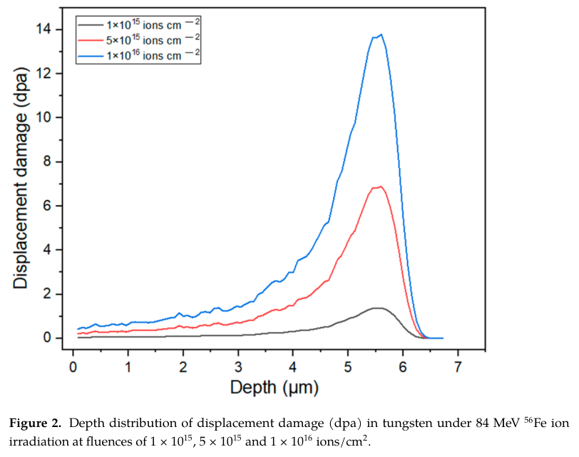
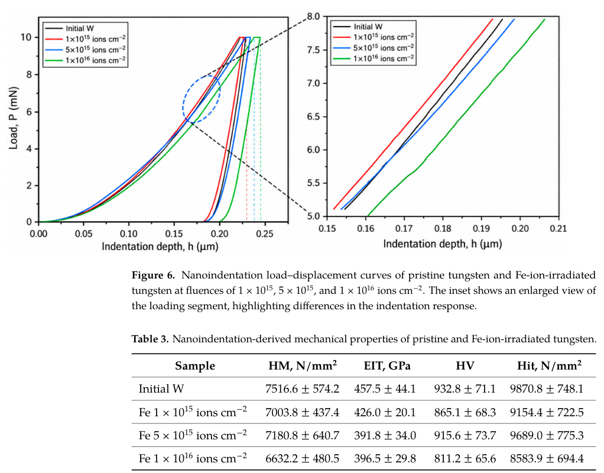
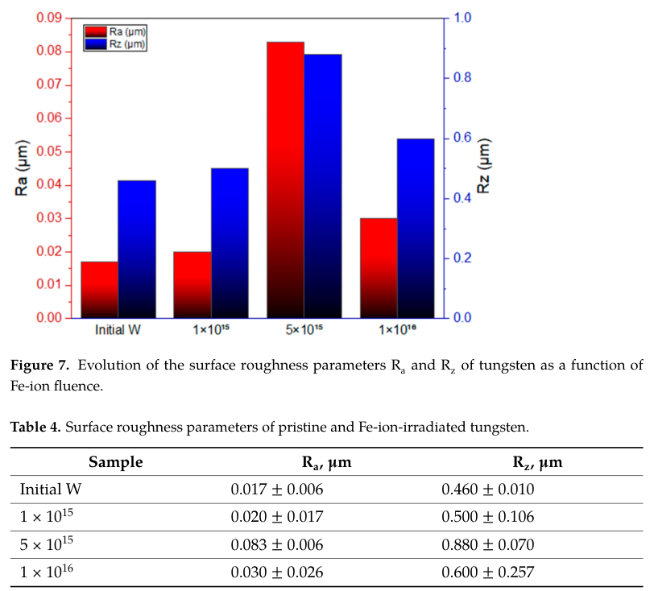

# Fe 离子辐照钨的损伤、表面与力学响应

## 0. 论文与全文来源

- 原题：*Correlation Between Radiation Damage Evolution and Mechanical Properties of Fe-Irradiated Tungsten*。
- 作者：Bauyrzhan Rakhadilov、Moldir Bayandinova、Riza Abilkalykova、Zarina Satbayeva、Lazat Baimoldanova。
- 正式出版：*Materials* **19**, 4540，2026-10-28；接收日期为 2026-10-24。
- DOI：[10.3390/ma19214540](https://doi.org/10.3390/ma19214540)。本次读取的是[官方 CDN 正式 PDF](https://mdpi-res.com/d_attachment/materials/materials-19-04540/article_deploy/materials-19-04540.pdf)，共14页，CC BY；[本地 PDF](../pdfs/Rakhadilov%20et%20al.%20-%202026%20-%20Fe%20irradiation%20tungsten%20damage%20mechanics.pdf)。哈希、页数等由[当日核验记录](../pdf_validation.json)统一记录。
- 阅读方式：MinerU pipeline 全文解析成功，并以本地布局文本、PDF 原页交叉核对。已目视查看第1、5、6、9、10、11页，保留三幅原图／原表摘录。
- 证据性质：**回旋加速器 Fe 离子辐照与材料表征实验，加作者 SRIM/TRIM 损伤估计**。没有中子照射、激光脉冲辐照、聚变堆寿命或显著软化的验收。

## 1. 研究问题与主要结论

钨第一壁与偏滤器的工程问题不仅是碰撞造成多少原子位移，还包括这种损伤如何反映在表面形貌、衍射和力学量上。本文在同一入射能量下扫描三个注量，连接 SRIM 深度剖面与 SEM/EDS、XRD、轮廓仪和纳米压痕。它提供的是一组受限条件下的材料响应对照。

结果不能压缩为“dpa 越大，钨越软或越粗糙”。计算峰值 dpa 随注量线性增加，粗糙度却在中间注量达到本扫描最大均值，力学均值下降一般与测量散布同量级。作者结论也明确把这些力学变化称为趋势，未证明强烈硬化或软化。

## 2. 材料、辐照与诊断（原文第2节）

样品为纯度99.95 wt.%、直径10 mm的多晶钨圆片，先研磨、机械抛光。DC-60重离子回旋加速器提供室温 $^{56}\mathrm{Fe}^{6+}$，能量1.5 MeV/u，即每个离子84 MeV；三个物理注量为 $10^{15}$、$5\times10^{15}$、$10^{16}\ \mathrm{ions\,cm^{-2}}$。本文说明室温有助于减弱热激活迁移／退火，但没有用原位缺陷诊断证明这些过程为零。

SRIM-2013采用TRIM Full Cascades，位移阈能90 eV，钨原子数密度 $N_W=6.334\times10^{22}\ \mathrm{cm^{-3}}$。每个能量模拟10,000条离子轨迹；74、94 MeV是相邻能量对照计算，**实验只有84 MeV**。10,000是计算采样数，物理辐照量另由注量给出，两者不可混作照射离子总数。

SEM/EDS在15 kV低真空下观察局部表面。XRD为Cu Kα、$\lambda=0.15406$ nm、$2\theta=20$–90°、步长0.02°，用PowderCell 2.5处理晶格参数与峰宽。后续“未见新相”始终受XRD检出限约束。

压痕使用Vickers压头，最大载荷10 mN、加载15 s、保持5 s，最大深度约0.25 μm。原始、低／中／高注量的有效压痕数分别为6、8、7、6，表中误差是**均值±SD**；这些是压痕点数，不应自动当成独立样品重复数。表面轮廓每个样品测7个位置，截止长度和评定长度均为2.5 mm，仅一个截止长度。

## 3. SRIM 损伤剖面（原文3.1）

74、84、94 MeV的投影射程分别为5.13、5.57、6.00 μm，纵向离散分别为0.4374、0.4470、0.4465 μm（表1）。相应位移／离子为13,924、14,007、14,117，空位／离子为13,066、13,216、13,325。此能区内主要变化是损伤层位置变深，不能把74、94 MeV曲线写成另两组实测。

作者在第5页采用下式，把SRIM深度谱换算为dpa：

$$
\mathrm{dpa}(x)=\frac{D(x)\Phi}{N_W\,10^{-8}},\qquad D(x)=V(x)+R(x).
$$

这里 $D$ 为每入射离子、每Å深度的位移数，$V$ 与 $R$ 分别为空位和置换碰撞剖面，$\Phi$ 为物理注量。推导是：厚度 $\Delta x$ Å内每平方厘米有 $D\Phi\Delta x$ 次位移，原子数为 $N_W\Delta x\,10^{-8}$；两者相除，厚度消去，得到无量纲dpa。因此固定单离子谱时，dpa随注量成比例。**这里保留作者V+R的计算口径，不把它改称实测残余缺陷密度或任意其他损伤模型的等价值。**

**图2（PDF第6页）**横轴深度μm，纵轴displacement damage（dpa），三色对应三个注量；同为84 MeV，峰位置约5.60 μm，峰值依次1.38、6.89、13.79 dpa。纵轴是模型损伤次数／原子，未做实验归一化拟合。它支持“同一计算谱按注量放大”，未包含注量升高后缺陷复合、动态退火等对最终存活缺陷的反馈。

尤其需要区分：**约0.25 μm压入深度远浅于5.6 μm损伤峰**。压痕塑性影响体积也并非一个深度点。论文没有给出深度分辨力学量与对应加权dpa，所以不能将最高13.79 dpa直接配给表3的压痕体积并拟合定量软化率。

## 4. SEM/EDS 与 XRD（原文3.2–3.3）

图3显示抛光纹理逐渐叠加局部凹陷、孔与表面非均匀性，高注量表面变化更明显。这是所选视野的形貌证据，并没有TEM缺陷类型、体密度或级联重叠率测量。

图4的点EDS主要为W，O局部含量范围随三组样品分别为0.20–2.92、0.21–5.50、0.27–8.27 wt.%。原文明确指出照后空气暴露可能造成氧化，EDS为半定量；不能把O信号唯一归因于辐照，也不能据此直接确认O–空位复合物。关于O–V稳定性的解释引用的是其他条件下的理论／实验。

图5与表2显示各组保留bcc α-W，(110)/(200)/(211)/(220)峰约位于40.3°/58.3°/73.2°/87.0°。晶格参数依次3.1701、3.1688、3.1648、3.1692 Å，变化幅度小且非单调；没有检测到额外W–Fe或氧化物相，不等于完全没有这些相。

峰宽也不是统一增加：(110) FWHM从0.315°降至0.235°、0.226°、0.197°；(220)则从0.314°变成1.099°、0.807°、1.060°。作者将不同晶面响应讨论为可能的各向异性应变／畸变，但没有足够证据给各晶面指定某一种缺陷。不能仅凭峰宽把位错环、空位簇数量定量反演出来。

## 5. 纳米压痕与统计边界（原文3.4）

**图6／表3（PDF第10页）**横轴压入深度μm，纵轴载荷mN，右侧放大加载段。曲线之间存在小差别；这是代表性曲线，不能用视觉分离替代各组统计。表3中的HM、Hit为N/mm²，EIT为GPa，HV沿用原文标度。图表保留原单位，没有把N/mm²直接当GPa。

| 状态（注量 ions/cm²） | HM（N/mm²） | EIT（GPa） | HV | Hit（N/mm²） |
|---|---:|---:|---:|---:|
| 原始 | 7516.6±574.2 | 457.5±44.1 | 932.8±71.1 | 9870.8±748.1 |
| $10^{15}$ | 7003.8±437.4 | 426.0±20.1 | 865.1±68.3 | 9154.4±722.5 |
| $5\times10^{15}$ | 7180.8±640.7 | 391.8±34.0 | 915.6±73.7 | 9689.0±775.3 |
| $10^{16}$ | 6632.2±480.5 | 396.5±29.8 | 811.2±65.6 | 8583.9±694.4 |

各辐照组的均值普遍低于原始样，但HM等随注量仍非单调。作者明确认为变化通常与实验散布相当，故可记录“平均值下降趋势”，不应写成“确认显著辐照软化”，也不应从SD重叠直接推出严格的无差异检验结论。本文未提供独立样品层面的置信区间或预设显著性检验。

还有一处参数命名需保留：方法节提到约化模量 $E_{IT}/(1-\nu^2)$，表3列名写EIT；原文未在该表旁明确完成两种口径的转换。这里按原列名照录，不擅自重算为绝对杨氏模量。未给出的温升、晶粒／织构代表性、残余应力和表面粗糙度对浅压痕的影响，也限制机制归因。

## 6. 非单调粗糙度（原文3.5）

**图7／表4（PDF第11页）**横轴为原始和三个注量组，红色左轴 $R_a$（μm）、蓝色右轴 $R_z$（μm），是不同量程的双轴，柱高不可直接比较。图中没有误差棒，统计散布需读下方表4：每个样品7个位置，均值±SD。

$R_a$依次为0.017±0.006、0.020±0.017、0.083±0.006、0.030±0.026 μm；$R_z$为0.460±0.010、0.500±0.106、0.880±0.070、0.600±0.257 μm。中间注量为这个有限扫描的最大均值，不能当成已确定的全局阈值或最优辐照条件。

SEM局部孔／凹陷与2.5 mm轮廓的统计尺度不同，因此表面视觉变化更明显与粗糙度均值回落并不矛盾。溅射、再沉积及表面演化竞争是作者提出的可能解释，本文并未独立测量这些通道的通量或贡献率。峰值dpa增加而粗糙度下降，也不是“辐照损伤自愈”的直接证据。

## 7. 对本论文库的价值与待闭合问题

本文适合作为转换靶、辐照材料和聚变壁材料研究中的“模型损伤量不等于观测响应”案例：必须把入射谱／注量、损伤深度、诊断采样体积与统计重复对齐。它并不提供激光加速离子打钨后的产额、热冲击、抗疲劳、寿命或防护性能。

后续最有价值的是独立样品重复、束流注量／温度不确定度、截面TEM或其他缺陷测量、不同压入深度和匹配体积的dpa比较。若迁移到宽谱激光粒子或中子场，还需处理脉冲热负载、He/H产生、嬗变、损伤率和多场耦合差异。本轮没有复跑SRIM、压痕拟合或显著性检验。

复习要点：**Fe离子照射使钨的形貌与表征量发生变化；SRIM峰值dpa的线性放大并不推出粗糙度或力学量的线性变化。**
