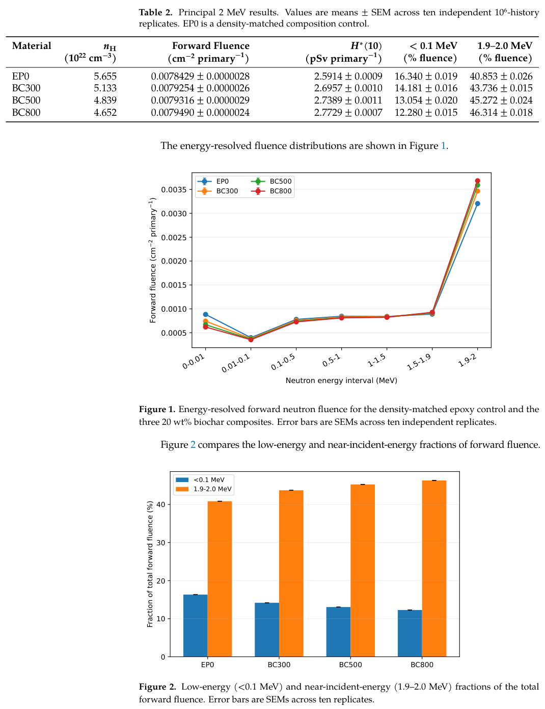
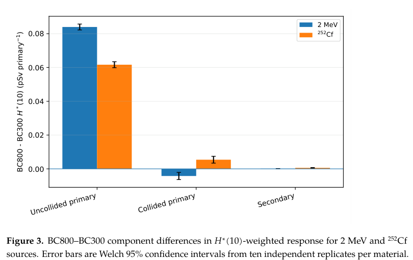
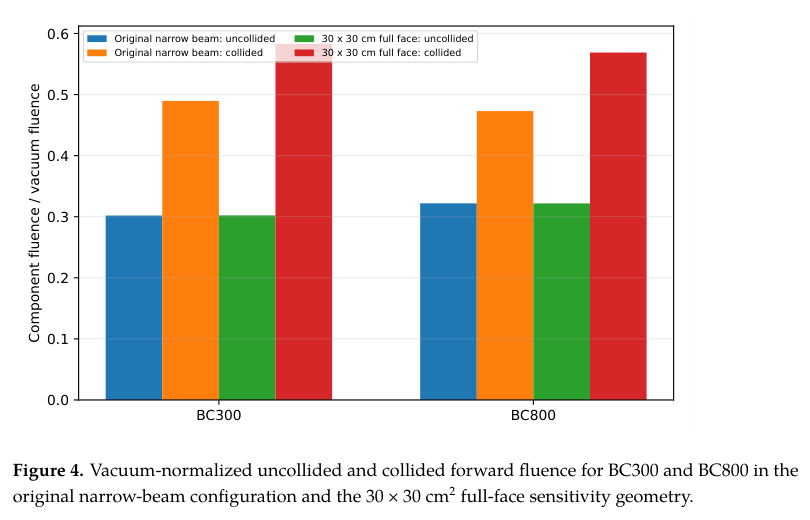
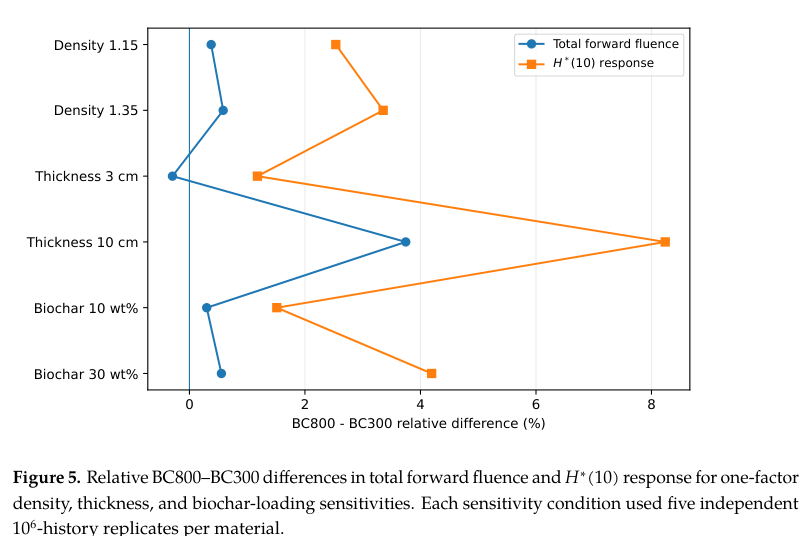

# 热解温度如何改变生物炭／环氧的未碰撞中子透射：全文笔记

## 0. 论文信息与阅读证据

- 原题：*Pyrolysis-Dependent Uncollided Neutron Transmission in Date-Palm Biochar/Epoxy Composites: A GEANT4 Study with 2 MeV and Cf-252 Neutrons*。
- 作者：Ahmed Alharbi；*Polymers* **18**, 2687 (2026)。[DOI与出版页](https://doi.org/10.3390/polym18212687)；2026-09-25收稿、10-25接受、**10-29正式出版**，由PDF首页确认。
- 实际阅读：[官方VOR PDF](../pdfs/Alharbi%20-%202026%20-%20Biochar%20epoxy%20uncollided%20neutron%20transmission.pdf)，12页；[本地布局文本](../pdfs/Alharbi%20-%202026%20-%20Biochar%20epoxy%20uncollided%20neutron%20transmission.txt)、[MinerU文本](../pdfs/Alharbi%20-%202026%20-%20Biochar%20epoxy%20uncollided%20neutron%20transmission.mineru.txt)。文件和SHA见[校验记录](../pdf_validation.json)。MinerU的部分H符号被识为替代字符，公式、单位、图表以原PDF与布局交叉校正。
- 证据层：作者Geant4输运／重复抽样／同核数据库解析一致性检查；**无本轮新材料制备、中子透射实验或工程防护验收**。本地仅阅读和静态复核，未运行作者输运程序。实际查看PDF第1、3–9页及4幅原图／表摘录。
- 与库内空气比释动能强度论文不同：本作研究中子材料组成与输运分量，前者研究近距离治疗光子源的计分定义；不是同一作品重复入库。

## 1. 摘要：响应上升代表透射增加

作者把300、500、800°C热解的枣椰残渣生物炭分别称为BC300、BC500、BC800，填入理想环氧。固定20 wt%填料、5 cm厚度和1.25 g/cm³体密度后，BC800相对BC300的前向总注量仅增加0.30%，而H*(10)加权响应增加2.86%。这意味着出射能量分配比总粒子数更敏感，不能把百分比上升解释成屏蔽改善。

独立的分量计分显示，响应增量主要来自未经碰撞的初级中子；散射初级分量在窄束几何中部分抵消该增量。Cf-252代表谱、扩大横向面积与单因素扫描仍支持这一机制，但数值结论限于给定材料近似、核数据库和源—样品—计分几何。

## 2. 引言：隔离化学组成，不能代替真实加工过程

引言先指出生物炭的力学、热学和导电优势随热解与加工变化，因而不能用“生物炭”这一名称判断中子屏蔽。快中子慢化依赖氢数密度；吸收、散射及后续能谱还依赖其他元素和同位素。

随后作者区分已有生物炭混凝土研究与本工作的任务：在聚合物中追踪未碰撞、碰撞后初级与次级中子的响应分量。热解同时改变密度、孔隙、湿度与颗粒结构；本作等密度控制只隔离组成效应，实际材料未必沿同一排序变化。

## 3. 材料与方法（原文第2节）

### 3.1 组成与灰分近似（2.1）

原文Table 1的生物炭C/H/O/N/S/灰分质量百分比来自既有文献。BC300的H为4.08 wt%，BC500为2.11%，BC800为0.86%；C则57.99→74.63%。这些是填料组成，并非最终复合物氢含量。

Ca/Mg/K/Na被计入灰分内部，按假设氧化物进行元素质量账本，其余灰分用SiO₂代理。这里的氧化物不是测得的矿相；氧的配比和残余灰分组成构成模型形式误差。本轮未单独下载S1–S6补充数据，因此没有独立重建其材料卡和逐次抽样结果。

### 3.2 密度、填料质量比与氢数密度（2.2）

有效环氧写成C₂₁H₂₇O₅，假设密度1.20 g/cm³；生物炭组分密度假设1.50 g/cm³。对质量分数为w的两组分，单位总质量的体积相加，得到

$$
\rho_c^{-1}=\frac{w_m}{\rho_m}+\frac{w_b}{\rho_b},\qquad w_m+w_b=1.
$$

代入0.8、0.2即1.25 g/cm³。所有炭温组和纯环氧EP0对照都被强制设为该密度。EP0是等密度组成对照，不能称为实测纯树脂。作者还明确指出外引生物炭密度资料的g/L与数值尺度疑点，不用该资料替三个样品构造定量密度预测。

氢原子数密度为

$$
n_H=\rho w_H\frac{N_A}{M_H}.
$$

质量密度乘氢质量分数给g H/cm³，除以氢摩尔质量再乘阿伏伽德罗常数，得到atoms/cm³。EP0、BC300、BC500、BC800分别为5.655、5.133、4.839、4.652×10²² cm⁻³。高温炭替换富氢环氧后，氢碰撞机会减少。颗粒界面、孔隙、团聚、吸水及固化反应均未显式建模。

### 3.3 输运设置与源（2.3）

Geant4 **10.6.2**、Shielding参考物理表、**G4NDL4.6**，各组一致；没有给炭／环氧指定材料专属束缚原子热散射S(α,β)数据。

基准是10×10 cm²、厚5 cm平板，真空环境。源面位于前方2 cm，半径2 cm圆盘内均匀取点，2 MeV中子统一沿+z方向。下游5 mm处为100 cm²、厚0.001 cm的计分体；没有水体模回散。这一接受范围不是全空间逃逸总数。

Cf-252敏感性采用归一化后数值抽样的Watt谱：

$$
p(E)\propto e^{-E/a}\sinh\sqrt{bE},\qquad a=1.025\ \mathrm{MeV},\quad b=2.926\ \mathrm{MeV}^{-1}.
$$

指数与根号自变量均无量纲，抽样范围0–20 MeV。它是代表性裂变谱，未模拟特定封装源。Cf结果也不是把2 MeV以上粒子截掉后得到。

### 3.4 计分量与单位（2.4）

对每个能区j累加前向步长：

$$
\Phi_j=\frac{1}{N V}\sum_{s\in j,\,\mu_z>0}\ell_s.
$$

N是产生的初级中子数、V是计分体积(cm³)、ℓ是体内步长(cm)。结果为cm⁻²/primary。对法向穿越一次的真空粒子，ℓ等于计分厚度，V等于面积乘厚度，因而每初级响应为1/A：100 cm²时0.0100，900 cm²时0.0011111 cm⁻²。倾斜轨迹贡献与路程有关，因此该量不等于简单的穿面粒子计数。

把每步注量乘对应能量的ICRP74／ICRU57系数h*(10,E)并累加，可概括为

$$
R_{H^*}=\int h^*(10,E)\,d\Phi(E),\qquad [R_{H^*}]=\mathrm{pSv/primary}.
$$

作者实际逐步插值，不是仅拿图1宽能区中心加权。系数在对数空间做四点三次Lagrange插值；低于10⁻⁹ MeV取最低表值6.60 pSv·cm²。低能整区对响应贡献<0.4%，但本轮未独立检验插值。真空2 MeV校准给4.20 pSv/primary。这是前向场的H*(10)加权响应，不是人体吸收剂量或现场实测环境剂量当量。

### 3.5 重复抽样与一致性检查（2.5）

主比较每材料10个独立10⁶-history运行；2 MeV和Cf分量分析另有各10次独立运行。均值±SEM表示运行间蒙特卡罗采样不确定度，不含组成、截面、密度和计分算法系统误差。BC800–BC300用独立组Welch标准误／自由度构造95%区间；不是把百万条相关粒子轨迹当百万个材料实验。

未碰撞初级指样品内没有非transport中子相互作用，碰撞初级指至少一次，次级指非零parent track ID；该分类和作者实现绑定。

解析对照使用相同G4NDL家族的元素总截面：

$$
T_{\mathrm{unc}}=e^{-\Sigma_t x},\qquad
\Sigma_t=\rho N_A\sum_i\frac{w_i}{A_i}\sigma_{t,i}.
$$

元素数密度乘微观截面(cm²)得到cm⁻¹，再与厚度相乘。由未碰撞概率的微分衰减方程dT/dx=−ΣtT可得指数式。这检验材料卡／计分一致性，未引入独立核数据或实验真值。

## 4. 结果（原文第3节）

### 4.1 总量小变，能谱明显变（3.1）

原PDF第6页：图1横坐标是**不等宽能量区间**(MeV)，纵轴是该区积分前向注量(cm⁻²/primary)，不是每MeV微分谱，连线不能当连续谱斜率。四色对应EP0、BC300、BC500、BC800，误差为10次运行SEM。图2纵轴是占各自总前向注量的百分比，不能与图1绝对量混写。

Table 2中BC300→BC800，总注量0.0079254→0.0079490 cm⁻²/primary，H*(10)响应2.6957→2.7729 pSv/primary。1.9–2.0 MeV区占比43.736→46.314%，增**2.578个百分点**(95%区间2.529–2.627)；<0.1 MeV区14.181→12.280%，减1.901个百分点。BC500相对BC300总注量只增0.078%，其区间含零，不能说每一步热解升温都显著增加总注量。

### 4.2 分量实验是独立MC批次（3.2）

横轴为未碰撞初级、碰撞初级、次级分类；纵轴为两材料H*(10)响应差(pSv/primary)，蓝色2 MeV、橙色Cf-252，误差为**Welch95%区间**，与图1的SEM不同。2 MeV批次总差0.07986，未碰撞差0.08398，碰撞差−0.00422：未碰撞分量可大于净差，因为散射项抵消。它不是“超过100%的物理概率”。

此批次总响应2.69398→2.77384，对应2.96%，与主批次2.86%来自不同运行，不应机械混合计算。Cf总响应2.26714→2.33479，增加2.98%，增量的91.1%来自未碰撞、8.0%来自碰撞初级、0.9%来自次级。此处的贡献占比不是出射中子的绝对粒子分数。

### 4.3 同数据解析对照保留约0.5%系统差（3.3）

Σt依EP0到BC800为0.254214、0.238498、0.231016、0.225753 cm⁻¹，支持失氢增加未碰撞透射的排序。但MC未碰撞透射比重构指数值系统性低0.43–0.51%，超出采样误差。作者列出同位素映射、插值和微量组分处理等可能原因，没有确定根因。本轮保留这一差异，不能写“解析与MC严格吻合”或用两者共享数据来证明核数据库正确。

### 4.4 横向几何改变散射分量（3.4）

横轴为BC300/BC800，纵轴为分量注量除以**各自几何真空注量**，无量纲；四种柱分别是两种几何的未碰撞和碰撞初级。30×30 cm²全脸源／大平板／大计分体保留更多散射，未碰撞归一值约0.30220/0.32177基本不变，碰撞归一量升至0.5830/0.5687。

大几何总响应0.314060→0.324942 pSv/primary，相差3.47%；数值比小几何低不能直接判防护更好，因为单初级分摊的面积变了。净差84.0%来自未碰撞，碰撞项贡献转正，说明散射项符号依赖源和接受几何。

### 4.5 有限单因素扫描（3.5）

纵向列举六个独立条件，横轴是BC800相对BC300的差值百分比；蓝色总注量、橙色H*(10)，不是绝对响应，也不是横轴某个连续控制参数。每条件5次独立10⁶-history运行。H*(10)差为：密度1.15/1.35 g/cm³时2.53/3.35%，厚3/10 cm时1.18/8.24%，填料10/30 wt%时1.51/4.19%。

3 cm薄板中总注量反而下降0.295%，而加权响应仍增1.18%。所以最稳健的解释是出射能谱／未碰撞存活率的变化；这些有限条件没有找到工程全局最优，也没有覆盖全部实际源谱、厚度、掺杂和孔隙。

## 5. 讨论与结论（原文第4–5节）

讨论4.1首先把总注量与能量加权量区分，随后用独立MC分量和两个源条件支撑机制归因。由于全部改变仍在同一受控材料模型内，“氢耗减主导”是此模型的一阶解释，尚未单独测量真实样品的微观结构贡献。

讨论4.2把生物炭定位为有多功能需求的候选填料，而非可以替代富氢／含硼屏蔽相。给定源下H*(10)上升对下游防护是负面约束，需要与机械、热、成本需求一同权衡。

讨论4.3及结论要求加工后样品的密度、组成、孔隙和湿度表征及相同几何下透射实测。本轮没有这些数据，也没有激光加速束→转换靶→中子场的源项、俘获γ输运／总混合场剂量、结构寿命或临床实验。

## 6. 可证伪的下一步与速记

先测真实BC300/BC800复合物的氢含量、体密度、灰分和水分，以等面密度及等几何各做一次比较；同时量出透射谱和角分布。若实际密度／湿度效应抵消甚至反转高能存活率排序，受控化学模型便不能直接预测实际制品。数值侧需公布可复跑材料卡、逐步分类与截面插值，先定位0.43–0.51%系统差，再加入真实源谱及混合场响应。

速记：等密度下，高温生物炭失氢使未碰撞快中子更易穿透；粒子总量的微小变化不等于剂量响应不变。统计误差很小，也不会自动消除材料模型和数据库系统误差。
