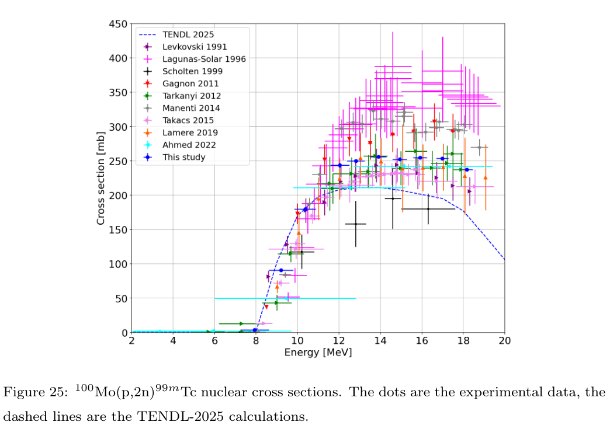
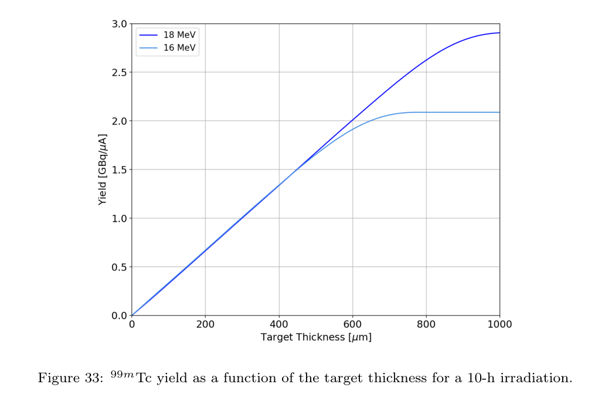
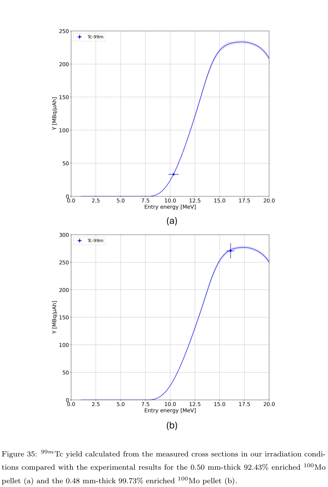

# 质子轰击钼制备 ⁹⁹ᵐTc：激发函数、同位素杂质与有限生产试验

## 0. 论文信息与阅读身份

- 原题：Optimization of 99mTc proton-induced production by means of cross-section measurements of technetium radioisotopes from molybdenum targets。
- 作者：Gaia Dellepiane、Sofia D’Uva、Lars Eggimann、Alexander Gottstein、Samuel Juillerat、Eva Kasanda、Isidre Mateu、Paola Scampoli、Ihor Kadenko、Saverio Braccini。
- 来源：[官方 arXiv 2610.36949v1](https://arxiv.org/abs/2610.36949v1)，提交于 2026-10-27 10:10:48 UTC；本轮精确标题 Crossref 前三项未确认同作品正式版本。这里阅读的是 **62 页作者预印本**，不是已核验期刊 VOR。
- 本地全文：[PDF](../pdfs/Dellepiane%20et%20al.%20-%202026%20-%20Proton%20induced%20technetium%20production.pdf)；PDF SHA-256：`cdd28d4323610648fb38032ab443a085302b3559e253844509943907dc752d5a`。MinerU pipeline 成功，关键段与独立布局文本、原页交叉核查；正文/图表至 p.47，附录数据 p.48–54，参考文献 p.55–62。
- 证据层：医用回旋加速器质子断面实验、FLUKA 能损计算、SRIM 阻止本领、产额/纯度计算及两次 nA 级生产试验。本轮没有复跑这些程序或实验。

## 1. 摘要：最应分开的两个量级

作者测量钼靶质子反应的 Tc 同位素产额，目的是用直接的 ¹⁰⁰Mo(p,2n)⁹⁹ᵐTc 路径补充反应堆 ⁹⁹Mo/⁹⁹ᵐTc 发生器供应。¹⁰⁰Mo 富集度、目标能量窗和照射/冷却时间同时决定有用活度与杂质活度，单看主反应断面峰值不够。

摘要约 **1.7 GBq/µA** 指 **99.73% 富集、约 16 MeV、0.5 mm、10 h 照射的计算 EOB 活度除以电流**。真实较优试验为 **16.1(4) MeV、0.48 mm、3.82 nA、3.83 min**，⁹⁹ᵐTc EOB 活度 **66.1(8) kBq**。两者验证层和时间归一化不同，不能把前者写成已经生产的 GBq 批次。

## 2. 引言：从供应链问题转向反应通道账本

论文先说明 ⁹⁹ᵐTc 的 6.0072 h 半衰期、140.511 keV γ 线及其诊断用途，再介绍直接加速器制备路线。这里的诊断意义是研究动机；本文没有患者注射、成像质量、有效剂量或临床试验。

作者指出既有 ¹⁰⁰Mo(p,2n) 断面之间分散较大，并把研究扩展到 ⁹³/⁹⁴/⁹⁵/⁹⁶Tc 的基态/亚稳态、⁹⁷ᵐTc、¹⁰¹Tc 和 ⁹⁹Mo。天然钼、富集 ⁹⁷Mo 与富集 ¹⁰⁰Mo 提供不同的同位素混合权重，使多个母靶核贡献可通过线性系统分离。文章的价值因而同时包含核数据和生产参数选择。

## 3. 材料与方法（原文第 2 节）

### 3.1 束流、谱学与同位素组成

Bern 的 IBA Cyclone 18/18 通过 6 m 束流线输送质子。名义出口能量由多种既有测量加权得到 **18.24(25) MeV**；较低能量通过铝衰减片实现，样品处能量由输入实测束流的 FLUKA 几何模型估算。这不是每一片靶上的独立直接能量测量。

活度用 Canberra GR2019 HPGe、Lynx/Genie2k 采集并由 InterSpec 分析。效率源与靶几何相配，在不同距离标定；低计数率使平均死时间低于 3%。能量、分支比、效率、束流均匀度、积分电荷与靶质量都进入断面误差预算。

表 2 的 ICP-MS 结果应优先于供应商标签：天然 Mo 中 ¹⁰⁰Mo 为 **11.38(6)%**；富集 ⁹⁷Mo 实测 **89.65(4)%**；¹⁰⁰Mo(b) 为 **92.43(6)%**；¹⁰⁰Mo(a) 为 **99.73(3)%**。后两者不是同一富集靶。高富集靶仍含 ⁹⁸Mo **0.19%**、⁹⁷Mo **0.03%**，以及各约 **0.01%** 的轻 Mo 同位素，不能在杂质计算中视作纯 ¹⁰⁰Mo。

### 3.2 薄靶活化与断面反演

天然 Mo 是 25 µm 箔；富集 ⁹⁷Mo 与 92.43% ¹⁰⁰Mo 粉末沉积后等效厚度低于 15 µm。约 2×2 mm² 样品位于直径 4.2 mm 铝盘凹槽，13 µm 铝箔封装。离焦束覆盖全部样品，用 UniBEaM 检查分布，靶站电流计配负偏压电子抑制环。天然/⁹⁷Mo/¹⁰⁰Mo 的平均照射分别约 14/18/15 min、电流约 10/11/12 nA。

为清楚解释归一化，下面给出由活化方程推得的形式，**不是直接照抄作者印刷式**。设靶核总数、恒定入射通量率及产物衰变常数为

$$
N_T=\frac{mN_A\epsilon\eta}{M},\qquad
\phi=\frac{I/S}{q},\qquad \lambda=\frac{\ln2}{t_{1/2}}.
$$

其中质量 m、摩尔质量 M、同位素丰度 ε、化学计量数 η 给出可反应核数；φ 的单位为 cm⁻² s⁻¹，q 为质子电荷，S 为受束面积。薄靶、恒定能量和均匀束下，产生率为 N_Tσφ。解产生—衰变方程可得

$$
\frac{dN}{dt}=N_T\sigma\phi-\lambda N,
\quad
A_{\rm EOB}=N_T\sigma\phi(1-e^{-\lambda T}),
\quad
\sigma=\frac{A_{\rm EOB}}{N_T\phi(1-e^{-\lambda T})}.
$$

推导关键是活度等于 λN，而原子数 N 不是活度。在短照射极限中，活度正比于 λT；该因子必须在由活度反推断面时消除。变电流时，应对逐时产生率乘以衰变存活因子积分：

$$
A_{\rm EOB}=\lambda N_T\sigma\int_0^T\phi(t')e^{-\lambda(T-t')}dt'.
$$

**印刷式待澄清：** p.7 原式(1)写成 A_EOB/(N_Tφ) 乘 f_C，而 p.8 式(3)定义 f_C=λT/(1−e⁻λᵀ)。在正文所称“电流/面积”定义下，这相对上面恒流活化解多出 λT；除非作者另有未说明的量定义，需要核实时间归一化。已查看原页，不能归咎于解析丢字；没有代码和原始计数，不能据此判定实际断面计算错误。

对同一产物的两条反应，令两种靶的有效产生断面组成向量 s，丰度矩阵为 B，则

$$
\mathbf s=\mathbf B\boldsymbol\sigma,
\qquad
\boldsymbol\sigma=\mathbf B^{-1}\mathbf s.
$$

这就是原式(4)的来源。两靶同位素比例必须足够不同，且能量对应；若 B 接近奇异，微小测量误差会被放大。共同效率/电流系统误差还会使结果相关，不能把反演后的每一点当互相独立的新实验。

### 3.3 产额、纯度和靶片制备

在质量阻止本领 S_m=−dE/d(ρx) 下，积分反应概率为

$$
p_j=\frac{N_A\epsilon\eta}{M}
\int_{E_{\rm out}}^{E_{\rm in}}
\frac{\sigma_j(E)}{S_m(E)}\,dE.
$$

推导先写薄层反应概率 dP=(N_Aεη/M)σd(ρx)，再用能损关系把面密度积分换为能量积分。S_m 使用 MeV·cm²/g、σ 使用 cm²、M 使用 g/mol 时，p_j 无量纲。连续束且无母核馈入时，

$$
\frac{A_j(T)}I=\frac{p_j}{q}(1-e^{-\lambda_jT}),
\qquad
\frac{A_j(T)}Q=\frac{p_j}{q}\frac{1-e^{-\lambda_jT}}T,
\qquad Q=IT.
$$

前者是固定照射时长下每单位电流的 EOB 活度；后者才是每单位积分电荷的产额。长照射时活度趋向饱和，不能把短照射 MBq/(µA·h) 不加衰变地乘以 10 h。完全停束厚靶的下限为反应阈能；有限靶取 FLUKA 给出的 E_out。原式(5)再次沿用上述 f_C，却把 TTY 称为 GBq/(µA·h)，后文图 29/31 又用 GBq/µA；需要向作者核实式子、时间定义和数值程序之间的关系。本笔记按每张图/表的实际口径分别报告。

原式(9)纯度是 Tc 活度的归一化：

$$
P_{99m}(t)=\frac{A_{99m}(t)}{\sum_{i\in{\rm Tc}}A_i(t)}.
$$

分母是考虑到的 Tc 放射性核素活度总和；它不是摩尔比活度、化学纯度、放射化学标记效率或成药比例。⁹⁹Mo 活度另列，不可不加说明地混入这个 Tc 比值。

生产试验将约 75 mg 的高富集粉末和约 82 mg 的较低富集粉末，以约 4×10⁴ N 压成直径 **0.62(2) cm** 的片，密度分别 **5.2(3)** 与 **5.4(3) g/cm³**。这远低于致密金属 Mo 的理想值，应使用实际压片密度与面密度。靶站没有主动冷却，本文因此限制在低电流，尚未验证 µA 级长照射热工。

## 4. 激发函数结果（原文第 3.1 节）

### 4.1 误差预算与 ⁹³–⁹⁶Tc 的馈入

正文称束流平坦度约 5%、电流积分约 1%、HPGe 效率约 2.5–4.5%、质量小于 5%，另加核素相关峰拟合、分支比和 Bateman 拟合误差；按独立项高斯传播。这里有需补证的口径：表 13 若干最终断面误差仅约 1–2%，比单项 5% 平坦度更小。共同系统量不应因两种靶加权而自动消失，后续要取得完整协方差及“表中误差包含哪些项”的说明。

⁹³Tc 的两通道为 ⁹²Mo(p,γ) 与 ⁹⁴Mo(p,2n)；⁹³ᵐTc 以 77.4% 分支馈入基态，因此拟合不能只用独立指数衰变。⁹⁴ᵐTc 不馈入 ⁹⁴ᵍTc，两态可分开处理。⁹⁵ᵐTc 的 61 d 半衰期使其晚时长计数更合适，其 3.88% IT 馈入也应保留。⁹⁶ᵐTc 约 98% 馈入 ⁹⁶ᵍTc，作者分别报告晚时累积断面与双参数 Bateman 提取的独立断面；它们不能相加后再当同一累积量。

对 EOB 后的母核 P 向子核 D 馈入，带分支比 b 的通式是

$$
A_D(t)=A_{D0}e^{-\lambda_Dt}
+b\frac{\lambda_DA_{P0}}{\lambda_D-\lambda_P}
(e^{-\lambda_Pt}-e^{-\lambda_Dt}).
$$

它由 dN_D/dt=bλ_PN_P−λ_DN_D 和 N_P=N_P0e⁻λᴾᵗ 联立积分得到。原文 p.12 式(11)没有显示 b，而文字明确给出 77.4% 等非 100% 分支。需确认作者是否已将 b 吸收进输入的 A_P，或程序另行处理；现有“母核活度”定义没有说明这一点。

### 4.2 ⁹⁷ᵐTc、⁹⁹ᵐTc、¹⁰¹Tc 与 ⁹⁹Mo

⁹⁷ᵐTc 用晚时长测量获得，⁹⁷ᵍTc 半衰期达约 4.21×10⁶ y 且无强 γ，本文没有测其产生断面。因此低放射性杂质不等于已测定所有长寿命载体原子数。

⁹⁹ᵐTc 以 ¹⁰⁰Mo(p,2n) 直接产生，也可由 ¹⁰⁰Mo(p,pn) 产生的 ⁹⁹Mo 馈入。作者用短照射、短冷却并检查 EOB 后约 7 h 的衰变近似指数，提取直接产生断面；其“母核影响可忽略”结论有这个时间窗条件，不适用于任意长照射/冷却。

**图 25（PDF p.36）怎么读：** 横轴质子能量 MeV，纵轴独立反应断面 mb；蓝点是本研究，其他点为先前实验，虚线为 TENDL-2025 计算。附录表 13 的加权结果从 **7.9(7) MeV 的 3.79(6) mb** 升至 **12–17 MeV 的约 244–256 mb**，18.2(3) MeV 为 **237(2) mb**。高能平台的文献散布远大于本研究所报点误差，TENDL 在该区偏低。图支持“测量数据用于能窗积分”的动机，不支持将 16 MeV 点单独称为唯一最大断面，更不支持线性映射到任意激光质子谱。

¹⁰¹Tc 通过 ¹⁰⁰Mo(p,γ) 形成，半衰期 14.2 min，使刚停束时的污染和冷却后污染不同；其断面数据及图 26 与 TENDL 的偏差直接影响早时活度分配。⁹⁹Mo 的 ¹⁰⁰Mo(p,pn) 断面在高能端上升，附录表 15 给出 18.2 MeV 约 83(1) mb；不能把本文直接 ⁹⁹ᵐTc 路径当成已建立高产 ⁹⁹Mo 发生器路线。

## 5. 生产参数选择（原文第 3.2 节）

作者先按表 2 的 **99.73%** 靶组成合成所有 Tc 产生断面。固定 1 h 照射时，完全停束厚靶在可用的最高 18 MeV 给出约 **0.46 GBq/µA** 的主核素 EOB 活度；¹⁰¹Tc 与 ⁹⁴ᵐTc 是早时主要杂质。按作者转述的欧洲药典单核素限值，⁹⁴ᵐTc 为总 Tc 活度的 **0.02%**，在 18 MeV、1 h 情景需要约 3 h 冷却；⁹³Tc、⁹⁴Tc 各为 0.04%，⁹⁵Tc 为 0.07%，⁹⁵ᵐTc 为 0.005%，⁹⁷ᵐTc 为 0.01%。这些是论文用于模型比较的阈值；本轮未独立验收药典版本/完整放行项目。

延长到 10 h，18 MeV 完全停束主核素计算量升至 **2.90 GBq/µA**。短寿命杂质较早饱和，主核素仍累积，故其相对活度下降；⁹⁵Tc/⁹⁶Tc 的绝对活度增加，但作者计算在所考察冷却期内仍低于对应阈值。这里不能把所有杂质活度都说成随照射时间下降。

**图 33（PDF p.42）怎么读：** 横轴靶厚 µm，纵轴 **GBq/µA**，已固定 **10 h 照射**；两条曲线为靶入口 16 与 18 MeV。500 µm 时两能量几乎重合，约 **1.66/1.68 GBq/µA**；更厚时 18 MeV 才能继续积分额外能区。18 MeV 在约 900 µm 接近平台，正文对比 900/500 µm 为 **2.83/1.68 GBq/µA**，原料约 **131/73 mg**，按其报价成本约 **1117/620 USD**。因此 0.5 mm 是产额、富集材料成本和热负担之间的选择；并非单目标产额最大，也不是包含制造、回收、冷却与放射化学成本的全局最优。

图 34 的 10 h 纯度—厚度曲线约在 **99.5–99.6%**，应连同核素分项和时间点读取。它与下一节 **短照射后再冷却 2 h** 的 99.941% 不同，不能拿这两个值直接验证相同情景。选 16 MeV 也为名义 18 MeV 机器的提取/窗口能损留出余量。

## 6. 两次生产试验（原文第 3.3 节）

| 参数或结果 | Test 1 | Test 2 |
|---|---:|---:|
| ¹⁰⁰Mo 富集度 | 92.43% | 99.73% |
| 实际靶厚 | 0.50 mm | 0.48 mm |
| 入射质子能量 | 10.4(5) MeV | 16.1(4) MeV |
| 照射时间 | 2.89 min | 3.83 min |
| 电流 | 4.81 nA | 3.82 nA |
| ⁹⁹ᵐTc EOB 活度，实测 | 7.69(5) kBq | 66.1(8) kBq |
| 同项计算 | 7.71(12) kBq | 66.4(7) kBq |
| 活度/电荷，实测 | 33(2) MBq/(µA·h) | 271(14) MBq/(µA·h) |
| 活度/电荷，计算 | 33 MBq/(µA·h) | 272 MBq/(µA·h) |
| EOB 后 2 h 的 Tc 纯度，实测 | 89.6(3)% | 99.941(4)% |
| 同时间点计算 | 89.9(2)% | 99.908(2)% |

**图 35（PDF p.45）怎么读：** 横轴入口能量 MeV，纵轴 **MBq/(µA·h)**；(a)/(b) 对应上表两种靶，每幅只有该试验能量的一个实测点，曲线是基于断面/能损的计算。两点在主核素活度/电荷上相符，支持有限条件的交叉检查；并非跨全部能区、每种富集度和束流强度的实验验证。0.48 mm 的 Test 2 不应无差别标成所有计算中的 0.50 mm。

用上表作量纲复核，Test 2 积分电荷约 **0.0002438 µA·h**，66.1 kBq 除以它约为 **271 MBq/(µA·h)**；Test 1 同样得到约 33。这只是已发表参数的代数交叉核算，不是重跑输运或活化拟合。

**纯度的一致性须保留疑点。** 表 3 的 99.941(4)% 与 99.908(2)% 相差 **0.033 个百分点**。若括号为同一层级的独立标准不确定度，差值约为合成误差的 **7.4 倍**；因此不能照搬正文“误差内一致”的宽泛说法。可能涉及共同系统误差、未探测杂质的处理、检出限、拟合相关或表格口径，需原始谱/计算定义才能判断。未探测不等于零，较高实测纯度也不能自动证明各个药典限值均经过带检出限的放行检查。

Test 2 刚停束还测到 ¹⁰¹Tc **3.9(1) kBq**、⁹⁴ᵐTc **0.088(7) kBq**、⁹⁶Tc **0.0021(1) kBq** 和 ⁹⁹Mo **0.43(1) kBq**；两小时纯度必须通过各自衰变/馈入计算得到，不能用这些 EOB 活度直接相除。试验没有展示主动冷却、高电流 10 h 连续生产、Tc/Mo 分离回收、制剂化或患者使用。

## 7. 结论、限制与可复用价值

论文为低能质子照射 Mo 提供多通道激发函数和富集靶生产的有限实测检查，可作为激光离子核素路线的核数据与计分方法参照。迁移时应把激光质子的实际能谱、角分布、脉冲电荷、靶内能损和瞬态损伤卷积进反应率，再处理照射历史、冷却、化学分离和检出限；不能把单能连续束的每 µA 结果直接换成每发激光产量。

接续最有价值的材料是：作者断面/系统误差协方差、活化与 TTY 程序中的时间归一化、Bateman 分支比实现、原始 HPGe 谱与检出限、纯度差异的误差解释，以及高电流靶热工和化学处理数据。上述印刷/数值口径疑点是本地静态核查问题，不是已证实的作者程序错误。

## 8. 复习速记

先把靶同位素组成和反应通道拆开，再把断面随能量积分，最后按真实照射/冷却历史形成活度比。本文的 1.7 GBq/µA 是十小时模型值；更优生产试验实测为 66.1 kBq 和两小时后 99.941%，仍有纯度误差、归一化、热工和制剂化未闭环。
