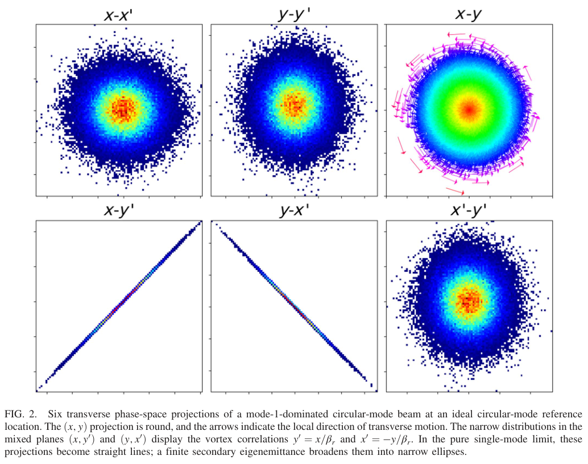
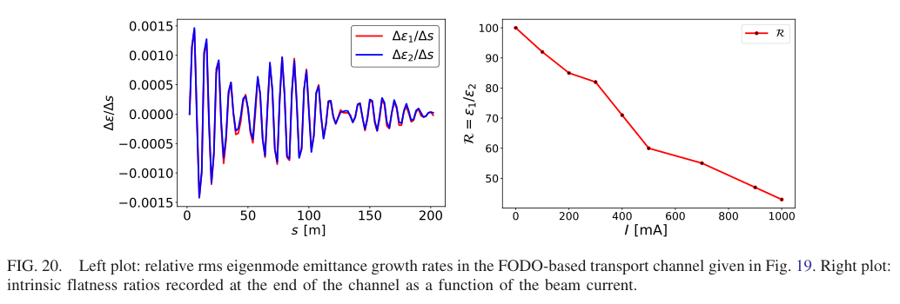
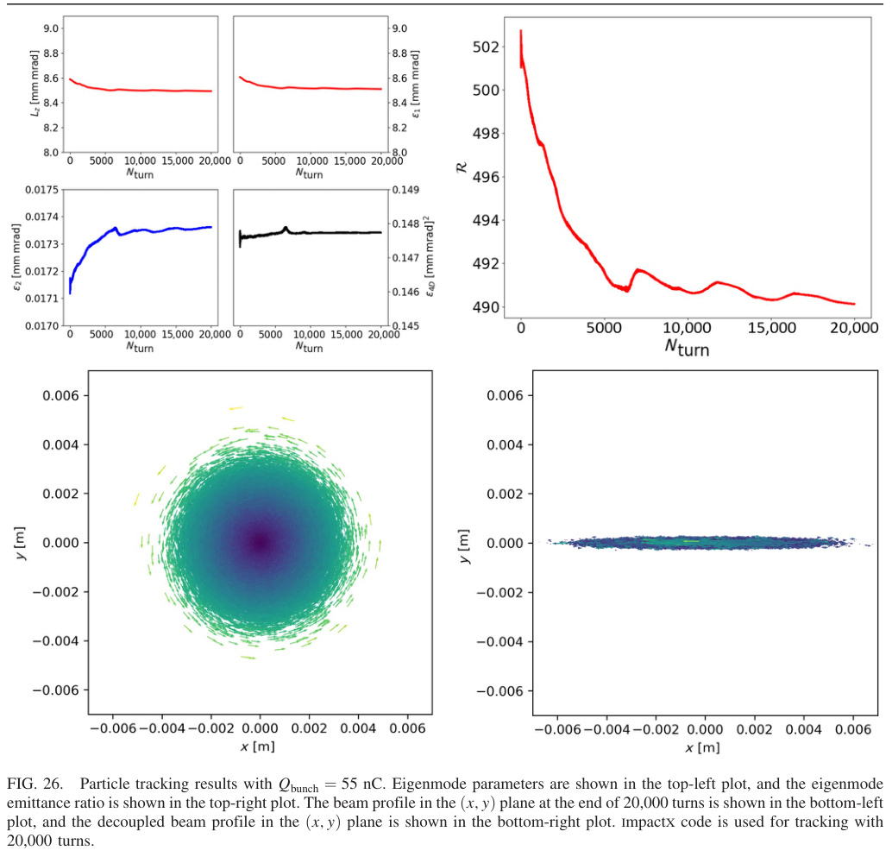

# 圆模光学：让高强度束在低能段保持圆截面，随后恢复本征平坦性

## 0. 论文信息与证据等级

- 原题：*Circular-mode optics for high-intensity beams and high-luminosity colliders*。
- 作者：Onur Gilanliogullari、Brahim Mustapha、Pavel Snopok。
- 正式来源：[Physical Review Accelerators and Beams 29, 103202](https://doi.org/10.1103/1drd-x8kp)，2026-04-27收到、10-05接受、**10-28正式发表**。同作品旧预印本为 [arXiv:2609.33840](https://arxiv.org/abs/2609.33840)，本次阅读的是正式VOR。
- [本地32页PDF](../pdfs/Gilanliogullari%20et%20al.%20-%202026%20-%20Circular%20mode%20beam%20optics.pdf)；[布局文本](../pdfs/Gilanliogullari%20et%20al.%20-%202026%20-%20Circular%20mode%20beam%20optics.txt)。PDF、布局和MinerU全文保存在本地并按仓库约定Git忽略；正式PDF由APS官方harvest取得。
- **证据：解析束流光学＋TRACK/ImpactX粒子跟踪与空间电荷PIC。没有本论文新束流实验、激光加速实验或对撞机性能实测。** 原文引用的转换器和相空间painting实验是前人成果。
- 本笔记按原文摘要、I—VII及附录顺序阅读，MinerU正文与PDF/布局交叉核查；实际查看PDF第1、5、17、19、21、22、23、25、26、30页，保留3幅原图摘录。图版权为作者/APS，CC BY 4.0；保留原图号、原题和署名来源。本文未运行作者代码、空间电荷模拟或NAFF。

## 1. 摘要：本征不对称与空间圆截面可以共存

论文研究的对象是强横向耦合、两本征发射度差别很大的圆模束。其空间投影可以近似圆形，同时把“平坦性”储存在四维相空间的混合相关中。经过低能强空间电荷段后，再用逆转换器把这种本征不对称变回常见的物理平束。

作者给出的主要增量是保持圆模的晶格条件、圆模空间电荷调谐移动/展宽描述，以及有限输运线与环形加速器中的数值例证。圆模概念本身并非本文首次提出；数值支持的是文中理想晶格与已选参数，不能把“设计框架”写成已建束线或普遍稳定性定理。

## 2. I. Introduction：为什么低能直接运送平束困难

### 2.1 亮度和光度比较的基准

原文以束流亮度及对撞光度引入发射度的重要性。固定束流电流、粒子数、重复频率和相互作用点光学参数时，若横向大平面发射度保持不变，而小平面缩小R倍，则

$$
\mathcal B\propto\frac{I}{\epsilon_x\epsilon_y},\qquad
\mathcal L\propto\frac{f_0N_1N_2}{\sigma_x^*\sigma_y^*},\qquad
\sigma_j^*=\sqrt{\beta_j^*\epsilon_j},
$$

$$
\epsilon_y=\frac{\epsilon_x}{R}
\quad\Longrightarrow\quad
\frac{\mathcal B_{\rm flat}}{\mathcal B_{\rm round}}=R,
\qquad
\frac{\mathcal L_{\rm flat}}{\mathcal L_{\rm round}}=\sqrt R.
$$

变量中I为电流，f₀为重复频率，N为束团粒子数，β*为相互作用点β函数，ε默认为几何rms发射度。**推导**是先用束斑与发射度平方根的关系，再代入面积；不是把同一束经无耗散线性转换后凭空增加4D亮度。原文的R倍亮度比较针对不同初始发射度预算的束；转换器保持的是已有本征发射度乘积。

### 2.2 低能段的空间电荷动机

低能质子/重离子束的自场强，直接平束的薄平面会经历很强的自场梯度和发射度增长。圆模把横向密度保持得较圆，因此可能在保留本征不对称的同时获得类似普通圆束的领先阶空间电荷行为。这不是“去掉空间电荷”：弱本征模仍可能被明显加热。

## 3. II. Theory：圆模到底保存什么

### 3.1 耦合本征模与u参数

在稳定线性4×4辛映射下，横向运动可拆成两个独立正规模。各模式具有作用量、betatron相位和投影到x/y方向的β、α及耦合相位。束的rms本征发射度是模式作用量的平均。

Lebedev–Bogacz表示中的u是**光学耦合参数**，不是模式粒子比例或发射度比。u=0和1对应两种解耦/交换标签的极限；u=1/2表示最大耦合。它只是理想圆模的条件之一，还需各投影β相等、参考位置α为零，以及两耦合相位处于正交关系：

$$
u=\frac12,\qquad
\beta_{1x}=\beta_{2x}=\beta_{1y}=\beta_{2y}\equiv\beta_0,
\qquad\alpha_{jx}=\alpha_{jy}=0,
\qquad\nu_1=\nu_2=\frac\pi2\pmod\pi.
$$

这里第一项的u与后面的希腊ν不同；β₀是本征模投影β函数，单位m。把最大耦合直接等同于圆束或单模束，会丢掉上述条件。

### 3.2 从涡旋关系推出圆形投影

在仅占据模1的理想极限，定义βᵣ=2β₀、A为运动幅度，则

$$
x=A\cos\psi,\quad y=A\sin\psi,\quad
x'=-\frac A{\beta_r}\sin\psi,\quad
y'=\frac A{\beta_r}\cos\psi,
$$

$$
y=-\beta_rx',\qquad y'=\frac{x}{\beta_r},
\qquad x^2+y^2=A^2.
$$

x、y为横坐标，撇号为对纵向路径的导数；βᵣ单位m，x′、y′为小角度量。**推导**是把相差π/2的横向振动代入坐标与斜率，消去相位；物理上是位置与正交方向动量相关，而不是独立的两平面高斯束。

### 图2：圆斑内仍可隐藏很强的4D平坦性

来源：Gilanliogullari等，正式PDF第5页Fig.2，原图摘录，CC BY 4.0。上排是x–x′、y–y′、x–y，下排是x–y′、y–x′、x′–y′；这是相空间结构示意，图中未给数值刻度或统一标定色条，不能从图读绝对发射度。x–y投影圆而无倾斜，混合平面却呈极窄相关椭圆；箭头给出旋转方向。有限小模发射度使理想直线变宽。其意义是“圆斑”不足以判断四维束流质量，也不足以判定没有角动量。

### 3.3 二阶矩、角动量和本征发射度

理想圆模参考点满足

$$
\langle x^2\rangle=\langle y^2\rangle=(\epsilon_1+\epsilon_2)\beta_0,
\quad \langle xy\rangle=0,
$$

$$
\langle xy'\rangle=\frac{\epsilon_1-\epsilon_2}{2},\qquad
\langle yx'\rangle=-\frac{\epsilon_1-\epsilon_2}{2},
\qquad L_z\equiv\langle xy'-yx'\rangle=\epsilon_1-\epsilon_2,
\qquad R=\frac{\epsilon_1}{\epsilon_2}.
$$

这里Lᶻ是原文所用的束平均、按参考纵向动量归一的角动量表示，具有发射度量纲；并非直接以kg·m²/s表示的机械角动量。上述用斜率写的关系适用于场自由区。在螺线管内部，正则动量还含矢势贡献，不能把机械斜率无条件代成正则量。

**推导与直觉：** 两个反向旋转模式对空间尺寸贡献相加，对角动量贡献相减。因而两模式发射度相等时仍可有圆投影和最大耦合，却没有净角动量；R很大才是强单模占优。

## 4. III. Creation：三条构造路径

### 4.1 Derbenev转换器

三个斜四极磁铁可把原本解耦的平束变成圆模束。变换把原x/y发射度映射到两本征发射度，同时产生横向耦合；逆转换器再把本征不对称恢复为物理平束。线性辛映射不产生新的4D冷却，输入本来就需有很大的发射度比。

### 4.2 磁化束

从轴向磁场内部产生、经出口边缘场出来的束具有磁化相关。与先有平束的转换器路线不同，这里可以从近圆、低初始散角束出发。原文用Busch定理讨论正则角动量，并用TRACK考察场强增加时两本征发射度的分离。

把乘积记为ε₄D，有

$$
\epsilon_{4D}=\epsilon_1\epsilon_2,\qquad
\epsilon_1-\epsilon_2=L_z,
\qquad
\epsilon_{1,2}=\frac{\sqrt{L_z^2+4\epsilon_{4D}}\pm L_z}{2}.
$$

**推导：** 以ε₁=ε₂+Lᶻ代入乘积得到二次方程，选正根。ε₄D在本文定义下是两个rms发射度的乘积，量纲为长度平方（常报(mm·mrad)²），而不是再次开方的“4D发射度”。在正确的强磁化条件下，

$$
L_z^2\gg\epsilon_{4D}
\quad\Longrightarrow\quad
\epsilon_1\simeq L_z+\frac{\epsilon_{4D}}{L_z},\qquad
\epsilon_2\simeq\frac{\epsilon_{4D}}{L_z}.
$$

这一展开说明：即使Lᶻ近守恒，乘积的增长也会优先损害小模和R。原文第23页Eq.(47)之后印成“Lᶻ远大于ε₄D”，两者量纲不同；本笔记采用上面的平方比较，不把印刷条件直接照抄为物理判据。

### 4.3 相空间painting

对小束元进行四维注入painting，并令两横平面的相位差为π/2，可以形成有定向旋转的分布。原文介绍Danilov类分布和既有SNS演示；本文没有新增注入painting实验。实际实现仍需横纵kicker匹配、束元位置和角度控制。

## 5. IV. Preservation：角动量和圆截面是两个验收项

### 5.1 圆投影条件

空间协方差给出束斑轴比及倾斜。在模1占优时，近似有

$$
\frac{\langle xy\rangle}{\sigma_x\sigma_y}\simeq\cos\nu_1,
\qquad \sigma_x^2\simeq\epsilon_1\beta_{1x},\qquad
\sigma_y^2\simeq\epsilon_1\beta_{1y}.
$$

所以等β保证轴比为1，耦合相位π/2保证无倾斜。角动量守恒单独不保证每一个位置都保持圆斑；它也不保证在非线性自场下两rms本征发射度严格不变。

### 5.2 晶格对称性和调谐分裂

以二次型表示角动量，输运矩阵需满足角动量二次型的不变关系。在无横耦合块对角映射中，这给出两平面总聚焦映射相同。螺线管通过轴对称聚焦和两旋转方向相反的相移，使本征模调谐分开而维持角动量条件。

四极段局部聚焦不对称，不能像理想螺线管那样逐点保持圆模条件。原文采用中面对称、两侧等强反极性的symmetric alternating-gradient（SAG）单元，使相位滑移在一周期后抵消；它提供**逐单元的离散恢复**，不等于整个单元内部处处守恒。常规只在一个平面聚焦的弯铁不满足同样条件，文中用场指数n=1/2的indexed dipole及直线段螺线管构造示例。

### 5.3 光学测量提案的限制

作者用逐圈位置FFT的两模峰值估计发射度比，并提出用已知晶格下的束斑倾角/尺寸重建本征发射度。傅里叶幅度还依赖模式β函数，只有适当匹配条件下才能直接关联平方根发射度比。文中这些主要是模拟诊断及测量提案，不是已实现高强度束线在线验收。

此处原文Fig.13正文写R=90而图注写“factor of100”；两处不一致，不从该图采信精确比值。有限能散会使不同动量切片的耦合相位和β函数不同，叠加后可能退相干；非轴对称非线性也会破坏角动量。作者明确把定量色差与外部非线性研究留待后续。

## 6. V. Space-charge effects：小模仍会加热

### 6.1 调谐移动的圆束领先阶

采用原文的线密度定义，广义perveance随能量升高迅速减小：

$$
\kappa_{sc}=\frac{2r_p\lambda(z)}{\beta^2\gamma^3}.
$$

rₚ为经典粒子半径，λ是相应粒子线密度；若换成电流或电荷线密度需补粒子电荷和速度，不能混用。β、γ在这里是相对论速度因子，与光学β函数不同。

对齐的高斯截面，在普通平面光学中的调谐移动为

$$
\Delta Q_x=-\frac{\kappa_{sc}}{4\pi}\oint
\frac{\beta_x(s)}{\sigma_x(s)[\sigma_x(s)+\sigma_y(s)]}\,ds,
$$

$$
\sigma_x=\sigma_y=\sigma_b
\quad\Longrightarrow\quad
\Delta Q_{x,y}=-\frac{\kappa_{sc}}{8\pi}\oint
\frac{\beta_c(s)}{\sigma_b^2(s)}\,ds.
$$

**推导：** 自场线性梯度是负附加聚焦，调谐一阶改变量为β加权的聚焦改变量积分；将两束宽相等代入即得圆束式。Q是每圈振荡数，无量纲，负号表示散焦。原文Fig.15以100MeV质子比较：在相同强度和投影rms尺寸下，圆模与无相关圆束的领先阶调谐移动近重叠；物理平束薄平面的调谐移动更大。图的正纵轴按位移幅度比较，不能把它读成自场正聚焦。

### 6.2 调谐展宽：区分平面坐标和本征模坐标

原文将空间电荷势作为扰动，以作用量偏导的相位/晶格平均给出振幅相关调谐移动：

$$
\Delta Q_j=\left\langle\frac{\partial V_{sc}}{\partial J_j}\right\rangle_{\psi_1,\psi_2,\psi_z,s}.
$$

J为相应解耦平面或正规模作用量，Vₛ꜀为对应归一化下的势；平均需用真正的动力学坐标，而不能仅把空间椭圆转到主轴就视为动态解耦。原文再对长高斯束作Bessel函数积分。

Fig.16在普通平面调谐坐标中比较无相关圆束的二维“领结”足迹与理想单圆模的对角线；该图**移除了空间电荷系数，只呈现无量纲形状**。Fig.17在耦合本征模调谐坐标中得到不对称的单侧领结部分，不能把两图混成“圆模足迹普遍一维”。论文支持所选匹配分布与振幅范围内足迹缩小，不是任意R、失配和共振附近均改善的定理。

## 7. VI. Transport lines and rings：数值例证及其连接条件

### 7.1 数值模型

输运线使用TRACK，环例使用ImpactX；环模拟为六维跟踪＋完整三维PIC空间电荷。每个加速段有五个短RF腔、一阶谐波，并计动量压缩和纵向同步振荡。**外部四极/弯铁/螺线管采用参考动量上的理想线性硬边界映射**，因此同步振荡没有通过真实色差直接调制横向本征光学；其横向影响来自演化的纵向密度及三维自场。

对加速图，必须比较归一化量：

$$
\epsilon_{j,N}=\beta\gamma\epsilon_j,\qquad
L_{z,N}=\beta\gamma L_z.
$$

ε₄D若由归一化两模乘积构成，则含两个βγ因子。几何发射度因加速缩小，不等价于新的束流冷却。

### 7.2 FODO输运：R随电流下降

无空间电荷例子在输运两端放置转换器，显示先平→圆模、再圆模→平。加入空间电荷的代表案例是200MeV、500mA质子束，约200m输运，小模发射度增长明显而大模近保持；初始R=100。作者给出的700mA案例终值R=55。

来源：正式PDF第21页Fig.20。左横轴s单位m，纵轴印为Δε/Δs，两色为两个本征发射度的差分增长；右横轴电流mA、纵轴R为无量纲本征发射度比。右图的下降说明强度增加会侵蚀小模优势；不能声称圆模完全保护R。**口径疑点：** 左图图注/正文称“relative growth”，但轴并未除以各自ε，且Fig.19小模从约0.010升至0.015量级，大模在约0.98附近变化很小。因此不能据此写“两模相对百分比增长相同”；更像是相近绝对差分增长，需作者数据确认。

### 7.3 螺线管booster

| 参数 | 代表数值/条件 |
|---|---|
| 质子动能 | 200MeV→3.2GeV |
| 初始rms束长、能散 | 2.65m、0.579MeV；相对动量宽约1.59×10⁻³ |
| 束团电荷 | 60nC |
| 工作点及初始调谐移动 | Q₁=4.86、Q₂=4.37；两模约−0.15 |
| 跟踪和本征平坦性 | 20,000圈，初始R=1000，末值约470 |

连续轴对称聚焦比仅离散恢复的四极结构更有利于保持角动量。但Fig.22初始小模快速变化、4D乘积先增长再平衡，作者把它与初始自场打开时的失配联系起来；R从1000降至470不应写成“几乎无损”。规范化角动量也有有限漂移，本文没有逐圈守恒误差预算或数值收敛复验。

### 7.4 四极booster

四极负责主要聚焦、直线段加螺线管分裂调谐，输入同为200MeV质子，55nC，Q₁=5.94、Q₂=5.32，调谐移动约−0.110。初始R=1000、20,000圈后约200。空间电荷势随束形变化，不满足外部晶格施加的理想镜像对称，导致去磁化、小模变热、R下降。

螺线管与四极案例束团电荷并不完全相同（60/55nC），因此约470/200是这些设计案例结果，不是严格控制所有其它量相等得到的通用提升倍数。

### 7.5 高能同步加速器

第三例**假设**3.2GeV注入时已有R=500，然后加速到23.2GeV；输入55nC、rms束长2.05m、能散3.42MeV、相对动量宽8.7×10⁻⁴，Q₁=10.64、Q₂=9.23。约8,000—9,000圈穿越transition，文中按其RF相位约定反转五腔同步相位保持纵向稳定；20,000圈后R约490。

来源：正式PDF第26页Fig.26。上左为归一化Lᶻ、两本征发射度和乘积，横轴圈数；R曲线从约500到490，约2%的相对下降只适用于该高能输入案例。下方两图坐标均为m，左为末端圆投影，右为逆转换后物理平束；颜色未给绝对粒子数/电荷色条，只可读形状。数值上证明的是理想映射中本征不对称可重新映射到物理平面。

**连接边界：** 四极booster的实际末值约200，而同步环输入R=500是另行假设；螺线管booster约470也不是精确500。因此三例不能拼成已验证的200MeV→23.2GeV全链性能。Fig.27的NAFF调谐足迹只与理论作定性拓扑比较，没有逐点边界残差或实验足迹验证。

## 8. VII及附录：结论、推导核对和源文疑点

论文最有用的结论是：在强空间电荷区间维持较圆的**实际密度**，同时保留尽可能大的**本征发射度比**，可为下游恢复平束提供另一种输运设计。守恒角动量、保持圆斑、控制4D乘积增长和末端解耦分别需要诊断，任何单项都不足以替代其余项。

附录A推涡旋关系及二阶矩；B用投影协方差说明耦合相位改变时圆斑可变倾斜窄椭圆；C处理加速归一化；D推Gaussian自场调谐展宽。对这些推导，保留如下静态核查：

1. **附录D2的根号符号。** 第30页实际PDF把空间协方差主轴方差根号内印成两对角项差的平方**减**4倍协方差平方。直接对2×2实对称协方差矩阵求本征值，应为

$$
\sigma_{\eta,\tau}^2=
\frac{\sigma_x^2+\sigma_y^2}{2}
\pm\frac12\sqrt{(\sigma_x^2-\sigma_y^2)^2+4\sigma_{xy}^2}.
$$

由特征方程展开可见正号；原文印刷式在等宽但有相关时甚至可能给虚根。本笔记不沿用该负号，也不据此断言实际模拟代码或特定θ=0结果错误。

2. **附录C3的坐标归一化。** PDF先写带波浪坐标等于原坐标除以√(βγ)，后续代入却对应原坐标等于波浪坐标除以√(βγ)，定义方向不一致。可直接用加速Hill方程验证：若两平面聚焦相同，则几何Lᶻ的导数等于负的对数动量导数乘Lᶻ，从而βγLᶻ守恒。结论可独立推出，但印刷中间定义需核对。
3. 第23页强磁化比较的量纲、Fig.20相对/绝对增长、Fig.13的90/100差异均已在对应段说明。MinerU也会把π/2、u/ν或下标识别混杂，公式以实际PDF及量纲检查为准，不能把解析文本无检查复制到模拟器。
4. 原文Data Availability称数据不随发表公开，可向作者索取。没有公开输入、粒子采样、PIC网格/宏粒子/步长收敛及原始测量结果，本轮仅完成全文阅读与静态关系核查。

## 9. 与本库任务的关系和可证伪后续

该文可作为高强度离子束传输、本征发射度诊断和PIC自场研究的设计参考。迁移到激光电子/离子束时，首先需面对真实宽能散、指向漂移、非Gaussian尾和磁光学误差；本论文没有验证这些输入，也没有计算转换靶γ、中子、核素产额或剂量。

可检验的下一步是：取得各例输入与代码版本；在固定电荷/能量/输入ε乘积下比较晶格；做宏粒子、网格、时间步与初始匹配收敛；分别记录归一化角动量、两本征发射度、4D乘积、损失与色差切片。若声称端到端性能，必须让上一段实际输出直接进入下一段，而不是重新指定更好的R。

复习速记：**圆的是密度投影，平的是本征发射度；轴对称帮助保持角动量，但小模加热与全链匹配仍决定能否恢复高质量平束。**
