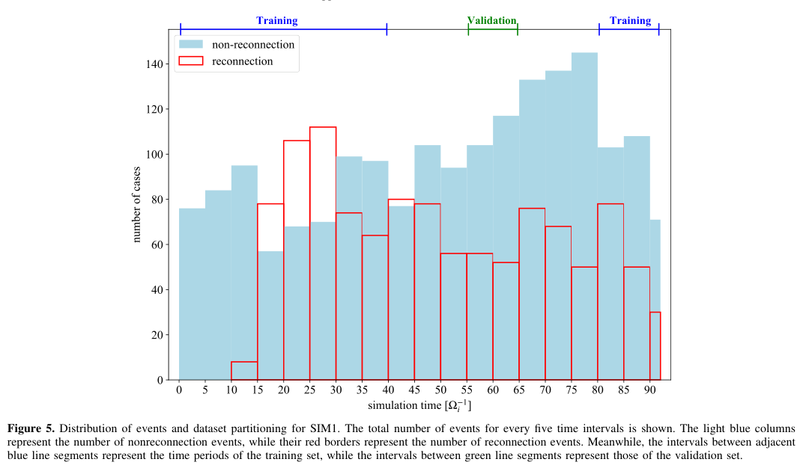
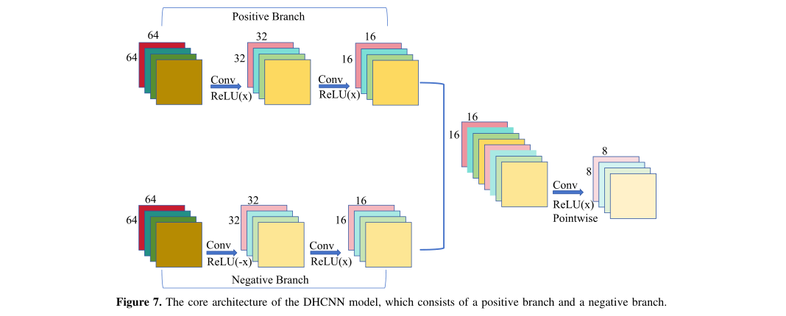
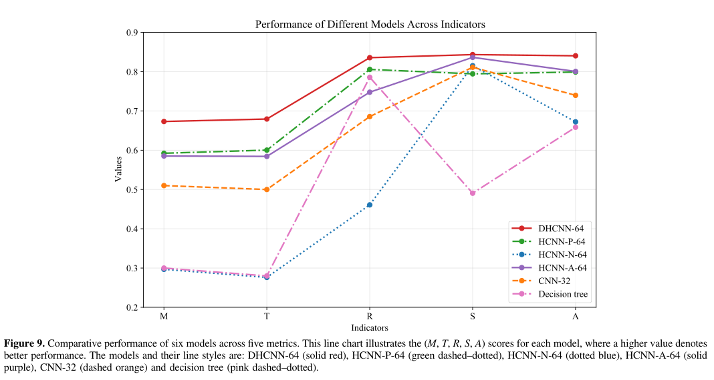

# 用保留正负信息的双分支 CNN 识别湍流中的磁重联：DHCNN 全文笔记

## 0. 论文身份、来源与本轮证据

- 原题：*Identification of Magnetic Reconnection in Plasma Turbulence Using a Dual-branch Lightweight Hybrid Convolutional Neural Network*。
- 作者：Y. Yin、S. Y. Huang、Q. Y. Xiong、H. Zhang、Z. G. Yuan、K. Jiang、H. H. Wu、H. W. Zhan、Y. T. Tang、H. Bai。
- 正式版本：*The Astrophysical Journal Supplement Series* **287:26，11页**；卷期标记为2026年11月，**首页明确2026-10-29在线发表**，接受日为2026-09-17。不能用卷期月份替代在线日期。
- DOI：[10.3847/1538-4365/aeaa32](https://doi.org/10.3847/1538-4365/aeaa32)；[官方出版社 PDF](https://iopscience.iop.org/article/10.3847/1538-4365/aeaa32/pdf)；[本地已验证全文](../pdfs/Yin%20et%20al.%20-%202026%20-%20DHCNN%20reconnection%20identification.pdf)。图片为该文原图摘录，按 **CC BY 4.0** 保留作者、期刊和 DOI 归属。
- 阅读依据：官方 VOR 全文、MinerU pipeline 正文与独立布局文本交叉检查；实际目视查看PDF第1、3、4、5、6、7、8、9、10页及下列3幅摘录。下载哈希、全部页文本检查和图片坐标见当日核验记录。
- 证据类型：**两组约化质量比、二维全动理学 PIC 数据上的监督分类研究**。本轮未复跑 PIC、标签流程、网络训练或推理；没有卫星、实验室激光或强场 QED 的直接部署结果。

## 1. 摘要：准确率对应什么任务

作者想在衰减湍流中找到磁重联候选，而非仅找到强电流区。传统正值激活容易截去磁场、速度、电场和能量转换量的负值，因此论文设计正、负两个支路分别提取特征，再融合分类。主要结果是独立 PIC 测试集上的 Matthews 相关系数约0.67、TSS约0.68、召回约0.84、特异度约0.84、准确率约0.84。

这里的预测单位是**先由电流阈值和聚类筛选出的局部图块**，正负真值来自人工物理判读。其性能并非未经预筛选的全空间像素检测率，也不是重联能量释放率的测量精度。论文提供的是有限物理条件下辅助定位的分类器，尚未完成从观测到机制、再到干预验证的闭环。

## 2. 引言：为什么电流片形态不等于重联

引言前几段梳理磁层、太阳风及实验室背景：磁重联通过改变场拓扑把磁能转给粒子；在理想、孤立的电流片中，磁场反转和局部流场易于判读，但湍流会生成大量交织的强电流结构。因而，自动方法必须区分“有电流片”与“正在重联”。

随后作者比较阈值法、聚类法和既有 CNN。其研究动机集中在负值信息：对带方向和符号的物理通道直接用普通 ReLU，会丢失一部分输入。双分支的贡献是对信息表示方式进行改进；不能由此推断网络已经自动发现新的重联物理机制。

原图1展示同一类模拟在约34和100个离子回旋时间处的电流形态差别。作者认为晚期重联事件稀少，最终抽样截止到92个离子回旋时间。因此本数据不是对所有衰减阶段的均匀抽样，尤其不能由总体准确率推断晚期稀有事件的检出率。

## 3. 模拟和数据来源

### 3.1 PIC 物理条件与真正独立的 SIM2

模型是二维周期正方形、离子—电子等离子体的全动理学 PIC。主要设定如下。

| 项目 | 文中设定与含义 |
|---|---|
| 空间平面、大小 | xz平面，边长64个离子惯性长度 |
| SIM1 网格 | 2048×2048；由几何可得网格间距为离子惯性长度的1/32 |
| 粒子、分布 | 每物种每单元1600个宏粒子；初始 Maxwell 分布、准中性、均匀密度 |
| 质量比 | 离子/电子质量比25，远低于真实质子/电子质量比 |
| 初始热状态 | 离子与电子 beta 均为1 |
| 磁场及扰动 | 均匀导引场等于基准场；磁场相对均方根扰动约1；随机相位磁场/速度扰动 |
| 波数 | 相对基波波数2—6；基波由周期盒长确定 |
| 频率比 | 电子等离子体频率/电子回旋频率为3 |
| SIM2 | 1024×1024，**另一次独立模拟**；随机种子与初始条件不同，其余物理参数保持 |

SIM1用于训练和验证，SIM2专用于测试。因此不能把本文误写为“仅把同一个 PIC run 的相邻帧随机拆分”。但SIM2仍在同一类二维、约化质量比、相同宏观参数的湍流问题内；它验证了有限的跨实现泛化，没有验证真实质量比、不同 beta、不同导引场、三维、碰撞或辐射物理。

### 3.2 候选预筛选和人工标签

作者先用强电流阈值找局部峰，再抽取约200×200网格的候选区，结合DBSCAN分离共存电流结构。聚类要求点数至少100、最大横/纵延伸至少20个网格；阈值参考了其样本中重联结构的最小点数103和最小延伸21。随后围绕峰值裁出边长为最大延伸两倍的正方形，并经双三次插值统一到128×128。

这一前置过滤意味着最终召回率只对**进入候选池的事件**成立。没有给出漏过阈值、过小结构或聚类失败的全域真值统计，因而还不能把分类召回率解释为整个模拟盒内的端到端召回率。样本尺度经重采样后统一，64×64输入也不能直接等同固定的物理长度。

标签由人工结合面内磁场反转、X型形态、电子流入/流出等物理特征确定，其余变量辅助。作者没有在此给出跨标注者一致性、标签误差率或由磁通函数/连通性变化独立判定的全量真值。训练输入与人工标签判据具有明显重叠，因此分类成功首先说明网络可重现这组标签规则。

网络实际使用7个通道：总电流大小、电子速度的x/z分量、磁场的x/z分量、电子参考系电场的y分量、电子能量转换代理。人工还可查看面外分量、面内磁场/电子速度大小等额外信息。表1采用的后两个物理量为

$$
E'_{e,y}=(\mathbf E+\mathbf v_e\times\mathbf B)_y,\qquad
D_e=\mathbf J\cdot(\mathbf E+\mathbf v_e\times\mathbf B).
$$

**变量、单位与推导。** 电场、磁场、电子流体速度及总电流密度分别记为上式中的矢量；在SI中电场为V/m、电流密度为A/m²，所以点乘具有W/m³的功率密度量纲。先用非相对论运动电场变换形成电子流体中的非理想电场，再与电流密度点乘，得到作者选用的局部能量转换代理。图中数值为代码归一化量，不能直接读成实验室W/m³。

**物理直觉与限制。** 理想冻结关系成立时括号内近于零，非零值有助于定位非理想区；但其正负反映局部转换方向，不自动等于不可逆熵增或电子加热。本文采用的是表1明确给出的代理式，不能未经补充项/参考系检查就称为完整相对论耗散不变量。

### 3.3 类别比例、增强和时间隔离

SIM1原始样本2397个，其中非重联1839、重联558，约3.3:1。原点对称翻转把重联数扩为1116，合计2955个，比例约1.65:1；这是**减少不平衡**，不是严格一比一平衡。其他增强包括约±15°旋转、翻转和噪声。作者还明确写到：少量正样本经x/y单轴翻转后被改为负标签，其他增强保留标签。

这项改标签规则需要代码或逐通道变换说明：如果只是对整个物理场作一致的坐标镜像，重联身份通常不应因此变化；若作者有意改变不同矢量通道间的符号/拓扑关系，需说明具体操作。当前全文不足以判定实际实现错误，也不足以复现其标签操作。它是本轮保留的静态方法疑点。

**图5阅读。** 横轴为模拟时间，以离子回旋时间为单位；纵轴为每5个时间单位内的事件数。浅蓝柱与红边分别对应非重联和重联样本，上方蓝线标训练区、绿线标验证区，间隔区作缓冲。正文称使用15个离子回旋时间的间隔；图上大致可见前段与80之后用于训练，中间一段用于验证。正文把验证区线色写成red，实际图和图注是green，本笔记以原图为准。

**意义和边界。** 这比随机拆分相邻帧更能减少同一结构跨训练/验证出现的风险，但不独立证明15个时间单位已超过事件相关寿命。**SIM2另有285个独立模拟样本，非重联171、重联114**；它与SIM1内部的时间隔离是两层不同验证设计。

### 3.4 分段归一化的印刷疑点

正值通道的min–max式为

$$
s_+=\frac{I_+-I_{+,\min}}{I_{+,\max}-I_{+,\min}}.
$$

变量为某物理通道的正值及其极值，分子分母单位相同，结果无量纲；代入极小/极大端点即可得0和1。原文Eq.(4)由这个结果乘范围再加极小值，是反变换，却把结果称为归一化量，记号描述不够清楚。

更关键的是，原文Eq.(5)印为

$$
s_-^{\rm printed}=\frac{I_--I_{-,\max}}{I_{-,\min}-I_{-,\max}}.
$$

原文称负值映射到−1至0。按其文字定义直接代入：在负值极小端点结果为1，在极大端点结果为0，因此**印刷式给出0至1，而非−1至0**。例如负值范围−4至−1时，代入−4得到1。这是由PDF第5页直接确认的公式—文字不一致；没有取得并运行实现，不能据此声称训练代码真的丢失负值或结果无效。复现前应查实际预处理、零值/常数通道处理、极值取自训练集还是每个图块，以及SIM2是否使用独立统计量。

## 4. 方法：双分支为什么有帮助

### 4.1 架构与符号信息

**图7阅读。** 上支路先取正值激活，下支路用反号后激活提取原负值，分别作卷积和降尺度，再经融合及逐点卷积。图中64、32、16、8表示特征图空间尺寸；叠色方块为不同通道/特征，不是物理粒子数或物理能量。两条支路可以学习不同权重，因此不会像直接取绝对值那样把相反符号完全合并。

作者结合常规多尺度卷积与深度可分离卷积：先逐通道作空间卷积，再用1×1逐点卷积混合通道。它为降低计算成本提供架构动机，但全文没有给出足以证明真实设备实时部署的端到端延迟、吞吐量或所有对比模型统一硬件成本，不能仅凭“lightweight”标题认定已经实时运行。

### 4.2 输出概率与训练目标

$$
\widehat y=\frac{1}{1+e^{-z}},\qquad
\ell=-[y\ln\widehat y+(1-y)\ln(1-\widehat y)].
$$

**变量与推导。** 真实标签为0或1，网络logit为无量纲实数，sigmoid把它映到0—1。以伯努利模型写出一个样本标签的似然，再取负对数，即得二元交叉熵。作者使用PyTorch `BCEWithLogitsLoss`，以数值稳定形式直接处理logit；并用Adam中的L2正则、dropout和验证损失早停控制过拟合。

**直觉和边界。** 标签为1时，损失促使预测概率增大；标签为0时则反向。这个概率是对当前训练标签与样本分布的模型输出，论文没有给出概率校准或域外可信度检测，不能把0.9直接解释为90%的物理重联真实性。

## 5. 结果：验证集与独立模拟测试集分别读

### 5.1 指标定义及多数类基准

$$
R=\frac{TP}{TP+FN},\quad S=\frac{TN}{TN+FP},\quad
A=\frac{TP+TN}{TP+TN+FP+FN},\quad T=R+S-1,
$$

$$
M=\frac{TP\,TN-FP\,FN}
{\sqrt{(TP+FP)(TP+FN)(TN+FP)(TN+FN)}}.
$$

TP/FN指真实重联样本的检出/漏检，TN/FP指非重联的正确排除/误报；所有指标无量纲。召回与特异度分别在各真实类别内归一化；TSS是两者减去随机无技巧基线1，平衡准确率则为两者平均。MCC把二元预测与真实标签的协方差用各自方差归一化，兼顾四个混淆矩阵分量。

SIM2里始终猜非重联即可得到171/285=60%的准确率，所以不能只看84%。主模型的召回约0.836和特异度0.844同时改善，TSS约0.680、平衡准确率约0.840，才是更有信息的判据。正文称M与T都对类别不平衡“高度敏感”，但在固定召回/特异度条件下TSS的代数定义不依赖类别先验；有限正样本数仍会影响估计误差。

### 5.2 图块尺寸只在给定扫描内选优

作者比较16、32、48、64、96、128六种输入尺寸，每个配置做15次不同随机初始化的训练。在**SIM1验证集**上，64×64的M=0.718、T=0.744、R=0.899、S=0.845、A=0.864，是该扫描的综合较优配置。32×32召回更高但特异度较低，48×48特异度更高，说明“最佳”依赖漏报与误报的目标权衡。

图8箱线图显示的是这15次训练的模型变动，不是15组独立等离子体实验。表3的TP/FP/TN/FN为重复试验汇总并取整的数值，不能当作一个精确整数混淆矩阵再要求由其代数重现全部平均指标；更不应把验证集0.718M挪作SIM2结果。

### 5.3 独立 SIM2 上的模型对比

**图9阅读。** 横轴依次为M、T、R、S、A五种不同指标，纵轴为无量纲分数。折线连接只是帮助辨认模型，不是时间轨迹；红实线为双分支，绿点划线为仅正值，蓝点线为仅负值，紫线为绝对值单分支。图中没有对这些平均值给出置信区间，不能由曲线间距本身认定统计显著性。

| 配置或比较 | SIM2主要结果 | 正确读法 |
|---|---|---|
| DHCNN-64 | M=0.673（结论/表4全变量处写0.674），T=0.680，R=0.836，S=0.844，A=0.841 | 15次训练—测试的平均；M保留原文0.001级表述差异 |
| 仅正值HCNN-P-64 | M=0.592，T=0.600，R=0.806，S=0.795，A=0.799 | 双分支较此提高M 0.081、A 0.042，为绝对分数差 |
| 仅负值HCNN-N-64 | M=0.297、T=0.276 | 负值单独不足，不能据此说负值无用 |
| 绝对值单支HCNN-A-64 | M=0.585、T=0.584 | 取绝对值混合符号，并不能复现双支收益 |
| 旧CNN-32 | 双支较其M/T/R/S/A分别高0.164/0.180/0.150/0.030/0.099 | 在作者给定复现/训练设置下对比，不是对所有CNN的普遍优势 |

摘要将T概括成0.67，而正文和结论给0.680；本笔记保留详细结果，不把不同位置的近似值强行拼成更高精度。原文还把召回、特异度的优势描述成高“precision”，但它们不是阳性预测值；本文主要报告的五个指标不包含单独的precision。15次训练通常复用同一285个SIM2样本，因而不能把它们视作4275个独立物理事件或15个独立外部测试集。

### 5.4 变量贡献是标签预测贡献，不是机制因果

表4使用前向逐步选择：先分别训练每个通道，接着固定当前较好通道，再尝试逐一加入其余通道。单通道时总电流大小的M=0.447最好，能量转换代理为0.310；仅电子参考系电场y分量约−0.069。加入磁场z分量后M=0.598，再加x分量后0.651。全变量约0.674，与三通道相比仅小幅增加。

能量转换代理与电流合用时M=0.435，未优于单独电流。其合理解释之一是变量相关、信息冗余、有限样本及训练变化；**不能推出能量转换在重联物理上不重要**。此外，人工标签本来就依据电流形态和磁场反转，这些输入贡献大也部分体现标签定义，不能作为独立物理发现。

更具体的验证边界是：第4.4节明确在每一轮用**SIM2分数选择较优变量**。因此SIM2在这项变量选择分析中被反复查询；最终精简通道方案尚需第三个未参与选择的数据集再评估。主模型的跨run测试仍有价值，但不能把所有探索后的配置都说成只在最终一次完全盲测中确定。

## 6. 结论、未闭环问题与可证伪下一步

论文给出的可支持结论是：在指定二维衰减湍流PIC候选池里，分离正负信息的网络较正值单支或绝对值单支获得更好的分类平均指标；另一次不同种子/初态、较低网格分辨率的PIC run 提供有限的跨run测试。作者明确承认尚未应用到不同物理参数的复杂模拟或卫星观测，三维、时空网络和MMS部署属于后续方向。

本轮保留的复现与物理问题如下。

1. **先核验输入，而后解释模型。** 对Eq.(5)的端点做预处理单元检查，并取得实际负支数据、训练集极值与SIM2变换；论文印刷矛盾尚不能判为运行故障。
2. **核验标签变换。** 公开各标量、极矢量、轴矢量在旋转/镜像中的逐通道操作，并重新检查翻转后改负标签的样本。采用独立磁拓扑真值和跨标注者比较，检验网络是否主要学习人工形态模板。
3. **补全域漏报账本。** 在预筛选前建立事件清单，分别计电流阈值、聚类、尺度过滤和最终分类的遗漏，避免把条件召回当全域召回。
4. **建立第三组外部测试。** 对变量选择后冻结的模型，用新seed、新质量比/beta/导引场及三维数据测试；同时报告类别先验、事件级而非帧级不确定度、误报聚类和校准。
5. **连接机制诊断。** 对预测事件固定粒子群、时间窗、参考系、能量账本，联合拓扑变化、电子非理想场与粒子能量增益；用漏检/误检事件设计反例，而不把特征消融解释为因果干预。
6. **量化轻量化和实际部署。** 固定硬件比较参数量、全预处理+推理时间、吞吐量和误报处置成本，之后才能讨论在线诊断；本论文尚未提供激光、QED、光核或临床应用验证。

## 7. 复习速记

“84%准确率”是另一组相同物理参数族的二维PIC候选图块测试结果；双分支保留符号表示有用，但识别标签不等于解释机制。复现首先应解决负值归一化印刷式、镜像增强标签、全域预筛选漏报和SIM2反复参与变量选择这四个问题。
