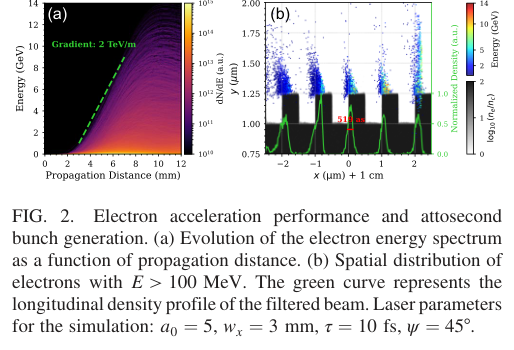
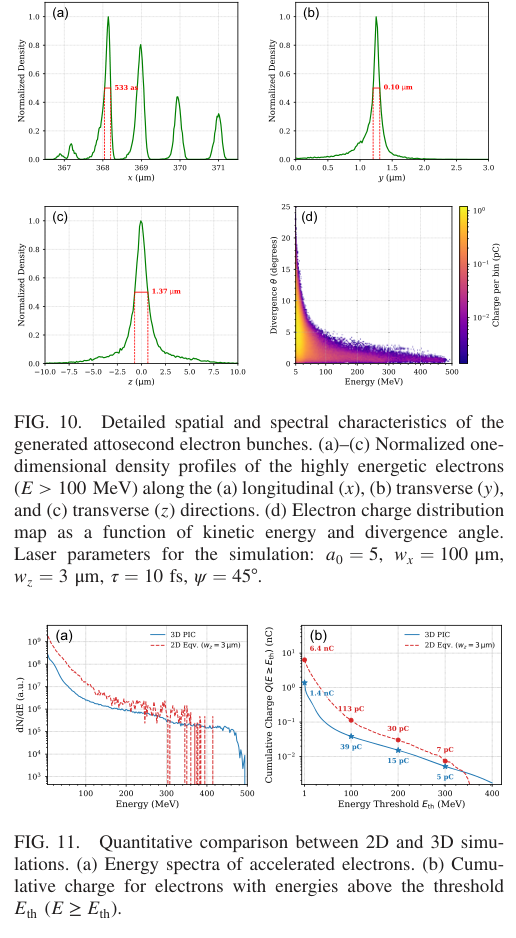
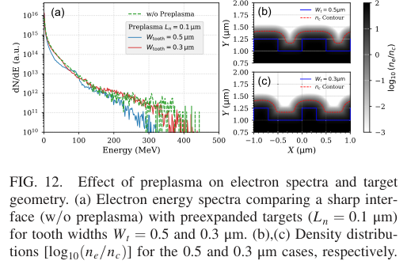

# 脉冲前沿倾斜激光驱动光栅表面掠行电子：二维10 GeV预测与三维阿秒束验证范围

## 0. 身份、版本与来源恢复

- 原题：*Generation of attosecond electron bunches via high-gradient acceleration in periodic structures driven by a pulse-front-tilted laser*。
- 作者：Chaolu Ding、Xuesong Geng、Liangliang Ji。
- *Physical Review Applied* **26, 044091 (2026)**；[DOI](https://doi.org/10.1103/q1y7-w87y)。首页为2026-09-21接受、**2026-10-29发表**，接受与正式日期分开。
- [官方12页VOR](../pdfs/Ding%20et%20al.%20-%202026%20-%20Periodic%20structure%20attosecond%20electrons.pdf)。APS harvest经代理／直连均401；正确的[prapplied官方PDF](https://journals.aps.org/prapplied/pdf/10.1103/q1y7-w87y)由既有下载器直连取得，已验证题名、作者、期刊、日期与全部页。此前检索辅助曾用错误prab页面，未采信其版本信息。
- MinerU无法读取该URL，**没有解析成功声明**；实际使用已验证本地全文、独立布局文本及PDF第1、3—10页目视检查。原图摘录仅作论文评论，©2026 APS；未宣称CC BY许可。补充视频本轮未取得／观看。
- **证据类型：作者2D/3D无碰撞PIC、test-electron轨迹和理想标度。** 本轮未运行EPOCH／探针／靶制造／实验；“demonstrate”在此不是实验观测。

## 1. 物理问题与机制链

普通横向入射激光对沿表面电子的作用长度受min(cτ,wx)限制。作者令激光沿−y入射、电子沿+x掠行，脉冲强度前沿满足延迟x·tanψ/c。取ψ=45°时，包络峰沿x运动速度c/tanψ≈c，以大长轴wx延长重叠。

光栅周期d=λ=1 µm、齿高h=0.25 µm；不是靠0.5λ高齿遮住减速相位的旧piecewise方案。表面自生电荷／回流场扭曲驻波，齿角电子被抽出、回拉并注入；合适相位同时获得净加速与交替横向聚焦，其他相位散焦或减速。因此近场是**相位筛选器**，形成周期性微束团列。

“PFT包络同步”与“载波／近场相位锁定”是不同条件。ψ=45°不能单独保证所有电子一直加速，还需要注入相位、驻波结构和横向稳定。作者以固定时刻的px=100mec测试电子片、20个周期追踪和|Δy|<0.1 µm判据支持筛选机制；该探针不是所有真实自注入粒子的统计效率测量。

## 2. 必须分开的三组条件

| 条件 | 2D高能结果 | 2D轨迹／扫描 | 3D核验 |
|---|---|---|---|
| a0、λ、τ | 5、1 µm、10 fs（场包络1/e） | 同左 | 同左 |
| wx／wz | 3 mm／假定3 µm | 100 µm／假定3 µm | 100／3 µm |
| 推定能量／功率 | 61 J／4.8 PW | 2 J／161 TW | 2 J／161 TW |
| 电子密度 | 100 nc | 100 nc | **10 nc** |
| 网格窗口 | 40×15 µm²、4000×1500，沿x以c移动 | 同类 | 40×15×20 µm³、2000×750×500 |
| 宏粒子 | 电子100、离子16／格 | 同类 | 电子32、离子8／格 |

初始冷、全电离Al¹³⁺、1 µm厚基底；未给出真实预脉冲流体演化、碰撞／电离或辐射反作用全链。2D电荷用有效厚度Leff=√π·wz≈5.32 µm换算，该第三维是人为映射，不是实测或自洽3D体积。

同一a0下2D和3D密度不同，是同时改变维度与材料条件的对照；不能把差异全部归因于三维侧向逃逸，也不能说已完成控制其他条件的密度鲁棒性扫描。

## 3. 高能与束长：原图2

PDF第4页：(a)横轴传播距离mm、纵轴能量GeV、颜色为对数谱量；绿虚线标称约2 TeV/m阶段梯度。(b)横纵坐标为局部x/y µm，点颜色为能量，绿曲线为归一化纵向密度，灰色为靶密度。**519 as是所示E>100 MeV选区中的一个微束团峰FWHM**，旁边仍有周期束团，不是整列束流只有519 as。

61 J二维计算给E>100 MeV总电荷1.3 nC、>10 GeV尾部11 pC；不能称1.3 nC全在10 GeV或11 pC都位于519 as那一个峰。图中初期斜率约2 TeV/m不等于10 mm全程平均净能量增益；后期耗尽、横向去束缚与能谱选择都会改变斜率。

“11 pC”对应约6.9×10⁷物理电子，是以2D有效厚度还原的束流数，非宏粒子数；论文没有在该61 J条件完成同规模三维10 GeV复核。

## 4. 三维束质与2D映射：原图10—11

PDF第8页：图10(a—c)为E>100 MeV粒子的各方向归一化密度，x/y/z坐标µm；533 as对应约0.160 µm的纵向FWHM，y宽0.10 µm、z宽1.37 µm，呈带状而非圆束。(d)横轴电子能量MeV、纵轴散角度数，颜色为对数电荷bin；高能组更准直。正文所报>5 MeV约5°、>100 MeV约1.2°需维持作者散角定义，未给充分口径时不擅自补成rms发散。

图11(a)谱纵轴a.u.，(b)为阈值Eth以上累积电荷nC，对数轴。>1 MeV处二维6.4 nC、三维1.4 nC；>100 MeV处约113／39 pC；>200 MeV约30／15 pC；>300 MeV约7／5 pC。高能尾趋近但并非所有阈值完全一致，尤其不能凭小规模尾部接近验证61 J、3 mm情形全部绝对电荷。

## 5. 能量标度、相位滑移与预等离子体

假定恒定加速场G、注入已相对论且不失去横向约束，作者积分得到

$$
\Delta\phi_\infty=\int_0^\infty\frac{\pi\,dx}
{\lambda_0[\gamma_0+eGx/(m_ec^2)]^2}
=\frac{\pi m_ec^2}{\lambda_0 eG\gamma_0}.
$$

G单位V/m、eG为每米能量，故结果无量纲；λ=1 µm、G≈2 TV/m、γ0≈3.7给约0.22 rad，支持指定理想轨迹滑移小。恒G和无限稳定约束不是由积分自己保证，不能据此证明任意长靶加速或排除耗尽、结构变形及辐射损失。

固定a0、wz、τ时Elaser∝wx、Ecutoff∝wx，故给线性能量标度；提高a0则Elaser∝a0²而Ecutoff∝a0。**1 kJ→200 GeV是理想外推**，不是完整PIC或实验；也未计算下游γ亮度、光核中子、剂量或对撞机光度。

PDF第9页：(a)能谱横轴MeV、纵轴对数a.u.，绿虚线锐界面，蓝／红为Ln=0.1 µm平滑后的0.5／0.3 µm齿宽；(b,c)为x/y µm与log10(ne/nc)密度图。0.5 µm齿膨胀会填槽并压低高能尾；缩窄齿可部分恢复。Ln是对初始几何作高斯卷积的规定模型，不是激光对比度—烧蚀流体—主脉冲自洽模拟，更不是制造容差实测。

## 6. 接续诊断与证据边界

下一步应在**相同密度／相同分辨率收敛标准**下做二维／三维对照，测独立初始条件／齿宽／PFT误差的重复统计；给每个微束团的能量—时间—电荷联合分布、6D相空间与运输后束长。高能外推需能量账本、辐射损耗、预脉冲靶态和有限z损失闭合，再讨论转换靶或应用。

本文为独立的PFT—等离子体光栅表面掠行机制，与库内介质三角光栅、普通LWFA和尚在重试的有限时长等离子体光栅论文不同；后者涉及对向激光建立的密度光栅，不能因标题共享grating而合并。全文已恢复，所以本篇不进重试；MinerU失败仅是解析回退，不是全文缺失。
