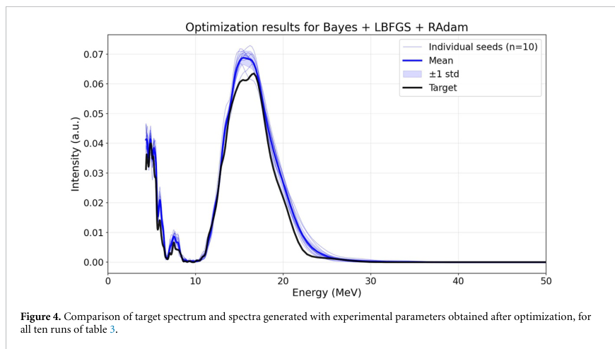
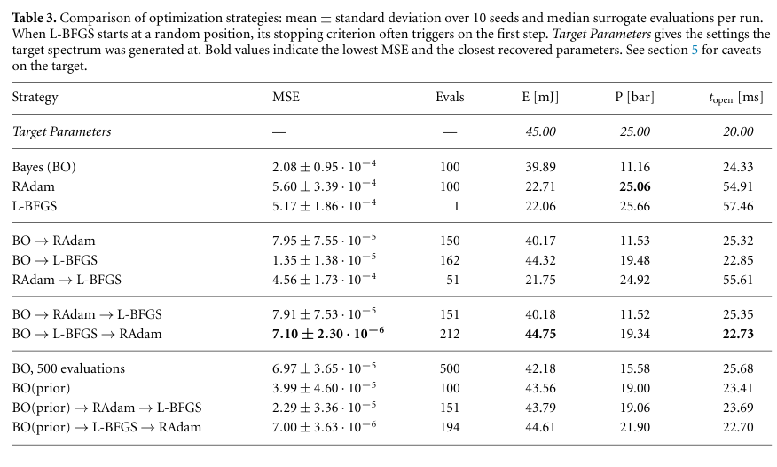
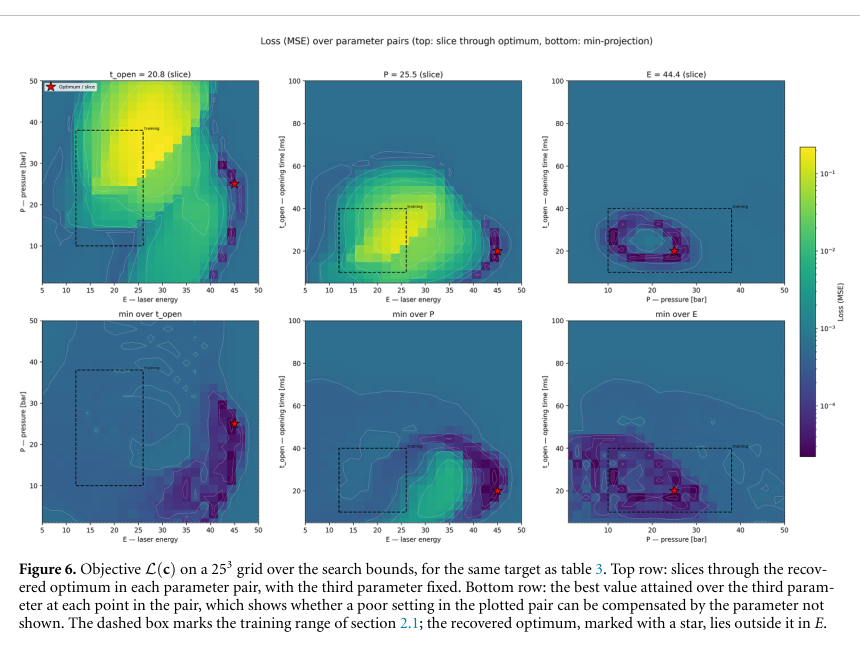

# 条件扩散模型反演LWFA设置：可微代理优化与真机验证之间的距离

## 0. 身份与证据

- 原题：*Differentiable control of laser–plasma experiments with conditional diffusion models*。
- 作者：Matěj Mráček、Gabriele Maria Grittani、Carlo Maria Lazzarini、Alexander Kovalenko。
- *Machine Learning: Science and Technology* **7, 065001 (2026)**；[DOI／官方来源](https://doi.org/10.1088/2632-2153/aeb79a)。首页确认接受2026-10-21，正式发表**10-30**，不是以Crossref日期单独推定。
- 阅读[官方VOR PDF](../pdfs/Mracek%20et%20al.%20-%202026%20-%20Differentiable%20laser%20plasma%20control.pdf)，共18个PDF页，含1页下载封面、17页文章。MinerU与独立布局文本交叉检查；目视查看PDF第2、5、8、11—14、16页。原图／表摘录依CC BY 4.0保留作者、期刊和DOI。
- **实验数据训练的离线生成代理＋模型内逆设计基准**。没有证明在真实加速器执行推荐设置能得到目标谱；本轮未训练、推理、控制或重跑PIC。

## 1. 问题与数据：1279条谱不是1279种设置

ALFA/L1-Allegra约1 kHz、15 fs激光LWFA束线，以磁谱仪和LANEX测电子谱。模型输入c=(激光能量E、背压P、阀门开启时间topen)，输出256个能量bin组成的一维谱。

| 数据项目 | 数值与限制 |
|---|---|
| 独立控制组合 | **22组**，稀疏且不均匀，包含1279条记录谱 |
| 训练参数范围 | E=12—26 mJ，P=10—38 bar，topen=10—40 ms |
| 谱坐标／原单位 | 4.3—97.8 MeV，256 bins，pC/MeV；全数据统一min/max归一化 |
| 阀门的双重角色 | 1 kHz下每ms约1发，10—40 ms记录约积分10—40发；既影响气柱，也影响曝光累加 |
| 留出验证 | 每次将某一设置的全部记录留出，22个leave-one-setting-out结果；优于同设置随机拆图，但不是跨束线验证 |

因此谱幅变化同时混合物理束流与曝光长度。模型不能未经每发归一化就被解释为单发电荷优化。全数据归一化也不是独立外部标定。训练覆盖有限，单条记录谱不应当成单次激光发。

## 2. 可微的是何种映射

网络为约860万参数的一维U-Net，带attention与条件输入，AdamW、4000 epochs；作者1张A100约1.05 h。EDM采样用18步二阶Heun，从固定噪声z积分到谱：

$$
\frac{dx}{dt}=\frac{x-D_\theta(x,t,c)}{t},\quad
S_\theta(c,z)=\operatorname{Heun}_{18}(c,z),\quad
L(c)=\frac1{256}\|S_\theta(c,z)-S_{\rm target}\|_2^2.
$$

x为归一化谱向量，t是扩散噪声尺度，**不是电子飞行或激光脉冲时间**；θ是固定网络权重，优化变量只有三维物理设置c。反向传播穿过整个采样器，可得代理目标的梯度；不等于真实装置的梯度，训练并未约束参数导数正确。

每次优化固定z；10次重复各用不同z。18步、双分支guidance与Heun校正按3.4节为70次网络评估／一次完整目标，梯度步约2.32 s、12.2 GiB A100显存。4.2节又用“2M次”描述前向预算，口径不一致，复现计时应以真实实现与完整采样调用计数核对。

BO先100次目标评估（含10次初始随机点），再L-BFGS（history 10、Strong-Wolfe）和50次RAdam refinement。搜索盒E=5—50 mJ、P=1—50 bar、topen=5—100 ms，显著超出训练范围。

## 3. 前向模型误差有实测参照

作者按能量bin比较谱强度的分布，以归一化强度0.01阈值排除双方都近零的bin，然后平均一维Wasserstein距离。它比较**固定能量bin的强度分布**，不是把整个能谱当能量概率分布作运输距离。

22组整设置留出：Ww=0.098±0.087，中位0.076、范围0.017—0.381；实测数据随机分半作同分布参照仅0.008±0.007。模型误差约为该有限采样参照的12—13倍，高能量／高背压边缘最差。这是明确的代理偏差，不能用“生成谱看起来相似”抹去。

## 4. 逆设计的成功口径：原图4、表3

PDF第12页：横轴电子能量MeV，纵轴归一化强度a.u.；黑色目标、蓝色十次生成谱和平均／±1 SD。**目标也是同一个代理在(45 mJ,25 bar,20 ms)生成的谱**。蓝黑吻合是模型自反演能力，不是实验误差条，更不是实际真机产生了45 mJ束流谱。

PDF第13页，MSE为10个seed均值±SD，Evals为每次运行调用的中位数。

| 方法 | MSE | 代理调用中位数 |
|---|---|---|
| 单独BO | (2.08±0.95)×10⁻⁴ | 100 |
| BO→L-BFGS | (1.35±1.38)×10⁻⁵ | 162 |
| BO→L-BFGS→RAdam | (7.10±2.30)×10⁻⁶ | 212 |
| 单独BO扩到500次 | (6.97±3.65)×10⁻⁵ | 500 |
| 带代理先验BO→L-BFGS→RAdam | (7.00±3.63)×10⁻⁶ | 194 |

三阶段比100次BO约低29倍、比500次BO约低9.8倍；比较的是最终谱误差，不能直接说更省评估或更省时间。恢复参数为44.75 mJ、**19.34 bar**、22.73 ms，压力明显未恢复到25 bar；谱误差小不表示三个参数都准确或唯一。单独RAdam压力25.06更接近真值，也不代表整谱更好。

带先验版本需预计算25³=15625次目标、约2.4 h，相当于完整管线自身预算约74倍；只有多次共享目标或可复用先验时才有摊销意义，不能只引用“少8%调用”。表中实际包含12种配置，摘要“七个替代／八策略”是较窄分组，不能把所有表行当八种。

## 5. 目标几何、不可辨识与理论边界

PDF第14页：坐标分别为mJ、bar、ms；颜色为对数MSE。上排固定第三参数切片，下排对第三参数取最小值，不能视为同一个联合后验。虚框为训练范围，红星在E方向明显越界。低损失谷允许压力与开阀时间补偿，说明的是代理中的近退化集，不是物理真实设置的已验证唯一解。

作者把BO解释为跨平台、L-BFGS作局部曲率下降、RAdam沿平谷松弛；附录以Langevin／自由能作类比。本文自己强调这不是最优性证明。两点静态审阅需继续核查：

1. Eq.11中bin指标对**能量积分变量**不连续，不自动意味着固定bin谱对设置c不连续；平滑谱的固定bin积分可以对c求导。需要实际计算Jacobian/Hessian，不能仅凭指标函数导数推导“必有阶梯”。
2. z和随机状态固定时，RAdam有限步轨迹不等价于显式采样的各向同性Langevin噪声；宽谷与抗真机jitter关系需扰动实验，不是热力学定理。

这两项是对原文论证适用条件的分析，不是已定位的源码运行缺陷。

## 6. 对后续工作的价值与最小验证

[作者代码／数据入口](https://github.com/Jechmate/LWFA-diffusion-optimization)由正文给出；本轮未下载或执行，也未审计其训练划分。先做训练域内的冻结模型、整设置／独立日期盲测，加入每发电荷和曝光归一化；再选有真实约束的候选设置上机，测目标谱与jitter、漂移、失败率。比较完整训练／先验预计算／优化墙钟，并加入普通回归代理和谱运输损失基线。

本研究与Reichherzer等物理方差日程输运扩散代理（2609.01705）的对象、作者与数据不同，单独收录；它没有直接验证转换靶γ／中子产额、剂量、FEL或临床性能。
