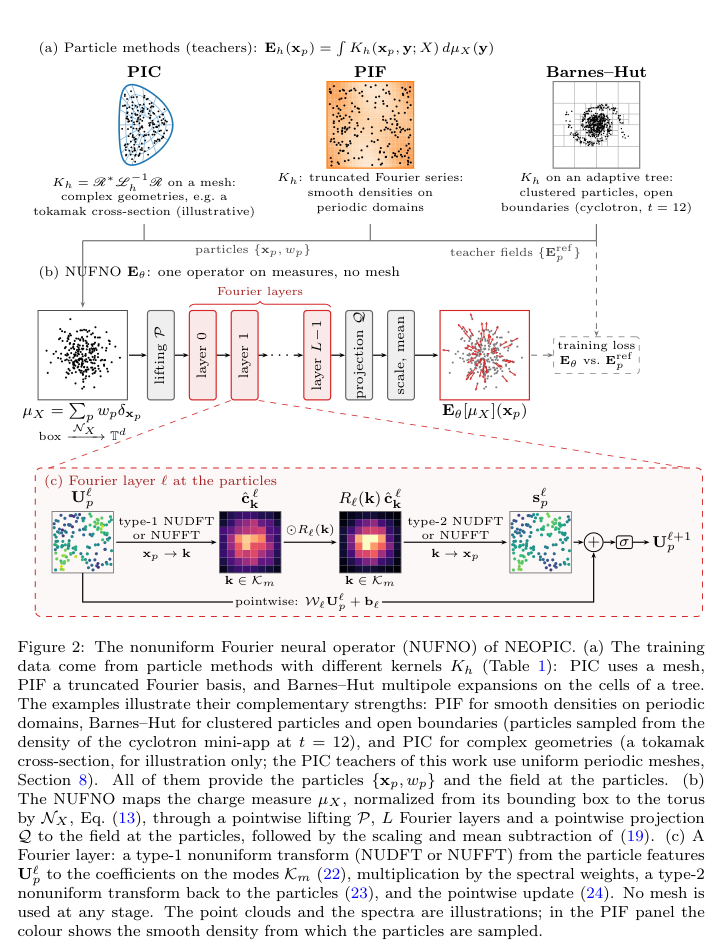
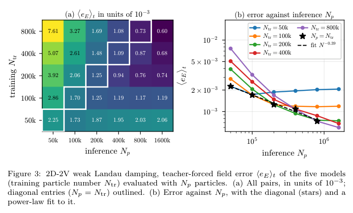
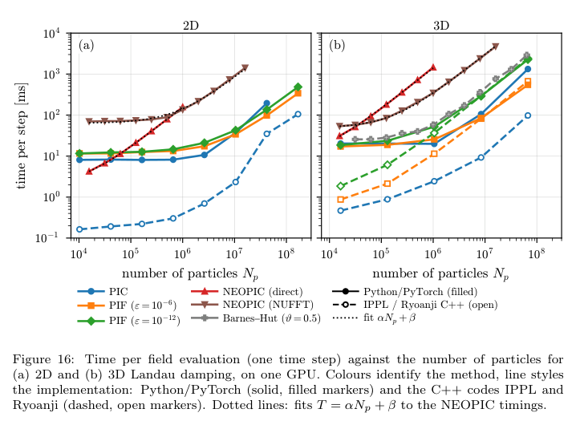

# NEOPIC：对粒子测度学习场算子，以及表示等价、噪声与性能的边界

## 0. 论文身份与阅读范围

- 原题：*NEOPIC: A Neural Operator Framework for Particle-based Kinetic Plasma Simulations*。
- 作者：Sriramkrishnan Muralikrishnan、Chelsea Maria John、Jeffrey Kelling、Michael Bussmann、Robert Speck、Paul Gibbon。
- [arXiv:2610.40528v1](https://arxiv.org/abs/2610.40528v1)，2026-10-29 17:33:20 UTC投稿；[DOI](https://doi.org/10.48550/arXiv.2610.40528)。官方页面无期刊引用，精确标题Crossref前三项均不匹配，本轮按**作者预印本**处理。
- [官方84页PDF](../pdfs/Muralikrishnan%20et%20al.%20-%202026%20-%20NEOPIC%20particle%20field%20operator.pdf)已做全部页可读性、独立布局提取和MinerU交叉检查。重点阅读模型／误差假设、数值结果、成本与附录边界；目视查看第1、13、17、22、28、47、48、51、54、58、60、61、64、68页。下列为少量原图摘录用于论文评论，作者保留版权，arXiv非独占分发许可不等于CC BY，不据此宣称可自由再许可。
- 本笔记没有独立重证所有定理，未审计或运行作者代码、训练、PIC/PIF/tree基准；区分作者数学推导、作者数值实验与本轮静态阅读。

## 1. 学什么：粒子到粒子处的自洽静电场

本文处理非相对论、无碰撞Vlasov–Poisson系统，外加电／磁场可已知。网络只替换自洽**静电场映射**，保留带权粒子和leapfrog/Boris时间推进，不预测整个相空间未来态，也不直接解析PIC机制。

$$
\mu_N=\sum_{p=1}^{N_p}w_p\delta_{x_p},\quad\sum_pw_p=1,\qquad
E_p=E_\theta[\mu_N](x_p)+E_{\rm ext}(x_p).
$$

xp为位置，wp为归一化宏粒子权重；总物理电荷由外部尺度恢复，改变计算粒子数时不能同时改变总物理电荷。源到场的完整PIC沉积—Poisson—插值组合被学习，而非只把网格Poisson求解器替换成神经网络。

PDF第17页。上排PIC／PIF／Barnes–Hut是teacher类别示意，**tokamak剖面只是插图，本文PIC教师实际用均匀周期网格**。下排非均匀变换把粒子特征投到固定Fourier模，再回到粒子。示意没有诊断坐标或实际实验测量。

每层的核心为

$$
\widehat c_k^{\ell}=\sum_pw_pu_p^{\ell}e^{-ik\cdot x_p},\qquad
u_p^{\ell+1}=\sigma\!\left(W_\ell u_p^{\ell}+b_\ell+
\operatorname{Re}\sum_kR_\ell(k)\widehat c_k^{\ell}e^{ik\cdot x_p}\right).
$$

这里k为归一化坐标的模数，R为学习的复权重；固定结构下，对粒子重排等变、对同位置粒子拆分／合并不变。对周期问题额外减去粒子加权平均场，使总自力为零；动量守恒依赖这个显式修正，不是训练自动学出的普遍性质。

## 2. 表示等价与物理精度是两层命题

NUDFT精确求和时，离散实现就是该神经算子在输入经验测度上的精确求值；表示等价并不意味着它等于真实Poisson算子，也不消除有限粒子采样误差、有限模容量或teacher偏差。NUFFT是容差控制的近似；内部会使用辅助均匀网格与FFT，不能把“不做PIC电荷沉积”扩大成“底层实现完全没有任何网格／混叠”。

作者的轨迹误差结构为

$$
\mathbb E e(t)\lesssim C(t)\big(N_p^{-1/2}+\varepsilon_{\rm NN}+\Delta t^2\big),
\qquad \varepsilon_{\rm NN}\le\varepsilon_{\rm learn}+\varepsilon_{\rm teacher}.
$$

这只是结构式；常数含网络Lipschitz界与最坏情形指数增长。原定理假设周期、无外场、光滑经典解、初始速度紧支撑、iid采样、固定归一化和周期Lipschitz lifting。它不是任意长期、任意几何、强场QED或全电磁稳定性证明。

**实现与定理的接口尤其重要：** 实际输入逐样本按粒子云min/max归一化，极值受少数远离粒子影响；高斯云边界还随Np变化。原文附录A.1明确该效应不在固定归一化误差分析内。实际对原始坐标作线性lifting在周期缝处不连续，附录Remark16承认不能全局满足周期Lipschitz假设。周期sin/cos嵌入可修复该条件，但对开边界又需保留非周期信息或padding，不能不分边界地直接替换。

因此“表示等价”仍可成立，而某条长期误差定理的全局前提未自动落到当前实现；这两种结论不能相互覆盖。

## 3. 粒子噪声：训练粒子更多未必更稳健

输入粒子和teacher标签来自同一含噪配置，训练噪声惩罚的是模型与teacher对密度扰动的**响应差**，不是简单把所有噪声滤掉。平方损失分析的主阶形式为

$$
\overline L_N=L_\infty+\frac{Q+P}{N}+O(N^{-2}),\qquad
Q=\mathbb E\|[DG_\theta-E_h]\xi\|_{L^2(\rho)}^2\ge0.
$$

P与无噪声残差有关，未必非负；理论以population loss、光滑性、iid近似和理想极小点为前提。实际采用L1训练，附录只在相应噪声／残差区间解释近似类比。teacher粒子随时间相关、同run相邻snapshot噪声冻结，随机80/20时间拆分不等于独立验证；作者另用不同随机种子的teacher runs作评估。

PDF第47页：横轴推断Np，纵轴训练Ntr，格内误差单位10⁻³；右图为对数误差与粒子数。它是给定teacher粒子位置上的场预测，**未闭环推进**。800k训练降到50k推断误差7.61×10⁻³，而50k训练／50k推断2.25×10⁻³；低噪训练模型对高噪输入更脆弱。反向增加推断粒子通常先降误差再到模型底噪。

在闭环弱Landau中，对角误差约N⁻⁰·⁵⁴；相对同初始粒子的高阶PIF参考约N⁻⁰·⁵¹，后者主要含teacher离散化差，不能把拟合指数当独立真实Vlasov解的普遍收敛验收。建议训练Np接近预期最小推断Np，仍要满足相关Fourier模信噪比足够；不能无限减少训练粒子。

## 4. 数值成功与失败都要保留

默认4层、宽32、每维32个保留模、projection宽128；精度结果主要用直接NUDFT，NUFFT主要用于计时，弱Landau另核对两种实现接近。模型用12张A100数据并行训练；二维multi-app约3.2 h，三维四／五任务约5.9／7.4 h，这不是单卡训练成本。

二维五任务包括弱／强Landau、双流、bump-on-tail与开边界磁化电子云，训练约到T=30（磁化云6），测试到两倍时间窗。它们是参与训练的任务在新轨迹／时间上的检验，不能称所有物理任务都未见。单弱Landau模型对强Landau失败，显示输入分布覆盖边界。

- 2D弱Landau的场能对数斜率−0.290（PIF）／−0.293（模型）；双流0.614／0.613，bump-on-tail0.297／0.301。这里Wi∝exp(2γt)，斜率是**2γ**，不能直接与振幅增长率γ混用。
- “稳定到2T”不代表轨迹误差不长。双流外推窗场误差／位置误差可增12／39倍；需转看场能与饱和态统计。
- 开边界cyclotron晚期局部场误差可约20%，芯场约高10%，特定径向区螺旋多绕约14%；非中心力会破坏离散角动量。Boris未解析回旋时的诊断误差须与模型误差分开。
- 3D双流饱和峰比PIF高17—26%，晚约1时间单位；Penning trap总能初期增6.6%，外推窗最大变化5%，PIC约0.3%。这些不能被“动量守恒／长期稳定”掩盖。
- 多teacher可能平均或切换各自噪声响应，平均结果也可能比任一teacher更差；更杂的数据并不自动意味着更接近连续真解。

Eq.67以粒子处E²平均近似全域场能积分，严格说粒子由ρ采样时得到密度加权积分；显著非均匀密度下不能自动等同均匀体积积分。论文对cyclotron／Penning另用势能或独立PIC网格诊断；周期非线性任务的该近似仍值得独立网格积分核对。这是静态诊断问题，不是本轮已复现的数值错误。

## 5. O(Np)并不等于加速：原图16

PDF第61页，横轴粒子数、纵轴每次场评估ms，双对数；实心为Python/PyTorch，空心为生产C++ IPPL/Ryoanji。NEOPIC架构固定，而PIC/PIF随Np按固定每格粒子数增大网格／模数；因此未严格匹配每点物理精度。

NUFFT拟合T=αNp+β：2D α=79 ns、β=64 ms；3D α=300 ns、β=49 ms。固定开销主要为每次重建NUFFT plan，persistent plan是未来优化，不能提前计作已实现。

相同粒子数下，本文默认模型每粒子比Python PIF约慢37—39倍，比优化FFT-PIC约慢**120—200倍**；1.6×10⁷粒子时比Barnes–Hut(θ=0.5)约慢6倍。小opening-angle tree可更贵，但必须匹配精度后再比。O(Np)指固定架构的渐近复杂度，不包含随精度要求改变结构的代价；未证明电磁生产PIC端到端加速。

## 6. 价值与接续

最有价值的是把学习误差限制在可替换的场接口，并显式讨论测度、有限粒子噪声、teacher偏差和守恒诊断。它区别于库内网格latent residual FNO（2606.17733），作者、输入表示和验证场景均不同；也不是iGENEJAX的同作品新版本。

[官方arXiv页面](https://arxiv.org/abs/2610.40528v1)提供代码与分析仓库及neopic-arxiv-v1／neopic-arxiv-v1-nufft标签；本轮仅记录入口，未核验源码commit或复跑。后续先冻结tag、权重与输入，做相同物理精度／同粒子预算的独立run，核对周期缝、粒子云归一化、独立体积能量积分和守恒；再评估隐式求解器总成本及真正分布式瓶颈。相对论、电磁、碰撞、多物种、激光强场和真实复杂几何都需要另验。
