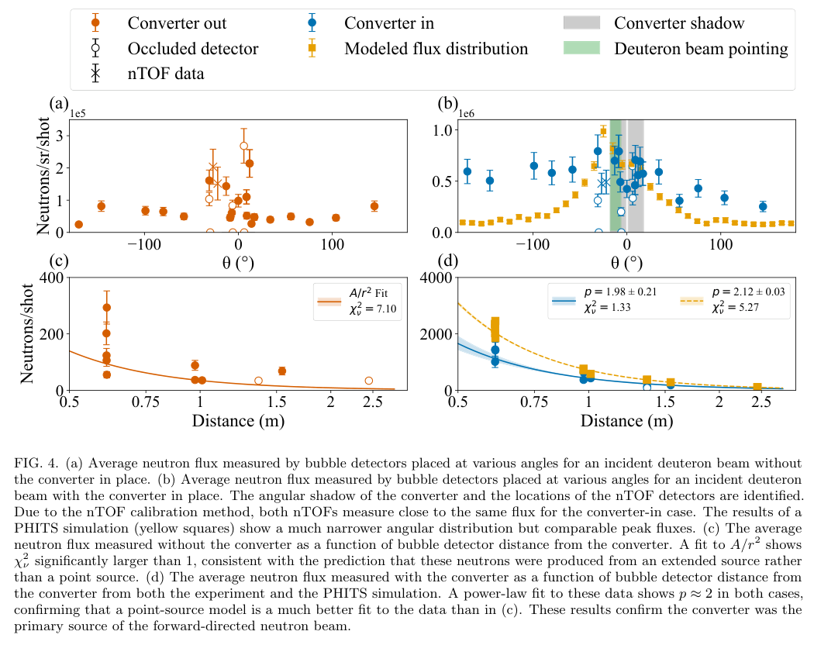
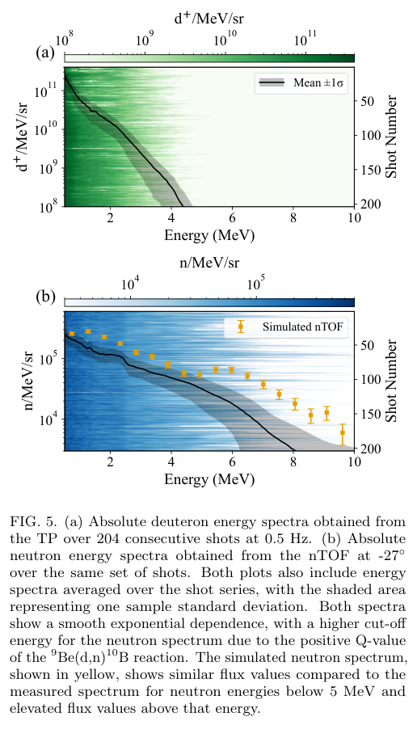
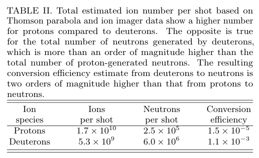

# 连续重水液体薄靶—铍转换靶快中子源：同发离子与中子谱及产额边界

## 0. 身份、版本与阅读依据

- 原题：*High-Repetition-Rate Laser-Driven Fast Neutron Generation from Planar Liquid Heavy Water Jets*。
- 作者：F. Treffert、G. D. Glenn、C. B. Curry、D. P. DePonte、R. C. Hollinger、G. Jain、S. Popa、M. Ricks、J. J. Rocca、B. Sullivan、D. Ursescu、S. Wang、G. J. Williams、S. Zahedpour、S. H. Glenzer、M. Gauthier；前两位共同第一作者。
- [官方arXiv v1](https://arxiv.org/abs/2610.38931v1)，2026-10-28 21:19:05 UTC提交；[DOI](https://doi.org/10.48550/arXiv.2610.38931)。本轮精确标题Crossref前三结果均非此作品，未核实期刊VOR；不是正式期刊论文。
- [经验证的13页全文](../pdfs/Treffert%20et%20al.%20-%202026%20-%20Liquid%20heavy%20water%20fast%20neutrons.pdf)。全文、MinerU正文、独立布局文本交叉核对；实际查看PDF第1、3—10页。原图摘录来自本文，CC BY 4.0，保留作者及来源归属。
- **证据类型：真实激光离子—转换靶—中子实验，加上响应标定、角积分和PHITS辅助解释。** 本轮只读审查，未重跑实验、PHITS、谱反演或标定。

## 1. 研究问题与主要进展

作者在Colorado State University的ALEPH平台，以持续补新的H₂O／D₂O薄液片代替逐发更换的固体pitcher，以铍作catcher。关键进展是0.5 Hz连续204发中，利用转换靶中心小孔保留Thomson抛物线谱仪（TP）视线，使驱动氘谱和中子TOF谱可以逐发关联。

这比只提供整段曝光的气泡计数多了一层诊断闭合。但TP仍只采样极小立体角，中子谱也仅测有限方向；同发并不意味着测得全部离子相空间和4π中子谱。本文是离子诱发中子路线，不能改写成电子韧致辐射—光核中子实验。

## 2. 装置、源项与诊断

| 环节 | 实际条件／定义 |
|---|---|
| 激光 | 400 nm二倍频，45 fs，靶上4.8±0.3 J，最高8.5×10²⁰ W/cm²，0.5 Hz；相对靶面s偏振、45°入射 |
| 液片 | 室温H₂O或D₂O，600±100 nm；约500—600 psi、5.5 mL/min；相互作用点距喷嘴3.5 mm |
| 环境 | 加热接液器和液氮冷指，运行约10⁻³ mbar；0.5 mm玻璃片隔离压缩器，文中靶上能量已扣反射损耗 |
| 铍靶 | 距pitcher 39 mm；厚1 mm、直径25.4 mm，中心孔直径1.6 mm；前置10 µm Al保护层 |
| TP | 靶法向视线，接受角6.9×10⁻⁸ sr；MCP／荧光屏以单发开槽CR-39绝对标定 |
| 离子成像 | 距源65 mm的GOS屏，25 µm Al滤层；质子／氘探测下限约1.7／2.2 MeV，因此发散不是全能区发散 |
| 中子 | 26个气泡探测器，约0.1—10 MeV响应、单个测量采用20%不确定度；两个nTOF在−22°、−27°、距铍1.1 m，前置5 cm Pb |

离子源预表征的氘截止能4.1±0.4 MeV、指向−12.1±1.4°、FWHM发散11.7±1.3°；质子指向仅−3.3±1.6°。氘方向明显偏离TP轴，后续总离子数估计必须保留这一系统偏差。离子预表征TP／成像分别为质子116／94发、氘61／44发，数量差源于相机触发失败，不能合并成同一全诊断样本。

−27° nTOF以已知通量DD源在−2 kV标定，再按PMT增益曲线换到实验−1.8 kV；−22°探测器用204发数据交叉标定，假设5°间隔内通量相近。因此两条nTOF的一致性部分由标定构造决定，不是两套完全独立绝对标定。

## 3. 角分布与源定位：原图4

PDF第7页，上排横轴相对名义靶法向角度（度），纵轴n/sr/shot，是每发每立体角产额，**不是n/cm²/s的通量率**。橙／蓝对应无／有铍靶；空心点视线被设备遮挡；黄色是PHITS。下排横轴探测器距名义铍源距离（m），纵轴相应探测器每发计数，不能与上排立体角归一化量直接混用。

铍靶插入后，遮锥范围±17.7°内距离幂律拟合p=1.98±0.21，约化χ²=1.33；无靶时固定1/r²拟合χ²=7.10。它支持前向中子主要来自铍区域，但并未排除腔壁／设备的扩展源。模拟角分布明显更窄，大角度低估提示腔内硬件散射未闭合。

PHITS v3.350使用测得平均谱、11.7°发散与−12.1°指向；铍／Al／SS304壳按实验设置，但省略其他内部硬件。**模拟氘数3×10¹⁰来自匹配中子数据的扫描，不是独立测量输入**；Table II的5.3×10⁹为另一种TP/FWHM估算，二者相差约5.7倍。该比较不能作为独立绝对产额预测的验证，需原始源归一化与输入卡进一步澄清。

## 4. 连续204发同发谱：原图5

PDF第8页：横轴能量（MeV），右轴发序号；颜色分别为d⁺/(MeV·sr)和n/(MeV·sr)，叠加曲线为平均谱、阴影为**样本标准差**，不是均值置信区间。黄色点为模拟nTOF。

同发氘平均截止能4.1±0.5 MeV，谱峰约(3.0±0.7)×10¹¹ d⁺/(MeV·sr)。中子平均谱截止约8.7 MeV，高于入射氘能量，因⁹Be(d,n)¹⁰B有约+4.36 MeV的Q值；不能用“中子能量必须小于氘能量”否定该结果。1.5和2.2 MeV附近的调制是TOF电缆反射伪迹，不能解释为核反应结构。

模拟在低于4 MeV约因子2范围符合，但5 MeV以上显著偏高。γ闪光尾、TOF分辨率和氘反应评价数据均是竞争解释，原文没有把原因唯一识别出来。204发／0.5 Hz约为数分钟的运行窗，不能外推为全天候、kHz或长期喷嘴寿命验收。

## 5. 产额、增强与效率：Table II

| 口径 | 结果及含义 |
|---|---|
| 有靶气泡前向平均 | (5.1±2.2)×10⁵ n/sr/shot；误差为样本SD |
| 角分布探测器平均 | 约4.8×10⁵ n/sr/shot；跨诊断讨论值约4.9×10⁵，口径不同不应混成单一精确值 |
| 最高单探测器方向值 | 7.9×10⁵ n/sr/shot，不是时间峰值通量率 |
| 氘／质子前向增强 | 约5.1×10⁵／4×10⁴≈13；不等于全空间总产额增强或能量效率 |
| 总中子数 | 氘6.0×10⁶、质子2.5×10⁵ n/shot，来自稀疏角测量平均后假设4π归一化 |
| 离子数 | 氘5.3×10⁹、质子1.7×10¹⁰/shot；轴上TP谱积分×预测FWHM，假设发散与能量无关 |
| 数量转换率 | η=Nₙ/Nᵢ：氘1.1×10⁻³、质子1.5×10⁻⁵，约73倍差；非激光到中子能量转换效率 |

6×10⁶ n/shot与0.5 Hz相乘得3×10⁶ n/s；除以4.8 J得1.25×10⁶ n/shot/J。以上均继承4π角外推。正文第6页称6×10⁶为平均总产额，讨论第10页又称peak integrated，故本笔记按Table II的估计值使用，保留平均／峰值用词不一致。

氘束偏轴使Nᵢ可能低估，从而η可能高估；4π平均可能遗漏前向分量，影响方向相反，不能未经误差传播宣称两者自动抵消。质子有靶气泡数据实际51%发有靶、49%发无靶，也削弱严格同条件比值。breakup增强有物理依据及趋势支持，但未逐通道直接测量，不能把全部额外产额归到唯一反应。

## 6. 可接续的验证与仓库位置

优先取得逐发TP/nTOF原始数据、能量依赖响应和角向离子谱；测真实束轴及照到铍的粒子数，独立标定两个TOF；以完整腔室几何核对高能谱尾和散射，并给Nₙ/Nᵢ协方差／4π误差。后续样品处谱、活化、成像、剂量和屏蔽还需专门实验，本文没有这些应用验收。

与库内CoReLS的CH₂/CD₂—Cu实验（2605.18969）不同；与Vallières的ALLS电子LWFA—W光核路线（10.1038/s41467-025-66535-9）在作者、装置、初级粒子和转换材料上均不同，判为独立作品。相同“高重复率中子”关键词不构成重复，也不构成独立复现实验的认定。
