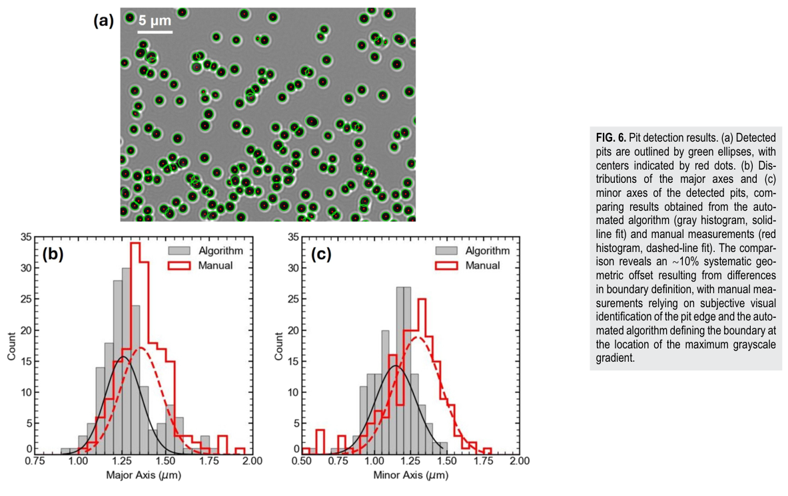
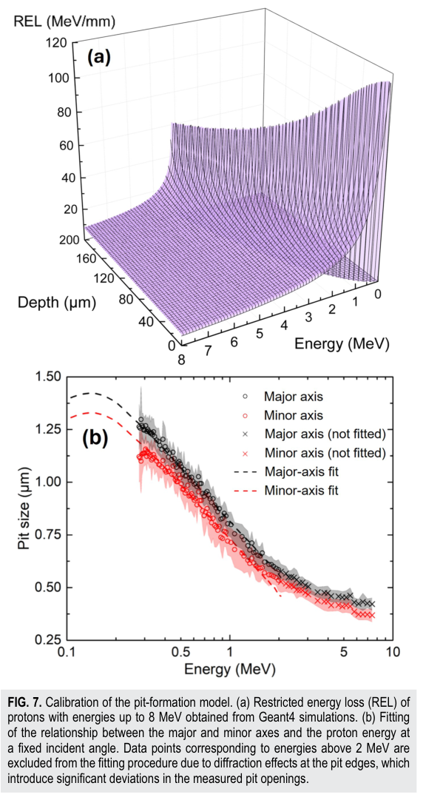

# CR-39自动蚀刻坑识别：重叠分离、几何标定与能角反演

## 0. 身份与版本

- 原题：*Automated CR-39 pit detection for energy and angular characterization of laser-driven ion beams*；Wei Lin、Tzu-Yao Huang、Shih-Fan Yang、Shih-Wei Wang、Wu-Cheng Chiang、Kuo-Yu Hsiao、Chun-Han Chen、Yan-Syu Liu、Jun-Yi Chen、Ya-Po Yang、Chen-Kang Huang、Hsu-hsin Chu、Chih-Hao Pai。
- *AIP Advances* **16, 075051 (2026)**，[DOI](https://doi.org/10.1063/5.0338529)。正式PDF确认收到4月22日、接受7月3日、**7月28日发表**。10月28日上传的[arXiv:2610.38089v1](https://arxiv.org/abs/2610.38089v1)是同作别名，本轮作为此前未收录的正式论文补入，不能写成10月新发表。
- 阅读[官方VOR](../pdfs/Lin%20et%20al.%20-%202026%20-%20Automated%20CR39%20pit%20detection.pdf)，9个PDF页含下载封面；目视第2、6—8页。另读[arXiv附属补充材料](../pdfs/Lin%20et%20al.%20-%202026%20-%20Automated%20CR39%20supplementary%20material.pdf)，3页，目视前2页；该补充文件标注7月13日，不冒称出版社补充版。
- AIP代理403后官方直连取得VOR。MinerU正式URL失败，成功解析的是对应arXiv作者稿；主证据仍为VOR独立布局文本和渲染。没有执行作者[公开代码](https://github.com/wlin8633/CR39-pit-detector)、GPU测试、Geant4或实验。

## 1. 实验与算法解决什么问题

100 TW Ti:sapphire装置，800 nm、43 fs、6.4 μm FWHM焦斑，峰强5.0×10¹⁹ W/cm²，11 μm PE薄膜产生TNSA离子。靶法线TPS入口距靶30 cm，电／磁场200 kV/m／0.31 T。CR-39用7.25 M NaOH、80±1 ℃蚀刻30 min；体蚀刻率1.684±0.004 μm/h，由空白样质量损失推得。

常规按完整轮廓找圆容易在坑重叠时失败。本文不是深度学习分类器，主体为确定性图像处理：Otsu阈值提取灰度梯度边缘，Bresenham线段与Hough投票找中心，平滑和最大值过滤压制伪峰；局部径向向量与梯度方向匹配选边，多窗口受约束最小二乘拟合椭圆。重叠中心的中分线附近排除一段像素，以剩余轮廓拟合。最小间距、窗口、排除宽度仍是用户参数，GPU支持不等于已有端到端加速基准。

## 2. 从坑到能量依赖模型和实验标定

作者用Geant4限制能损REL给出轨迹蚀刻率与体蚀刻率之比

$$V=V_T/V_B=1+\alpha\,\mathrm{REL}^{\beta}.$$

沿轨迹的V(x)与已知蚀刻深度共同决定坑壁；椭圆近似要求V在两个交点对应的轨迹区间变化缓慢，补充材料以局部特征长度远大于该区间表述。它不是任意形状坑都严格为椭圆。测量轴长后，在预计算(E,θ,t)几何库中按容差反查候选，可能存在多解。

TPS实验覆盖0.3—7.4 MeV，但**拟合排除约2 MeV以上的数据**，因为高能坑接近光学衍射极限。得到α=(1.007±0.002)×10⁻²、β=1.501±0.001；α的量纲随REL单位而定，本文REL图用MeV/mm，不应脱离单位搬用。小于0.2%的参数拟合误差不是离子能量、绝对计数或跨批次CR-39的总精度。

人工与自动轴长均值差约10%；三位人工读者的均值标准差最高9.4%。作者解释为人工最外衍射环与最大灰度梯度的边界定义不同，并由后续经验标定吸收偏差。这只对**同一边界定义和标定链**成立，不能直接迁移旧人工曲线。文中未给独立全图真值上的漏检／误检率、高重叠极限、能角联合误差或统一硬件墙钟对照，不能据“可重复”推成绝对无偏。

## 3. 原图与坐标

**Fig.6，PDF第6页**：上为显微图，5 μm标尺，绿椭圆／红中心为算法输出；下为长／短轴μm的数量直方图，灰为算法、红为人工及各自拟合。两个分布的系统平移是边界口径差，不能当成算法能量分辨率。重叠实例证明存在可分离个例，缺少盲标全图计数真值时仍不能给全局识别准确率。

**Fig.7，PDF第7页**：(a)为Geant4 REL（MeV/mm）随深度μm和初能MeV的模型面，非直接量热；(b)横轴能量MeV为对数坐标，纵轴坑尺寸μm，黑／红是长／短轴，叉号标未纳入拟合的高能点。高能侧偏离清楚，低能侧曲线弯折也提示映射可能不唯一。阴影／参数误差依赖同一标定数据，尚未传播批次、温度、边界和模型误差。

两图为VOR原图裁取，无曲线修改；Lin等，DOI如上，[CC BY 4.0](https://creativecommons.org/licenses/by/4.0/)，[裁框及哈希](../research/figure-manifest.json)。

## 4. 静态疑点与可证伪检查

正式文式(5)的几何轴长含2√(y₁y₂)，式(10)却以1/√λ给出椭圆半轴；补充材料明确特征值对应半轴。复现时应先确认轴／半轴的统一定义。式(10)后又印θ=arctan(aₘ/bₘ)：圆坑aₘ=bₘ给π/4，与“对法线角”的正常入射0不同；它可能涉及角度定义或印刷问题，**本轮仅发现公式定义疑点，未审计或运行代码，不能判为实现错误**。应以已知倾角、已知圆／椭圆及单位测试固定几何语义后再做能角反演。

更重要的实验验证是固定图像与参数，建立人工共识盲真值，扫描坑密度／倾角／蚀刻时间，报告precision、recall、轴长偏差和多解比例；再以独立TPS／滤片约束检查重建能量。多物种、低能分支和超2 MeV衍射区均需外部信息，不宜宣称单张二维坑图唯一恢复所有离子参数。

## 5. 与同日闪烁体论文的关系

[单发闪烁体标定](Lin%20et%20al.%20-%202026%20-%20In%20situ%20scintillator%20absolute%20calibration.md)沿用本方法获得质子计数，并建立光子／质子响应。两篇研究目标与结果不同，按两个作品收录；来自同一团队和方法链，不能当作两次独立复现。本文支持激光离子诊断，不给转换靶γ／中子或临床、防护验收。本轮未复跑任何作者计算。
