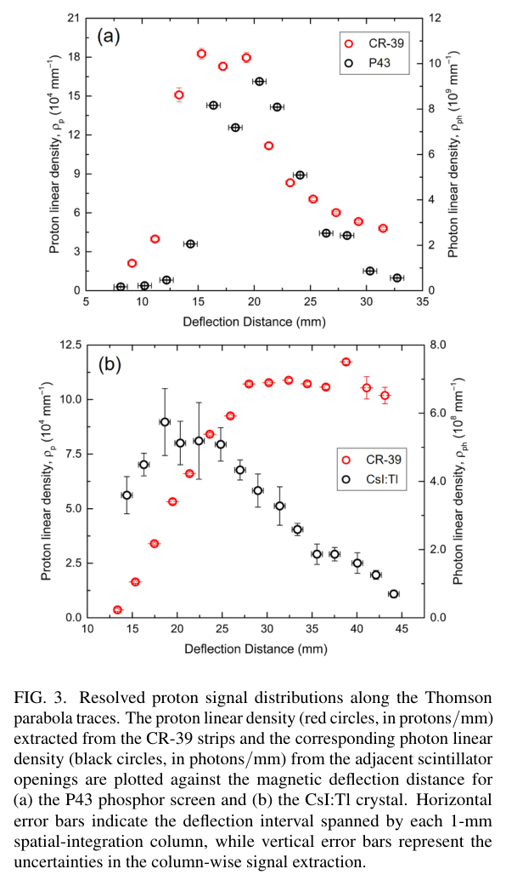
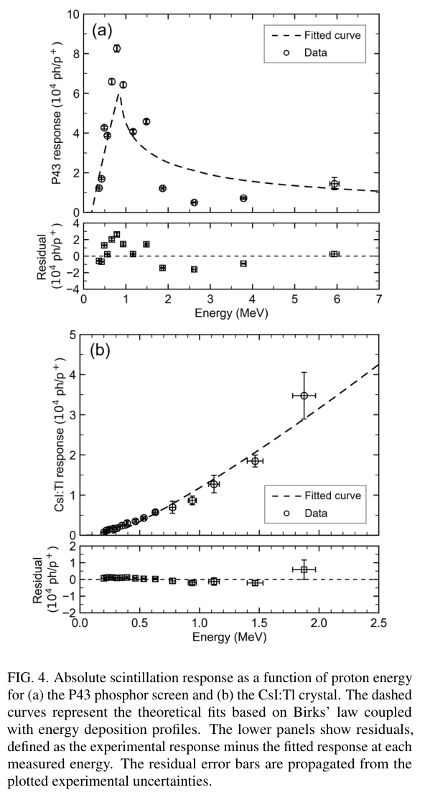

# 同发CR-39取样标定闪烁体：P43穿透阈与CsI:Tl参数不确定性

## 0. 身份与证据

- 原题：*Absolute calibration of scintillators for laser-driven ion spectroscopy using in situ CR-39 sampling detectors*；Wei Lin、Tzu-Yao Huang、Shih-Fan Yang、Shih-Wei Wang、Kuo-Yu Hsiao、Chun-Han Chen、Yan-Syu Liu、Jun-Yi Chen、Ya-Po Yang、Chen-Kang Huang、Hsu-hsin Chu、Chih-Hao Pai。
- [arXiv:2610.38063v1](https://arxiv.org/abs/2610.38063v1)，官方提交**10月27日23:25:54 UTC**，正文打印日期10月28日，两者不混写。[全文](../pdfs/Lin%20et%20al.%20-%202026%20-%20In%20situ%20scintillator%20absolute%20calibration.pdf)5页，MinerU与独立布局文本核对，目视第1、4页。
- 精确标题Crossref前三结果没有核实本作正式版，保留**作者预印本**身份，不断言所有数据库均不存在正式版。它引用同团队7月CR-39正式论文，不能据引用把本篇也视作已发表。
- 证据是**真实TNSA质子束的单发空间交叉标定＋Geant4能损模型拟合**。本轮未重新标定光路、分析显微图、拟合或运行Geant4。

## 1. 为什么同一发仍需要空间假设

与[CR-39蚀刻坑识别](Lin%20et%20al.%20-%202026%20-%20Automated%20CR39%20pit%20detection.md)同一团队、100 TW平台，激光800 nm、43 fs、5.0×10¹⁹ W/cm²、11 μm PE靶；靶法线TPS为200 kV/m／0.31 T，入口距靶30 cm、约1 mrad角接受度，覆盖约0.3—7 MeV。

800 μm厚CR-39加工成1 mm条／1 mm开口，周期2 mm，放在闪烁体前5 mm。条带截获的质子蚀刻计数，间隙质子进入闪烁体并由ICCD记录。两种材料分别做单发实验，**不是同一发同时标定两屏**。5 mm距离在约1 mrad下只增加约5 μm横向展宽。

同发避免跨发源波动，但两探测器采的是相邻位置。用ρₚ=Nₚ/(1 mm)并对CR-39取样点线性插值，假设TPS迹线上的质子数在2 mm周期内平滑。窄谱峰、尖锐横向结构、遮罩边缘和未识别重叠坑会破坏这一对应。同发不是同一群质子被两探测器逐粒子同时测量，也没有消除空间取样系统误差。

## 2. 绝对光子数与能损模型

P43为6 μm Gd₂O₂S:Tb粉体层，峰545 nm；CsI:Tl为400 μm单晶，峰550 nm。1 ms ICCD门记录闪烁发光，不能据此推定质子束持续1 ms。原式(1)以各向同性发光假设将相机计数C换成光子数Y：

$$C=Y\,\eta_{geo}T_{opt}K_{532,G=1}R_{spec}G.$$

ηgeo=(1.099±0.018)×10⁻⁴，Topt=(77.9±3.4)%，K=(0.682±0.060) counts/photon；532 nm光路透过率假定适用于发射波段，Rspec用发射谱、滤片和ICCD响应加权。最终转换因子P43为(2.10±0.45)×10⁴ photons/count（G=10.61±2.18），CsI:Tl为(2.42±0.24)×10⁴（G=1），约21%／10%相对转换不确定度。

响应S(E)=ρph/ρₚ，单位photons/proton，拟合采用Birks形式

$$S(E)=\int_0^{x_0}\frac{A\,[dE/dx]}{1+k_B[dE/dx]}dx.$$

Geant4 11.3.0，以7.32／4.51 g/cm³名义密度、G4EmStandardPhysics及离子／衰变模块、1 μm production range cut计算能损。厚度、孔隙和光收集的真实差异仍会进入模型残差；这里是光子响应，不是组织吸收剂量。

| 材料 | A／photons MeV⁻¹ | kB／mm MeV⁻¹ | 可用解释 |
|---|---:|---:|---|
| CsI:Tl | (3.71±2.88)×10⁴ | (2.90±3.66)×10⁻³ | 弱非线性、参数强相关，kB不确定度大于中心值 |
| P43 | (8.08±2.48)×10⁴ | (0.00±2.35)×10⁻⁴ | 该区间不需要可分辨淬灭项，不等于一切能量无淬灭 |

正文明确：**上述拟合误差及Figs.3、4误差条未包含光学转换不确定度**。不能用较小点误差声称总标定精度；相关的全局尺度误差与逐点噪声应分别传播。

## 3. 原图及物理读法

**Fig.3，PDF第4页**：横轴磁偏转距离mm；红点左轴是质子线密度（上图10⁴／mm，下图10⁴／mm），黑点右轴是光子线密度（P43上图10⁹／mm，CsI:Tl下图10⁸／mm）。两个纵轴尺度不同，曲线视觉相似或交叉不能当成产额相等。横误差是1 mm取样列，纵误差为信号提取；响应需经插值、光学转换和TPS能量映射得到，而非直接拿两条曲线相除所有坐标点。

**Fig.4，PDF第4页**：横轴质子能量MeV，纵轴10⁴ photons/proton；P43横轴延至7 MeV，CsI:Tl图中实测只约到2.1 MeV，不能把装置0.3—7 MeV接受范围写成两屏都完成7 MeV标定。P43约0.8 MeV处峰值是薄层穿透后沉积能减少，非质子源能谱峰。其残差正负跨越且明显大于统计条，支持未建模系统变化存在；作者提出颗粒层厚度、密度和散射等候选，未逐项实验辨识。CsI:Tl相对平滑，但不能据此认定Birks参数已精确确定。

图为作者arXiv原图裁取，无曲线重绘；出处Lin等，arXiv:2610.38063v1，[原版本许可页](https://arxiv.org/abs/2610.38063v1)，[裁框与SHA](../research/figure-manifest.json)。

## 4. 价值、风险和可接续验证

结果给出把激光离子TPS屏幕从相对亮度转成绝对粒子谱的可实施路径，有助于束靶效率分母。它没有验证电子转换靶、γ谱、中子／同位素产额或治疗剂量，更没有给临床标定。

下一步优先同一屏跨发／独立日期重复，并把遮罩相位或周期改变，检验2 mm平滑假设；对高能衍射／密坑漏计做独立计数真值，保证引用的CR-39几何标定适用于本批次。扩展CsI:Tl能区以辨识A—kB退化，实测P43厚度／密度，再纳入相关光学尺度误差和非各向同性发光的影响。重离子虽在CR-39上可见，本篇绝对响应只针对质子，不能直接迁移。

## 5. 核验与去重

两篇Lin论文作者和装置相关，但任务分别是蚀刻坑几何识别与闪烁体响应，不是同作；本篇只入库一次。全文与两份文本依约本地保留、Git忽略；[PDF核验](../pdf_validation.json)、[版本查询](../research/version-checks.json)、[解析记录](../research/mineru-attempts.json)。
