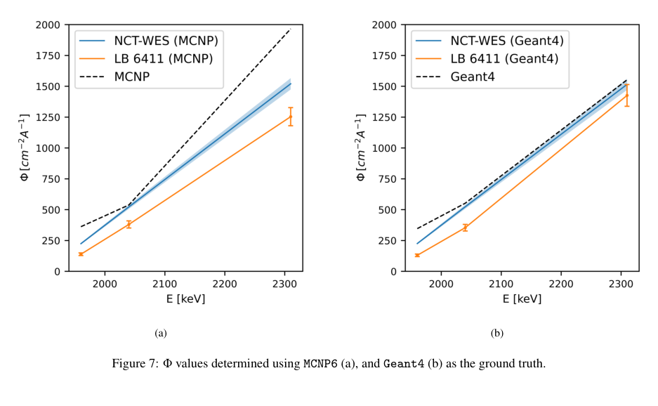
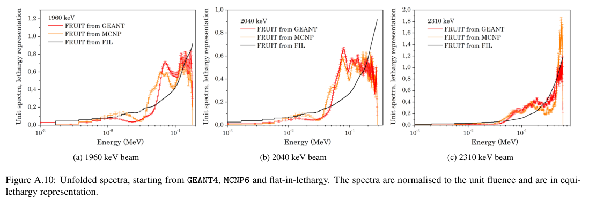

# LiF(p,n)中子场的NCT-WES谱验证：先验依赖、代码分歧与绝对通量缺口

## 0. 身份与阅读范围

- 原题：*Neutron spectrometry of (p,n) based neutron fields at the University of Helsinki using the NCT-WES single-moderator directional spectrometer*；M. Myllymäki、S. Saariokari、A. Perkkiö、H. Badran、R. Bedogni、E. Brücken、A. I. Castro Campoy、L. Russo、F. L. Frigi、J. M. Gomez-Ros、K. Helariutta、T. Hildén、J. Huikari、J. Lapa、A. Pietropaolo、M. Väänänen、T. Siiskonen。
- [arXiv:2610.39763v1](https://arxiv.org/abs/2610.39763v1)，**10月29日10:15:49 UTC提交**。[官方PDF](../pdfs/Myllymaki%20et%20al.%20-%202026%20-%20NCT%20WES%20neutron%20spectrometry.pdf)12页，MinerU／独立布局文本交叉，目视第1、7—9、12页。精确标题Crossref前三返回旧NCT-WES不同源项研究，未核实本作VOR。
- 这是常规静电加速器质子—LiF源实测、MCNP6／Geant4输运和FRUIT展开；不是激光源实验，也不是BNCT临床束线验收。本轮未运行三套程序或重放计数。

## 1. 源项与探测器：厚靶不产生ISO单能场

Helsinki EGP-10-II tandem装置，4 mm厚、38.1 mm直径天然LiF靶，ρ=2.635 g/cm³；选择1960、2040、2310 keV质子，束能标准不确定度5 keV。靶内降能使中子谱展宽，不能因质子能量接近ISO推荐值就称为ISO单能中子参考场。源介绍的最大10 MeV能力也不是本次实验束能。

NCT-WES直径36 cm、长41.5 cm，六个深度不同的热中子探头，前准直、侧面聚乙烯／含硼橡胶抑制旁向散射。源到前脸138 cm，因探测器尺寸不再远小于距离，使用**138 cm专用响应矩阵**。六个重叠宽响应不能唯一恢复任意连续谱，尤其0.1—10 keV分辨能力有限。

自由场电流依次0.430、0.146、0.135 μA，测量1.3、1.8、2.0 h；另有阴影锥测量1.9、2.6、3.6 h。Table 1给NCT-WES散射份额1.2—2.3%、0.4—1.8%、1.9—3.3%，应保留实际3.3%上限，而非机械引用“低于约3%”。单moderator同时采六探头仍要小时级测量和阴影锥，不能称为单发激光实时全谱。

## 2. 模型与展开的证据层

MCNP6 6.3.0：ENDF70PROT／ENDF-B VII.0质子数据，Lib80x／VIII.0中子数据，缺¹⁹F质子数据时使用CEM03.03。Geant4 11.2.2：QGSP-BIC-allHPT、TENDL-2014质子、JEFF-3.3中子，do_not_adjust_final_state=true。两者同时改变核数据库和模型，代码差不能唯一归因于求解器。房间墙壁未建模，模拟与阴影锥扣除后的无房间散射数据比较。

模拟用10 mm直径单能质子束，实验束管内径5 mm；这一几何口径差需要输入deck／靶面束斑核对，本轮未验证其数值影响。输出为前方138 cm、直径10 cm截面谱，不能当成4π总产额。

六通道计数满足源强、前向各向异性因子、单位积分谱和响应核的折叠。作者先将计数各自除以六通道均值，比较形状偏差d；如此消去总归一化，所以d较小只支持相对形状，不验证绝对源强。MCNP6／Geant4的平均d依次为1.2／2.0、1.3／1.8、2.1／1.2，低两档倾向MCNP6，最高档倾向Geant4。

FRUIT-SGM分别用两套MC及flat-in-lethargy先验展开。输入计数1—2%、响应约2%误差经展开传播；这不等于覆盖所有核数据、先验、束能、几何系统误差的完整后验。不同先验都可复现六通道计数，局部谱结构仍可能不同。

## 3. 谱与通量结果

Table 3展开平均中子能量（Geant4／MCNP6先验）约90／89、120／119、278／295 keV，截止约181／179、281／281、587／587 keV；这些是响应与先验辅助的展开量，非逐中子TOF直接谱。

| 质子能量／keV | NCT-WES，G4先验 | NCT-WES，MCNP先验 | LB 6411，G4谱换算 | LB 6411，MCNP谱换算 |
|---|---:|---:|---:|---:|
| 1960 | 224±7 | 225±7 | 130±10 | 138±11 |
| 2040 | 522±16 | 523±16 | 350±30 | 380±30 |
| 2310 | 1520±46 | 1515±45 | 1430±90 | 1250±70 |

按原Tables 4、6印刷单位cm⁻² μA⁻¹转录。正文交替用fluence／flux，计数又是cps／电流归一化；若量为通量率每μA应还有s⁻¹，若积分注量需明确曝光时长。**本笔记不自行补单位，不把这些数转成n/proton、总n/s或剂量**。

G4列LB 6411相对NCT-WES低约42%、33%、6%（按上表中心值计算）；MCNP列低约39%、27%、17%。低两档差远超各自标称误差，故摘要的“满意符合”不能概括为两个仪器已绝对闭合。正文承认LB读数系统偏低并提出后续校准；LB换算也用了同一模拟谱，因此是硬件交叉检查，非完全独立于模型的绝对测量。LB预热效应最多约8%、另计5%不确定度，尚不能独自解释低档约40%差。

## 4. 原图逐图解释

**Fig.7，PDF第9页**：横轴质子束能keV；纵轴Φ按原文cm⁻² μA⁻¹，蓝色NCT-WES、橙色LB 6411、黑虚线MC。左右图分别使用MCNP6／Geant4谱作为展开与响应换算依据；图注称“ground truth”只是作者比较口径，不能把模拟升格为实验真值。三个离散能点间连线非连续能量扫描，最低档模拟也偏高；2310 keV MCNP6高能产额偏大，而G4相对接近实测。

**Fig.A.10，PDF第12页**：三栏对应三种质子束能；横轴为**中子能量MeV**的对数坐标，不是入射质子能量。纵轴为积分归一到单位注量的等勒积分谱，不能直接读成每MeV概率密度或绝对通量；红／橙／黑是不同初猜展开结果。FIL在低能形状、终点附近仍与MC先验不同；相近的折叠计数不唯一决定细谱。误差条传播计数／响应，不表示已纳入先验族之外的模型差异。

原作者PDF裁取，曲线未改；Myllymäki等，arXiv:2610.39763v1，[来源与许可入口](https://arxiv.org/abs/2610.39763v1)，[图源及哈希](../research/figure-manifest.json)。

## 5. 应用与下一步

本研究对LiF转换靶、近阈反应核数据和方向性中子谱仪有价值；不同于本库的激光D₂O—Be／CD₂—Cu实验和此前放射源NCT-WES验证。它没有演示BNCT的慢化整形、患者剂量或激光束靶端到端能力。

接续应取得曝光／电流／计数的严格归一化、靶面束斑和两程序输入deck；用独立活化箔／可追溯参考探测器闭合绝对通量，再用TOF或窄核反应约束先验不敏感的谱特征。交换核库／反应模型、扫描束能±5 keV与几何，才能识别G4—MCNP分歧来源。原始数据为向作者合理请求可得，本轮未获得或复核原始计数。
