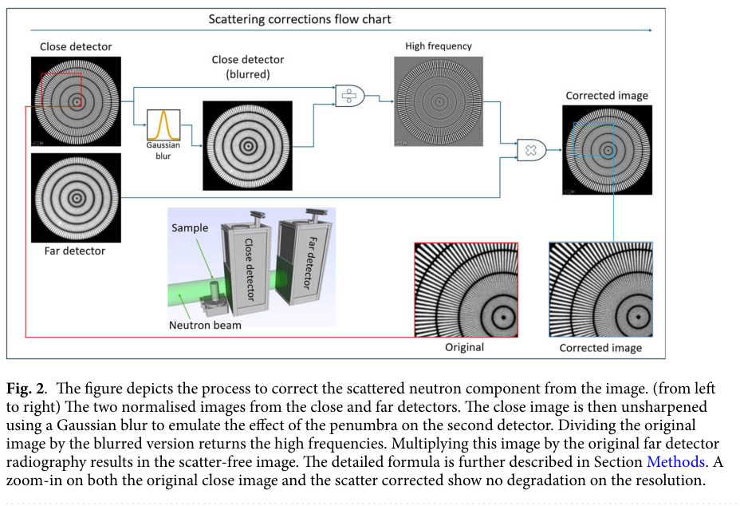
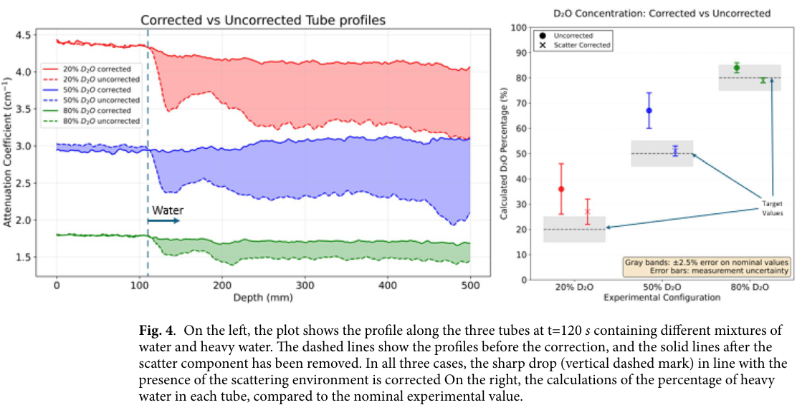

# 双探测器中子散射修正：材料定量改善与残余散射边界

## 0. 身份、版本与阅读证据

- 原题：*Material calibration-independent neutron scattering corrections for quantitative imaging*。
- Oriol Sans-Planell、Nikolay Kardjilov、Henning Markötter、Christian Tötzke、Alessandro Tengattini、André Hilger、Mark Krzyzagorski、Nicolas Lenoir、Ingo Manke；*Scientific Reports* **16, 36230 (2026)**。[正式来源](https://doi.org/10.1038/s41598-026-77789-8)。PDF第6页确认收到7月24日、接受10月22日、**发表10月30日**。
- 阅读[出版社VOR全文](../pdfs/Sans-Planell%20et%20al.%20-%202026%20-%20Calibration%20independent%20neutron%20imaging.pdf)，7页，文件／SHA／逐页文本及MinerU交叉核查；目视查看第1、3—6页。Nature代理入口返回HTML，官方PDF直连成功。
- 证据是**冷中子束线实测＋OpenMC辅助解释**。本轮未重放原始数据、运行OpenMC或重建CT。补充材料中的结果仅在主文引用范围内介绍，本轮未单独下载该补充文件。

## 1. 问题与物理机制

含氢样品把部分中子散射到本应属于其他射线的探测器像素，增加透射信号，导致由负对数推得的衰减系数偏低。它也会让样品周围环境变化伪装为样品内部组分变化。本文把近端的空间分辨率和远端较小的散射份额结合，用于动态材料定量。

两探测器沿同一束轴同步记录。近端得到清晰的透射＋散射图，远端由于角扩散收集较少散射，但几何半影较大。暗场、各自开束平场、坏点处理和配准后，定义近端图C、远端图F及匹配远端模糊的高斯算子G，主文式(1)为

$$I_{\rm corr}=\frac{C}{G(C)}F.$$

比值保留近端高频，远端约束低频透射。它依赖散射平滑、配准准确、远端残余散射足够小、两探测器响应可归一化等条件；主文也明确其分量解释不是严格的普适数学恒等式。**不需要逐种样品做材料校准，仍需要仪器校准**。

## 2. 实验条件与定量结果

NeXT／ILL冷中子束线，L/D=400。近／远端⁶LiF/ZnS闪烁体分别50／200 μm，两屏间距20 cm，像素60 μm；0.1 s曝光，300幅投影／30 s一次断层，软件同步并以Siemens星配准至像素级。高斯σ=3.5 px为本装置经验匹配量，不能当成通用常数。正文把σ对应约225 μm模糊尺度，勿混同于近端约75 μm的分辨率。

土壤、玻璃珠疏水层及三根不同D₂O/H₂O比例毛细管构成异质动态样品，从底部注入50/50混合液。原Table 2：

| 名义D₂O比例 | 修正前衰减系数／cm⁻¹ | 修正前推定比例 | 修正后衰减系数／cm⁻¹ | 修正后推定比例 |
|---|---:|---:|---:|---:|
| 20% | 3.79±0.45 | 36±10% | 4.24±0.20 | 27±5% |
| 50% | 2.27±0.12 | 67±7% | 3.06±0.05 | 51±1% |
| 80% | 1.47±0.02 | 84±2% | 1.70±0.02 | 79±1% |

这些结果支持组分偏差减小，20%管仍偏高7个百分点，不能概括成所有管都准确恢复。正文将其主要归因于高衰减区计数不足，尚需曝光／通量扫描区分统计和模型残差。

OpenMC主文Table 1给出20 cm时三管散射／未碰撞透射比约9.2%、17.1%、4.0%，误差仅MC统计标准差。**远端不是严格无散射**；50%管最大值与其中央位置和土壤路径有关，不能按浓度单调解释。主文转述补充模拟：10→20 cm使湿区浓度RMS误差8.3→3.9个百分点，50 cm反升6.6个百分点；这是本几何下散射稀释与模糊竞争的有限扫描，非普适最优距离。

## 3. 原图逐图阅读

**Fig.2，PDF第3页**：原始归一化辐射图、近端模糊图、相除得到的高频因子和乘以远端的结果；没有定量强度色条。局部放大支持条纹细节保留，主文报告约75 μm分辨率。边缘保持不证明低频透射无偏；除法还需要处理低计数分母和协方差。作者指出独立远端计数引入噪声，不能将视觉清晰等同于精度无损。

**Fig.4，PDF第5页**：左图纵轴衰减系数cm⁻¹，实／虚线为修正后／前，红蓝绿为20／50／80%管，竖虚线对应周围水环境的边界。修正后消除大部分与浸润前沿关联的假降幅；右图是由衰减推得的D₂O比例，灰带为名义值±2.5%，点误差是测量不确定度。左图横轴原标“Depth (mm)”约0—500，与示意图厘米级样品及60 μm像素的关系未在本文解释，**提取实际长度前应确认是物理毫米还是图像坐标**，本笔记不据此报告500 mm样品。

两幅为原图裁取，未修改曲线；Sans-Planell等，DOI如上，[CC BY 4.0](https://creativecommons.org/licenses/by/4.0/)，裁框与SHA见[图源清单](../research/figure-manifest.json)。

## 4. 对本库的价值、限制和下一步

对激光中子材料成像有直接方法启发，但这里是稳定冷中子束，不是脉冲快中子源。迁移前须核对能谱、γ闪光、时间响应、两屏间透射与剂量，以及样品运动和同步。材料定量不是束源总产额或防护验收。

接续应在公开原始数据上固定配准／σ选择，比较重复曝光、独立黑体修正与全输运；按空间频率和区域给残余偏差／噪声，而非只报分辨率。原始数据入口为[ILL-DATA.UGA-92](https://doi.org/10.5291/ILL-DATA.UGA-92)，处理数据为按需提供；本轮只确认论文声明，未下载该数据集。

## 5. 本轮核验

全文、布局文本和MinerU正文本地保留并Git忽略；[PDF核验](../pdf_validation.json)、[下载](../download_report.json)、[来源](../research/sources.jsonl)。本笔记基于正式PDF，不以网页摘要或模拟代替实验。
