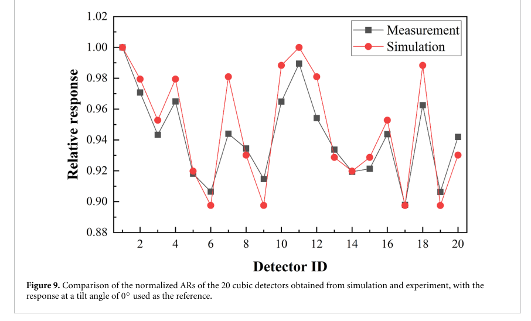
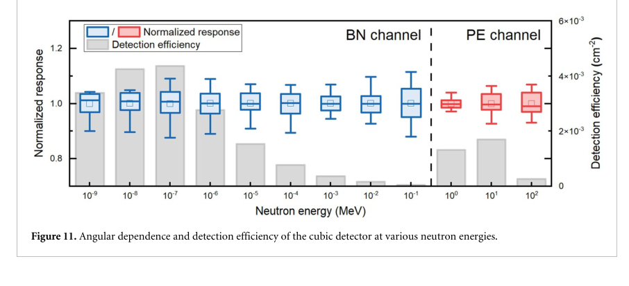

# 六面 CR-39 中子探测器：角响应均化与绝对标定之间的距离

## 0. 身份与证据

- 原题：*A novel angle-independent neutron detector based on CR-39*；Liuyu Cui、Weihai Zhuo、Bo Chen，*Journal of Radiological Protection* **46**, 041509。
- [正式 DOI](https://doi.org/10.1088/1361-6498/aeb271)，正式 PDF 标明 **2026-10-30 发表、10-09 接受**。PubMed 的 10-09 ahead-of-print 字段与正式版日期不同，本库采用 PDF 的 Published 日期。
- [本地正式 PDF](../pdfs/Cui%20et%20al.%20-%202026%20-%20Angle%20independent%20CR39%20neutron%20detector.pdf)，12 页，含一页下载封面；正文页码比 PDF 页码小 1。MinerU 与独立布局文本交叉核对，目视 PDF 第 2、5、7、9、10 页。
- 证据为 **FLUKA 输运＋蚀刻模型，以及 Cf-252／热中子参考场实验**。本轮没有运行 FLUKA、MATLAB、计数系统或实验。

## 1. 问题、结构与响应定义

单片 CR-39 对入射方向敏感：投影面积与次级带电粒子的蚀刻临界角共同影响坑计数。作者将六片相互正交的 CR-39 做成立方体，以六片响应的算术平均 AR 为观测量；单片记作 SR。外层 PE 产生反冲质子，内侧 BN 利用 B-10(n,α)Li-7 产生短程 α 粒子；两个表面分别读出快／热中子通道。

单片尺寸 1×1×0.1 cm，PE 厚 0.4 cm，BN 基体边长 1.4 cm，装配后外边长 2.4 cm。蚀刻条件为 6.25 N NaOH、90±0.2 ℃、2 h，SACS 自动显微系统采用椭圆拟合。内部反冲质子可用于蚀刻的时间按式(1)取 `t=t₀−z/Vb`，Vb=7.56 μm/h；这一几何／能量筛选与简单统计进入 CR-39 的粒子数不同。

六面平均并不带来严格几何恒等式：理想立方体投影面积随方向的因子为 |nx|+|ny|+|nz|，本身并非常数。本文均化依赖实际输运与临界角响应的组合，不能只用“投影面积不变”证明全角度无关。

## 2. 模拟、实验及其覆盖边界

模拟采用 FLUKA 4.4.1／FLAIR 3.3.1，USERDUMP 记录次级粒子位置、能量、方向，再用 MATLAB R2023b 蚀刻模型判断是否可见。全角度扫描的方位角步长 5°，cosθ 从 −1 到 1、步长 1/18。能量分辨扫描利用对称性，每个能点只取 12 个方向，不是连续全立体角证明。

| 项目 | 实际验证 | 可以支持的结论 |
|---|---|---|
| PE 广谱模拟 | SR 正入射约为全角平均 3.2 倍；AR 变化低于约 10% | 在所用源谱与离散方向下均化 |
| BN 广谱模拟 | SR 峰约 3.7 倍；AR 正入射附近约 12%，其余多低于 10% | 近似角无关，仍有残差 |
| Cf-252 快中子实验 | 2.66×10⁶ Bq、源距 100 cm；0—45° 每 5° 两个探测器，共 20 个；AR RSD=0.035 | 有限倾角下相对响应一致性 |
| 快中子模拟／实验比较 | 各自除以 0° 响应，范围内变化约 11%，两者最大相对差约 4% | 归一化曲线相符，不是绝对效率误差 4% |
| NIM 热中子实验 | Am–Be 慢化参考场、累计注量 10⁷ cm⁻²；20 个探测器朝向相同，AR RSD=0.02 | 该场中的单元平均稳定性；没有逐角旋转验证 |

热中子设施的源项和详细几何不可得，作者没有模拟该实验。六面的差异也同时受到方向性和空间非均匀影响；RSD=2% 不等于任意热中子方向下响应误差为 2%。结论明确将绝对注量／剂量标定列为未来工作。

## 3. 原图与物理读法

**Figure 9，PDF 第 9 页／正文第 8 页**：横轴是 20 个探测器编号，不能直接当作角度；每十个覆盖一次 0—45°。纵轴为各自归一化到 0° 的六面平均响应，无量纲。黑方块为测量，红点为模拟，连线仅帮助辨认序列。约 0.90—1.00 的范围显示均化后的残差仍在；图中没有给出完整误差条，不能仅凭重合程度闭合统计与系统误差。

**Figure 11，PDF 第 10 页／正文第 9 页**：横轴为中子能量 MeV、对数刻度；蓝／红箱图是 BN／PE 通道在采样方向之间的归一化响应，左轴无量纲。灰柱用右轴的“Detection efficiency (cm²)”表示每单位注量的响应，是面积量纲的有效灵敏度，不能直接读为无量纲探测概率。BN 在约 0.1 eV、PE 在约 10 MeV 附近响应较高；约 10⁻⁴—10⁻¹ MeV 两通道效率低，角均匀不能补偿低灵敏度。

两图均为 Cui 等正式版原图裁取、未重绘。原文 CC BY 4.0；[裁框、原 PDF 与图像 SHA](../research/figure-manifest.json) 保存出处。

## 4. 原文疑点与应用价值

有两处需要作者／输入卡澄清，不能自行修正后当成已证实：方法 2.2／2.4 写源能区 0.001—100 **MeV**，结论却写 0.001 **eV**—100 MeV，Figure 11 的最低横坐标为 10⁻⁹ MeV；两种下限相差 10⁶。模拟段又说“nuclear reactions were not explicitly considered”，但 BN 通道依赖俘获核反应，需明确该句是否仅指未纳入其他高能次级粒子与蚀刻计分，而非关闭 B-10(n,α)。

该设计可为复杂方向中子场的被动监测提供参考，适合本库的核诊断／防护方向。它尚未测得激光源绝对产额，没有时间分辨、能谱展开、个人剂量转换或临床防护验收。下一步应公开 FLUKA 输入／核库与计分定义，统一能区单位，进行多能点旋转与独立绝对注量标定，并评估批次、蚀刻、坑重叠和 γ 混合场影响。

## 5. 核验与去重

按 DOI、作者和器件内容与既有 521 条去重；它与昨日 Lin 等质子坑识别／闪烁体标定论文不是同作。正文与两种抽取文本本地保存、Git 忽略；[PDF 核验](../pdf_validation.json)、[解析记录](../research/mineru-attempts.json)、[来源](../research/sources.jsonl)。
