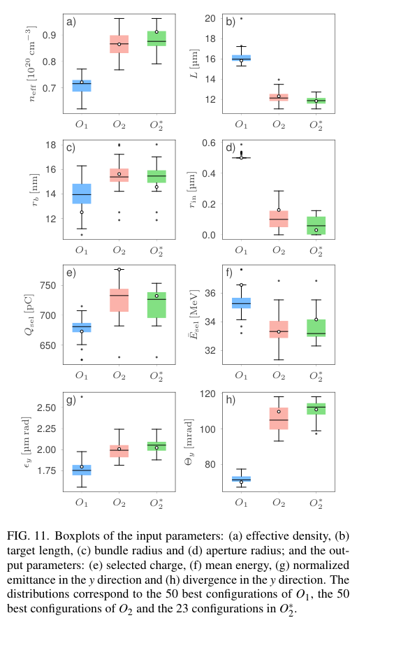
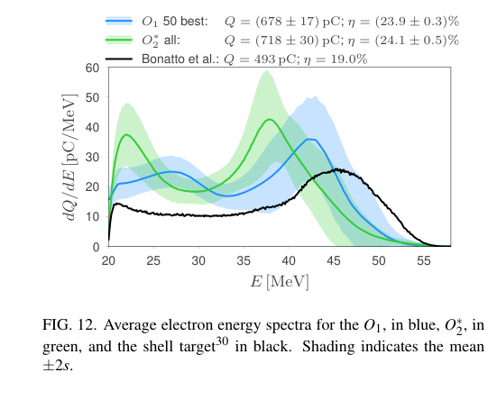

# CNT 靶的贝叶斯优化：效率、可制造性与电子束品质的权衡

## 0. 身份与证据

- 原题：*Bayesian optimization of longitudinally aligned CNT targets for 800 nm laser wakefield acceleration in the bubble regime*；B. S. Nunes 等，完整作者见台账和原文。
- [arXiv:2610.38810v1](https://arxiv.org/abs/2610.38810v1)，**2026-10-28 20:09:36 UTC 提交**，PDF 标注 Dated: 30 October；两日期不混用。精确标题 Crossref 前三没有核实同作正式论文，仍标为预印本。
- [官方全文](../pdfs/Nunes%20et%20al.%20-%202026%20-%20Bayesian%20optimized%20CNT%20targets.pdf) 16 页，MinerU／布局文本交叉核对，目视第 1、4、7、9、13、14 页。证据为 **3D WarpX PIC＋贝叶斯优化**，没有实物 CNT 靶束流测量；本轮未运行 WarpX、Optimas、训练或输运代码。

## 1. 目标函数实际优化了哪群电子

作者用三角晶格排列的纵向 CNT 束代替同心圆壳结构，每束以均匀中性碳圆柱近似，束内平均碳原子密度固定为 10²² cm⁻³。几何填充率给出有效**碳原子密度** neff，完全电离的自由电子密度还需乘 6，二者不能混用。中心孔通过移除孔内圆柱实现，neff 的定义不包含该孔。

激光固定为 100 mJ、800 nm、2.67 fs 强度 FWHM、w₀=1.5 μm、a₀=21.6、峰强约 10²¹ W/cm²。优化参数为 neff=(0.35—3.5)×10²⁰ cm⁻³、L=10—20 μm、束半径 rb=10—50 nm、孔半径 rin。第一次 O1 限 rin≥0.5 μm，第二次 O2 放宽到 0。

目标 η=Eb/Eℓ，Eb 为**已经离靶、正向纵动量对应动能超过 20 MeV 的选中电子**的总动能。阈值按纵向动量筛选，不等同于所有总动能大于 20 MeV 的电子；谱、平均能量和电荷沿用这群粒子。作者给出 Eb=(Qsel/e)Ēsel。静态核算 673 pC×36.6 MeV 对应约 24.63 mJ，与 100 mJ 激光的 24.6% 一致；这只是单位／归一化检查，不是模拟复现。

## 2. 数值与优化设置

WarpX 25.10、三维笛卡尔 Yee／Boris／Esirkepov、三阶粒子形状，ADK 电离，所有边界 PML；**不含碰撞**。1024³ 网格约 1.1×10⁹ 单元，分辨率 6.8×6.8×30.3 nm，8 宏粒子／初始占据单元，CFL=0.999；在 16 张 32 GB V100 上运行。作者的“约七个网格”指最小圆柱横截面的单元面积数量，最小直径只有约 3 个横向网格宽，不能误写为直径解析了七格。

Optimas 0.7.1 用高斯过程和 qNEI，初始 10 个随机点，O1 展示 167 次迭代；固定同一 PIC 随机种子以降低优化噪声。固定种子也意味着 top-50 的离散度不是同一构型的独立重复统计。长度上界受显存、束半径下界受分辨率约束，最优点多靠近边界；没有证明全参数空间最优。

## 3. 结果与统计对象

| 组别 | 效率与束流 | 解释 |
|---|---|---|
| O1 单次最高 | 24.6%；673 pC；平均 36.6 MeV；高能峰约 46 MeV；RMS 能散 8.6 MeV | 不能把峰位置当平均能量，也不能把 RMS 能散视为窄带谱 |
| O1 top-50 | (23.9±0.3)%、(678±17) pC；平均谱峰约 42.2 MeV；散角约 72—73 mrad | ± 为不同被选构型的标准差，不是效率测量不确定度 |
| O2 单次最高 | 25.8%，第 118 次迭代；777 pC；峰约 38 MeV | 仍移除一束 CNT，**不是完全无孔靶** |
| O2 top-50 | (727±28) pC、平均能量 (33.4±1.0) MeV；散角比 O1 约增 48% | 优化总能量并不显式奖励准直／高峰能 |
| O2* 完全未移除束的 23 个构型 | 平均 (24.1±0.5)%、(718±30) pC；平均谱高能峰约 37.8 MeV；散角约 106—111 mrad | 无孔靶可制造性更好，但效率不能直接套用 25.8% |

O1 最佳构型另做 30 个位置无序实现，位移 σ=4rb，neff 变化约 (0.2±0.1)%；平均电荷 (677±21) pC、效率 (24.2±0.7)%，谱峰从约 46 移到 43.8 MeV。这支持**近恒有效密度的特定位移扰动**鲁棒性，不包括倾斜、断束、束径／密度变化、预等离子体、指向／能量抖动与重复射击寿命。

## 4. 原图与机制解释

**Figure 11，PDF 第 13 页**：比较 O1／O2 各 top-50 与其子集 O2* 的输入／输出分布；neff 单位 10²⁰ cm⁻³，L／rin 为 μm、rb 为 nm，电荷 pC、平均能量 MeV、归一化发射度 μm rad、RMS 散角 mrad。放宽孔径后密度提高、靶变短，电荷略增而平均能量下降，散角明显上升。O2* 是 O2 的子集，箱图不是三组独立重复实验；不能把分布宽度当作真机容差或作者给出的置信区间。

**Figure 12，PDF 第 14 页**：横轴电子总动能 MeV，纵轴 dQ/dE、pC/MeV；蓝／绿分别为 O1／O2* 平均谱，阴影为跨构型 mean±2s，黑色为同心壳参照。谱积分是筛选后电荷，效率还要能量加权并除以 100 mJ，不能用峰高比当效率比。蓝／绿约 24%、黑色 19%，但黑色是先前扫描中的代表例，没有同等优化预算；相同数值分辨率不等于已经公平证明新几何优于所有同心壳靶。

图为 Nunes 等 arXiv 原文裁取、无曲线重绘；[原版本许可页](https://arxiv.org/abs/2610.38810v1)、[裁框与 SHA](../research/figure-manifest.json)。正文中的气泡腔、纵向场与回溯粒子图支持 LWFA 解释，但回溯标记用的是最终被选中粒子，不能把早期已标色理解为当时就超过 20 MeV。

## 5. 价值、限制与可接续验证

其价值是把可制造的靶几何、选中电子能量和优化成本连接起来。对转换靶／光核源而言，较大电荷是否有利取决于传输接受度和角谱，散角增大可能抵消电荷收益；论文没有计算转换靶 γ、中子、核素、材料热工或临床剂量。它与同作者 Mo-99／同心壳文献关联，但本篇优化任务与结果不同，不能把引用文献的核素结果算作本篇新增应用验证。

优先补同几何的网格／粒子／种子收敛，检验有效密度和无碰撞近似；再对激光抖动、真实束径／碳材料与预脉冲做扰动测试。几何比较应分配相同优化预算，目标加入联合角能谱或下游接受电荷；只有随后做转换靶输运与实测，才能讨论中子／核素产额。

[PDF 核验](../pdf_validation.json) · [正式版查询](../research/version-checks.json) · [解析记录](../research/mineru-attempts.json)。全文及抽取文本依约本地保存、Git 忽略。
