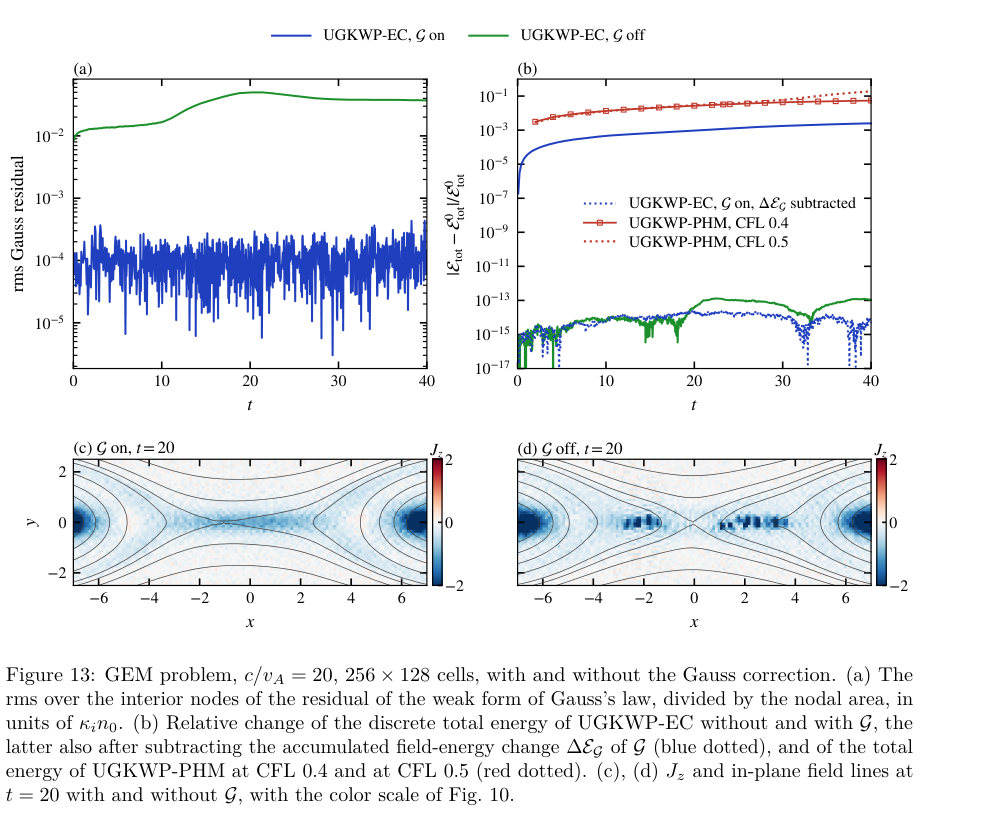
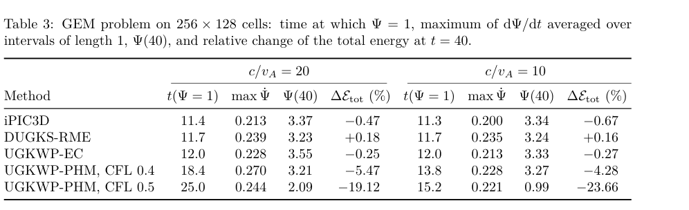

# UGKWP-EC：共享电流响应、Gauss 修正和能量账本

## 0. 身份与证据

- 原题：*A semi-implicit unified gas-kinetic wave–particle method with energy-conserving electromagnetic coupling for multiscale plasmas*；Yixiao Wang、Zhigang Pu、Xing Ji、Kun Xu。
- [arXiv:2610.40206v1](https://arxiv.org/abs/2610.40206v1)，**2026-10-29 14:55:12 UTC 提交**；[本地 PDF](../pdfs/Wang%20et%20al.%20-%202026%20-%20Semi%20implicit%20UGKWP%20multiscale%20plasmas.pdf) 34 页。精确标题 Crossref 前三未核实同作正式版，保留预印本身份。
- 证据为 **离散推导＋作者一／二维数值算例及代码比较**，没有实验验证。本轮只读原文并交叉核对 MinerU／布局文本，目视第 1、7、11、13、24、25、27、29 页；没有编译或重跑求解器。

## 1. 为什么把波和粒子放进同一个电流响应

模型为多组分 BGK–Vlasov–Maxwell 系统，速度矩能量采用 |u|²/2，是非相对论体系。UGKWP 用解析流体“波”和模拟粒子共同表示分布；碰撞增强、Δt/τ 增大时，粒子承担的比例约按 exp(−Δt/τ) 下降。若场方程仍强迫时间步解析光穿网格时间／等离子体周期，即使碰撞占优，也保留大量粒子，削弱波粒混合节省成本的优势。

新方法让隐式中点速度映射同时推动粒子和解析波，用同一映射构造电流对电场的线性响应。这样场做功与组分动能增量使用同一个电流，避免“宏观电流算场、另一个推进式推粒子”的能量不匹配。

一时间步为：半输运 → 全场耦合 → 半输运 → Gauss 修正。重构 Maxwell 方程给出一个关于中点电场的线性系统；命题 1 证明任意正 Δt 下有唯一解，并在周期／理想导体场边界条件下证明**场耦合子步**离散总能量守恒。输运 CFL 仍依赖流速与声速，算例取 CFL=0.8；“不用解析快周期”不等于任意时间步都准确。

## 2. 守恒对象和修正代价

电流响应不满足离散连续性方程，因此 Gauss 定律不自动成立。修正 G 联合改变电场与波／粒子的权重，保持粒子位置、速度和磁场不动，通过带非负权重约束的凸二次问题保持每个带电组分的**全局质量、动量和能量**。它移除弱散度值域中的电荷缺陷，剩余为正交分量 r⊥，不能表述为所有形式的 Gauss 残差严格归零。

完整一步的能量变化为修正带来的电场能变化：

$$\mathcal E^{n+1}_{tot}-\mathcal E^n_{tot}=\Delta\mathcal E_G.$$

所以“场步严格守恒”“修正保持组分能量”“含 G 的全算法总能量严格不变”是三种不同命题，本文支持前两种。扣掉累计 ΔEG 后的机器精度曲线是账本核对，不是原始物理总能量误差变成零。

磁旋转场还用网格平滑与依赖 ωpΔt／漂移参数的滤波。附录 A 的冷流体正定不变量分析省略碰撞、G 与部分滤波，含 β<4 条件；不能当作任意非线性多维系统的无条件稳定性证明。相同总能量也可能伴随漂移能错误转成热能，作者专门用漂移等离子体展示这一点。

## 3. 数值结果与成本口径

验证覆盖 Langmuir／whistler 波、跨碰撞度 Brio–Wu、Orszag–Tang 和 GEM 重联。计时在工作站 64 核上完成，CPU time 定义为墙钟时间乘核数，是 **core-hours**，不是单次墙钟小时。

| 比较 | 原文结果 | 边界 |
|---|---|---|
| Orszag–Tang，256²，Kn=10⁻³／10⁻²／10⁻¹ | UGKWP-EC 为 2.6／4.4／6.4 core-h；iPIC3D-BGK 为 10.8／10.3／8.9，即 4.2／2.3／1.4 倍 | 同网格、BGK、参考粒子数与流动 CFL，但 PIC 用 θ=1，非通用同精度成本基准 |
| GEM，256×128，mi/me=25，c/vA=20／10 | EC 为 11.0／10.6 core-h；显式 PHM 为 126.4／67.1，DUGKS-RME 为 1452／1444 | DUGKS 用每组分 40³ 速度点；不能外推到任意 PIC／GPU 或激光模拟 |
| 含 G 的能量残差 | OT 最大约 0.32%；GEM t=40 为 −0.25%／−0.27% | 来源主要是 G 的场能改变，不应藏在“严格守恒”标题下 |

**Figure 13，PDF 第 27 页**：时间和空间均为原文无量纲化；(a) 为弱 Gauss 残差除节点面积的 RMS，以 κᵢn₀ 为单位、纵轴对数，G 将残差从约 10⁻² 降到约 10⁻⁴；(b) 为总能量相对变化的绝对值、对数纵轴，开启 G 的实线约到 10⁻³，扣除其场能后的虚线与关闭 G 的曲线才接近舍入误差。(c,d) 为 t=20 的 Jz 和场线，色标截在 ±2；关闭 G 出现局部电流斑块。它说明同时检查约束、能量分配和结构的重要性，不能单凭最平的能量曲线选算法。

**Table 3，PDF 第 25 页**：分别比较两种 c/vA 下达到重联磁通 Ψ=1 的时间、长度 1 的时间窗平均最大重联率、Ψ(40) 与总能量变化百分数。c/vA=20 时 EC 的 Ψ(40)=3.55，iPIC3D 为 3.37、DUGKS 为 3.23，仍有动力学差异；PHM CFL=0.5 的 −19.12% 能量损失和延迟重联不是高保真参照。表中百分数与 Figure 13 的无量纲相对值应换算后比较。

图表为 Wang 等 arXiv 原文裁取，未重绘；[原版本与许可](https://arxiv.org/abs/2610.40206v1)、[裁框与 SHA](../research/figure-manifest.json)。

## 4. 与 PIC／HEDP 的关系及接续验证

这项工作为碰撞主导区与动理学区共存时减少粒子数提供具体算法参考，也给出“共享电流—场做功—粒子／波动能—修正能量”的可追溯账本。它不是相对论激光 PIC、强场 QED、真实 Coulomb 碰撞或辐射输运验证；BGK 不能直接替代全部材料／核物理过程。

接续应先取得作者实现，复现波色散与漂移测试，分离输运、线性求解器和 G 的能量／电荷残差；随后做等物理误差的网格／时间步／粒子数比较，再检查真实质量比、三维开放边界和高阶非 Maxwell 分布。不得将有限二维成本比写成普适加速倍数。

## 5. 核验与去重

与既有 PIC／UGKWP 文献按 DOI、标题、作者和电磁耦合方案去重；本作只入库一次。[PDF 核验](../pdf_validation.json)、[正式版查询](../research/version-checks.json)、[解析记录](../research/mineru-attempts.json)。全文和文本本地保留、Git 忽略。
