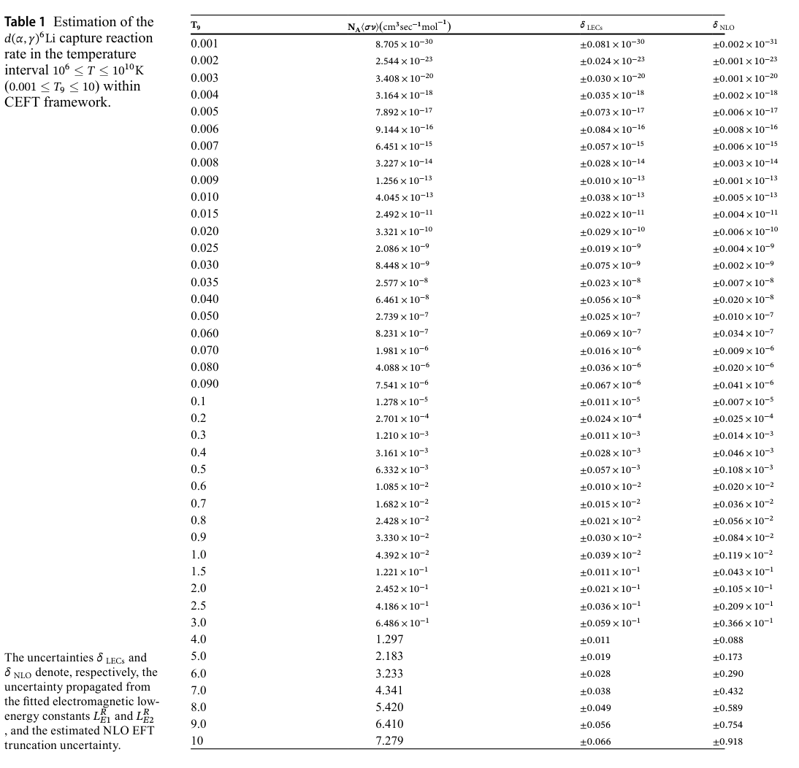
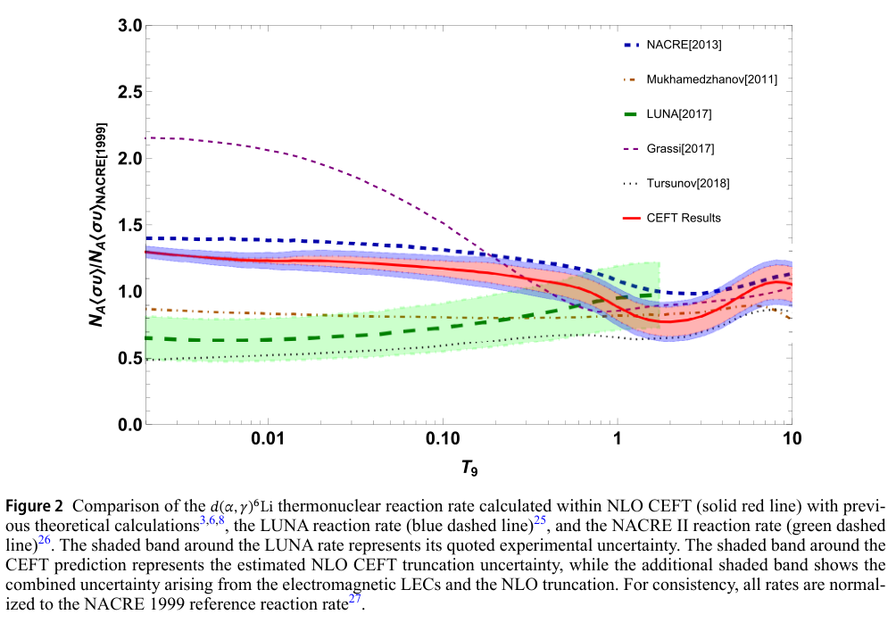
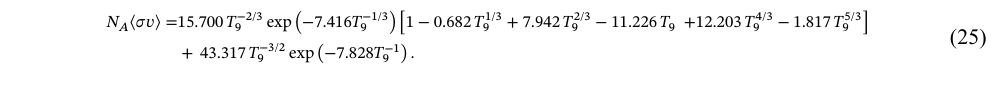

# d–α 辐射俘获的 CEFT 热核反应率：表值、误差与早期版拟合疑点

## 0. 身份、版本和证据层

- 原题：*Thermonuclear reaction rate of the deuteron alpha capture reaction in cluster effective field theory*；F. Nazari、M. Radin、M. Moeini Arani，*Scientific Reports*。
- [正式 DOI 与出版商页面](https://doi.org/10.1038/s41598-026-78629-5)。PDF 标明 2026-06-15 收稿、10-27 接受、**11-02 在线发布**；当前是 **Article in Press 正式接收早期版，尚非最终编辑 VOR**。Crossref 的版本标签不能覆盖 PDF 自己的声明。
- [本地全文](../pdfs/Nazari%20et%20al.%20-%202026%20-%20Deuteron%20alpha%20capture%20reaction%20rate.pdf)，11 页。常规 `.pdf` 路由实际返回文章 HTML；页面的 Download PDF 指向 `_reference.pdf`，该入口取得有效全文。
- 证据是 **已有数据约束的两体团簇有效场论计算**，不是新俘获实验。散射相移和 S 因子约束沿用前作，本轮没有重新拟合。这里仅检查印刷公式的算术一致性，没有复算 CEFT 振幅、截面、热积分或核反应网络。

## 1. 物理对象与模型

研究反应为 $d+\alpha\to{}^6\mathrm{Li}+\gamma$。模型将氘核作为自旋 1、α 作为自旋 0 的有效粒子，Li-6 基态描述为束缚能约 1.47 MeV 的 $^3S_1$ 两体束缚态。E1 来自 P 波，E2 来自 D 波；正文指出质心能量约 0.1 MeV 以上 E2 重要，711 keV 的 $3^+$ 共振进一步增强贡献。库仑相互作用非微扰处理，短程相互作用与电磁反项通过重整化低能常数表示。

总截面在振幅层面包含 E1、E2；平均初始自旋、求和末态极化并做角积分后，两者干涉项因角结构正交而消失。这是本文角积分观测量的性质，不等于任意微分观测量都无干涉。

本文将先前已拟合的电磁常数保持固定，沿用代表性短程调节量 $r_c=0.1$ fm，将截面折为 Maxwell–Boltzmann 热平均：

$$
R(T)=N_A\langle\sigma v\rangle
=N_A\sqrt{\frac{8}{\pi\mu}}(k_BT)^{-3/2}
\int_0^\infty E\,\sigma(E)e^{-E/(k_BT)}\,dE.
$$

$\mu$ 为约化质量，$T_9=T/(10^9\,\mathrm K)$，表中 $R$ 单位为 cm³ s⁻¹ mol⁻¹，既不是单粒子反应概率，也不是样品每秒核素产量。计算覆盖 $0.001\le T_9\le10$。

## 2. 数值表与不确定性



**Table 1，PDF 第 8 页**：横向列分别是无量纲温度 $T_9$、热核反应率、传播自两项电磁低能常数的误差 $\delta_{\rm LECs}$ 和 NLO 截断误差 $\delta_{\rm NLO}$。两类误差分列，不能将其中一列当作全部误差。

| $T_9$ | 本文表值 $R$ | $\delta_{\rm LECs}$ | $\delta_{\rm NLO}$ |
|---|---:|---:|---:|
| 0.1 | $1.278\times10^{-5}$ | $0.011\times10^{-5}$ | $0.007\times10^{-5}$ |
| 1 | $4.392\times10^{-2}$ | $0.039\times10^{-2}$ | $0.119\times10^{-2}$ |
| 10 | 7.279 | 0.066 | 0.918 |

以上为原表转录，未独立计算截面或积分。两项电磁常数误差采用一阶传播、假定相互独立，并以对称有限差分计算；不能据此认定已经传播相移拟合的全协方差、所有模型系统误差或实验归一化不确定性。NLO 相对误差随温度升高而增加，$T_9=10$ 时约 12.6%。作者也承认前作在 $E_{\rm cm}\gtrsim3.3$ MeV 的两体 CEFT 收敛已可疑，因此高温热积分权重向高能移动时需要额外审慎，表的温区不等于全温区已获相同可靠性。

## 3. 比较图及版本内不一致



**Figure 2，PDF 第 9 页**：横轴 $T_9$ 为对数刻度，纵轴是反应率除以 NACRE 1999 参考率，**无量纲**。红实线为本文 CEFT；按图内图例，蓝虚线为 NACRE[2013]、绿虚线为 LUNA[2017]。低温端红线大致随蓝线变化，而高于绿线；不能把纵轴读成绝对反应率。红线附近两层带分别涉及 NLO 与合并低能常数误差，但颜色对应关系应等待清晰的最终图例确认。

**图注及第 7 页正文将 LUNA 写成蓝虚线、NACRE II 写成绿虚线，与图内图例相反。** 笔记保留这处冲突，采用图内明确的文字标签描述曲线，不静默交换原图或宣称两种说明均已验证。



**式(25)，PDF 第 7 页**：作者称该解析参数式在 $0.002\le T_9\le10$ 对数值反应率的最大相对偏差为 1.29%。将目视核对的印刷系数逐字代入，却得到：

| $T_9$ | 印刷式(25)算术结果 | Table 1 | 相对表值差 |
|---|---:|---:|---:|
| 0.002 | $2.76173\times10^{-23}$ | $2.544\times10^{-23}$ | +8.56% |
| 0.1 | $1.50935\times10^{-5}$ | $1.278\times10^{-5}$ | +18.10% |
| 1 | 0.08733545 | 0.04392 | +98.85% |
| 10 | 11.74050 | 7.279 | +61.29% |

这是**四个指定表点的算术核对，不是全温区误差扫描**，也不能推断作者实际计算使用了错误系数。可能涉及排版、系数或归一化问题；在澄清前，不把印刷拟合式推荐为反应网络输入，也不自行修正系数。可复现命令：

```bash
python daily/2026-11-03/research/check_printed_rate_fit.py
```

[脚本](../research/check_printed_rate_fit.py)与[数值记录](../research/printed-rate-fit-check.json)仅执行上述公式算术。

## 4. 对本库的价值与接续

它提供核反应截面到热平均率、有效理论截断和参数误差分离的案例。对于非热激光离子束，应按实际氘／α 联合能谱、相对速度、靶柱密度和输运重新折叠，不能直接用 Maxwell 热率宣称激光产额、Li-6 制备效率或聚变增益。本文没有光核、中子产额、活化、剂量、靶热工或防护验收。

下一步优先获取最终 VOR／作者数值表，确认式(25)及图 2 图例，核对调节量与高能尾权重、低能常数协方差，再考虑网络输入。数据声明为向通讯作者合理请求获取，不等于已有公开可复现数据集。

## 5. 核验与来源

目视 PDF 第 1、3、6、7、8、9、10 页。原 PDF 的公式正常显示，但独立文本提取含 `inline-eq` 占位符及重叠字形，公式和表值已回到页面核对；没有把文本乱码判作原文缺公式。MinerU 因 `HTTP 401 / A0211 / user token expired` 未解析成功，采用已验证全文、独立布局文本和渲染回退。

三幅原始摘录只做整式／整图／整表裁取和栅格化，未改写图内内容；来源 Nazari 等，CC BY-NC-ND 4.0，限非商业引用并署名。见[原图清单](../research/figure-manifest.json)、[核验](../pdf_validation.json)、[来源记录](../research/sources.jsonl)。按 DOI、标题、作者与反应任务对旧 524 条去重，无同作条目。
