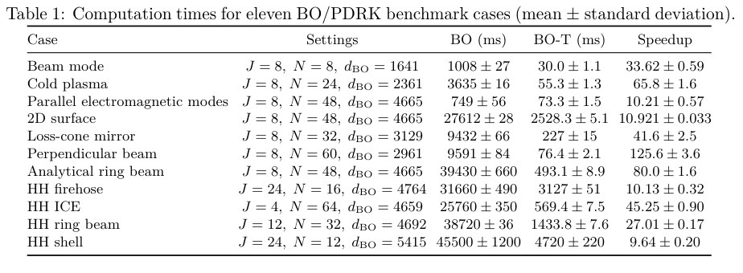
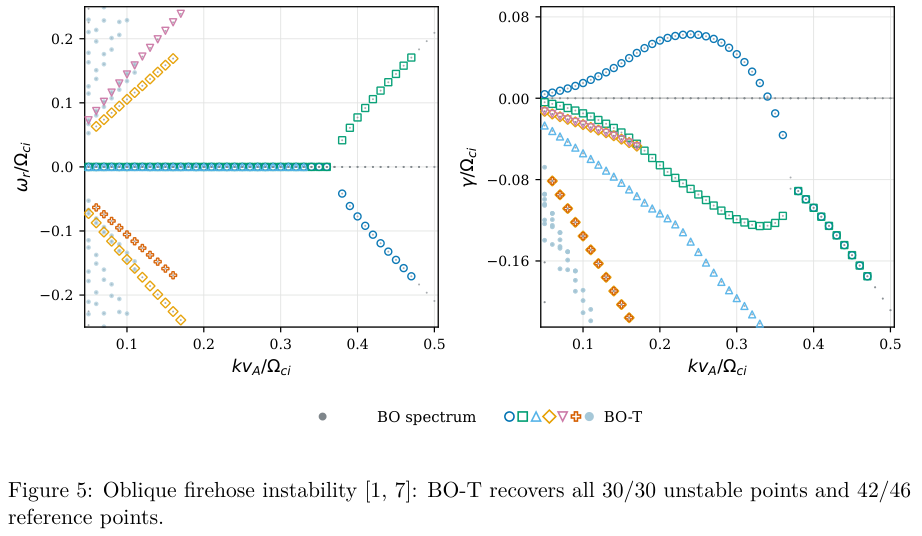

# BO-T 动理学色散求解：矩阵降阶、局部根界与计时范围

## 0. 身份与证据

- 原题：*Accelerating Computation and Resolving Extraneous Roots in the Kinetic Plasma Dispersion Relation Solver BO*；Xizhi Tian、Huasheng Xie、Long Wei。
- [arXiv 2610.41450v1](https://arxiv.org/abs/2610.41450v1)，2026-10-30 **08:54:14 UTC 提交**，11-02 公告；21 页。[本地 PDF](../pdfs/Tian%20et%20al.%20-%202026%20-%20BO%20Tian%20kinetic%20dispersion%20solver.pdf)。精确标题 Crossref 前三只返回其他作品，未核实同作正式版。
- 证据为 **数学推导与作者 CPU 数值基准**。BO 指既有色散求解器，**不是贝叶斯优化或机器学习算法**。作者给出 [BO-T 源码／复现材料地址](https://github.com/FusionAlpha/botian)；本轮没有下载运行源码、复跑基准或做 PIC 验证。

## 1. 三种根必须分开

线性扰动采用 $\exp[i(\mathbf k\cdot\mathbf x-\omega t)]$，$\omega=\omega_r+i\gamma$，因此 $\gamma>0$ 为增长。目标 $D_\star$ 是给定平衡分布与 Vlasov–Maxwell／Darwin／静电模型下的色散矩阵；$D_h$ 是 J 极点展开、回旋谐波截断和分布拟合后的有理近似；最后还有其线性化大矩阵的特征值。

额外解有两类：同一极点重复辅助变量引入的极点特征值，以及近似色散关系本身在非极点位置产生的伪根。精确保持大矩阵频谱，只能解决第一层表示问题，不能自动保证它等于原连续动理学模型的物理解。

## 2. 矩阵降阶与根筛选分别做什么

相同极点 $\xi_g$ 的辅助变量合并后，保留场方程只通过残差矩阵 $Q_g=C_gB_g$ 依赖该组变量。精确分解 $Q_g=L_gR_g$，令 $r_g=\operatorname{rank}Q_g$，将辅助维度由 $b_g$ 减至 $r_g$。所实现的电磁核嵌入三维电场残差，秩最多 3，静电情形最多 1。不同而接近的极点不能任意合并。

式(15)在精确算术中给出

$$
\det L_h^{\rm full}(\omega)=\det L_h^{\rm redu}(\omega)
\prod_g(\xi_g-\omega)^{b_g-r_g}.
$$

非极点特征值及重数保持，被删的极点特征值可补回。实际 SVD 阈值改变残差时，还要控制式(16)中的 $\|\Delta Q_g\|/|\omega-\xi_g|$；靠近极点更敏感。**精确分解的恒等式不等于浮点 SVD 在任意阈值下无误差。**

第二步以候选矩阵 $D_0$ 与参考 $D_1$ 作围道比较。若两者在区域及边界解析、无极点，且 $D_0$ 在围道非奇异，满足

$$
\delta_\Gamma=\sup_\Gamma\|D_1-D_0\|_2
<\mu_\Gamma=\inf_\Gamma\sigma_{\min}(D_0),
$$

则围道内根的总数含重数保持。圆盘还需独立确认 $D_0$ 仅有一个简单根，才能将半径 $\rho$ 作为参考根误差界；根簇只保证总根数。失败仅表示该充分条件未证实，不能据此将根判为伪根。

离散采样必须结合导数界与数值求值误差覆盖采样间隔，不能仅看若干采样点就声称连续围道证明。若参考仅为另一有限近似，则保证的是两种有限近似间一致；相对 $D_\star$ 的结论还需要剩余截断误差界。增长率区间 $[\operatorname{Im}\hat\omega-\rho,\operatorname{Im}\hat\omega+\rho]$ 跨零时，稳定／不稳定的符号未确定。

## 3. 计时结果与选样方式

**Table 1，PDF 第 9 页**：11 个磁化算例，列为极点数 J、谐波数 N、完整矩阵维数、两个求解器时间（ms）与配对加速比。误差是运行间样本标准差，不是物理频率误差。总共 13 个测试，另两个静电小矩阵不列计时，因为降阶没有加速。

Windows 11、Ryzen 7 9800X3D、Python、单 BLAS 线程；交替运行两方法。作者在预设 N 网格上寻找“加速比达到 30 且频谱匹配”的点，再做 10 次配对；未达到者在所测最大 N 做两次配对。因此表中并非统一 N 或统一重复数的随机性能样本。六项达到 30 倍，其他五项约 9.64—27.01 倍；不能概括为所有算例超过 30 倍。

固定 N=32 的 Table 2 中，冷等离子体为 144.0±4.2 倍，束流模式 24.4±2.9 倍，解析环束 28.20±0.44 倍。**这些计时仅含矩阵构建与特征值计算，排除初始化、I/O 和后续模式选择。** 第 9 页明确说 12 个代表点的围道检查目前比完整特征值求解还慢，所以不能将 144 倍写成完整可靠色散扫描的端到端加速。

## 4. 根恢复率与原图

**Figure 5，PDF 第 12 页**：横轴 $kv_A/\Omega_{ci}$，左轴 $\omega_r/\Omega_{ci}$、右轴 $\gamma/\Omega_{ci}$，均无量纲；灰点为 BO 全矩阵频谱，彩色空心符号为 BO-T 所选分支。右图正增长峰恢复，而部分负增长段没有完整保留。图采用 N=2，计时表的 HH firehose 则 N=16，不能跨配置合并性能与精度。

| 算例 | 作者给出的匹配 | 限制 |
|---|---|---|
| 解析环束 | 不稳定点 163/163，总参考点 292/351 | 59 个强阻尼点未匹配；另保留其他分支 512 点 |
| HH 环束 | 参考 J=24 时 163/163 不稳定、324/351 总点 | 用 J=8 对照仅恢复 120/163 不稳定点 |
| 平行电磁 | 2498/2500 | 两点特征值存在但被 selector 删除；另有 548 个其他模式点 |
| 斜 firehose | 30/30 不稳定、42/46 总点 | 四个阻尼点缺失；一个扫描点快／穷尽筛选对两个候选不同 |
| 垂直束流 | 123/131 | 八个小 k 差异已存在于重新计算全谱与旧存档之间 |
| 镜不稳定性 | 298/400 | 102 个未匹配点中 100 个在重算全谱也未达匹配阈值，另两点被筛选删除 |

匹配采用 $|\omega_{\rm sel}-\omega_{\rm ref}|/(1+|\omega_{\rm ref}|)\le10^{-3}$；参考混有 exact-Z、既刊图数字化和旧存档，证据强度不同。另有 whistler 束流模式只保留 232/400 旧点，HH shell 会漏部分不稳定峰。不能称所有增长模或所有强阻尼分支都已可靠剔伪／恢复。

## 5. 对 PIC 机制诊断的价值与下一步

BO-T 可作为 PIC 中波动／不稳定性解释的线性参照：先固定物种分布、单位、波矢和参考系，再对比增长率与极化。其平衡线性模型不替代非均匀、非线性和随时间演化的 PIC 机制验证。

接续应先复现一个可用 exact-Z 的不稳定分支，记录 SVD 奇异值、J／N 收敛和连续围道误差界，再测完整筛选成本；单独追踪临界增长率、强阻尼、根簇与 shell 漏峰。不要把筛选失败当成稳定证明，也不要将所有与历史存档不符的问题归因于降阶。没有 γ／中子／核素、靶热工、辐照或诊疗验证。

## 6. 本轮核验

目视 PDF 第 5、6、7、8、9、12、13、14 页及两幅最终原图。原图 CC BY 4.0，Tian 等 2026，完整图表裁取未重绘；见[出处与裁框](../research/figure-manifest.json)。MinerU 因 `HTTP 401 / A0211 / user token expired` 失败，使用已验证本地 PDF、全页文本和页面渲染；[核验](../pdf_validation.json)、[版本核对](../research/version-checks.json)、[来源](../research/sources.jsonl)。按 DOI、arXiv ID、标题、作者与物理任务与旧 524 条去重。
