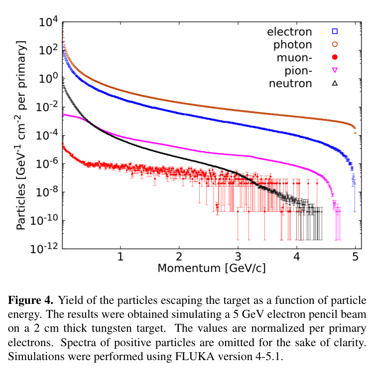
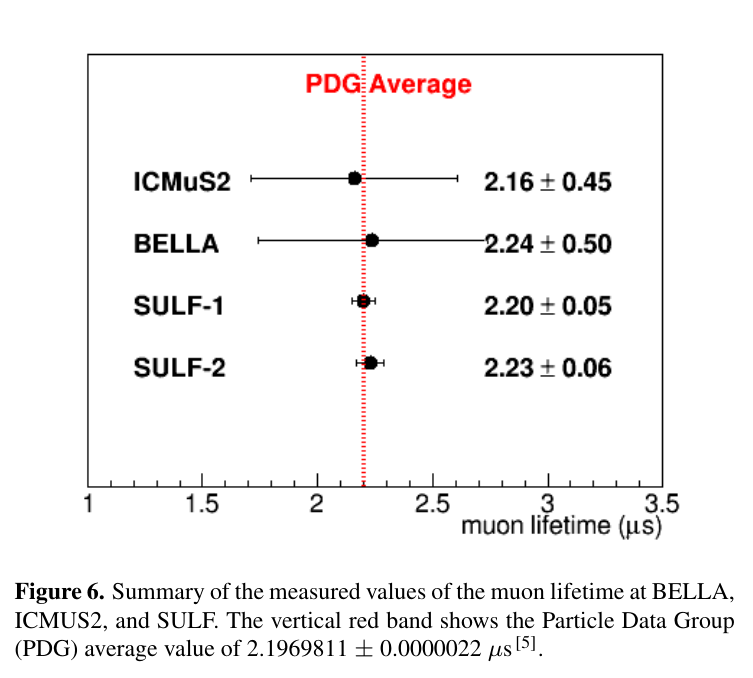
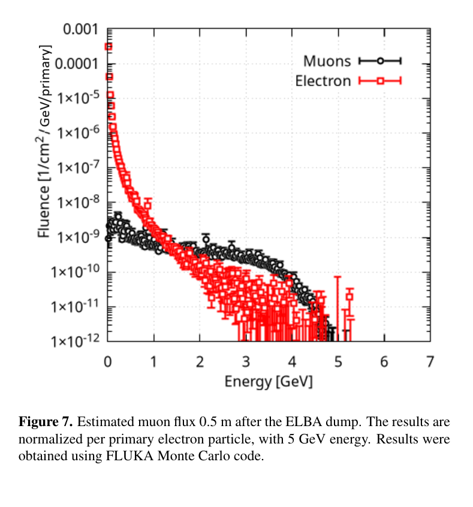

# 激光驱动多 GeV μ 子源：转换靶、寿命证据与应用距离

## 0. 论文身份与证据等级

- 原题：*Laser-Driven Multi-GeV Muon Sources: Production and Applications*；A. Cimmino、R. Versaci 等，*High Power Laser Science and Engineering*，DOI [10.1017/hpl.2026.10210](https://doi.org/10.1017/hpl.2026.10210)。[出版社页面](https://www.cambridge.org/core/journals/high-power-laser-science-and-engineering/article/laserdriven-multigev-muon-sources-production-and-applications/0F50BF6D035517FBF6B61568E20E9A55)与 Crossref 的在线日期为 **2026-11-03**。
- 实际取得的是出版社 **24 页 Accepted Manuscript、Review**；第一页明确已同行评审、尚未 copyedit/typeset，**不是最终编辑排版 VOR**。Crossref 把服务链接标为 `vor`，不能覆盖原件和页面的版本声明。[本地 PDF](../pdfs/Cimmino%20et%20al.%20-%202026%20-%20Laser%20driven%20multi%20GeV%20muon%20sources.pdf)。开放许可 CC BY 4.0。
- 本文是**综述**：引用既有 LWFA 电子束与 μ 子实验，穿插 FLUKA/Geant4 计算和未来系统投影。综述中的同一旧实验不计为新的独立复现；本轮没有重新运行激光、PIC、粒子输运、拟合或实验。
- 读全文后最需注意：已能观察和识别 μ 子，但全束流相空间、绝对产额和效率尚未在统一条件下闭合。早期稿还有标度公式、坐标／图注和单位问题，见下文。

## 1. 摘要与引言：为何从电子束走向 μ 子

摘要首先把路线限定为 LWFA 多 GeV 电子束撞击高 Z 靶：电子及其韧致辐射激发 μ 子对产生，或先产生带电 π 介子再衰变成 μ 子。可调方向、短脉冲和潜在较高通量是相对天然宇宙线 μ 子的吸引力；“可移动”和高重频性能仍是系统发展方向。

引言用海平面宇宙线约 1 μ/(cm²·min)、平均约 4 GeV 说明天然源的有限速率。这个量不是任意方向、任意能阈的通用基线；文章后面相对“大天顶角宇宙线”的高增益，不能直接用这里的积分通量相除。

常规大型质子设施、电子束高 Z 转换靶和 LWFA 分别解决不同的能区、强度与占地问题。LWFA 缩短加速段，并不自动缩短全部屏蔽、束流输运和探测区；源通量高也不等于可跟踪的应用事例率高。

## 2. 多 GeV LWFA 电子束

### 2.1 物理参数与标度式

正文先介绍 CPA、激光驱动等离子体尾场和不同注入方式。束流的能量、总电荷、能散、发散和稳定性同时影响转换靶产额，因此只给电子最高能量不能预测完整 μ 子源性能。气体密度下降允许更长的失相长度，但同时需要匹配导引、耗尽、束流负载和注入条件。

文章式(1)使用近单位驱动幅度下的理想尾场估计。为避免原文把频率与束腰都记作同一符号，这里将激光角频率记为 ωL、束腰记为 w0：

$$
\varepsilon_m\simeq 2m_ec^2\gamma_{\rm ph}^2,
\qquad
\gamma_{\rm ph}\simeq\frac{\omega_L}{\omega_{pe}}
=\sqrt{\frac{n_{\rm cr}}{n_e}},
\qquad
\varepsilon_m\simeq 2m_ec^2\frac{n_{\rm cr}}{n_e}.
$$

这里 εm 是电子能量，me 是电子质量，c 是光速，γph 是尾场相速的洛伦兹因子；ne 与 ncr 必须采用相同的密度单位。推导只需将冷等离子体频率平方正比于密度代入相速关系，再代入能量式。直觉是低密度尾场移动更接近光速、理想失相能量更高；它不保证实际电子一定达到该能量，也不保证电荷保持不变。

**原稿标度链存在可直接核对的代数冲突。** PDF 第 3 页式(2)与式(4)实际印为：

$$
a_0^3=\frac{P}{\bar P}\gamma_{\rm ph}^{2},
\qquad
\frac{\varepsilon_{\rm las}}{\bar\varepsilon}
=2\frac{P}{\bar P}\gamma_{\rm ph},
\qquad
\bar\varepsilon=\frac{2\pi\bar P}{\omega}.
$$

P 与 Pbar 是功率，εlas 与 εbar 是能量，a0 无量纲。**按照印刷式本身**，固定 a0 和激光频率（因而固定 εbar）可得：

$$
\frac{P}{\bar P}=a_0^3\gamma_{\rm ph}^{-2},
\qquad
\frac{\varepsilon_{\rm las}}{\bar\varepsilon}
=2a_0^3\gamma_{\rm ph}^{-1},
\qquad
\varepsilon_m\propto\varepsilon_{\rm las}^{-2}.
$$

但同页式后汇总写的是电子能量随激光能量的 **正 2/3 次幂**增长。这两条结论不能由相同的印刷等式和固定 a0 同时推出。以上仅为原式消元检查，**没有推断“正确版本”或修改因子位置**。该页还把频率比中的 ω0 文字解释为束腰，随后又以 ω0 表示长度；使用时需先回到原始标度文献与最终 VOR 澄清。不能直接把这组印刷式作为设计输入。

文章随后给出 1 kJ、1 μm 驱动对应约 140 GeV、密度约 1.6×10¹⁶ cm⁻³、长度 11.5 m 等**理想投影**。它们不是本综述的新电子束实测；受上述标度冲突、导引与稳定性条件限制，本轮不将其验证为可复现的工程设计点。

### 2.2 已有多 GeV 电子实验

原文 Table 1 汇总的是不同设施、激光构型和参考实验，不能将最高能量、最高电荷与最高重频拼接成同一次运行。Texas PW 的图 2 上支约 10.4±1.9 GeV、340 pC 是高能束团，2.9 nC 是总电荷；下支约 4.9±0.4 GeV 则有约 2.2 nC 总电荷和更高能尾部。这个例子说明“最高能电子”和“可用电荷”的定义必须分开。

自波导／OFI 通道可在较低密度延长加速，避免完全依赖相对论自聚焦。这里的实验支持多 GeV 驱动电子束已存在；数 Hz 导引、高日发射次数、10 PW 设计和未来数十至百 GeV 属于不同成熟度，不能共同当作现成 μ 子束线参数。

## 3. 从高 Z 转换靶到 μ 子识别

### 3.0 产生机制、背景与诊断

电子撞击高 Z 靶后形成电磁簇射。韧致辐射光子在核库仑场产生 μ⁺μ⁻ 对的 Bethe–Heitler 路线通常有较高能、较前向的分量；光／电致 π 介子产生与衰变带来较低能、宽角分量。这里描述的是机制趋势，真实源必须将初级电子联合角能谱、靶厚、级联和输运共同计分，不能只根据探测器在轴上就把每个事例归类为 BH。

**图 4，PDF 第 6 页，作者 FLUKA 4-5.1 模拟**：5 GeV 单能电子细束撞击 2 cm W，PRECISIO 默认并开启 μ 子对产生；归一化到每个初级电子。光子和电子背景比 μ⁻ 高许多数量级，不能把高穿透性等同于无背景。正粒子谱为清楚起见未画出。误差条没有在本文完整定义成总系统误差；低计数端也不能用线性外插提高精度。

**图注／轴名冲突**：横轴真正印的是 **Momentum [GeV/c]**，图注却写随 particle energy 变化；纵轴还印 GeV⁻¹·cm⁻² per primary。因此本笔记只按原图描述分量与背景，不把它数字化后当一致定义的能谱积分。能量与动量的换算尤其在低能 μ 子区需要质量信息。

μ 子鉴别的重要证据是停止 μ 子产生的延迟衰变电子／正电子。忽略背景和响应时，停止粒子数随时间满足：

$$
\frac{dN}{dt}=-\frac{N}{\tau_\mu},
\qquad
N(t)=N_0e^{-t/\tau_\mu},
\qquad
h(t)=A e^{-t/\tau_\mu}+b(t).
$$

N 是仍未衰变的停止 μ 子数，τμ 的单位为 μs；h 是实测时间直方图，A 含探测效率，b 包括延迟背景。指数分布由恒定单粒子衰变率积分而来。匹配约 2.197 μs 的时间常数有力支持 μ 子存在，却不单独给出总源产额；门控、停止几何、负 μ 子俘获和探测效率仍会改变可见计数。原文第 5 页同段先写正确的 μs 数值，随后误写 “ms timescale”；本笔记明确采用 μs，不沿用该误写。

核乳胶有空间／角度分辨率和被动运行优势，但无在线时间信息；闪烁体与气体探测器可实时计时／跟踪，却必须处理瞬时饱和、恢复时间和重叠事例。综述强调现有实验探测器首先为“证明有 μ 子”配置，不是为完成全部源相空间测量配置。

### 3.1 Texas PW：前向信号与推断产额

约 1–3 GeV、约 100 pC 的电子束射入 2.54 cm W。Geant4 在 2 GeV、65 pC 假设下预计每炮数千 μ 子、约 30° 半宽角分布。漂移管探测器受饱和影响，只有少数炮次给出有效数据；另一闪烁屏系统约 40 炮得到每炮约 1000 μ 子的**推断**，三个角位置的归一化信号给出约 25° 半高半宽。

原文图 5 是归一化闪烁信号，不是完整角度—能量绝对相空间。正文给出推断产额，但 Table 2 的 Texas 产额和识别技术栏记为 N.A.，因此不把这个数字与其他组的模拟校正总产额直接排名。

### 3.2 SULF：寿命证据与宽角分量

15–20 J、约 30 fs、0.1 Hz 激光产生约 0.4–1.5 GeV、约 200 pC 电子，178 炮后用 Pb 靶与液体闪烁体寻找延迟衰变。角分布分析支持主要来自 π 衰变，综述引用约 0.01 μ/e 的估计效率。它不是本轮独立校准的效率，也不能当成任意电子能谱或任意靶厚下的普适系数。

**图 6，PDF 第 7 页**：横轴 μ 子寿命 μs，纵向是不同实验／探测配置；点为拟合寿命，横条为各来源报告的不确定度，红线／极窄带是 PDG 参照。ICMuS2 为 2.16±0.45，BELLA 为 2.24±0.50，SULF 两配置为 2.20±0.05 与 2.23±0.06 μs。它支持不同测量与 μ 子寿命相容；不能根据误差条较短就断言该源转换效率更高，也不是全部实验完成了同一系统误差评估。

### 3.3 BELLA：直接识别计数与源产额分开

21 J、40 fs、30 cm 波导得到 2–8 GeV 的宽谱电子，2 GeV 以上约 80 pC，亚 mrad 发散但有约 3 mrad 指向抖动。电子射入 Pb／钢／混凝土组合束流堆，轴上与离轴闪烁体用于区分不同分量。

760 炮共识别 **126±12 个 μ 子事例**；正文寿命约 2.2±0.5 μs。完整几何 Geant4 支持轴上 BH 与离轴 π 衰变成分的解释。Table 2 的 **2.6×10⁴/shot** 是估计源产额，不是把 126 事例除以炮数得到的直接计数。两者之间包含角接受度、停止与衰变、屏蔽和响应模型，不能混写。

### 3.4 ICMuS2／ALEPH：μ 子证据与穿墙信号

20–30 cm 波导的驱动电子可达约 10 GeV，约 100 mm W 磁谱仪入口兼作转换靶；EJ-200 闪烁体及 Pb／聚乙烯屏蔽记录主脉冲 1 μs 后的延迟信号，时间常数约 2.16 μs。

另一演示把粗像素探测器放在实验室外的卡车，观察穿过墙体／屏蔽后的单炮信号，放入 24 英寸 Pb 后信号明显衰减。但正文承认粒子鉴别有限，且这部分有未解析的参考文献 `[?]` 与“paper in preparation”。因此应称**包括 μ 子及其他高能粒子的粗成像可行性演示**，不能称已验证的纯 μ 子定量断层图像或独立公开数据集。

### 3.5 ELI-NP 的 PW 实验与模拟束线

约 560±180 pC（200 MeV 以上）、谱延伸至约 2 GeV 的电子打 1–2 cm Pb；屏蔽后的 TimePix3 轨迹支持 μ 子产生。文中模拟提出在探测平面数 cm² 范围每 nC 初级电子可交付超过 100 μ 子；这是运输线设计计算，不等同于实验直接达到该交付率。

### 3.6 ELI-NP 10 PW：初步事例仍在分析

原文描述 60 mm 气体靶产生峰值约 4 GeV、超过 1 nC 电子，入射 40 cm Pb。探测器位于约 10 m 外、隔 2 m 混凝土，1×1 m² 四层闪烁条望远镜本为宇宙线跟踪设计。背景仍强；多粒子同步到达使逐条轨迹重建困难。作者报告提示能量达到或超过 1 GeV 的 μ 子事例，**数据分析尚在进行**，不能把它升级成完整能谱或效率测量。

### 3.7 ELI-BL：已实现电子参数与未来运行点

L3-HAPLS 的设计值为 30 J、30 fs、10 Hz；文中已经实现的电子运行点为 13 J、30 fs、**0.2 Hz** 下约 5 GeV，另一个 **3.3 Hz** 的结果是 8 J 导引。把这两组拼成 5 GeV／3.3 Hz μ 子源会跨越证据边界。2 m 混凝土束流堆同时作转换靶，L4-ATON 与百 GeV 电子方案则属未来升级。

**图 7，PDF 第 10 页，FLUKA 模拟**：5 GeV 初级电子、ELBA 堆后 0.5 m，横轴 Energy [GeV]；黑色 μ 子在中高能区相对电子背景更有利，低能区电子更多，接近端点时统计稀疏。纵轴原标为 **Fluence [1/cm²/s/GeV/primary]**，图注仅说明每个初级电子归一化，未说明其中秒的引入方法。**本笔记不从该图推算每秒绝对通量**，也不将其模拟谱当成已测能谱。

全节总结明确指出各实验是互补的概念验证，源产额、角谱、能谱、发射度、总体转换效率没有在统一条件下系统测量；现在做定量优劣排名为时过早。

## 4. 应用：先规定可交付束流与可识别事例率

### 4.0 散射成像与透射成像

原文式(5)用多重库仑散射的近似宽度联系动量、材料与角偏转：

$$
\sigma_\theta\simeq
\frac{13.6\,\mathrm{MeV}}{\beta cp}
\sqrt{\frac{L}{X_0}}
\left[1+0.038\ln\!\left(\frac{L}{X_0}\right)\right].
$$

p 是 μ 子动量，βc 为速度，L 是材料路径长，X0 为以相同长度单位表示的辐射长度，σθ 为弧度。独立小角散射近似相加使角方差随厚度增长，因此角宽约随平方根厚度增长；动量越高越难偏转，产生逆动量因子，对数项为经验修正。式子不是材料成分的唯一反演：动量分布未知时，密度／厚度与动量会互相混淆。

散射成像需要入射与出射两组跟踪，透射成像可在已知源谱／通量条件下只测下游衰减。脉冲中许多近同方向 μ 子同时到达，可能比天然宇宙线更难配对入射与出射轨迹；亮度提升必须与 pile-up、分辨率和探测恢复时间一起评估。

### 4.1 核安全与安检

正文讨论高 Z 材料辨识、核材料检测及 μ 子俘获次级中子等应用。这里是应用需求与可能架构的综述，**不是本论文新增的材料检出限、误报率、剂量或现场认证结果**。转换靶自身的 γ／中子背景还可能妨碍观测；需要测量与响应模型共同说明。

### 4.2 地学与考古

文章先回顾已有宇宙线成像案例，再讨论水平可定向人工源的潜力。目标尺寸和岩土厚度决定最低能量，有时需要 TeV 级穿透，不能把目前几 GeV 的 LWFA μ 子随意移用于所有地下目标。源放置、探测区、曝光时间、分辨率、功耗和环境条件都需逐案评估，移动激光器并非唯一工程工作。

### 4.3 高能物理与探测器研究

低动量高通量精密实验、GeV 级探测器测试、亮度／冷却要求很高的对撞机和中微子源使用不同束流指标。作者将 LWFA μ 子视为补充源或早期技术测试平台。65–70 GeV 对撞束用于 Higgs 能区的讨论仅是前景，既没有达到该 μ 子能量，也没有闭合电荷选择、冷却、发射度和亮度。

### 4.4 μ 子催化聚变

μ⁻ 替代电子可缩小氢同位素分子尺度并提高低温聚变概率，但 μ 子寿命和与聚变产物黏附限制每个 μ 子的循环次数。文中约 300 次／μ 的数量级不是本综述新测量；已有 μ 子产生能耗仍大于其促成的聚变输出。

文章提出约 10¹¹–10¹² μ/shot、低能 μ 子、D–T／D–D“点火火花”等远期条件，并在图 9 中画的是**激光质子撞靶产 μ 子**示意，不能冒充本节 LWFA 电子源已经实现的实验构型。p–¹¹B 方案又引入 D–D 质子与能量转移的计算设想；它没有给出经验证的全系统能量增益、μ 子生产效率或点火实验。全文没有诊疗／临床终点研究。

## 5. 结论、可复用信息与接续

作者总结少量 GeV、约 100 pC 电子与高 Z 转换靶可产生约每炮千量级 μ 子，提出未来 10 Hz、约 50 m² 系统的技术前景。这个表述概括不同实验与投影，不能替代按能区、角接受度和效率定义的同一运行点。图 4 与图 7 仍是输运模型结果，不是完整源性能实测。

对本库最有用的是把工作拆成可检验的链：激光／气靶 → 同炮次电子联合相空间 → 转换靶与级联 → 屏蔽后能角谱 → 探测门控与效率 → 应用事例。下一步应先取得最终 VOR 澄清第 3 页标度与符号、图 4 横轴／图注、图 7 时间归一化及未解析引用；再对一套真实构型保存初级电子、靶几何、物理模型、时间窗和绝对响应，做盲背景与校准。**证明有 μ 子、估计总产额、获得可交付束流和完成成像应用是四个不同里程碑。**

## 6. 本轮全文与图像核验

PDF 第 **1、3、6、7、8、9、10、13、14 页**以完整页面并排图真实目视；第 3 页公式又单独放大核对，图 4、6、7 的最终原图裁取逐幅重新打开。图 4 初裁缺少图注后已扩大裁框重查，图 6 底部也扩大到完整图注。原图未重绘，保留作者、DOI、CC BY 4.0、页码、裁框与哈希，见[目视与出处记录](../research/muon-visual.json)。

共享 MinerU 凭据在本轮对 FEL 公开 URL 的测试中返回 **HTTP 401／A0211／user token expired**；本篇没有单独发起远程解析任务，使用已验证本地 PDF、全页文本、布局文本和页面渲染回退。见[解析来源记录](../research/mineru-attempts.json)、[PDF 核验](../pdf_validation.json)。上面的标度消元为对印刷式的静态代数核对，没有本地物理模拟、输运积分、寿命拟合或原始实验数据复分析。
