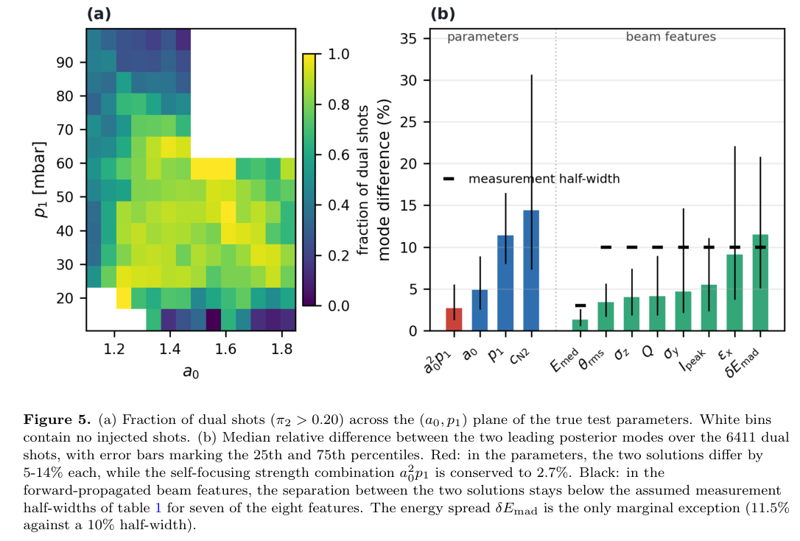
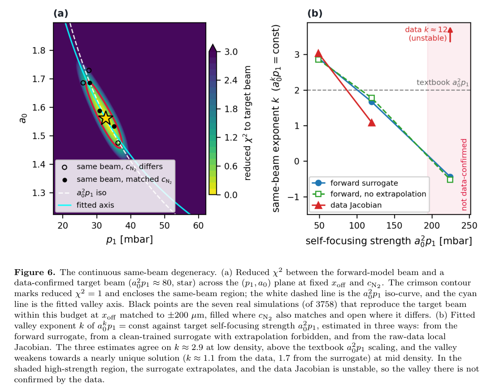
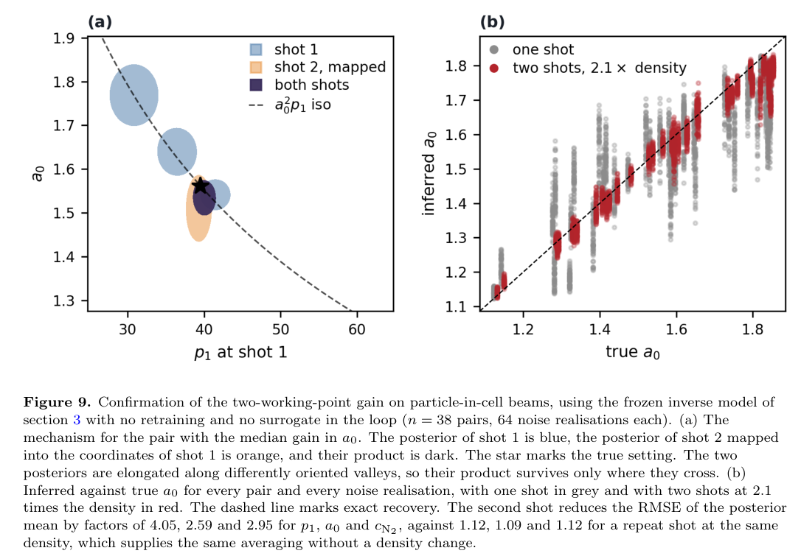

# 激光等离子体加速器逆建模：双解、连续退化谷与两密度测量

## 0. 论文信息与证据

- 原题：*Inverse modelling of a laser-plasma accelerator*；M. Lenivenko、A. Beck、H. Güler、G. Kane、S. Kazamias、V. Kubytskyi、B. Lucas、M. Pintonato、J. Serhal、S. Smartsev、K. Swain、K. Cassou。
- [arXiv 2611.00108v1](https://arxiv.org/abs/2611.00108v1)，2026-10-27 12:23:41 UTC 提交，11-03 分类公告；18 页。[本地 PDF](../pdfs/Lenivenko%20et%20al.%20-%202026%20-%20Inverse%20modelling%20laser%20plasma%20accelerator.pdf)。PDF 使用 IOP 期刊模板，但卷号、年、文章号与接收日期仍为占位符；不能据此认定已经正式发表。精确标题 Crossref 前三未核实同作正式版，见[版本检查](../research/version-checks.json)。
- 这是 **Smilei 模拟数据上的概率逆推与诊断设计研究**，不是 PALLAS 真机参数反演实验。本轮未运行 Smilei、模型训练、后验拟合或作者复现代码。
- 作者公开的数据、模型与代码入口见第 8 节；本轮仅核查论文内容，没有验收代码复现性或模拟器对真实装置的准确性。

## 1. 摘要与引言：准确预测束流不等于唯一恢复设置

论文从正向问题转向逆向问题：激光与气体设置决定电子束，但不同设置可能给出诊断精度内相同的电子束。输出单点的回归网络会把多个有效设置平均，平均点可能并不是一个有用的真实工作点。因此模型应报告候选设置及其概率和宽度。

作者反演注入区压力、真空归一化矢势和氮浓度，并把焦点位置作为已知但不精确的条件。混合密度网络的平均决定系数约 0.91，但约三分之二测试束流存在两个有显著权重的解。退化与相对论自聚焦有关，不能仅通过换一个更强网络消除。

论文依次比较三种增量信息：加入完整能谱的低维表示、用正向代理审核候选解、改变一次已知等离子体密度后再测束流。后者在独立于训练样本的配对 PIC 算例中最有效；这里的“独立”指样本，不是独立模拟器或真实实验。

## 2. 模拟、输入与测量噪声

### 2.1 两区气靶与数据划分

Smilei 使用方位角模展开和激光包络近似。第一段 He–N₂ 气体负责电离注入，第二段纯 He 负责加速；四个扫描输入为真空激光强度参数、真空焦点位置、第一段压力和氮浓度，其余激光、气体与数值设置保持固定。

训练库为均匀随机扫描、经注入预测预筛后实际形成电子束的 **3758** 个模拟；测试库为另一随机扫描中标记为已注入的 **9846** 个模拟。未注入样本没有束流可反演，故不在本任务定义内。训练库再随机留出 15% 做验证，五个成员共用这一验证划分。

原 Fig. 1 的直方图按面积归一化，展示训练与测试输入分布；压力单位 mbar、焦点位置单位 µm，矢势与浓度无量纲，浓度轴用百分比。图中代表性能谱为中位能量 141 MeV、电荷 170 pC 的一个模拟样本，不是实验束流或整个库的典型误差保证。

### 2.2 八个束流特征与一个机器条件

八个特征是中位能量、由中位绝对偏差定义的相对能散、电荷、峰值电流、垂直于激光偏振方向的归一化发射度、束长、横向尺寸及 RMS 发散角；均在等离子体下降沿之后的最后一个模拟时间步提取。宽动态范围通道先取常用对数，再标准化。

焦点位置作为第九个输入，而不是第四个输出。后文局部雅可比表明若同时反演焦点，最弱响应方向主要落在焦点参数上，条件数从约 18 增至约 115。已知焦点并没有让其他三个参数完全可辨识。

特征选择先在 30% 噪声下按验证误差逐步加通道，后在较低噪声下补横向尺寸与发散角。束长目前不在 PALLAS 上直接测量，因此完整八特征性能包含尚待实现的诊断条件。

### 2.3 噪声预算是设定，不是测得的仪器联合响应

每轮训练重新采样有界均匀噪声，测试库只加一次。束流通道使用乘性误差，焦点使用加性误差，扰动后裁剪到物理范围：

$$
x_j'=x_j(1+u_j),\qquad u_j\sim U[-\ell_j,\ell_j],\qquad
x_{\rm off}'=x_{\rm off}+v,\quad v\sim U[-100,100]\;\mu{\rm m}.
$$

能量半宽为 ±3%，其余七个束流特征均为 ±10%。其中峰值电流、发射度、尺寸和束长假定可由生成式六维相空间重建获得。±10% 为作者假设，不能写成已验证的重建准确度；这些量在真实仪器中也未必相互独立。

对均匀噪声，半宽除以根号三才是标准差。因此表中的 ±10% 不能直接当作高斯 1σ。该预算用于作者的合成观测模型，不能代替真实的输运、响应、标定与相关误差模型。

## 3. 方法：显式候选分支与不确定度口径

### 3.1 混合密度网络和五成员集成

每个 MDN 用三层、每层 128 个 SiLU 单元，从九个输入输出五个三维高斯分量。各分量协方差取对角，均值、宽度与权重均由网络决定。令三个标准化目标合为向量，则模型形式为

$$
q_m(\boldsymbol\theta\mid\mathbf y)
=\sum_{k=1}^{5}\pi_{mk}(\mathbf y)
\mathcal N\!\left(\boldsymbol\theta;\boldsymbol\mu_{mk},
\operatorname{diag}\boldsymbol\sigma_{mk}^{2}\right),
\qquad \sum_k\pi_{mk}=1.
$$

这里 m 表示集成成员，k 表示分量，观测向量包括束流和焦点条件。训练最小化真值处的负对数混合似然。单个高斯即使宽度足够，也不能把两处概率峰及中间低概率区清楚地区分。

五个成员只改变初始化与噪声种子。点估计是成员后验均值的平均，总方差遵从全方差公式：

$$
\operatorname{Var}_{\rm ens}(\theta_j)
=\frac15\sum_m\operatorname{Var}_{q_m}(\theta_j)
+\operatorname{Var}_m\!\left[\mathbb E_{q_m}(\theta_j)\right].
$$

第一项还包含成员内部不同分量间的离散均值差，不只是各高斯自身宽度。作者称其主要为 aleatoric 项，包括观测噪声与逆问题退化；第二项表征成员差异。由于模拟器、训练划分和遗漏物理共同存在于所有成员中，集成窄并不能排除共同模型偏差。

“参数 oracle”选取最接近真值的候选，因调用真值只用于评估。跨五成员的 oracle 有 25 个分量；第 5、6 节物理解与审核分析只用验证 NLL 最优成员的五个分量，以免把不同成员对同一分支的重复拟合误计为新物理解。

### 3.2 正向审核与校准

正向代理为五个异方差高斯 MLP，每个三层、每层 256 单元，由同一均匀 PIC 库训练；平均束流特征决定系数约 0.96。它根据候选参数预测八个特征，与有噪声观测比较，方差预算含测量、正向残差及焦点不确定度传播。

$$
\chi^2=\sum_{j=1}^{8}\frac{(F_j-x_j)^2}{s_j^2}.
$$

显著分量的权重大于 0.05；评估束流有效性时，用无噪声目标束流作对照，阈值为八自由度卡方分布的 95% 分位数 15.51。审核器实际选择时只看有噪声观测。该阈值是作者在给定误差预算下的接受规则；有界噪声、代理误差及通道相关性使其并非自动具有精确 95% 统计覆盖率。

区间校准将测试库等分为 4923 个校准样本与 4923 个评估样本，只调整总标准差的统一尺度，要求两部分可交换。校准的保证针对中心区间整体，不能保证两个峰的位置、峰间概率或真实装置的域外覆盖。

## 4. 精度、架构比较与覆盖率

| 指标／方法 | 压力 | 激光矢势 | 氮浓度 | 三参数平均 |
|---|---:|---:|---:|---:|
| MDN，逐通道噪声，决定系数 | 0.954 | 0.829 | 0.948 | 0.911 |
| MDN，均一 20% 噪声 | 0.911 | 0.693 | 0.889 | 0.831 |
| Gaussian deep ensemble，逐通道噪声 | 0.954 | 0.839 | 0.947 | 0.913 |
| cINN，逐通道噪声 | 0.953 | 0.833 | 0.948 | 0.911 |

激光矢势决定系数最低，但因扫描范围较窄，其相对误差反而最小。去掉全部观测噪声后，原模型平均决定系数为 0.938，残差仍混合退化、训练有限与代理近似，不能全归因于诊断噪声。

均一 20% 模型同时遇到更难的测试噪声，不能把 0.831 与 0.911 的全部差额归因于训练策略。让两个模型在同一逐通道预算下评估，按预算训练的净增益约为 0.025。cINN 的 NLL 比 MDN 好 0.72 nats，而点精度接近；MDN 的优点是候选峰显式且作者训练约快十倍，不是所有指标最优。

Table 2 的解析高斯总方差区间覆盖率为 **0.75／0.98**，同表图注和 Table 5 的后验采样区间为 **0.70／0.95**；两者针对 68%／95% 标称水平，计算口径不同，不能相互替代。多模混合用单个高斯概括会跨过峰间空隙并偏宽。90% conformal 校准后，三参数覆盖为 0.912、0.906、0.914，尺度分别 1.48、1.37、1.51，均低于原高斯系数 1.645。

四倍增大单一发散角、束长或电荷噪声，会令平均决定系数下降约 0.08–0.11；把任一单通道噪声完全去掉，最多只提升约 0.007。这支持联合信息不足的解释，但没有证明实验的主要误差一定来自这些通道。

## 5. 退化：离散双峰背后是连续谷

### 5.1 双峰统计与自聚焦组合量

作者用第二大分量权重大于 0.20 定义 dual shot，约占测试库 65%；阈值改成 0.15／0.25，比例变成 75%／46%。92% 的 dual 样本在两分量均值之间有概率谷，剩余分量有重叠。无噪声时双解仍存在，故不只是加噪声制造的现象。

**原 Fig. 5，PDF 第 8 页。** 左图横轴矢势无量纲、纵轴压力 mbar，颜色为 dual 占比；白格表示无已注入样本，不能解读为已证唯一。右图纵轴为两个主模的相对差百分比，误差棒是 25%–75% 分位区间，不是均值标准误。个别参数差约 5%–14%，自聚焦组合量的中位差仅 2.7%；正向传播后的八个特征中，七个中位差低于设定测量半宽。能散差 11.5% 略高于 ±10%，但后文指出其代理误差也达到相近水平。

关键标度可由临界自聚焦功率分步理解：

$$
P_c\simeq17\left(\frac{\lambda_p}{\lambda}\right)^2{\rm GW},
\qquad \lambda_p^2\propto n_e^{-1},\qquad
P\propto a_0^2,\qquad
\frac{P}{P_c}\propto a_0^2 n_e\propto a_0^2p_1.
$$

最后一步要求光斑、脉宽、激光波长和气体成分固定。矢势平方控制激光功率，压力提高电子密度并降低自聚焦临界功率，二者可以互相补偿。两个候选的氮浓度也在变化；按 N⁵⁺ 计电子后，组合量的中位差进一步缩至 2.3%。这些是有限扫描内的近似补偿，不是守恒律。

在 500 个测试设置上，三参数局部对数雅可比的中位奇异值比约 18，意味着弱方向响应远小于强方向，尚非严格零响应；加上焦点变量后约 115。观测预算会淹没弱方向，但更精确或不同方向的测量有机会恢复它。

### 5.2 连续“同束流谷”及其适用域

**原 Fig. 6，PDF 第 9 页。** 左图横轴压力 mbar、纵轴无量纲矢势，颜色为相对目标束流的 reduced χ²；红轮廓为 1，包围作者预算下不可区分的区域。白虚线为二次自聚焦标度，青线为实际拟合谷轴。黑点是七个匹配 PIC 模拟，来自 3758 库中焦点差不超过 ±200 µm 的邻域；不是七次实验。

右图横轴为自聚焦组合量，因压力单位而以 mbar 表示；纵轴为局部谷指数。三个估计分别来自正向代理、禁止外推的干净代理和原始模拟邻域雅可比。低密度下约为 2.9，较高密度时原始数据约 1.1、代理约 1.7；高强度阴影区代理外推且数据雅可比不稳定，未由原始数据确认。

$$
a_0^k p_1\approx\mathrm{const},\qquad k\simeq2.9\quad\text{（所测低密度区域）}.
$$

因此“双模近似保持二次组合量”与“连续谷实际斜率偏离二次”可以同时成立：两个离散候选在谷内相距较近，二次组合量仍近似相同。不能把整条谷处处写成二次不变量，也不能用高密度代理外推宣称已证明没有其他退化。

## 6. 三种消歧方式

### 6.1 加入能谱：提高分支权重判断，不重建精细结构

模拟谱重采样到 5–400 MeV 的 160 个能量格，先对数压缩、标准化，再用训练集拟合 PCA。八主成分解释 96.4% 方差；每格和总幅度分别加 ±10% 扰动。原标量特征和谱的噪声来源在主配置中分别生成，作者用同一加噪谱重算能量／能散做辅助检查，平均决定系数变化小于 0.01。

加入八主成分后，矢势决定系数从约 0.83 提至约 0.89，三参数平均约 0.94。最接近真值的候选本身没有改善，主要是重新分配候选权重。

原 Fig. 7 表明四主成分点精度最高，但谱的相对 L1 重建误差高达 63%，八和十六主成分分别为 35%、16%。恢复精细谱形不等于提高该逆推任务精度；细成分可能受噪声支配，作者没有辨明其物理来源，也未在其他噪声预算下验证这一最优点。

### 6.2 正向审核：束流有效和参数正确是两个目标

| 选择方法 | 全库参数候选选对率 | dual 样本分支选对率 | 全库束流有效率 | dual 束流有效率 |
|---|---:|---:|---:|---:|
| 最大后验权重 | 0.548 | 0.429 | 0.837 | 0.861 |
| 正向标量审核 | 0.617 | 0.541 | 0.890 | 0.927 |
| 读取真值的参数 oracle | 1.000 | 1.000 | 0.826 | 0.862 |

这里“选对”是候选中距离真值最近，不代表绝对参数误差为零。错误参数分支仍可能产生有效束流，故按束流优化的审核器在束流指标上甚至能超过参数 oracle。

约 66% 全库样本有至少两个显著且束流有效的候选，约十分之一没有任何有效候选，后者不能靠重排修复。原 Fig. 8 的 dual 样本中，73.3% 两分支同时落在接受阈值内；无噪声输入和候选也只把真分支识别率提到约 62%。

即使直接代入真参数，统一误差预算下也只有 93% 被判束流有效，而不是标称 95%；改用逐样本正向误差后为 97%。这显示判据还受代理误差预算影响。审核器可剔除部分不一致候选，无法凭同一组信息创造缺失的参数可辨识性。

### 6.3 改变已知密度再测一次

**原 Fig. 9，PDF 第 12 页。** 左图横轴为第一炮坐标中的压力、纵轴为无量纲矢势，蓝色为第一炮后验、橙色为第二炮映回第一炮坐标的后验，深色为乘积，星号为模拟真值。不同密度的近退化谷方向不同，其交集缩小。右图横纵轴分别为真实与反演矢势，灰点为单炮、红点为密度提高 2.1 倍后的双炮；点包含每对的 64 个噪声实现，不能视为彼此独立的新物理样本。

专项共 **45 个设置、100 次 Smilei 模拟**；其中 38 对在两个密度均发生注入，构成性能样本。每对保持矢势、焦点和氮浓度固定，把压力乘 2.1；另十个中间密度模拟未用于这里的配对分析。38 对低密度炮压力为 **12–48 mbar**，主要处在退化最明显的低压段，未测高密度整体推广性。

| 相对低密度单炮的 RMSE 改善倍数 | 压力 | 激光矢势 | 氮浓度 |
|---|---:|---:|---:|
| 同密度再抽一次观测噪声 | 1.12 | 1.09 | 1.12 |
| 仅改成高密度单炮 | 2.13 | 1.17 | 1.12 |
| 两密度配对 | 4.05 | 2.59 | 2.95 |
| 配对相对高密度单炮 | 1.90 | 2.21 | 2.64 |

模型冻结、无重训练，配对反演环中没有正向代理；但两次束流仍来自与训练库相同的 Smilei 包络模型。因此它检验方法能否利用模拟器中的互补信息，没有独立验证模拟器。

后验乘积为什么可以收窄？在给定参数时两次观测条件独立，联合似然相乘；每个单炮后验已经各含一次先验，所以一般应除去重复先验：

$$
p(\boldsymbol\theta\mid\mathbf y_1,\mathbf y_2)
\propto\frac{p(\boldsymbol\theta\mid\mathbf y_1)
p(\boldsymbol\theta\mid\mathbf y_2)}{\pi(\boldsymbol\theta)}.
$$

作者在平坦扫描先验、已注入有效支持域内采用直接乘积，并把第二炮压力后验按已知比例映回第一炮；固定比例变换的常数雅可比由归一化吸收。推广到非平坦先验、注入选择变化或未知密度比例时，应重新处理先验、支持域及比例误差。

共同标定偏差、激光能量漂移、两炮相同的诊断偏差会破坏所假设的条件独立。附录 F 明确说模拟两炮没有这种共同项。两炮中心 68% 区间实测覆盖为约 0.62–0.68，样本仅 38 对；作者估计小于约 1.5 倍的改善在此规模下分辨不了。2.6 倍是受这些条件限制的模拟 RMSE 比，不是实机精度指标。

## 7. 讨论与接续实验

作者把同束流谷解释成工作容差图：沿谷调激光与压力，束流近似不变；横跨谷、改变焦点或氮浓度仍然敏感。这对运转有用，但反过来意味着只看最终束流无法唯一追溯设置。

能散的主模差最大，但代理误差相当，尚不能确定它是最可靠的消歧诊断；相对代理误差，电荷更可信，却仍低于预设测量分辨率。下一步应先让正向误差显著小于分支间差，再比较仪器升级收益。

去掉当前未测的束长，在辅助均一噪声配置下使平均决定系数下降 0.024，加能谱时下降 0.010；这些差值不能直接移植到主文逐通道配置。所有结果都限制在原扫描输入范围，其他激光与气体量固定，未覆盖实验逐炮变化的全部自由度。

作者还做等方差高斯噪声、同仪器共享误差及固定偏置辅助检验；固定偏置可令平均决定系数下降约 0.03、参数偏移约 4%。这些有限检查不能替代真实相关误差标定。主噪声模型没有持续标定误差或完整相关联合分布。

对本库的直接价值是可证伪的诊断设计：先报告多模后验和“无有效候选”比例，再改变可控密度方向，验证两次测量是否真正增加独立信息。不能用高决定系数或正向束流重建成功，宣称激光设置已经唯一恢复。本文不包含转换靶 γ 谱、光核中子／核素、剂量、防护或临床结果。

## 8. 附录、数据与本轮核验

附录 A 给出 Adam 初始学习率 0.002、400 epoch 余弦调度、batch 256、weight decay 0.00001、梯度范数上限 5；验证 NLL 连续 80 epoch 未改善 0.0001 则早停，保留最佳权重。五种子 100–104 共用验证划分，只反映初始化和噪声差异。

附录 C 中 K 从 1 扫到 15，平均点精度近乎不变，oracle 与双解比例在 K≈5 后趋稳，更多分量主要细分已有支。cVAE 使用相同预算却未专项调架构，差性能不能解释为模型类别本质劣势；其 NLL 还是 IWAE 上界，不能无条件与精确似然等同。

附录 E 的级联试验用早期均一 20% 噪声和精确焦点：已知真实压力时矢势决定系数 0.668→0.875，改喂预测压力仅 0.659。这是参数信息瓶颈的对照，不是可部署 oracle 性能。附录 G 的 300 炮漂移演示由正向代理产生，恢复矢势下降斜率为真值的 94%，压力却出现 −1.4% 假漂移；组合量变化真值 −10.2%、反演 −11.1%，仍需真机验证。

PDF 第 13 页数据声明链接 [Zenodo 23156728](https://doi.org/10.5281/zenodo.23156728)，而其引用的第 18 页参考文献 [28] 写 [Zenodo 14503805](https://doi.org/10.5281/zenodo.14503805)。两处记录号不同；本轮目视确认这一引用差异，但未核实两记录的包含关系或下载数据，不能据此认定数据缺失。作者另列[逆模型代码和训练模型](https://gitlab.in2p3.fr/lpa-pic-simulations-data/inverse-modelling-lpa)及[既有正向数据项目](https://gitlab.in2p3.fr/lpa-pic-simulations-data/lpi-surrogate-models)，原始 PIC 粒子数据仍称可向作者索取。

本轮已读取全部 18 页布局全文，目视 PDF 第 **1、3、4、6、7、8、9、10、11、12、13、14、15、16、17、18** 页及三幅最终原图摘录；保留 Fig. 5、6、9 的原坐标、图例与完整图注，未重绘。图为 Lenivenko 等 2026 的原文节选，官方 arXiv 标注 nonexclusive-distrib，本笔记不宣称其为 CC BY。裁框、来源和 SHA 见[原图核验](../research/inverse-visual.json)。

MinerU 对本轮另一篇公开 URL 的认证测试返回 **HTTP 401／A0211／user token expired**，形成共享认证阻塞；本篇未单独提交 API 解析任务。采用已验证本地 PDF、全页布局文本与页面渲染回退，见[解析记录](../research/mineru-attempts.json)和[PDF 核验](../pdf_validation.json)。

## 9. 复习速记

平均反演精度高，不保证唯一恢复激光与气体设置。有限低密度扫描中，近自聚焦补偿形成连续同束流谷；已知密度改变后的第二份独立观测，比在同一工作点重复加噪测量更能缩小该谷，但真实装置的模拟偏差、共模误差和先验支持仍须单独闭环。
